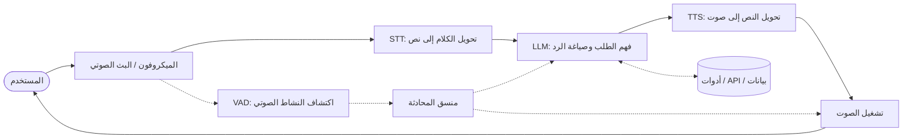
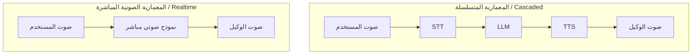
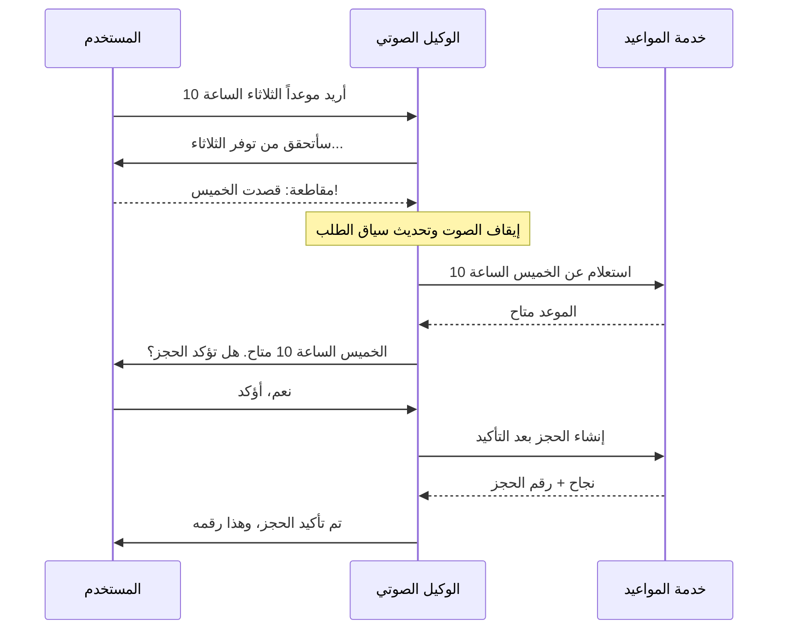

# ما هو الوكيل الصوتي الذكي؟ من الكلام إلى المحادثة الطبيعية

**سلسلة هندسة الوكلاء الصوتيين — المقالة 01 / 16**  
**المستوى:** مبتدئ → تأسيسي  
**المقالة الإنجليزية:** [[01-What-is-a-Voice-Agent-EN|Read in English]]  
**خارطة السلسلة:** [[00-Series-Roadmap|Voice AI Engineering Roadmap]]

![[assets/voice-agent-cover.png]]

> [!abstract] الفكرة في دقيقة
> الوكيل الصوتي الذكي (Voice AI Agent) ليس مجرد نموذج يتعرف على الكلام، ولا مجرد صوت يقرأ إجابة مولّدة. إنه **نظام متكامل** يستقبل صوت المستخدم، ويفهم المقصود، ويقرر ما الذي ينبغي فعله، ثم يستجيب صوتياً، مع إدارة التوقيت والسياق والمقاطعات. نجاح النظام لا يُقاس فقط بذكاء الإجابة، بل بمدى طبيعية التجربة واعتماديتها.

## قبل أن نبدأ: لماذا يبدو الأمر أسهل مما هو عليه؟

تخيّل أنك تتحدث مع مساعد صوتي لحجز موعد:

**المستخدم:** «أريد حجز موعد يوم الثلاثاء الساعة العاشرة».  
**الوكيل:** «حسناً، سأتحقق من المواعيد المتاحة يوم الثلاثاء الساعة العاشرة، ثم...»  
**المستخدم، مقاطعاً:** «لحظة، قصدت الخميس، وليس الثلاثاء».

في هذه اللحظة لا تكفي إجابة ذكية من نموذج لغوي. يحتاج النظام إلى أن يلاحظ أن المستخدم بدأ يتحدث، ويتوقف عن إصدار الصوت، ويفهم التصحيح، ويتخلص من الافتراض القديم، ثم يواصل المحادثة بناءً على الموعد الجديد.

الفرق بين **عرض تجريبي ناجح** و**تجربة محادثة حقيقية** يظهر غالباً في هذه التفاصيل الصغيرة.

> [!question] السؤال الذي تقوده هذه المقالة
> كيف ينتقل النظام من موجات صوتية قادمة من الميكروفون إلى استجابة مناسبة يستطيع المستخدم سماعها ومقاطعتها؟

## 1. ما هو Voice AI Agent؟

الـ **Voice AI Agent** هو تطبيق تفاعلي يستخدم الصوت بوصفه واجهة أساسية للتواصل، ويمكنه — حسب تصميمه والصلاحيات الممنوحة له — فهم طلب المستخدم، وإدارة سياق الحوار، واستدعاء أدوات أو خدمات خارجية، وتوليد رد مسموع.

للتوضيح، من المهم التمييز بين ثلاثة مصطلحات متقاربة:

| المصطلح | ما الذي يفعله؟ | مثال |
|---|---|---|
| **Speech-to-Text (STT)** | يحوّل الصوت إلى نص | كتابة ما يقوله المستخدم |
| **Text-to-Speech (TTS)** | يحوّل النص إلى صوت | قراءة جملة بصوت اصطناعي |
| **Voice AI Agent** | ينظم التفاعل الصوتي والفهم والقرار والاستجابة | مساعد يستوضح الموعد، يتحقق من التقويم، ثم يجيب |

إذن، وجود STT وTTS في تطبيق واحد لا يجعله تلقائياً وكيلاً جيداً؛ لا بد أيضاً من **منطق المحادثة** و**إدارة الحالة** و**التعامل مع الأحداث في الوقت الحقيقي**.

وقد يكون الوكيل بسيطاً، مثل مساعد للإجابة عن أسئلة شائعة، أو متقدماً، مثل نظام يدير مهمة متعددة الخطوات باستخدام أدوات خارجية تحت ضوابط واضحة.

## 2. كيف يعمل الوكيل الصوتي من الداخل؟

في واحدة من أشهر المعماريات التعليمية والعملية، يمر الصوت عبر ثلاث قدرات رئيسية: التعرف على الكلام، ثم معالجة اللغة واتخاذ القرار، ثم تحويل الإجابة إلى صوت. تُسمّى هذه البنية **Cascaded Pipeline** أو **STT → LLM → TTS**. [^livekit-pipelines]

*الشكل 1 — المسار المنطقي للوكيل الصوتي المتسلسل. أسهم VAD والمنسق تمثل مسارات تحكم جانبية؛ التنفيذ الفعلي قد يجري بالتوازي، وليس مرحلة بعد أخرى فقط.*

### الخطوة الأولى: الاستماع واستقبال الصوت

يصل صوت المستخدم من ميكروفون المتصفح أو الهاتف أو المكالمة عبر قناة اتصال صوتي. قبل أن يفهمه أي نموذج، يكون الصوت بيانات رقمية تُرسل وتُستقبل على شكل أجزاء صغيرة (Audio Chunks).

وهنا تظهر تحديات مثل جودة الميكروفون، وضجيج الخلفية، وتأخر الشبكة، وانقطاع بعض الحزم، وارتداد صوت الوكيل إلى ميكروفون المستخدم.

### الخطوة الثانية: التعرف على الكلام — STT

يحوّل نظام **Speech-to-Text** الإشارة الصوتية إلى نص. فإذا قال المستخدم: «أريد تغيير الموعد»، ينتج النظام نصاً يمكن تمريره إلى نموذج لغوي.

في الأنظمة الآنية لا ننتظر بالضرورة نهاية التسجيل بالكامل. يمكن للمحرك إرسال **نتائج جزئية (Partial Transcripts)** قبل الوصول إلى **نص نهائي (Final Transcript)**. لكن النص الجزئي قابل للتعديل، ولذلك ينبغي ألا تُنفذ إجراءات حساسة اعتماداً عليه وحده.

### الخطوة الثالثة: الفهم واتخاذ القرار — LLM

يحلل نموذج اللغة النص مع سياق المحادثة وتعليمات النظام، ثم يقرر نوع الاستجابة. ربما يطرح سؤالاً توضيحياً، أو يستدعي أداة للتحقق من البيانات، أو يجيب مباشرة.

**مثال:** إذا طلب المستخدم «غيّر موعدي إلى الخميس»، فلا ينبغي افتراض نجاح التغيير لمجرد أن النموذج قادر على قول «تم». يجب التحقق من الموعد، واستخدام أداة فعلية إذا كانت متاحة ومصرحاً بها، وتأكيد النتيجة فقط بعد نجاح العملية.

### الخطوة الرابعة: توليد الصوت — TTS

يحوّل **Text-to-Speech** الرد النصي إلى كلام. لا يكفي اختيار صوت جميل؛ تهمنا أيضاً سرعة بدء الصوت، ووضوح نطق الأسماء والأرقام، وقدرة المحرك على توليد الصوت على دفعات بدلاً من انتظار كامل الجملة.

### الخطوة الخامسة: تشغيل الصوت وإدارة الحالة

يُرسل الصوت إلى جهاز المستخدم، ويشغّله التطبيق. لكن **توليد الصوت ليس مرادفاً لتشغيله، وتشغيله ليس ضماناً بأن الإنسان سمعه أو فهمه**.

من هنا تبدأ أهمية معرفة ما الذي أُرسل، وما الذي تم تشغيله، وما الذي يجب حذفه من السياق إذا وقعت مقاطعة.

## 3. هل جميع الوكلاء الصوتيين يستخدمون STT وLLM وTTS منفصلة؟

**لا.** هناك اتجاهان معماريان أساسيان، إلى جانب أنظمة هجينة تجمع بينهما. [^livekit-pipelines] [^openai-realtime]

| المقارنة | **Cascaded: STT → LLM → TTS** | **Direct Speech-to-Speech** |
|---|---|---|
| البنية | مكونات مستقلة نسبياً | نموذج صوتي مباشر أو مكونات مدمجة |
| التحكم بكل مرحلة | غالباً أكثر مرونة | يعتمد على واجهة النموذج |
| تتبع النص والقرارات | غالباً أسهل | قد يحتاج آليات إضافية |
| زمن الاستجابة | مجموع مراحل يمكن تداخلها بالبث | قد يقل بتقليل التنقل بين المكونات |
| فهم نبرة المستخدم | قد تضيع تفاصيل عند التحويل إلى نص فقط | قد يستفيد من خصائص الصوت مباشرة |
| مناسب متى؟ | عند الحاجة إلى الضبط والاختبار والتكامل | عندما تهم التفاعلية الصوتية المباشرة والبساطة |

**لا توجد معمارية أفضل دائماً.** الاختيار يعتمد على الاستخدام، واللغة، والميزانية، ومتطلبات الخصوصية، وإمكانية التدقيق، والحاجة إلى أفعال دقيقة يمكن التحقق منها.

> [!important] نقطة دقيقة
> عبارة «نموذج مباشر» لا تعني أن النظام لا يستطيع إنتاج تفريغ نصي؛ المقصود أن مسار الاستجابة الأساسي لا يتطلب بالضرورة مرور الصوت عبر خدمات STT وTTS منفصلتين.

## 4. لماذا المحادثة الطبيعية أصعب من الإجابة الصحيحة؟

المحادثة البشرية ليست طلب HTTP ينتظر نتيجته ثم ينتهي. قد تتداخل أدوار المتحدثين، وقد يتردد المستخدم أو يغير رأيه أو يصحح معلومة أثناء حديث النظام.

هناك خمس مشكلات رئيسية ينبغي فهمها منذ البداية:

### أ. معرفة متى يبدأ الشخص بالكلام — VAD

تساعد تقنية **Voice Activity Detection** في تحديد فترات وجود نشاط صوتي. لكنها لا تعني بالضرورة أن المستخدم أنهى كلامه، ولا تضمن وحدها التمييز بين المستخدم وصوت خلفية أو صدى خرج من مكبر الصوت.

### ب. معرفة متى ينتهي دوره — Turn Detection

فكر في الفرق بين الجملتين:

- «أريد حجز موعد...» *ثم توقف المستخدم ليفكر.*
- «أريد حجز موعد يوم الخميس.» *ثم انتهى من الطلب.*

الصمت موجود في الحالتين، لكن قرار الرد يجب ألا يكون واحداً. لذلك يمكن الجمع بين إشارات الصوت، والتوقيت، ومحتوى الكلام لتقدير نهاية دور المستخدم. تميّز وثائق Pipecat صراحةً بين اكتشاف الكلام/الصمت وبين قرار اكتمال الدور. [^pipecat-turns]

### ج. المقاطعة — Barge-in

إذا بدأ المستخدم يتحدث بينما الوكيل يرد، فقد يلزم إيقاف إخراج الصوت، وإلغاء العمل الجاري، والتعامل مع الطلب الجديد. ويجب كذلك تجنب **المقاطعات الخاطئة** الناتجة عن الضجيج أو عبارات التأكيد القصيرة مثل «نعم» عندما لا يريد المستخدم انتزاع الدور. [^livekit-turns]

### د. المحافظة على السياق بعد المقاطعة

هذه نقطة يسهل إهمالها عند بناء النموذج الأولي. لنفترض أن النموذج جهّز إجابة تقول:

> «يمكنك استخدام جواز السفر أو بطاقة الهوية، بشرط أن تكون الوثيقة سارية المفعول.»

لكن المستخدم قاطعه بعدما سمع فقط:

> «يمكنك استخدام جواز السفر...»

هل ينبغي أن يَفترض النظام أن المستخدم سمع بقية الشروط؟ **بالطبع لا.**

![[assets/playback-state-ar.png]]

*الشكل 2 — مثال توضيحي، لا يمثل قياسات فعلية: النص المُنتج، والصوت المُنشأ، والصوت الذي تم تشغيله ليست دائماً الشيء نفسه.*

في بعض تطبيقات الصوت الآني، تتطلب المقاطعة **اقتطاع (Truncation)** الجزء غير المشغّل من الاستجابة السابقة، حتى لا يحمل سياق النموذج معلومات لم تُعرض على المستخدم. تختلف التفاصيل بحسب طريقة النقل وتشغيل الصوت؛ توثيق OpenAI Realtime يميّز، مثلاً، بين إدارة المخزن الصوتي في WebRTC وبين التشغيل الذي يديره العميل في WebSocket. [^openai-interrupt]

### هـ. زمن الاستجابة — Latency

إذا احتاج النظام وقتاً طويلاً بعد انتهاء كلام المستخدم ليبدأ بالرد، فسيفقد الحوار إيقاعه الطبيعي حتى لو كانت الإجابة ممتازة.

لكن لا يكفي قياس زمن النموذج اللغوي فقط؛ توجد أزمنة تخص اكتشاف نهاية الدور، والتعرف على الكلام، وتوليد أول جزء من الإجابة، وتحويلها إلى صوت، ونقلها وتشغيلها. قد تتداخل بعض هذه المراحل بفضل **Streaming**؛ لذلك لا تكون كل الأزمنة مجرد مجموع متسلسل بسيط. [^deepgram-stack]

## 5. مثال متكامل: مساعد صوتي لحجز موعد

لنطبّق المفاهيم السابقة على سيناريو واحد.

*الشكل 3 — يميّز السيناريو بين **فهم نية المستخدم** و**تنفيذ إجراء حقيقي**. تأكيد الحجز لا يُقال إلا بعد نجاح خدمة المواعيد.*

لاحظ أن الوكيل الجيد لا يحتاج إلى التحدث كثيراً؛ يحتاج إلى أن **يصغي في اللحظة الصحيحة، ويتصرف ضمن صلاحياته، ويبلغ المستخدم بنتيجة حقيقية**.

ويمكن أن يطبّق المنطق نفسه في خدمة العملاء أو المساعدة الدراسية أو جمع البيانات الأولية للتحقق من الهوية. أما الاستخدامات الحساسة، مثل التحقق من الهوية أو التعامل مع البيانات الطبية، فتحتاج ضوابط موافقة وخصوصية وتصعيد بشري إضافية؛ ولا ينبغي للوكيل اتخاذ قرارات نهائية غير مخولة له.

## 6. كيف نقيس جودة Voice Agent؟

أحد الأخطاء الشائعة أن نختبر النموذج بسؤال واحد ونستنتج أن الوكيل أصبح جاهزاً. التقييم العملي يحتاج إلى **قياسات منفصلة** لجودة الفهم والتفاعل والاعتمادية.

| البعد | سؤال التقييم | مثال على القياس |
|---|---|---|
| **جودة التعرف على الكلام** | هل فهم الأسماء والأرقام واللهجة؟ | WER أو مجموعة حالات صحيحة/خاطئة |
| **جودة الاستجابة** | هل أجاب عن الطلب المناسب؟ | اختبارات مهام وحالات متوقعة |
| **بداية الرد** | كم انتظر المستخدم حتى يسمع أول صوت؟ | End-of-turn → First audible audio |
| **المقاطعات** | هل توقف الوكيل بسرعة وبشكل صحيح؟ | Interruption latency، false interruptions |
| **سلامة السياق** | هل تذكر ما قيل فعلياً دون اختلاق؟ | سيناريوهات تصحيح ومقاطعة |
| **موثوقية الأفعال** | هل نفذ الإجراءات المصرح بها فقط؟ | نجاح الاستدعاءات وسجلات التدقيق |

يمكن لاحقاً تتبع قيم **P50** و**P95** بدلاً من الاكتفاء بالمتوسط، لأن التجارب البطيئة القليلة قد تؤثر كثيراً في رضا المستخدم. سنخصص مقالة متقدمة لقياس التأخير وتحليل كل مرحلة. [^deepgram-stack]

## 7. من أين أبدأ عملياً؟ تجربة أولى بلا تعقيد

لست بحاجة إلى تدريب نموذج صوتي من الصفر كي تفهم هندسة الوكلاء الصوتيين. ابدأ بتجربة صغيرة، حتى لو كانت باستخدام واجهة صوتية جاهزة:

1. اطلب من الوكيل شرح موضوع بجمل قصيرة، وراقب هل يجيب بشكل مفهوم.
2. قاطعه في منتصف الجملة بسؤال مختلف تماماً، وسجّل هل توقف فعلياً.
3. صحح معلومة أثناء رده: «لا، أقصد الخميس وليس الثلاثاء».
4. تحدث مع توقف قصير في منتصف الفكرة، ولاحظ هل يقاطعك مبكراً.
5. جرب الضجيج أو سماعات خارجية، وراقب هل يلتقط صوت نفسه.
6. دوّن النتيجة في جدول: **السيناريو — السلوك المتوقع — السلوك الفعلي — السبب المحتمل**.

> [!tip] مخرج المقالة الأولى
> اكتب على ورقة واحدة تعريفاً لوكيلك الأول: **من هو المستخدم؟ ما المهمة؟ ما الصوت الداخل؟ هل يحتاج STT وLLM وTTS منفصلة أم نموذجاً مباشراً؟ ما الأدوات المسموحة؟ كيف يتصرف عند المقاطعة؟ وما معيار نجاح التجربة؟**

## 8. أخطاء شائعة منذ اليوم الأول

- **الخلط بين الدقة والطبيعية:** قد يكون تفريغ الكلام دقيقاً لكن توقيت الرد سيئاً.
- **افتراض أن الصمت يعني نهاية الجملة:** التوقف للتفكير شائع في الكلام البشري.
- **اعتبار النص المُولّد كلاماً مسموعاً:** جزء من صوت الوكيل قد يُلغى أو لا يُشغّل.
- **إرجاع نجاح زائف:** النموذج لا يستطيع حجز موعد لمجرد أنه قال «تم الحجز».
- **الاختبار في غرفة هادئة فقط:** جودة المكالمة تتغير مع الشبكة والضجيج والأجهزة.
- **الاعتماد على نموذج واحد لحل جميع المشكلات:** إدارة المحادثة والنقل والتشغيل من مسؤوليات هندسة النظام أيضاً.

## الخلاصة: Voice Agent هو نظام محادثة قبل أن يكون مجموعة نماذج

يمكن اختصار النموذج الذهني الأول في هذه المعادلة المفاهيمية:

**تجربة صوتية جيدة = فهم مناسب + إدارة أدوار صحيحة + استجابة في وقت مناسب + سياق متماسك + تنفيذ موثوق.**

هذه ليست معادلة رياضية، بل طريقة للتذكير بأن أي عنصر ضعيف يمكن أن يفسد المحادثة. فالصوت الطبيعي وحده لا يصنع وكيلاً مفيداً، والنموذج القوي لا يضمن تفاعلاً بشري الإيقاع.

**في المقالة التالية** سننزل مستوى أعمق: ما هو الصوت الرقمي؟ وما معنى Sample Rate وPCM وAudio Frames؟ ولماذا يحتاج مهندس Voice AI إلى فهمها قبل تحسين أي نموذج؟

> [!success] ما ينبغي أن تعرفه الآن
> تستطيع شرح دور STT وLLM وTTS، والفرق الأولي بين المعمارية المتسلسلة والصوتية المباشرة، ولماذا تُعد إدارة الدور والمقاطعة والسياق جزءاً من جوهر النظام.

**اقرأ الآن المقالة الثانية:** [[02-Digital-Audio-for-Developers-AR|الصوت الرقمي للمطورين — Article 02]]

---

## المصطلحات الأساسية | Glossary

| المصطلح | المعنى السريع |
|---|---|
| Voice AI Agent | وكيل يتفاعل صوتياً ويدير مهمة أو محادثة |
| STT / ASR | التعرف الآلي على الكلام وتحويله إلى نص |
| LLM | نموذج لغوي لفهم السياق وتوليد الاستجابة أو قرار استخدام أداة |
| TTS | تحويل النص إلى صوت اصطناعي |
| VAD | اكتشاف وجود نشاط صوتي |
| Turn Detection | تحديد انتهاء دور المستخدم أو بدايته |
| Barge-in | مقاطعة المستخدم للوكيل أثناء كلامه |
| Streaming | معالجة الصوت/النص على دفعات متتابعة |
| Latency | التأخير بين حدث وآخر في النظام |
| Playback State | حالة الصوت الذي جرى تشغيله بالفعل |

## مصادر ومراجع تقنية

[^livekit-pipelines]: [LiveKit — Pipeline types: Cascaded vs. Realtime](https://docs.livekit.io/agents/models/pipelines/). مرجع للمقارنة المعمارية ومفاضلات التحكم والتأخير.
[^pipecat-turns]: [Pipecat — Speech input and user turn detection](https://docs.pipecat.ai/pipecat/learn/speech-input). يشرح الفرق بين VAD وتحديد دور المستخدم.
[^openai-realtime]: [OpenAI — Realtime conversations](https://developers.openai.com/api/docs/guides/realtime-conversations). يشرح التعامل المباشر مع الصوت.
[^livekit-turns]: [LiveKit — Turn-taking tuning](https://docs.livekit.io/agents/logic/turns/tuning/). مرجع لإدارة المقاطعة والتوقفات والضجيج.
[^openai-interrupt]: [OpenAI — Interruption and truncation](https://developers.openai.com/api/docs/guides/realtime-conversations#interruption-and-truncation). مرجع لفصل الصوت المُنتج عن الصوت الذي جرى تشغيله.
[^deepgram-stack]: [Deepgram — The real-time voice AI stack: An architecture guide](https://deepgram.com/blog/real-time-voice-ai-stack-agents-architecture-guide) (25 أغسطس 2026). مقدمة لتفصيل مراحل التأخير والتقييم.

*المخططات من إعداد السلسلة لأغراض تعليمية. صورة الغلاف توضيحية وليست رسماً هندسياً لتنفيذ بعينه.*
