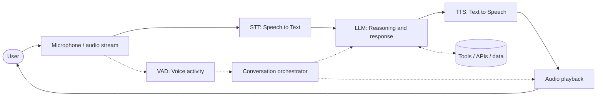
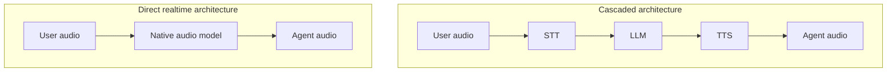

# What Is a Voice AI Agent? From Speech to Natural Conversation

**Voice AI Engineering Series — Article 01 / 16**  
**Level:** Beginner → Foundations  
**Arabic edition:** [[01-What-is-a-Voice-Agent-AR|اقرأ بالعربية]]  
**Series roadmap:** [[00-Series-Roadmap|Voice AI Engineering Roadmap]]

![[assets/voice-agent-cover.png]]

> [!abstract] The idea in one minute
> A Voice AI Agent is not simply a speech recognition model, nor is it a synthetic voice reading an LLM's answer. It is an **end-to-end interactive system** that receives audio, interprets a user's intent, decides what to do next, responds through speech, and manages timing, context, and interruptions. The quality of the result depends on far more than the intelligence of its language model.

## Why does building one look easier than it is?

Imagine speaking to an assistant that helps you book appointments:

**User:** “I'd like an appointment on Tuesday at 10 a.m.”  
**Agent:** “Of course. I'll check availability for Tuesday at 10 a.m., and then...”  
**User, interrupting:** “Wait. I meant Thursday, not Tuesday.”

At that moment, generating an intelligent response is not enough. The system needs to notice that the user has started speaking, stop the audio already playing, understand the correction, discard the outdated assumption, and continue with the new date.

This is where the difference between a polished **demo** and a reliable **real-world conversation** becomes clear.

> [!question] The question behind this article
> How does a system turn sound waves from a microphone into a relevant response that a user can hear, interrupt, and continue talking about?

## 1. What exactly is a Voice AI Agent?

A **Voice AI Agent** is an interactive application that uses speech as a primary interface. Depending on its design and permissions, it can interpret user requests, maintain conversational context, invoke external tools or services, and generate spoken responses.

Three related concepts are worth separating:

| Term | Responsibility | Example |
|---|---|---|
| **Speech-to-Text (STT)** | Converts incoming speech into text | Transcribes what the user said |
| **Text-to-Speech (TTS)** | Converts text into synthetic speech | Reads a generated sentence aloud |
| **Voice AI Agent** | Orchestrates understanding, dialogue, actions, and speech | Clarifies a date, checks a calendar, and responds |

Putting STT and TTS in the same application does not automatically produce a good voice agent. A practical agent also needs **conversation logic**, **state management**, and **real-time event handling**.

It may be as simple as a spoken FAQ assistant or as sophisticated as a workflow agent that completes several steps with tightly controlled tool access.

## 2. How does a voice agent work internally?

One widely used architecture connects three specialized capabilities: speech recognition, language understanding and decision-making, and speech synthesis. This is often called a **cascaded pipeline**, or **STT → LLM → TTS**. [^livekit-pipelines]



*Figure 1 — A simplified cascaded voice-agent architecture. VAD and orchestration are shown as side-channel controls; the actual implementation may overlap stages rather than execute every step strictly in sequence.*

### Step 1: Capture and transport audio

Speech arrives from a browser microphone, phone, or call connection. Before any model interprets it, speech is digital data sent or processed as small segments called **audio chunks**.

This layer deals with microphone quality, background noise, network delays, missing packets, and the agent's own speaker audio leaking back into the user's microphone.

### Step 2: Convert speech into text — STT

A **Speech-to-Text** engine transforms the audio signal into words. For example, the spoken request “I want to reschedule my appointment” becomes text the language model can process.

Real-time recognition does not always wait for a full recording. An engine can produce **partial transcripts** before a more stable **final transcript**. Since partial results may change, sensitive actions should not be executed solely on an unconfirmed partial transcription.

### Step 3: Understand and decide — LLM

The language model considers the transcript, conversation history, and application instructions. It may answer, ask a follow-up, or request an external tool call.

**Example:** If a user says, “Move my appointment to Thursday,” an agent should not simply reply “Done.” It must verify the relevant appointment, call an authorized scheduling service if available, and confirm the change only when the operation actually succeeds.

### Step 4: Generate spoken output — TTS

**Text-to-Speech** turns the answer into audio. A pleasant voice is useful, but production requirements also include how soon the first audio arrives, whether names and numbers are spoken correctly, and whether the engine can stream speech without waiting for an entire paragraph.

### Step 5: Playback and conversation state

The generated audio is transmitted to the user and played by the client. But **generated audio is not the same as played audio, and played audio is not proof that the person actually heard or understood it**.

The system may need to know which audio was produced, which audio reached playback, and which unplayed content must be removed from the conversation after an interruption.

## 3. Do all voice agents require separate STT, LLM, and TTS models?

**No.** There are two major architectural families, plus hybrid designs that combine elements of both. [^livekit-pipelines] [^openai-realtime]



| Dimension | **Cascaded: STT → LLM → TTS** | **Direct speech-to-speech** |
|---|---|---|
| Structure | Relatively independent components | A native audio model or integrated components |
| Control | Often more control over individual stages | Depends on the model's interface |
| Text trace and auditing | Usually easier | May require additional mechanisms |
| Response latency | Multiple stages, potentially overlapped through streaming | May reduce some inter-stage overhead |
| Understanding vocal cues | Some nuance can be lost when reduced to text | May use tone, rhythm, and other acoustic cues |
| Typical fit | Debuggability, precise tool use, modular integration | Direct voice interaction and expressive output |

**Neither architecture is universally better.** The right choice depends on the task, language, budget, privacy requirements, auditability, and how precisely the system must control external actions.

> [!important] A subtle but important distinction
> “Direct speech-to-speech” does not mean text transcription is impossible. It means the main audio-response path does not necessarily require separate STT and TTS services.

## 4. Why is natural conversation harder than producing a correct answer?

Human dialogue is not an HTTP request that completes before the next one starts. People hesitate, overlap, revise details, and interrupt each other. Five engineering challenges make that difficult for voice agents.

### A. Detecting when someone starts speaking — VAD

**Voice Activity Detection (VAD)** helps identify the presence of speech activity. On its own, however, it does not prove that the user has finished a thought, nor can it always distinguish the user's voice from background speech or the agent's own audio echoing through speakers.

### B. Detecting when a turn is complete — Turn Detection

Compare these two cases:

- “I'd like to book an appointment...” *The user pauses to think.*
- “I'd like to book an appointment for Thursday.” *The user has finished the request.*

Both contain silence, but they should not necessarily trigger the same response. A turn-detection mechanism may combine audio timing with linguistic context to estimate whether the user intends to continue. Pipecat's documentation explicitly separates raw speech/silence detection from user-turn decisions. [^pipecat-turns]

### C. Handling interruptions — Barge-in

If a user speaks while the agent is responding, the system may need to stop playback, cancel in-flight generation, and process the new input. It must also avoid **false interruptions** caused by noise or brief acknowledgments such as “yeah” that may not represent a request to take over the conversation. [^livekit-turns]

### D. Preserving context after an interruption

This is easy to overlook when building a prototype. Imagine the model generates:

> “You can use your passport or national ID, provided the document is still valid.”

But the user interrupts after hearing only:

> “You can use your passport...”

Should the system assume the user heard the rest of the requirements? **No.**

![[assets/playback-state-en.png]]

*Figure 2 — Illustrative states, not measured data: generated text, synthesized audio, and played audio may represent different amounts of the same response.*

Some real-time speech systems need to **truncate** the unplayed portion of an interrupted response so the model's conversation history does not assume the user received information that was never played. The implementation depends on the audio transport and playback architecture. For example, OpenAI's Realtime documentation distinguishes server-managed playback buffers in WebRTC from client-managed playback with WebSockets. [^openai-interrupt]

### E. Managing response latency

If the agent takes too long to start speaking after the user finishes, the exchange feels unnatural—even when its answer is correct.

Measuring only LLM inference time is insufficient. There may be delays in end-of-turn detection, speech recognition, generating the first response token, speech synthesis, transport, and playback. **Streaming** can overlap some of these operations, so real end-to-end delay is not always a simple sum of sequential components. [^deepgram-stack]

## 5. End-to-end example: an appointment-booking assistant

Let's connect the concepts in one concrete scenario.

```mermaid
sequenceDiagram
    participant U as User
    participant A as Voice agent
    participant API as Scheduling service
    U->>A: Book Tuesday at 10 a.m.
    A->>U: I'll check Tuesday availability...
    U-->>A: Interrupt: I meant Thursday!
    Note over A: Stop playback; update request state
    A->>API: Check Thursday at 10 a.m.
    API-->>A: Slot available
    A->>U: Thursday at 10 is available. Confirm booking?
    U->>A: Yes, confirm
    A->>API: Create booking after confirmation
    API-->>A: Success + confirmation number
    A->>U: Your booking is confirmed. Here is the number
```

*Figure 3 — The workflow distinguishes **understanding intent** from **completing a real external action**. The agent announces success only after the scheduling service confirms it.*

A good agent does not need to speak constantly. It needs to **listen at the right moment, operate within its permissions, and report what actually happened**.

The same interaction pattern can support customer service, educational tutoring, or initial identity-verification data collection. Sensitive applications—especially identity checks and healthcare—require additional controls for consent, privacy, and human escalation. An agent should not make unauthorized final decisions.

## 6. How do we measure voice-agent quality?

A common mistake is to test one question, observe a successful answer, and declare the system production-ready. Real evaluation covers **several distinct dimensions** of quality and reliability.

| Dimension | Evaluation question | Possible measurement |
|---|---|---|
| **Speech recognition** | Does it correctly capture names, numbers, and accents? | WER or task-specific test cases |
| **Response quality** | Does it address the user's actual request? | Task-based evaluation |
| **Response onset** | How long until the user hears the first audio? | End of user turn → First audible audio |
| **Interruptions** | Does it stop quickly and appropriately? | Interruption latency, false interruptions |
| **Context consistency** | Does it recover correctly after corrections? | Interruption and correction test set |
| **Action reliability** | Does it perform only authorized operations? | Tool outcomes and audit records |

Later in the series, we will use latency percentiles such as **P50** and **P95**, rather than relying exclusively on the average. A small number of very slow interactions can substantially affect perceived reliability. [^deepgram-stack]

## 7. Where should you start? A practical beginner experiment

You do not need to train your own speech model to start learning voice-agent engineering. Begin with a simple voice interface and observe how it behaves under realistic conditions.

1. Ask the agent to explain a topic in short sentences. Check whether its answers make sense.
2. Interrupt it halfway through a sentence with an unrelated question. Observe whether playback stops.
3. Correct a detail while it speaks: “No, I meant Thursday, not Tuesday.”
4. Pause halfway through your own sentence. Does the agent interrupt you too early?
5. Try a noisier room or external speakers. Does the agent mistakenly respond to itself?
6. Record each result: **scenario — expected behavior — actual behavior — possible cause**.

> [!tip] Your deliverable for Article 01
> Write a one-page design brief for your first voice agent: **Who is the user? What task will it perform? What audio input will it receive? Will you use a cascaded pipeline or a native audio model? Which tools are allowed? How should interruptions work? What counts as success?**

## 8. Common mistakes to avoid

- **Confusing accuracy with conversational quality:** A perfect transcript can still lead to poorly timed responses.
- **Treating silence as proof of turn completion:** People pause to think.
- **Treating generated text as speech already heard:** The response may be interrupted before playback finishes.
- **Announcing actions that never happened:** A model saying “Booked” is not evidence of a booking.
- **Testing only in quiet rooms:** Real calls introduce noise, network variation, and different devices.
- **Expecting one model to solve everything:** Orchestration, transport, playback, and security are systems-engineering responsibilities.

## Conclusion: A voice agent is a conversation system, not a collection of models

A useful first mental model is:

**Good voice experience = relevant understanding + correct turn-taking + timely response + consistent context + reliable actions.**

This is a conceptual checklist, not a mathematical formula. A weakness in any one component can make an otherwise capable model feel unusable. Natural-sounding speech is not enough, and a powerful LLM does not guarantee natural human-paced dialogue.

**Next in the series:** We will go one level deeper into digital audio. What are PCM, sample rates, and audio frames—and why should a Voice AI engineer understand them before trying to optimize a model?

> [!success] What you should know now
> You can explain the roles of STT, LLM, and TTS; distinguish cascaded from direct audio architectures; and describe why turn-taking, interruptions, and playback-aware context are essential parts of voice-agent engineering.

**Continue with Article 02:** [[02-Digital-Audio-for-Developers-EN|Digital Audio for Developers]]

---

## Essential terms | Glossary

| Term | Short definition |
|---|---|
| Voice AI Agent | A system that uses speech to manage an interaction or task |
| STT / ASR | Automatic speech recognition that turns speech into text |
| LLM | A language model for context, responses, and tool decisions |
| TTS | Speech generation from text |
| VAD | Voice activity detection |
| Turn Detection | Deciding when a user has started or finished a speaking turn |
| Barge-in | Interrupting the agent while it is speaking |
| Streaming | Processing or delivering partial audio/text continuously |
| Latency | Time elapsed between two relevant events |
| Playback State | The portion of audio that has actually been played |

## Technical references and further reading

[^livekit-pipelines]: [LiveKit — Pipeline types: Cascaded vs. Realtime](https://docs.livekit.io/agents/models/pipelines/). Architecture options and trade-offs.
[^pipecat-turns]: [Pipecat — Speech input and user turn detection](https://docs.pipecat.ai/pipecat/learn/speech-input). Distinguishes VAD signals from turn decisions.
[^openai-realtime]: [OpenAI — Realtime conversations](https://developers.openai.com/api/docs/guides/realtime-conversations). Native audio interaction.
[^livekit-turns]: [LiveKit — Turn-taking tuning](https://docs.livekit.io/agents/logic/turns/tuning/). Interruptions, endpointing, and noise-handling controls.
[^openai-interrupt]: [OpenAI — Interruption and truncation](https://developers.openai.com/api/docs/guides/realtime-conversations#interruption-and-truncation). Generated versus played output.
[^deepgram-stack]: [Deepgram — The real-time voice AI stack: An architecture guide](https://deepgram.com/blog/real-time-voice-ai-stack-agents-architecture-guide) (August 25, 2026). Layer-by-layer latency and evaluation considerations.

*All diagrams were created for this series as educational illustrations. The cover is conceptual artwork, not a diagram of a specific production deployment.*
