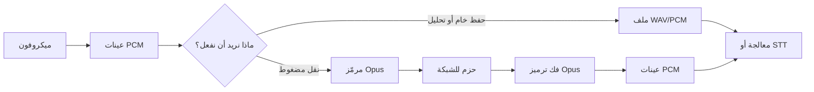
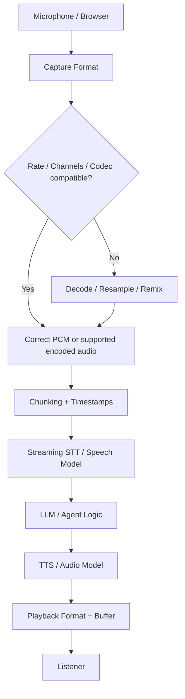
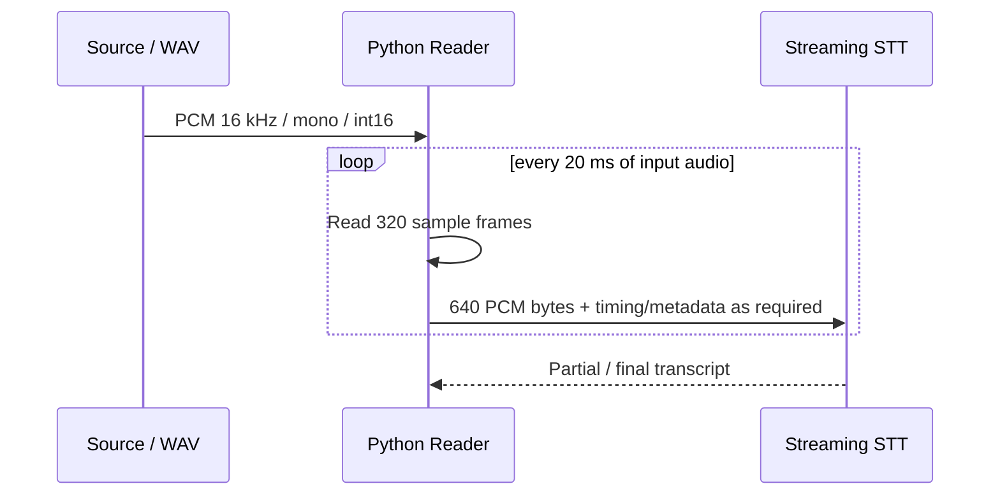

# الصوت الرقمي للمطورين: الأساس الذي يقوم عليه كل Voice AI Agent

**سلسلة هندسة الوكلاء الصوتيين — المقالة 02 / 16**  
**المستوى:** مبتدئ → تأسيسي، مع تطبيق برمجي  
**النسخة الإنجليزية:** [[02-Digital-Audio-for-Developers-EN|Read in English]]  
**المقالة السابقة:** [[01-What-is-a-Voice-Agent-AR|ما هو الوكيل الصوتي الذكي؟]]  
**خارطة السلسلة:** [[00-Series-Roadmap|خطة السلسلة الكاملة]]

![[assets/digital-audio-cover.png]]

> [!abstract] الفكرة في دقيقة
> قبل أن يصل صوت المستخدم إلى نموذج التعرف على الكلام (STT)، يكون قد تحول إلى أرقام. وإذا لم نفهم **Sampling، Sample Rate، Bit Depth، PCM، Channels، Chunks، Codecs**، فقد نرسل صوتاً بسرعة خاطئة، أو نفسر بايتات بصيغة غير صحيحة، أو نضيف زمناً غير ضروري إلى الاستجابة. هذه المقالة تضع الأساس الذي نحتاجه لفهم أنظمة Voice AI الآنية.

## البداية: لماذا يبدو الصوت جيداً عند التسجيل لكنه يفشل داخل الوكيل؟

لنفترض أنك سجّلت جملة واضحة من ميكروفونك: «مرحباً، أريد الاستفسار عن موعدي».

عندما تستمع إلى التسجيل على جهازك، تسمع صوتاً طبيعياً. لكن عندما ترسله إلى خدمة التعرف على الكلام، قد تظهر كتابة غير مفهومة، أو يصبح الصوت سريعاً أو بطيئاً، أو يفشل النموذج في قبول المدخل.

ليس ضرورياً أن يكون السبب ضعف نموذج STT. أحياناً يكون الخطأ ببساطة أن التطبيق **أخبر الخدمة أن معدل العينات 16 kHz بينما البيانات الفعلية سُجلت بمعدل 48 kHz**، أو أرسل صوتاً مضغوطاً باستخدام Opus إلى واجهة تتوقع PCM خاماً.

**القاعدة الهندسية الأولى:** الصوت ليس «ملفاً» فقط؛ إنه سلسلة عينات لها **صيغة** وتوقيت وقنوات وتمثيل رقمي متفق عليه.

> [!question] السؤال الرئيسي
> ما الذي يجري بين الميكروفون ونموذج الذكاء الاصطناعي، وكيف نعرف أن البيانات الصوتية المرسلة تمثل الكلام بالشكل الصحيح؟

## 1. من الموجة الصوتية إلى الأرقام

الصوت في العالم الفيزيائي تغير في ضغط الهواء بمرور الزمن. يحوّل الميكروفون هذا التغير إلى إشارة كهربائية، ثم يحولها النظام إلى قيم رقمية من خلال عملية **Analog-to-Digital Conversion — ADC**.

نستخدم تبسيطاً مفيداً: تخيل أننا نأخذ «لقطات» لقيمة الموجة على فترات منتظمة. تسمى كل لقطة **Sample**.

![[assets/sampling-explained.png]]

*الشكل 1 — الخط السماوي يمثل إشارة مستمرة، والنقاط الصفراء عينات مأخوذة في أزمنة محددة. الرسم توضيحي وليس تسجيلاً صوتياً حقيقياً.*

تنطوي الرقمنة على فكرتين مختلفتين:

1. **Sampling / أخذ العينات زمنياً:** في أي لحظات نقيس الإشارة؟
2. **Quantization / التكميم:** بأي قيم رقمية نُمثل سعة الإشارة بعد قياسها؟

عندما ننقل العينة أو نخزنها يجب أن نتفق أيضاً على طريقة كتابة هذه القيمة بالبايتات، وهنا يظهر مفهوم PCM.

## 2. ما معنى Sample Rate؟

**Sample Rate** هو عدد *إطارات العينات* التي تُلتقط في الثانية لكل قناة، ويقاس بالهرتز (Hz). في الصوت أحادي القناة تتساوى أعداد العينات وإطارات العينات.

| المعدل | ماذا يعني؟ | استخدام شائع |
|---|---|---|
| 8,000 Hz | 8,000 عينة في الثانية لكل قناة | نطاقات هاتفية ضيقة وبعض الأنظمة القديمة |
| 16,000 Hz | 16,000 عينة في الثانية لكل قناة | كثير من مسارات معالجة الكلام؛ ليس شرطاً عاماً لكل نموذج |
| 44,100 Hz | 44,100 عينة في الثانية لكل قناة | إنتاج وتخزين الصوت الاستهلاكي |
| 48,000 Hz | 48,000 عينة في الثانية لكل قناة | تطبيقات الصوت والفيديو والاتصال الآني |

مثلاً، تسجيل **ثانية واحدة** بقناة واحدة ومعدل **16,000 Hz** يحتوي على **16,000 قيمة صوتية**.

### لماذا لا نختار 192 kHz دائماً؟

معدل أعلى يعني عدداً أكبر من العينات، لكنه لا يعني بالضرورة تعرفاً أفضل على الكلام. الاختيار يتأثر بعرض نطاق الإشارة، وجودة التسجيل، والصيغة التي يقبلها النموذج، والتكلفة الحسابية. عند تحويل المعدل يجب استخدام **Resampling** فعلي مع ترشيح مناسب، لا مجرد تغيير رقم Sample Rate في الترويسة.

وفقاً لمبدأ نايكويست، إذا كانت الإشارة محدودة النطاق إلى تردد أقصى `f_max`، فإن استعادتها نظرياً تتطلب أخذ عينات بمعدل **أكبر من ضعف التردد الأعلى**، مع افتراض الترشيح المناسب. لذلك يكون تردد نايكويست النظري لإشارة مأخوذة عند 16 kHz مساوياً 8 kHz؛ وهذا لا يعني أن كل تسجيل بمعدل 16 kHz يحتوي حتماً على كل الترددات دون تشوه.[^mdn-audio]

> [!warning] خطأ شائع
> إذا كانت البيانات الأصلية 48 kHz، فكتابة `sample_rate = 16000` في الطلب لا تحوّلها إلى 16 kHz. هذا يعيد **تفسير التوقيت** ولا يعيد حساب العينات، وقد ينتج صوتاً مشوهاً أو زمناً خاطئاً.

## 3. ما هو Bit Depth؟ وما علاقته بـ PCM؟

**Bit Depth** يحدد عدد البتات المستخدمة لتخزين قيمة العينة عند استعمال تمثيل PCM الصحيح ذي الأعداد الصحيحة.

- **8-bit PCM:** عدد محدود نسبياً من مستويات التكميم، وغالباً يستخدم تمثيلاً غير موقّع في ملفات WAV التقليدية.
- **16-bit PCM:** يمثل كل عينة في قنواتنا التعليمية ببايتين (`int16` موقّع)؛ نطاق القيم من `-32768` إلى `32767`.
- **24-bit PCM:** دقة كمية أكبر عند الالتقاط والمعالجة المناسبة.
- **32-bit float PCM:** عينات ذات تمثيل عائم، وليست مجرد نسخة «أعلى Bit Depth» من `int16` بنفس نطاق القيم.

![[assets/quantization.png]]

*الشكل 2 — مثال مبالغ في تبسيطه باستخدام 3 بتات فقط لإظهار الفرق بين الموجة الأصلية والمستويات المنفصلة. ليس هذا تمثيلاً مقترحاً للصوت الكلامي.*

**PCM = Pulse-Code Modulation**: طريقة لتمثيل قيم العينات الرقمية. عندما نقول `PCM 16-bit mono 16 kHz` نكون قد وصفنا أجزاء مهمة من الصيغة؛ وقد نحتاج أيضاً إلى تحديد ترتيب البايتات **Endianness** وترتيب القنوات.

في كثير من واجهات Python المحلية التي تعمل مع WAV PCM، نستعمل `signed 16-bit little-endian` عند التعامل مع البايتات الخام. لكن لا تفترض أن كل API تتبنى هذه الصيغة: راجع عقد الواجهة أولاً.

## 4. Mono وStereo: لماذا يهم عدد القنوات؟

- **Mono:** قيمة عينة واحدة لكل لحظة زمنية (قناة واحدة).
- **Stereo:** قيمتان لكل لحظة زمنية (قناتان).

مهم هنا التفريق بين **Sample** و**Sample Frame**: الإطار في Stereo يحتوي عينتين متزامنتين، واحدة لليسار وأخرى لليمين. هذا تعريف تستخدمه أيضاً وثائق Web Audio.[^mdn-audio]

بالنسبة إلى وكيل حواري يستمع لمتحدث واحد، قد يكون Mono كافياً، لكن دمج Stereo في Mono يجب أن يتم بتصميم واعٍ، لا بحذف كل بايت ثانٍ؛ فهذه العملية تُفسد البيانات.

## 5. كيف نحسب حجم الصوت الخام؟

عند وجود صوت PCM غير مضغوط بصيغة صحيحة ثابتة البتات:

**الحجم بالبايت = المدة بالثواني × معدل العينات × عدد القنوات × (بتات العينة ÷ 8)**

تطبيق رقمي: ثانية واحدة من `16 kHz / mono / 16-bit PCM`:

`1 × 16000 × 1 × 2 = 32000 bytes`، أي نحو **32 KB بالوحدات العشرية**.

أما `48 kHz / stereo / 16-bit PCM` فيحتاج إلى:

`1 × 48000 × 2 × 2 = 192000 bytes` في الثانية.

هذه معادلة **حمولة PCM الخام** ولا تشمل ترويسة ملف WAV، ولا ترويسات النقل، ولا تنطبق مباشرة على ملفات Opus أو MP3 المضغوطة.

| مثال | المدة | حجم PCM الخام |
|---|---:|---:|
| 16 kHz، Mono، 16-bit | ثانية واحدة | 32,000 B |
| 16 kHz، Mono، 16-bit | 20 ms | 640 B |
| 48 kHz، Mono، 16-bit | 20 ms | 1,920 B |
| 48 kHz، Stereo، 16-bit | 20 ms | 3,840 B |

## 6. ما الفرق بين PCM وWAV وOpus؟

هناك ثلاثة مصطلحات يُخلط بينها كثيراً:

| المستوى | المثال | الوظيفة |
|---|---|---|
| **تمثيل العينات** | PCM | تحويل قيم الصوت إلى أرقام وبتات |
| **صيغة/حاوية ملف** | WAV | تخزين بيانات الصوت ووصف خصائصها في ملف |
| **ترميز/ضغط صوتي** | Opus | ضغط الصوت ونقله بكفاءة، خصوصاً في الاتصالات التفاعلية |

قد يحتوي ملف WAV على PCM غير مضغوط؛ لكن امتداد `.wav` وحده لا يكفي لاستنتاج أنه `16-bit PCM`. كما أن ملف `WebM` قد يحتوي Opus، ولا يجوز تمريره مباشرة إلى مدخل ينتظر PCM خاماً. راجع وثائق Python للوحدة `wave`، ووثائق المتصفح لأنواع الوسائط، ومعيار Opus.[^python-wave][^mdn-codecs][^opus]



*الشكل 3 — يوضح لماذا قد تحتاج إلى فك ترميز الصوت المضغوط قبل تمريره إلى نموذج يتوقع PCM. بعض الواجهات تتولى فك الترميز نيابة عنك، فلا تضف هذه الخطوة بلا حاجة.*

## 7. Audio Frames وChunks وStreaming

في الوكلاء الصوتيين الآنيين لا نريد غالباً انتظار اكتمال تسجيل طويل. نعمل على دفعات صغيرة:

- **Sample:** قيمة السعة لقناة واحدة في زمن محدد.
- **Sample Frame:** مجموعة عينات كل القنوات في اللحظة نفسها.
- **Chunk / Buffer:** مجموعة متتالية من إطارات العينات.
- **Codec Frame / Packet:** وحدة خاصة بالترميز أو النقل؛ ليست بالضرورة مساوية لحجم Chunk الذي يختاره التطبيق.

![[assets/audio-chunks.png]]

*الشكل 4 — تقسيم 100 ms إلى خمس دفعات، كل منها 20 ms. هذا مثال على PCM الخام، وليس مخططاً ثابتاً لكل بروتوكولات النقل.*

في حالتنا التعليمية `16 kHz / mono / 16-bit PCM`، فإن Chunk مدته 20 ms يتضمن:

- `16000 × 0.020 = 320` إطار عينة.
- `320 × 1 × 2 = 640` بايتاً.
- في ثانية واحدة يوجد نظرياً **50 دفعة من 20 ms**، إذا قُسمت دون تداخل.

**هل الأصغر دائماً أسرع؟** لا. الدفعات الصغيرة قد تقلل زمن الانتظار قبل إرسال أول جزء، لكنها تزيد عدد العمليات والرسائل وتكاليف الجدولة؛ أما الدفعات الكبيرة فتقلل عدد الاستدعاءات لكنها قد تزيد الانتظار. الحجم المناسب يتحدد وفق واجهات STT/TTS، والنقل، والتخزين المؤقت، ومتطلبات التأخير.

## 8. أين يحدث الخطأ داخل Voice Agent؟



*الشكل 5 — نقطة التوافق قبل النموذج ليست تفصيلاً تنفيذياً ثانوياً؛ إنها جزء من صحة النظام.*

مشكلات متكررة في التطبيقات:

| العرض | السبب المحتمل | الفحص المناسب |
|---|---|---|
| صوت سريع جداً أو بطيء | تفسير معدل العينات بشكل خاطئ | تحقق من معدل المصدر والوجهة ووجود Resampling فعلي |
| ضوضاء رقمية قاسية | تفسير `float32` كـ `int16` أو ترتيب بايتات خاطئ | راجع نوع العينة وEndianness |
| فشل API في فهم الملف | Codec أو Container غير مدعوم | افحص MIME/Codec ولا تعتمد على الامتداد |
| تقطّع في الصوت | نقص/تأخر Chunks أو مشكلة Buffer | راقب timestamps وJitter والصفوف |
| بداية رد بطيئة | طول الدفعات أو انتظار اكتمال الملف | قِس زمن تجميع الصوت والتوليد الأول |
| تشويه عند الذروة | Clipping بسبب تجاوز السعة | راقب Peak وRMS ومسار اكتساب الصوت |

## 9. مختبر Python: اصنع ملف WAV وحلّل بياناته

> [!info] ما الذي ستنفذه؟
> سننشئ ملفاً صوتياً تعليمياً مدته ثانية يحتوي نغمة ثابتة 440 Hz، بقناة Mono ومعدل 16 kHz وPCM موقّع 16-bit. ثم سنقرأه على دفعات 20 ms، ونحسب المدة والحجم و**Peak** و**RMS**. النغمة ليست كلاماً ولا نستخدمها لقياس دقة STT؛ هدفها التحقق من صحة مسار الصوت أولاً.

**الملف الجاهز داخل الحزمة:** `examples/digital_audio_lab.py`  
**الاختبارات:** `examples/test_digital_audio_lab.py`

شغّل الأوامر من داخل مجلد `Voice-Agent-Series`:

```bash
python examples/digital_audio_lab.py
python -m unittest discover -s examples -p 'test_*.py' -v
```

جزء أساسي من المثال:

```python
import wave

with wave.open("demo_16k_mono.wav", "rb") as wav:
    sample_rate = wav.getframerate()
    channels = wav.getnchannels()
    bytes_per_sample = wav.getsampwidth()
    frames = wav.getnframes()

    duration_s = frames / sample_rate
    chunk_frames = round(sample_rate * 0.020)
    first_chunk = wav.readframes(chunk_frames)

print(sample_rate, channels, bytes_per_sample * 8)
print(duration_s, len(first_chunk))
# 16000 1 16
# 1.0 640
```

الأرقام أعلاه ناتجة عن ملف التجربة الذي يولده السكربت، وليست نتيجة مضمونة لأي ملف WAV. الوحدة `wave` مناسبة هنا للصوت غير المضغوط المدعوم؛ لا تستعملها لفك ملفات MP3 أو Opus مباشرة.[^python-wave]



*الشكل 6 — محاكاة كيفية تغذية STT بدفعات صوتية. السكربت المرفق لا يستدعي خدمة STT؛ يمثل فقط الجزء الذي يسبقها.*

### كيف تفهم Peak وRMS؟

- **Peak:** أكبر قيمة مطلقة في الإشارة، وهي مفيدة لاكتشاف الاقتراب من التشبع، لكنها لا تكفي وحدها لإثبات حدوث Clipping.
- **RMS:** مقياس لمتوسط طاقة الإشارة عبر الزمن؛ وهو ليس مقياساً مباشراً لشدة الصوت كما يدركها الإنسان، لكنه مفيد لمراقبة مستوى الإشارة رقمياً.

لا ينبغي استخدام `Peak` أو `RMS` وحدهما لاكتشاف الكلام؛ فصوت المروحة قد يكون قوياً حتى لو لم يتحدث أحد. في المقالة التاسعة سننتقل إلى VAD وTurn Detection.

### جرّب هذه التعديلات

1. شغّل المثال بـ `--chunk-ms 10` ثم `--chunk-ms 40` وقارن `chunk_bytes` وعدد الدفعات.
2. غيّر `sample_rate` في `write_demo` من 16,000 إلى 48,000 **قبل** إنشاء الملف، ثم تحقق من الحسابات.
3. إن كان لديك تسجيل مرخّص لك استخدامه بصيغة `mono 16-bit PCM WAV`، مرره باستخدام `--input your_audio.wav`. لا ترفع تسجيلات خاصة إلى خدمة خارجية دون تصريح.
4. توقّع الخطأ عند إدخال Stereo أو Float WAV، لأن المثال يقيّد الصيغة عمداً كي لا يفسر البيانات بشكل خاطئ.

## 10. قائمة تحقق قبل ربط الصوت بأي نموذج

- [ ] عرفت معدل العينات **الحقيقي** من مصدر التسجيل.
- [ ] عرفت عدد القنوات وطريقة ترتيبها.
- [ ] تحققت من `PCM int16` مقابل `float32` أو أي تمثيل آخر.
- [ ] تأكدت من الـ Codec والـ Container أو نوع البيانات الخام.
- [ ] استخدمت Resampling حقيقياً عند تغيير المعدل.
- [ ] حددت طول الـ Chunk بالمللي ثانية وعدد إطاراته.
- [ ] قست Peak/RMS وتأكدت من عدم وجود تشويه واضح.
- [ ] فهمت متطلبات خدمة STT/TTS قبل إرسال البايتات.
- [ ] ميّزت بين تأخير تجميع الصوت وتأخير النموذج وتأخير التشغيل.

> [!success] مخرج المقالة الثانية
> تستطيع الآن وصف صيغة تيار صوتي بدقة، وحساب حجمه، وتفسير الفرق بين PCM وWAV وOpus، وقراءة WAV من Python، وتقسيمه إلى Chunks دون الخلط بين العينات والبايتات والمدة.

## الخلاصة

عندما يبني المطور Voice Agent، قد ينشغل باختيار أفضل LLM أو STT، وينسى أن النموذج لا يرى «كلاماً» مباشرة؛ بل تصله بيانات لها توقيت وصيغة وحدود. لهذا لا تبدأ هندسة الوكيل الصوتي من Prompt فقط، بل من فهم مسار الإشارة كاملة.

**في المقالة الثالثة** سنستخدم هذا الأساس لشرح **Speech-to-Text (STT)**: كيف تتحول الدفعات الصوتية إلى كلمات، وما الفرق بين *Partial* و*Final Transcripts*، وكيف تؤثر اللهجات والضجيج والتأخير في دقة النظام.

---

## قاموس المصطلحات | Glossary

| المصطلح | التفسير |
|---|---|
| Sample | قيمة رقمية لسعة إشارة في قناة وزمن محددين |
| Sample Frame | مجموعة عينات القنوات في لحظة واحدة |
| Sample Rate | عدد إطارات العينات في الثانية لكل قناة |
| Bit Depth | عدد البتات في العينة عند التمثيلات الصحيحة ثابتة العرض |
| PCM | تمثيل رقمي مباشر لقيم العينات |
| Mono / Stereo | قناة واحدة / قناتان |
| Codec | خوارزمية ترميز أو فك ترميز الصوت |
| Container | بنية ملف تحوي الصوت والبيانات الوصفية |
| Resampling | تغيير معدل أخذ العينات بتحويل الإشارة فعلياً |
| Chunk | دفعة من إطارات عينات متتالية |
| Peak / RMS | مقاييس رقمية لمستوى الإشارة |
| Clipping | تشوه ينتج عن تجاوز حدود تمثيل الإشارة أو النظام |

## المصادر والمراجع

[^mdn-audio]: [MDN — Basic concepts behind Web Audio API](https://developer.mozilla.org/en-US/docs/Web/API/Web_Audio_API/Basic_concepts_behind_Web_Audio_API) و[AudioBuffer](https://developer.mozilla.org/en-US/docs/Web/API/AudioBuffer). تعريف Sample Rate وSample Frames وتمثيل Float32 في المتصفح.
[^python-wave]: [Python Standard Library — wave](https://docs.python.org/3.14/library/wave.html). التعامل مع ملف WAV وعيناته وبياناته الوصفية؛ يختلف دعم بعض الصيغ بحسب نسخة Python.
[^opus]: [IETF RFC 6716 — Definition of the Opus Audio Codec](https://datatracker.ietf.org/doc/html/rfc6716) و[RFC 7587 — RTP Payload Format](https://datatracker.ietf.org/doc/html/rfc7587). مواصفات الترميز والنقل.
[^mdn-codecs]: [MDN — Web audio codec guide](https://developer.mozilla.org/en-US/docs/Web/Media/Guides/Formats/Audio_codecs) و[MediaRecorder MIME types](https://developer.mozilla.org/en-US/docs/Web/API/MediaRecorder/mimeType). فروق الترميزات والحاويات في الويب.

*الرسومات والأمثلة تعليمية وأُعدت لهذه السلسلة. الإعدادات العددية المستخدمة أمثلة وليست متطلبات ثابتة لكل واجهات Voice AI.*
