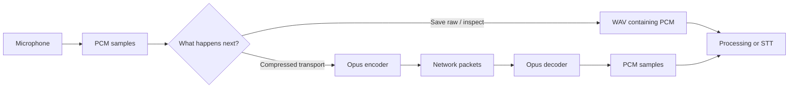
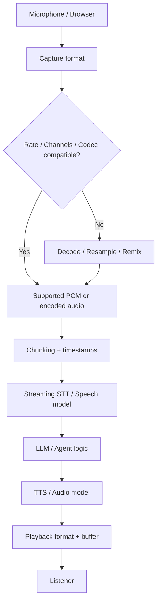
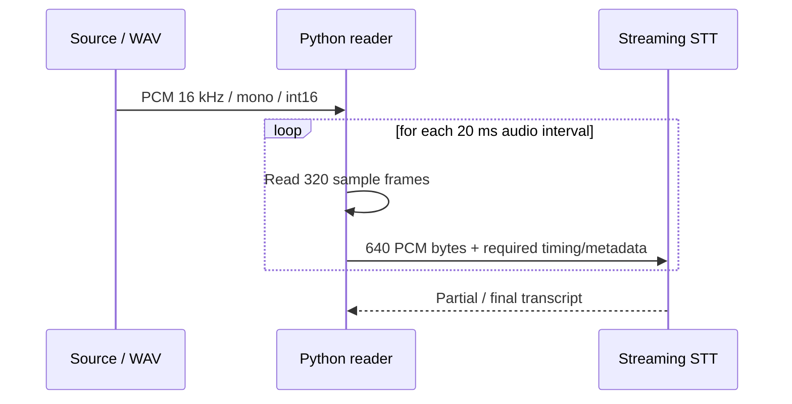

# Digital Audio for Developers: The Foundation of Every Voice AI Agent

**Voice AI Engineering Series — Article 02 / 16**  
**Level:** Beginner → Foundations, with a hands-on Python lab  
**Arabic edition:** [[02-Digital-Audio-for-Developers-AR|اقرأ بالعربية]]  
**Previous article:** [[01-What-is-a-Voice-Agent-EN|What Is a Voice AI Agent?]]  
**Series roadmap:** [[00-Series-Roadmap|Voice AI Engineering Roadmap]]

![[assets/digital-audio-cover.png]]

> [!abstract] The idea in one minute
> Before your user's speech reaches a speech recognition model, it has already become numbers. Without a working understanding of **sampling, sample rate, bit depth, PCM, channels, chunks, and codecs**, you can misinterpret those numbers, feed a model the wrong audio format, or add avoidable latency. This article covers the signal-processing basics that every reliable real-time voice agent depends on.

## The opening problem: why does good-sounding audio fail inside an agent?

Suppose you record a clear sentence: “Hello, I'd like to check my appointment.”

It plays perfectly on your laptop. Yet when you send it to an STT service, the transcript is nonsense, the audio sounds strangely slow or fast, or the service rejects the request entirely.

The model may be working fine. The problem could be that **you labeled a 48 kHz stream as 16 kHz**, or you sent Opus-compressed audio to an endpoint that expects raw PCM. A speech model cannot compensate for an arbitrary format mismatch.

**Our first engineering principle:** Audio is more than a file. It is a time-ordered signal with an agreed representation, channel layout, encoding, and timing.

> [!question] The question we're answering
> What happens between the microphone and an AI model, and how can we verify that the bytes we send actually represent the intended speech?

## 1. Turning sound waves into numbers

Sound in the physical world consists of pressure variations over time. A microphone converts those variations into an electrical signal; an **analog-to-digital converter (ADC)** produces a sequence of numerical measurements.

A useful mental model is to take regularly spaced “snapshots” of the signal's amplitude. Each snapshot is a **sample**.

![[assets/sampling-explained.png]]

*Figure 1 — The cyan curve is a continuous waveform; the yellow dots are discrete measurements. This is a conceptual illustration, not an actual speech recording.*

Digitizing a signal involves two separate steps:

1. **Sampling** decides *when* signal measurements are taken.
2. **Quantization** decides which digital value represents each measured amplitude.

To store or transmit the results, we also need an agreed byte representation. For uncompressed audio, that representation is usually **PCM**.

## 2. Sample rate: how often are we measuring the signal?

The **sample rate** describes the number of *sample frames* captured per second for each channel, measured in hertz (Hz). In mono audio, the count of frames and individual samples is the same.

| Rate | Meaning | Typical context |
|---|---|---|
| 8,000 Hz | 8,000 samples per second per channel | Narrowband telephony and some legacy systems |
| 16,000 Hz | 16,000 samples per second per channel | Many speech-processing paths; not a universal STT requirement |
| 44,100 Hz | 44,100 samples per second per channel | Consumer audio production and storage |
| 48,000 Hz | 48,000 samples per second per channel | Video and interactive real-time audio applications |

A **one-second, mono recording at 16 kHz** contains **16,000 samples**.

### Why not always use 192 kHz?

A higher rate gives you more samples, but not necessarily better recognition. What matters is signal bandwidth, input quality, model requirements, processing cost, and whether the pipeline is correctly resampling.

The Nyquist principle says that a sufficiently band-limited signal requires a sampling rate greater than twice its highest frequency for ideal reconstruction, given appropriate anti-aliasing filtering. At 16 kHz, the theoretical Nyquist frequency is 8 kHz. That does *not* mean that every 16 kHz recording perfectly preserves all frequencies below 8 kHz.[^mdn-audio]

> [!warning] A common engineering mistake
> If the source is 48 kHz, replacing its metadata with `sample_rate = 16000` does **not** resample it. The samples stay exactly the same; only the way their timing is interpreted changes. Use an actual resampling process with appropriate filtering.

## 3. Bit depth, quantization, and PCM

**Bit depth** describes how many bits encode each sample when using a fixed-width integer PCM representation.

- **8-bit PCM:** Relatively few quantization levels; standard WAV PCM commonly uses unsigned 8-bit values.
- **16-bit PCM:** Two bytes per sample; signed `int16` values range from `-32768` to `32767`.
- **24-bit PCM:** Finer amplitude quantization where supported by the recording and processing path.
- **32-bit floating-point PCM:** A floating-point sample representation; it is not merely “16-bit PCM with more bits” or the same integer range.

![[assets/quantization.png]]

*Figure 2 — A deliberately coarse 3-bit, eight-level example exaggerates quantization so that the difference is visible. It is not a recommended speech format.*

**PCM** stands for **Pulse-Code Modulation**. It represents the digital values of a sampled signal. A statement like `PCM / 16-bit / mono / 16 kHz` describes essential aspects of an audio stream. You may also need to specify **byte order (endianness)** and **channel ordering**.

A common local representation for uncompressed speech data is **signed 16-bit little-endian PCM**, but don't assume every API accepts it. What the endpoint documents is what counts.

## 4. Mono vs. stereo: sample frames matter

- **Mono:** One sample at a given time instant.
- **Stereo:** Two samples at that time instant, one per channel.

This is where the term **sample frame** comes from. A sample frame is the set of values for *all channels* at a single time. In stereo, one frame therefore contains two individual samples. The Web Audio documentation uses the same distinction.[^mdn-audio]

For a single-speaker voice agent, mono is often enough. Converting stereo to mono, however, requires deliberate downmixing. Dropping every other **byte** is not downmixing; it corrupts the sample representation.

## 5. Calculate the size of uncompressed audio

For fixed-width integer PCM, the payload size is:

**Bytes = duration in seconds × sample rate × channels × (bits per sample ÷ 8)**

One second of `16 kHz / mono / 16-bit PCM`:

`1 × 16000 × 1 × 2 = 32000 bytes` (exactly **32 kB** in decimal units, or about 31.25 KiB).

One second of `48 kHz / stereo / 16-bit PCM`:

`1 × 48000 × 2 × 2 = 192000 bytes`.

These values describe **raw PCM data**. They exclude WAV headers, transport overhead, and compressed codec payloads such as Opus.

| Example | Duration | Raw PCM payload |
|---|---:|---:|
| 16 kHz, mono, 16-bit | 1 second | 32,000 B |
| 16 kHz, mono, 16-bit | 20 ms | 640 B |
| 48 kHz, mono, 16-bit | 20 ms | 1,920 B |
| 48 kHz, stereo, 16-bit | 20 ms | 3,840 B |

Keep this calculation close at hand when debugging audio buffers, request limits, and packet throughput.

## 6. PCM vs. WAV vs. Opus: three different layers

These three terms are often used as if they meant the same thing. They don't:

| Layer | Example | Purpose |
|---|---|---|
| **Sample representation** | PCM | Numerical representation of sampled audio |
| **File container** | WAV | Stores audio payload and metadata in a file |
| **Audio codec** | Opus | Encodes and compresses audio efficiently for playback or transport |

A WAV file commonly contains uncompressed PCM, but the `.wav` extension alone does not establish that it contains signed 16-bit samples. Likewise, a WebM file may contain Opus audio, not raw PCM.

When integrating a streaming model, check whether the service accepts an encoded format and decodes it internally or instead expects decoded PCM. Python's `wave` documentation, MDN's media-format guide, and the Opus specification are useful references.[^python-wave][^mdn-codecs][^opus]



*Figure 3 — An encoded stream may need decoding before a PCM-only model can consume it. Some providers handle decoding for you; don't add unnecessary transformations.*

## 7. Audio frames, chunks, and streaming

A real-time voice agent rarely wants to wait for a complete long recording. It consumes and produces audio in short segments.

- **Sample:** One channel's numerical amplitude at a given instant.
- **Sample frame:** All channel samples associated with that instant.
- **Chunk / buffer:** A sequence of consecutive sample frames.
- **Codec frame / transport packet:** A unit defined by the codec or transport layer; it need not coincide with your application-level chunk.

![[assets/audio-chunks.png]]

*Figure 4 — Five consecutive 20 ms chunks form a 100 ms audio interval. This diagram illustrates raw PCM, not a universal packet size for every codec or network protocol.*

For the teaching format `16 kHz / mono / 16-bit PCM`, a **20 ms chunk** contains:

- `16000 × 0.020 = 320` sample frames.
- `320 × 1 × 2 = 640` bytes.
- Exactly **50 non-overlapping 20 ms chunks** per second, under ideal segmentation.

### Are smaller chunks always faster?

No. Smaller chunks can reduce the time needed to produce the first piece of audio, but they also increase the frequency of processing callbacks, network messages, and scheduling work. Larger chunks reduce overhead while potentially increasing buffering delay. The best size depends on your STT/TTS interface, transport, network conditions, and latency objectives.

## 8. Where audio-format bugs enter a voice-agent pipeline



*Figure 5 — If the format does not match, the pipeline is wrong, so treat format compatibility as a correctness requirement.*

| Symptom | Possible cause | What to check |
|---|---|---|
| Speech sounds too fast or slow | Wrong sample-rate interpretation | Source rate, destination rate, actual resampling |
| Loud digital noise | Interpreting `float32` as `int16`, or wrong byte order | Sample type and endianness |
| STT rejects the input | Unsupported codec or container | MIME type, actual codec, endpoint contract |
| Audio breaks up | Chunks arriving late or dropped, buffer underruns | Timestamps, queue lengths, jitter |
| Long delay before responding | Chunk size or waiting for whole files | Capture-to-first-audio measurements |
| Distorted loud speech | Clipping somewhere in the signal chain | Signal peaks and gain stages |

## 9. Hands-on Python lab: generate and inspect PCM WAV

> [!info] Your objective
> Generate a one-second, mono, 16 kHz, signed 16-bit PCM WAV file containing a 440 Hz sine tone. Then read it in 20 ms chunks and calculate duration, chunk size, **peak**, and **RMS**. This synthesized tone is not speech; we use it to validate the audio pipeline before introducing STT.

**Included script:** `examples/digital_audio_lab.py`  
**Included tests:** `examples/test_digital_audio_lab.py`

Run from the `Voice-Agent-Series` folder:

```bash
python examples/digital_audio_lab.py
python -m unittest discover -s examples -p 'test_*.py' -v
```

The core of the inspection takes only a few lines:

```python
import wave

with wave.open("demo_16k_mono.wav", "rb") as wav:
    sample_rate = wav.getframerate()
    channels = wav.getnchannels()
    bytes_per_sample = wav.getsampwidth()
    frames = wav.getnframes()

    duration_s = frames / sample_rate
    chunk_frames = round(sample_rate * 0.020)
    first_chunk = wav.readframes(chunk_frames)

print(sample_rate, channels, bytes_per_sample * 8)
print(duration_s, len(first_chunk))
# 16000 1 16
# 1.0 640
```

Those numbers describe the generated demo file, not arbitrary WAV files. The exercise deliberately accepts only uncompressed **mono signed 16-bit PCM WAV**, so that other encodings are rejected instead of being silently misread.[^python-wave]



*Figure 6 — A conceptual streaming flow. The included script inspects audio locally and does **not** invoke an STT service.*

### What are peak and RMS?

- **Peak:** The largest absolute sample value. A high peak can indicate proximity to a representable limit, but peak alone cannot prove that clipping occurred.
- **RMS (root mean square):** An energy-related summary of the signal level over an interval. It is not a direct model of human loudness, but it is helpful for monitoring signal levels.

Neither is a substitute for **voice activity detection**. A loud fan may produce high RMS without any speech at all; we will revisit this in Article 09.

### Experiment: change one variable at a time

1. Run with `--chunk-ms 10` and then `--chunk-ms 40`. Compare `chunk_bytes` and the number of chunks.
2. Change the `write_demo` source sample rate from 16,000 to 48,000 *before creating the file*, and predict the new values.
3. If you have permission to use your own `mono 16-bit PCM WAV` recording, inspect it via `--input your_audio.wav`. Do not upload private speech recordings to third-party services without authorization.
4. Observe how the script rejects stereo or floating-point WAV instead of guessing its format.

## 10. Pre-STT audio checklist

- [ ] Confirm the source's **actual** sample rate.
- [ ] Identify channel count and layout.
- [ ] Know whether the samples are `int16`, `float32`, or another type.
- [ ] Verify the codec, container, or raw binary contract.
- [ ] Use real resampling when changing sample rate.
- [ ] Define chunk duration in milliseconds *and* frame count.
- [ ] Inspect basic signal levels and obvious distortion.
- [ ] Match the exact audio requirements of your STT/TTS provider.
- [ ] Separate buffering delay from model and playback latency.

> [!success] What you should be able to do now
> Precisely describe an audio stream, calculate its uncompressed size, distinguish PCM, WAV, and Opus, inspect WAV metadata and sample buffers with Python, and explain how to segment audio without confusing samples, frames, bytes, and time.

## Conclusion

Voice-agent engineering starts with reliable input and output streams, well before anyone writes an LLM prompt. Your models operate on data whose interpretation depends on sampling, formats, and timing. When these assumptions are wrong, even an excellent model can appear broken.

**Next: Article 03 — Speech-to-Text (STT).** We'll build on these ideas to explain how streaming audio becomes words, why **partial** and **final transcripts** differ, and how noise, accents, and latency shape recognition quality.

---

## Glossary

| Term | Meaning |
|---|---|
| Sample | One channel's numerical signal amplitude at one instant |
| Sample frame | The sample values of all channels at one instant |
| Sample rate | Sample frames per second for each channel |
| Bit depth | Number of bits per sample in a fixed-width integer representation |
| PCM | Numerical representation of sampled audio values |
| Mono / Stereo | One channel / two channels |
| Codec | An audio encoding and decoding method |
| Container | A file structure holding audio data and metadata |
| Resampling | Actually converting the sample sequence to a new sample rate |
| Chunk | A consecutive block of audio frames |
| Peak / RMS | Digital signal-level measurements |
| Clipping | Distortion from exceeding a representable or system limit |

## Sources and further reading

[^mdn-audio]: [MDN — Basic concepts behind Web Audio API](https://developer.mozilla.org/en-US/docs/Web/API/Web_Audio_API/Basic_concepts_behind_Web_Audio_API) and [AudioBuffer](https://developer.mozilla.org/en-US/docs/Web/API/AudioBuffer). Sample rates, sample frames, and floating-point buffers.
[^python-wave]: [Python Standard Library — wave](https://docs.python.org/3.14/library/wave.html). WAV metadata, sample access, and version-dependent format support.
[^opus]: [IETF RFC 6716 — Definition of the Opus Audio Codec](https://datatracker.ietf.org/doc/html/rfc6716) and [RFC 7587 — RTP Payload Format](https://datatracker.ietf.org/doc/html/rfc7587). Codec and transport specifications.
[^mdn-codecs]: [MDN — Web audio codec guide](https://developer.mozilla.org/en-US/docs/Web/Media/Guides/Formats/Audio_codecs) and [MediaRecorder MIME types](https://developer.mozilla.org/en-US/docs/Web/API/MediaRecorder/mimeType). Browser containers and codecs.

*All charts and examples were prepared for this series. The illustrative sample configurations are not universal requirements for every voice AI provider.*
