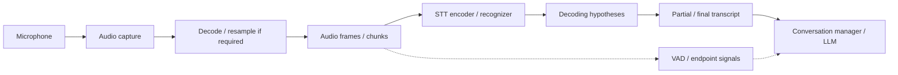
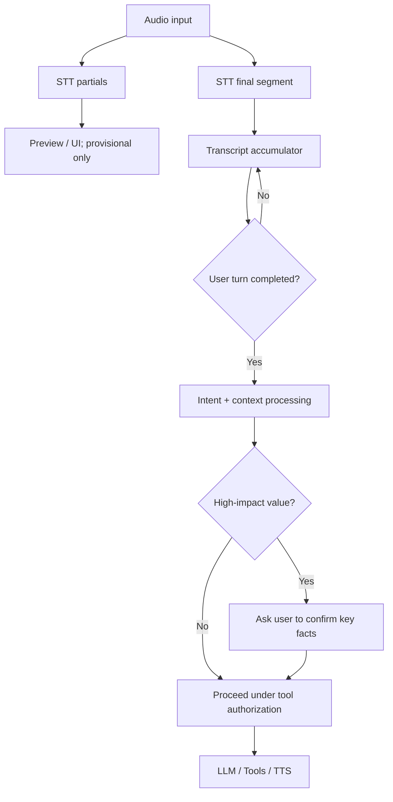

# من الصوت إلى النص: كيف تتعرف الآلة على كلام الإنسان؟

**سلسلة هندسة الوكلاء الصوتيين — المقالة 03 / 16**  
**المستوى:** مبتدئ → متوسط | **المدة المقترحة:** 15–20 دقيقة، إضافة إلى التطبيق  
**النسخة الإنجليزية:** [[03-Speech-to-Text-EN|Read in English]]  
**المقالة السابقة:** [[02-Digital-Audio-for-Developers-AR|الصوت الرقمي للمطورين]]  
**المقالة التالية:** تحويل النص إلى كلام (TTS) — قريباً  
**خطة السلسلة:** [[00-Series-Roadmap|خارطة السلسلة]]

![[assets/stt-cover.png]]

> [!abstract] الفكرة في دقيقة
> حين نقول إن الوكيل الصوتي «يفهم كلام المستخدم»، فالخطوة الأولى في كثير من الأنظمة هي **التعرف الآلي على الكلام (ASR)**، أي تحويل الإشارة الصوتية إلى تسلسل كلمات، وليس الفهم الدلالي. والنص الناتج ليس حقيقة مطلقة: قد يتغير والمستخدم ما زال يتكلم، وقد يخطئ في الأسماء والأرقام وفي كلام اللهجات. نشرح في هذه المقالة كيف يعمل STT، وما الذي يحدث في Streaming STT، وكيف نقيس الجودة، ثم نبني تجربة عملية آمنة وواضحة.

## البداية: كلمة واحدة قد تغيّر معنى الطلب كله

تخيّل أن مستخدماً قال لوكيل لحجز المواعيد:

> **المستخدم:** «أريد موعد يوم **الثلاثاء**».  
> **التفريغ الخاطئ:** «أريد موعد يوم **الخميس**».

معظم الكلمات صحيحة، لكن الخطأ وقع في المعلومة الأهم: **اليوم المطلوب**. وإذا نفّذ الوكيل الحجز مباشرةً دون تحقق، فلن يصحّح النموذج اللغوي هذا الخطأ مهما كان قوياً.

ومن هنا السؤال الذي نبني عليه المقالة:

> [!question] سؤال المقالة
> كيف نحوّل موجة صوتية إلى كلمات قابلة للاستخدام، وكيف نعرف متى نثق بالنص ومتى نحتاج إلى انتظار أو تأكيد؟

## 1. ما هو Speech-to-Text؟

**Speech-to-Text (STT)** هو الاسم العملي لعملية **Automatic Speech Recognition (ASR)**، أي تحويل الكلام المنطوق إلى نص باستخدام نماذج حاسوبية تتعامل مع خصائص الصوت والسياق اللغوي. وقد تُرجع الأنظمة أيضاً طوابع زمنية أو حدود مقاطع أو احتمالات، بحسب النموذج والخدمة.

من المفيد أن نفصل بين ثلاثة مفاهيم:

| المكوّن | السؤال الذي يجيب عنه | المثال |
|---|---|---|
| **VAD** — اكتشاف النشاط الصوتي | هل يوجد كلام أو نشاط صوتي محتمل؟ | بدأ المتحدث بالكلام |
| **STT / ASR** — التعرف على الكلام | ما الكلمات التي قيلت؟ | «احجز موعداً غداً» |
| **NLU / LLM** — فهم النية | ماذا يريد المتحدث، وما الإجراء الصحيح؟ | التحقق من التاريخ ثم طلب تأكيد الحجز |

**ملاحظة:** التعرف على الكلمات ليس فهماً للنية ولا تنفيذاً لإجراء. يقدّم STT تمثيلاً نصياً، ثم يستخدمه مكوّن آخر لفهم الطلب واتخاذ القرار.

## 2. ماذا يحدث بين الميكروفون والنص؟

سبق أن تعرّفنا في [[02-Digital-Audio-for-Developers-AR|المقالة الثانية]] إلى Sample Rate وPCM وAudio Chunks، وهنا نربط هذه المفاهيم بنموذج التعرف على الكلام.



*الشكل 1 — مسار مفاهيمي مبسّط. بعض النماذج تقبل الصوت مباشرةً وتتعامل داخلياً مع استخراج الخصائص، وبعض الخدمات تجمع أكثر من مرحلة في واجهة واحدة.*

### أ. التقاط الصوت وتجهيزه

قد يلتقط المتصفح الصوت عند 48 kHz، في حين يتوقع نموذج محلي أو واجهة أخرى تنسيقاً مختلفاً. يجب عند اللزوم **فك الترميز وإعادة أخذ العينات فعلياً (Resampling)**، لا تغيير رقم معدل العينات فقط. وانتبه كذلك إلى عدد القنوات (Mono/Stereo) وطريقة ترميز البايتات.

### ب. استخراج التمثيل الصوتي

يمكن النظر إلى الصوت على أنه موجة تتغير مع الزمن، لكن كثيراً من تقنيات التعرف على الكلام تستخدم خصائص زمنية-ترددية مثل **Spectrogram** أو **Log-Mel Spectrogram**. تُظهر هذه التمثيلات كيف تتوزع الطاقة عبر الترددات مع مرور الزمن. توجد أيضاً معماريات تتعلّم من عينات الموجة أو تستخدم تمثيلات داخلية أخرى؛ **لا تفترض أن كل STT يستخدم Spectrogram بالطريقة نفسها**.

![[assets/stt-spectrogram-example.png]]

*الشكل 2 — موجة اصطناعية شبيهة بصوت مجهور، ورسمها الزمني-الترددي باستخدام STFT. ليس تسجيلاً بشرياً ولا عرضاً لمخرجات نموذج STT بعينه.*

### ج. التنبؤ بالكلمات وفك الترميز

يُحوّل النموذج الإشارة إلى تمثيلات يمكن فكها إلى رموز (Tokens) ثم كلمات. توجد عائلات تصميم مختلفة، منها **CTC**، و**RNN-T**، و**Encoder–Decoder**. قد يستخدم النظام البحث الشعاعي (Beam Search) أو طرائق فك ترميز أخرى، ثم يعالج المسافات وعلامات الترقيم والأرقام.

ولا تتوقف جودة النتيجة على «وضوح الصوت» وحده؛ فهي تتأثر أيضاً باللهجة، والمفردات المتخصصة، وطول السياق، وجودة بيانات التدريب.

## 3. Batch STT أم Streaming STT؟

هذا من أوائل قرارات التصميم في أي Voice Agent.

| الجانب | **Batch / File STT** | **Streaming / Realtime STT** |
|---|---|---|
| المدخل | ملف مسجل أو مقطع مكتمل | صوت متدفق أثناء الكلام |
| وقت ظهور النص | بعد تقديم مقطع أو ملف مكتمل، ولو أمكن بث مخرجات المعالجة | أثناء وصول الكلام، حسب قدرات الخدمة |
| النتائج المؤقتة | ليست بالضرورة متاحة | قد تصدر فرضيات نصية مؤقتة ثم نتائج نهائية |
| التعقيد | أسهل للاختبار والتقييم | إدارة اتصال وأحداث وتوقيت وتراجع النص |
| الاستخدام | تفريغ مقابلة أو تسجيل | مكالمة أو وكيل صوتي مباشر |

> [!important] لا تخلط بين مفهومين
> **Streaming output from a prerecorded file** يعني أن النص يصل تدريجياً أثناء *معالجة ملف جاهز*. أما **Live audio streaming** فيعني أن الصوت نفسه ما زال يصل من الميكروفون أو المكالمة. تميّز وثائق OpenAI الحالية بين هذين المسارين.[^openai-file][^openai-live]

## 4. لماذا يتغير النص أثناء الحديث؟ Partial vs. Final

لنفترض أن المستخدم لا يزال يقول: «أريد حجز موعد يوم الخميس».

قد تتغير الفرضيات أثناء وصول الصوت:

1. `PARTIAL: أريد حجز...`
2. `PARTIAL: أريد حجز موعد يوم...`
3. `PARTIAL: أريد حجز موعد يوم الخميس`
4. `FINAL: أريد حجز موعد يوم الخميس`

![[assets/stt-partial-final.png]]

*الشكل 3 — تسلسل إنجليزي توضيحي للمفهوم نفسه؛ تغير النص المؤقت لا يعني أن المحرك ارتكب خطأً نهائياً.*

الـ **Partial / Interim** فرضية قابلة للتغيير؛ أما الـ **Final** فهي، بحسب عقد الخدمة، نتيجة ثبّتتها الخدمة لجزء معين من الصوت. لكنها لا تعني دائماً **أن المستخدم أنهى دوره بالكامل**.

في توثيق **Deepgram** مثلاً، يعبّر `is_final=true` عن تثبيت مقطع نصي، بينما يرتبط `speech_final=true` باكتشاف نهاية مقطع حديث وفق إعدادات Endpointing. وبالمثل تُميّز Google نتائج `is_final` عن نتائجها المؤقتة. **هذه الأسماء ليست معياراً عالمياً**؛ راجع أحداث كل مزود على حدة.[^deepgram][^google]

```mermaid
sequenceDiagram
    participant U as User
    participant S as STT service
    participant C as Transcript manager
    participant A as Agent
    U->>S: Audio chunks arrive
    S-->>C: partial(segment-1, "أريد حجز")
    S-->>C: partial(segment-1, "أريد حجز موعد")
    S-->>C: final(segment-1, "أريد حجز موعد")
    Note over C: Replace partial; commit stable text
    S-->>C: turn-end / endpoint signal
    C->>A: Confirmed turn or next action
```

### قاعدة هندسية مهمة

- اعرض النتائج المؤقتة للمستخدم أو استعملها في تحسين الاستجابة بحذر.
- **لا تنفّذ عملية غير قابلة للتراجع** اعتماداً فقط على Partial غير مؤكد.
- تتبّع `segment_id` أو الطوابع الزمنية؛ **لا تُلصق كل Partial بالنص السابق** وإلا ستتكرر الكلمات.
- فرّق بين **Final segment** و**End of user turn** و**Successful external action**؛ هذه ثلاثة أحداث مختلفة.

## 5. ما معنى VAD وEndpointing وTurn Detection؟

هذه المصطلحات متقاربة، لكنها ليست مترادفة:

| المصطلح | دوره | حدوده |
|---|---|---|
| **VAD** | اكتشاف فترات نشاط الكلام | قد يعد الضجيج أو صوت الخلفية كلاماً |
| **Endpointing** | تحديد نقطة توقف مناسبة لمعالجة جزء من الكلام | الصمت لا يضمن اكتمال المعنى |
| **Turn Detection** | تقدير هل انتهى دور المستخدم أم سيكمل؟ | يعتمد على السياق والتوقيت وقد يخطئ |

مثلاً، عندما يقول المستخدم: «أريد حجز موعد يوم...»، ثم يصمت نصف ثانية، فربما يفكّر في اسم اليوم، وهذا الصمت وحده لا يعني أن على الوكيل أن يبدأ الكلام. سنتناول هذه القرارات بتفصيل أكبر في [[00-Series-Roadmap|المقالة التاسعة]]؛ هدفنا هنا معرفة الإشارات التي يصدرها مسار STT وما يمكننا استنتاجه منها.

## 6. لماذا تكون اللغات واللهجات تحدياً خاصاً؟

العربية مثال واضح على ذلك: هناك فروق بين الفصحى واللهجات، ويختلف نطق الهمزات والأرقام والأسماء من متحدث لآخر، وقد يمزج المتحدث العربية بالإنجليزية في الجملة نفسها.

> «بدي أعمل **reschedule** للـ **appointment** تبعي يوم الخميس».

قد يخطئ النموذج في تهجئة المصطلح الإنجليزي، أو في حدود الكلمات، أو في اسم شخص أو مدينة. هذا لا يعني أن نماذج STT كلها ضعيفة في العربية؛ المقصود أن **اختبار اللغة واللهجة الفعلية للمستخدمين** أهم من الاعتماد على متوسط عام منشور.

نصائح أولية:

- اختر نموذجاً يدعم اللغة المقصودة، وحدد رمز اللغة (`ar` أو `en` مثلاً) إذا كانت الواجهة تدعم ذلك وكانت اللغة معروفة.
- أنشئ مجموعة اختبار صغيرة من كلام واقعي، بموافقة المتحدثين، تشمل اللهجات والضجيج والمقاطعات.
- اختبر **الأسماء والأرقام والتواريخ** بصورة مستقلة؛ فهي أكثر حساسية في كثير من التطبيقات.
- قارن أداء اكتشاف اللغة التلقائي مع فرض اللغة عند الحاجة، وراقب حالات تبديل اللغة داخل الجملة.
- لا تستخدم إعادة صياغة من LLM لتغطية خطأ STT دون تمييز؛ فقد يبدو النص «أكثر أناقة» لكنه يغير ما قاله الشخص فعلياً.

## 7. كيف نقيس جودة التعرف على الكلام؟ WER وCER

يُعد **Word Error Rate — WER** من أكثر مقاييس التعرف على الكلام شيوعاً. يقارن نص المرجع (Reference) بنص النظام (Hypothesis) بعد تطبيق قاعدة تقسيم وتطبيع معلنة:

$$
WER = \frac{S + D + I}{N}
$$

و`S` هنا عدد الاستبدالات، و`D` عدد الكلمات المحذوفة، و`I` عدد الكلمات المضافة، و`N` عدد كلمات المرجع.[^hf-wer]

**مثال عربي بسيط:**

- المرجع: «أريد موعد يوم **الثلاثاء**» — أربع كلمات.
- التفريغ: «أريد موعد يوم **الخميس**».
- هناك استبدال واحد → `WER = 1 / 4 = 25%`.

قد يبدو الرقم صغيراً، لكن هذا الخطأ الواحد يغيّر معنى الطلب كله إذا كان النظام يحجز مواعيد. كما أن WER قد يتجاوز 100% عند كثرة الإضافات، فهو لا يمثل نسبة «الكلمات الصحيحة» بصورة مباشرة.

أما **CER — Character Error Rate** فيحسب الأخطاء على مستوى المحارف، وقد يكون مفيداً عند دراسة أنماط كتابة معينة، لكنه لا يحل وحده تحديات تجزئة الكلمات العربية.[^hf-cer]

**ماذا نقيس أيضاً في النظام الآني؟**

| المقياس | ما الذي يخبرنا به؟ |
|---|---|
| **WER / CER** | دقة التفريغ وفق مجموعة اختبار وطريقة تطبيع محددة |
| **First partial latency** | الزمن إلى أول نص مؤقت من نقطة مرجعية معلنة |
| **Finalization lag** | الزمن بين نهاية الكلام وتثبيت النتيجة المعنية |
| **Word/entity accuracy** | دقة الكلمات الحساسة مثل التاريخ والاسم ورقم الحساب |
| **False endpoint rate** | عدد مرات إنهاء الدور قبل اكتمال طلب المستخدم |
| **RTF — Real-Time Factor** | زمن المعالجة ÷ مدة الصوت؛ يحتاج تفسيراً مختلفاً عن تأخير التفاعل في streaming |

> [!warning] لا تقارن أرقام أداء بلا شروط مشتركة
> النتائج لا تكون قابلة للمقارنة إن اختلفت اللغة واللهجة وجودة الميكروفون وطول الصوت والجهاز وطريقة التطبيع أو حدود التوقيت. يشرح دليل Hugging Face دور التوحيد النصي قبل حساب WER.[^hf-wer]

## 8. اختيار محرك STT: محلي أم خدمة سحابية؟

| القرار | **محلي — مثل Whisper / faster-whisper** | **خدمة Streaming مُدارة** |
|---|---|---|
| التحكم في البيانات | أعلى عند التشغيل داخل بيئتك | يعتمد على اتفاقية ومعالجة مزود الخدمة |
| التشغيل | تجهيز نموذج وموارد وعمليات مراقبة | اعتماد على واجهات API واتصال بالشبكة |
| النتائج المؤقتة | تحتاج بناء آلية أو اختيار تنفيذ يدعمها | قد توفرها الواجهة مباشرة |
| الكلفة | أجهزة/حوسبة وصيانة | استخدام وأسعار وسياسات تتغير |
| العمل دون إنترنت | ممكن بعد تنزيل الملفات اللازمة | غالباً يتطلب اتصالاً |
| الملاءمة | تجارب محلية وقيود خصوصية محددة | بناء مكالمات حقيقية مع أحداث STT مُدارة |

**Whisper** نموذج تعرف عام متعدد اللغات، و**faster-whisper** تنفيذ شائع باستخدام CTranslate2. وينبغي التفريق بين **تفريغ مقطع على دفعات قصيرة** وبين **محرك Streaming يصدر فرضيات متجددة مع وصول العينات**؛ ليست كل المكتبات المحلية تدعم الثاني مباشرةً.[^whisper][^faster]

## 9. مختبر عملي — ثلاث خطوات

سنستخدم ملفين مرفقين في مجلد `examples/`.

### التجربة الأولى: إدارة نتائج STT المؤقتة والنهائية

الملف `examples/stt_event_lab.py` **يحاكي أحداث STT** ولا يستمع إلى الميكروفون. فائدته عزل منطق المحادثة عن تفاصيل مزوّد الخدمة.

```bash
python examples/stt_event_lab.py
```

مثال من الكود:

```python
from stt_event_lab import STTEvent, TranscriptAssembler

state = TranscriptAssembler()
state.handle(STTEvent("partial", "segment-1", "أريد مو"))
state.handle(STTEvent("partial", "segment-1", "أريد موعد"))
state.handle(STTEvent("final", "segment-1", "أريد موعد"))

print(state.stable_text)   # أريد موعد
print(state.turn_ended)    # False: no turn-end event received yet
state.handle(STTEvent("turn_end"))
```

**ملاحظة تنفيذية:** يستبدل المثال النص المؤقت حسب معرف المقطع، ويثبت النتيجة النهائية مرة واحدة. لكن المزود الحقيقي قد يعيد ترتيب المقاطع أو يغير حدودها؛ لذلك يحتاج النظام الإنتاجي إلى طوابع زمنية أو أرقام تسلسل وعقد أحداث واضح.

### التجربة الثانية: تعرف حقيقي على ملف مسجل

الملف `examples/stt_microphone_demo.py` يستخدم **faster-whisper** عند توفر المتطلبات. سجّل بنفسك ملف WAV يحتوي على كلام حقيقي (لا تستخدم النغمة الاصطناعية من المقالة الثانية لقياس STT).

```bash
python -m pip install faster-whisper sounddevice numpy
python examples/stt_microphone_demo.py --input path/to/my_speech.wav --language ar --model base
```

سيحاول البرنامج تنزيل أوزان النموذج في التشغيل الأول إذا لم تكن موجودة محلياً، ويحتاج إلى بيئة متوافقة مع CTranslate2. اخترنا `base` لتخفيف متطلبات التجربة، لا بوصفه الأفضل في الدقة للعربية؛ جرّب `small` أو نماذج أخرى بعد التحقق من الموارد والنتائج.

### التجربة الثالثة: تجربة الميكروفون المباشرة

```bash
python examples/stt_microphone_demo.py --microphone --language ar --model base --windows 3 --window-seconds 4
```

تتحدث أربع ثوانٍ في كل نافذة، ثم يفرّغها البرنامج ويعرض النتيجة. جرّب في كل نافذة شيئاً مختلفاً: تصحيح كلمة مثلاً، أو التحدث بلهجة أخرى.

> [!warning] حدود التجربة بوضوح
> هذا **نموذج أولي من الميكروفون بنوافذ ثابتة**، وليس Streaming STT إنتاجياً: لا يصدر Partial أثناء النافذة، وقد تتقطع الكلمات عند حدودها، وقد تتأخر المعالجة، كما أن تشغيل الميكروفون يتطلب أذونات وتعريفات مناسبة. لم يُختبر التعرف الفعلي هنا على جهاز ميكروفون؛ جرى اختبار منطق الأحداث والحسابات البرمجية فقط.

### شغّل الاختبارات

```bash
python -m unittest discover -s examples -p 'test_*.py' -v
```

ضمن الحزمة **11 اختبار وحدة**، منها **7 اختبارات جديدة للمقالة الثالثة**؛ لا تتطلب نماذج أو ميكروفون أو حساب API. يمكن أيضاً استخدام `word_error_rate` على جملتك:

```python
from stt_event_lab import word_error_rate
print(word_error_rate("أريد موعد يوم الثلاثاء", "أريد موعد يوم الخميس"))
# 0.25
```

## 10. كيف يصل STT إلى الوكيل الصوتي؟



*الشكل 4 — مسار توضيحي لحماية الإجراءات الحساسة. يمكن لبعض الأنظمة بدء إعداد استجابة قابلة للإلغاء قبل اكتمال الدور، لكن لا ينبغي الخلط بين الاستباق وبين تأكيد إجراء خارجي.*

في نظام المواعيد، إذا قال المستخدم «الخميس» وكانت نتيجة STT غير موثوقة أو تخالف السياق، فالسلوك الأفضل غالباً هو **إعادة السؤال عن اليوم** أو **تأكيده قبل الحجز**. والأمر نفسه في التحقق من الهوية أو في البيانات الطبية: لا يصح اعتبار تفريغ آلي واحد مرجعاً معصوماً من الخطأ.

## 11. أخطاء شائعة يجب تجنّبها

1. **استخدام Partial كنتيجة نهائية:** قد تتغير الجملة بعد وصول الصوت اللاحق.
2. **تكرار النص عند كل حدث:** تحديث Partial يجب أن يستبدل الفرضية المناسبة، لا أن يضيفها دائماً.
3. **الخلط بين Final وTurn End:** المقطع النهائي لا يثبت أن المستخدم أنهى كلامه.
4. **الإفراط في الثقة بنسبة WER:** الخطأ الوحيد في رقم أو تاريخ قد يكون أهم من أخطاء كثيرة غير مؤثرة.
5. **مقارنة نماذج على جمل مثالية فقط:** اختبر اللهجات والصمت والضجيج وابتعاد الميكروفون.
6. **إرسال صوت بصيغة خاطئة:** تأكد من PCM والـCodec ومعدل العينات حسب عقد الخدمة.
7. **حفظ الصوت والتفريغات دون حاجة:** طبّق الموافقة والحد الأدنى من الاحتفاظ وضوابط الوصول؛ وتحقق من سياسة المزود.

## 12. تمرين نهاية المقالة

> [!todo] تمرين عملي — 20 دقيقة
> 1. شغّل `stt_event_lab.py` وبدّل كلمة في نتيجة `partial` ثم لاحظ متى تثبت في `final`.
> 2. سجّل جملة بالعربية مدتها 4–8 ثوانٍ تتضمن تاريخاً أو اسماً، وشغّل عليها `stt_microphone_demo.py`.
> 3. قارن النص بالنطق الحقيقي واحسب WER في المثال البرمجي مع **توثيق التطبيع المستخدم**.
> 4. جرّب جملة تمزج العربية بالإنجليزية. دوّن أي كلمة تغيّرت، وهل سيكون خطؤها مؤثراً في قرار الوكيل.
> 5. اكتب شرطاً يمنع تنفيذ حجز قبل استلام النص النهائي وتأكيد التاريخ من المستخدم.

> [!success] ماذا أصبحت تعرف؟
> لا يحوّل STT الموجة الصوتية إلى جملة مؤكدة؛ إنه **نظام احتمالي يُصدر فرضيات وأحداثاً وتوقيتات**. وحين تفهم الفرق بين النص المؤقت والنهائي، وتعرف كيف تقيس الدقة وتحمي الكلمات الحساسة، تكون قد وضعت أساس وكيل صوتي موثوق.

## المقالة القادمة

في المقالة الرابعة سنعكس الاتجاه: **Text-to-Speech (TTS)**، كيف نحول نص الوكيل إلى صوت طبيعي، وما الفرق بين جودة الصوت وزمن بدء تشغيله، وكيف يؤثر Streaming TTS في تجربة المحادثة.

---

## المصادر والمراجع

هذه المراجع تخص المفاهيم والواجهات كما كانت موثقة في تاريخ إعداد المقالة؛ راجع النسخ الحديثة قبل بناء نظام إنتاجي.

[^openai-file]: [OpenAI — File transcription guide](https://developers.openai.com/api/docs/guides/speech-to-text) — التفريغ من ملفات مكتملة والفرق بين بث مخرجات الملف والصوت الحي.
[^openai-live]: [OpenAI — Realtime transcription guide](https://developers.openai.com/api/docs/guides/realtime-transcription) — تفريغ الصوت الحي وأحداث النص المرحلية.
[^deepgram]: [Deepgram — Endpointing and interim results](https://developers.deepgram.com/docs/understand-endpointing-interim-results) — الفرق بين `is_final` و`speech_final` في هذا المزود.
[^google]: [Google Cloud — StreamingRecognitionResult](https://docs.cloud.google.com/speech-to-text/docs/reference/rpc/google.cloud.speech.v2) — معاني النتائج المؤقتة و`is_final`.
[^whisper]: [OpenAI — Whisper repository](https://github.com/openai/whisper) — نموذج تعرف متعدد اللغات وتجارب الملفات.
[^faster]: [SYSTRAN — faster-whisper](https://github.com/SYSTRAN/faster-whisper) — تنفيذ محلي باستخدام CTranslate2 وأمثلة الاستخدام.
[^hf-wer]: [Hugging Face — Evaluating ASR systems](https://huggingface.co/learn/audio-course/chapter5/evaluation) — تعريف WER، الأخطاء والتطبيع النصي.
[^hf-cer]: [Hugging Face Evaluate — CER](https://github.com/huggingface/evaluate/blob/main/metrics/cer/README.md) — تعريف Character Error Rate.

*تحرير: إبراهيم العبيد — سلسلة Voice AI Engineering، المقالة الثالثة.*
