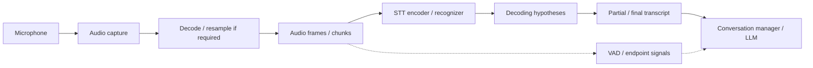
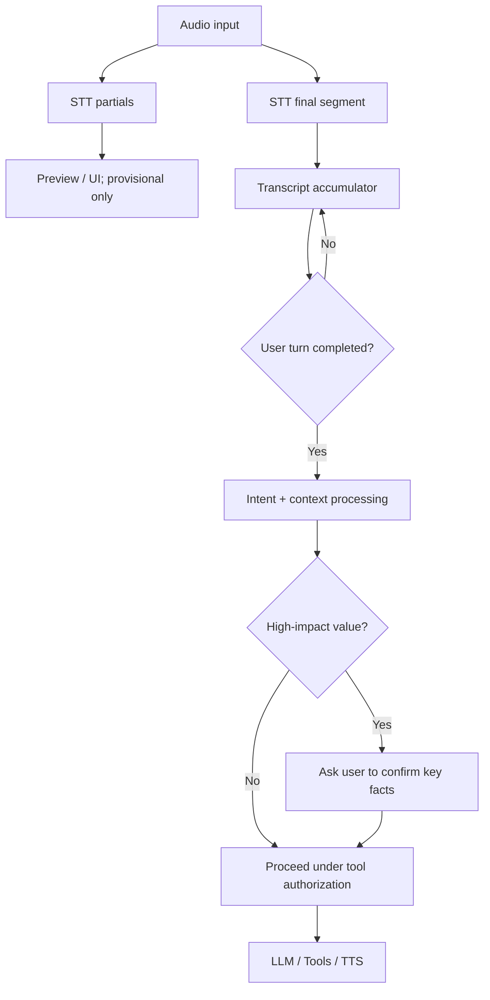

# Speech-to-Text: How Machines Turn Spoken Language into Text

**Voice AI Engineering Series — Article 03 / 16**  
**Level:** Beginner → Intermediate | **Reading time:** About 15–20 minutes, plus the lab  
**Arabic edition:** [[03-Speech-to-Text-AR|اقرأ بالعربية]]  
**Previous article:** [[02-Digital-Audio-for-Developers-EN|Digital Audio for Developers]]  
**Series roadmap:** [[00-Series-Roadmap|Voice AI Engineering Roadmap]]

![[assets/stt-cover.png]]

> [!abstract] The idea in one minute
> In many voice-agent architectures, “understanding speech” starts with **Automatic Speech Recognition (ASR)**, which maps incoming audio to text. That transcript is not an infallible record: it can change while someone is still speaking, and it can get names, dates, numbers, and accented speech wrong. This article covers what STT does, how streaming recognition differs from file transcription, how to handle partial and final events, how to measure quality, and how to run a local experiment.

## A single word can change the entire task

Imagine a user speaking to an appointment agent:

> **User:** “Book an appointment on **Tuesday**.”  
> **Incorrect transcript:** “Book an appointment on **Thursday**.”

Almost every word is right, and the one that is wrong happens to be the appointment date. Given only that transcript, even an excellent LLM has no reliable way to recover what the user actually said.

> [!question] Our guiding question
> How do we convert a sound wave into usable words, and how do we know when a transcript is provisional, stable, or important enough to verify?

## 1. What is Speech-to-Text?

**Speech-to-Text (STT)** refers to **Automatic Speech Recognition (ASR)**, the computational task of recognizing spoken words and representing them as text. Depending on the model and API, results may also include timestamps, language labels, segments, or other metadata.

It helps to separate three responsibilities:

| Component | Question it answers | Example |
|---|---|---|
| **VAD** (Voice Activity Detection) | Is there likely speech activity? | The caller has started talking |
| **STT / ASR** | What words were spoken? | “Book a slot tomorrow” |
| **NLU / LLM** | What does the caller want? | Identify date, check calendar, request confirmation |

**Recognizing words is not the same as understanding intent.** STT gives you a textual representation; another component does the reasoning and decides on actions.

## 2. Inside an STT pipeline

In [[02-Digital-Audio-for-Developers-EN|Article 02]], we covered sample rates, PCM, and audio chunks. Those are the inputs a recognizer works with.



*Figure 1 — A conceptual pipeline. Some services combine several of these stages, and different recognizers use different internal architectures.*

### Step A: Capture and prepare audio

A browser might capture audio at 48 kHz while the STT service expects another encoding or sample rate. When necessary, the application must **actually decode or resample** the audio, not simply relabel its metadata. Channel count, sample format, and codec are part of the interface contract.

### Step B: Represent acoustic content

Some recognition systems use features such as a **spectrogram** or **log-Mel spectrogram**, describing how audio energy varies with time and frequency. Others learn from raw waveforms or different learned representations. **A spectrogram is a useful teaching model, not a mandatory internal step of every STT system.**

![[assets/stt-spectrogram-example.png]]

*Figure 2 — An illustrative synthetic voiced-like signal and its short-time Fourier spectrogram. This is not recorded speech or a specific model's hidden representation.*

### Step C: Decode likely text

The recognizer maps acoustic information to token hypotheses and then to words. Common architecture families include **CTC**, **RNN-T**, and **encoder–decoder** models. Decoding can use a greedy method, beam search, or other strategies; further processing may add spaces, punctuation, or number formatting.

Performance also depends on dialect, technical terminology, recording conditions, training coverage, and the amount of context available.

## 3. Batch versus streaming STT

This is one of the first architecture decisions you make in a real voice agent.

| Dimension | **Batch / file transcription** | **Streaming / live transcription** |
|---|---|---|
| Input | Completed recording or clip | Audio arriving as someone speaks |
| When text appears | After a clip/file is provided, possibly streamed during processing | During the live speech stream, if supported |
| Interim results | Not necessarily exposed | Often exposes revisable hypotheses |
| Engineering work | Easier to test and reproduce | Requires connection, event, and timing management |
| Typical use | Recorded interview, lecture, voicemail | Call center, realtime subtitles, voice agent |

> [!important] Two kinds of “streaming”
> Streaming *text from an already uploaded file* is not the same as streaming *live microphone audio*. The current OpenAI documentation distinguishes these paths explicitly.[^openai-file][^openai-live]

## 4. Why does text change? Partial versus final transcripts

Suppose someone is saying, “I want to book an appointment on Thursday.” The recognizer might emit:

1. `PARTIAL: I want to...`
2. `PARTIAL: I want to book an appointment...`
3. `PARTIAL: I want to book an appointment on Thurs...`
4. `FINAL: I want to book an appointment on Thursday.`

![[assets/stt-partial-final.png]]

*Figure 3 — The partial hypothesis evolves before finalization; a segment final and a user turn end are separate concepts.*

A **partial** or **interim** result is a revisable hypothesis. A **final** result is, according to that provider's contract, settled for the corresponding audio region. But **a finalized segment does not necessarily mean that the speaker has finished their entire conversational turn**.

For example, Deepgram distinguishes `is_final=true` (segment finalization) from `speech_final=true` (endpointing detected a pause boundary). Google similarly defines a final result for a specific portion of audio. **These field names and their semantics are vendor-specific; there is no universal schema.**[^deepgram][^google]

```mermaid
sequenceDiagram
    participant U as User
    participant S as STT service
    participant C as Transcript manager
    participant A as Agent
    U->>S: Audio chunks arrive
    S-->>C: partial(segment-1, "I want to book")
    S-->>C: partial(segment-1, "I want to book a slot")
    S-->>C: final(segment-1, "I want to book a slot")
    Note over C: Replace hypothesis; commit stable text
    S-->>C: turn-end / endpoint signal
    C->>A: Confirmed turn or next action
```

### The design rule

- Display interim transcripts when useful, but treat them as provisional.
- Avoid irreversible actions based on an unconfirmed partial hypothesis.
- Track a `segment_id`, sequence, or timestamps: **do not append every partial as if it were a new sentence**.
- Keep **final segment**, **user turn completion**, and **successful tool execution** as distinct events.

## 5. VAD, endpointing, and turn detection are not synonyms

| Term | Main role | Important limitation |
|---|---|---|
| **VAD** | Detect likely speech activity | Noise or background speech can confuse it |
| **Endpointing** | Decide when a segment boundary is appropriate | A pause is not proof of completed intent |
| **Turn detection** | Infer whether the user will continue | Needs timing and sometimes linguistic context |

Consider “I’d like an appointment on...” followed by a short pause. A recognizer may output words, and a VAD may detect silence, but the user probably has not completed the request. A production agent should not respond solely because silence crossed a fixed threshold. We will revisit this in Article 09.

## 6. Why accents and code-switching matter

Nobody speaks a single, perfectly standardized form of a language. Users have different dialects and pronunciations, switch languages, and use local names and domain-specific words.

For example, a user might say in Arabic:

> «بدي أعمل **reschedule** للـ **appointment** تبعي يوم الخميس».

The STT engine might transcribe the English phrases inconsistently, change an Arabic name, or insert boundaries in the wrong place. A model's aggregate benchmark score will not tell you how often this happens to your users.

Practical guidelines:

- Choose an engine that supports your target languages and evaluate the exact dialects your users speak.
- Set a language hint (such as `ar` or `en`) only if supported and appropriate; compare it with automatic detection when users switch languages.
- Test **names, numbers, dates, and identifiers** separately.
- Build a consent-based evaluation set with real microphone and noise conditions.
- Do not silently use an LLM to “fix” a transcript and then claim the rewritten text is exactly what the speaker said.

## 7. Evaluating ASR: WER, CER, and beyond

**Word Error Rate (WER)** is a standard recognition metric. It compares a reference transcript to a hypothesis after applying a documented normalization and tokenization strategy:

$$
WER = \frac{S+D+I}{N}
$$

`S` is substitutions, `D` is deletions, `I` is insertions, and `N` is the number of words in the reference.[^hf-wer]

**Example:**

- Reference: “Book my appointment on **Tuesday**.” (five words)
- Prediction: “Book my appointment on **Thursday**.”
- One substitution → `WER = 1 / 5 = 20%`.

That one substituted day is enough to invalidate the booking. WER can also exceed 100% when many insertions occur; it is not simply “percent of words wrong” in the everyday sense.

**Character Error Rate (CER)** measures edits at character level and can help reveal spelling patterns, but it does not remove language-dependent tokenization and normalization choices.[^hf-cer]

| Metric | What it measures |
|---|---|
| **WER / CER** | Transcript error under a fixed normalization policy |
| **First partial latency** | Time to first interim text from a declared reference point |
| **Finalization lag** | Time from speech completion to finalizing the relevant transcript |
| **Entity accuracy** | Correct dates, names, amounts, and identifiers |
| **False endpoint rate** | Turns mistakenly ended before the speaker completes a thought |
| **RTF: Real-Time Factor** | Processing time divided by audio duration, not equivalent to end-user streaming latency |

> [!warning] Benchmark numbers need context
> Models cannot be compared fairly without controlling language, accent, noise, hardware, input duration, timing definitions, and text normalization. Hugging Face's ASR evaluation guide highlights the importance of normalization.[^hf-wer]

## 8. Local STT versus managed cloud STT

| Consideration | **Local — e.g., Whisper / faster-whisper** | **Managed streaming service** |
|---|---|---|
| Data control | More control within your own environment | Governed by provider policies and contracts |
| Operations | Model files, compute capacity, monitoring | API connectivity, credentials, limits |
| Interim hypotheses | May require extra logic or a different implementation | Often available directly through streaming events |
| Cost | Hardware, runtime, maintenance | Usage-based fees and changeable plans |
| Offline operation | Possible after obtaining dependencies/model weights | Usually network-dependent |
| Best starting use | Local prototypes and controlled data workflows | Event-driven realtime calls and integrations |

**Whisper** is an open multilingual ASR family. **faster-whisper** implements inference through CTranslate2. Transcribing repeated short windows with these tools is **not identical to a truly incremental recognizer that revises hypotheses as audio continuously arrives**.[^whisper][^faster]

## 9. Hands-on lab: three experiments

The `examples/` folder contains two new Python programs for this article.

### Experiment A — Model partial and final event handling without an API

`examples/stt_event_lab.py` is a **deterministic event simulator**, not a speech-recognition model. It tests transcript handling independently of microphones, network access, and external providers.

```bash
python examples/stt_event_lab.py
```

Try this minimal snippet:

```python
from stt_event_lab import STTEvent, TranscriptAssembler

state = TranscriptAssembler()
state.handle(STTEvent("partial", "segment-1", "book Tues"))
state.handle(STTEvent("partial", "segment-1", "book Tuesday"))
state.handle(STTEvent("final", "segment-1", "book Tuesday"))

print(state.stable_text)  # book Tuesday
print(state.turn_ended)   # False: no end-of-turn event yet
state.handle(STTEvent("turn_end"))
```

Here a new partial replaces a previous hypothesis for the same segment, while a final is committed once. Production providers may differ in segment IDs, ordering, and corrections; use their documented semantics and timestamps.

### Experiment B — Recognize words from an actual recorded file

The optional `examples/stt_microphone_demo.py` uses **faster-whisper** to process recorded speech. Supply a real human speech recording rather than the synthetic sine wave from Article 02.

```bash
python -m pip install faster-whisper sounddevice numpy
python examples/stt_microphone_demo.py --input path/to/my_speech.wav --language en --model base
```

Model weights may be downloaded on first use, and CTranslate2 requires a compatible runtime. The `base` model is chosen here as an accessible example, **not** a universal accuracy recommendation. Try `small` or another supported model after checking available resources.

### Experiment C — Transcribe directly from a microphone

```bash
python examples/stt_microphone_demo.py --microphone --language en --model base --windows 3 --window-seconds 4
```

The program records a fixed four-second microphone window, transcribes it, and prints its final result before starting the next window. Try one clean phrase, one with a named entity, and one with a short pause.

> [!warning] What this demo does **not** do
> This is **fixed-window microphone capture with transcription**, not production-grade streaming STT. There are no true interim hypotheses during each window; utterances may get cut by window boundaries, and inference can stall. A microphone and compatible audio drivers are required. The event logic and metrics were tested here, but live model inference was **not validated on real microphone hardware**.

### Run the tests

```bash
python -m unittest discover -s examples -p 'test_*.py' -v
```

The series bundle contains **11 unit tests**, including **7 new tests** for the STT event and WER lab. They do not require a model download or microphone.

```python
from stt_event_lab import word_error_rate
print(word_error_rate("Book my appointment on Tuesday", "Book my appointment on Thursday"))
# 0.2
```

## 10. Connect STT to the voice agent safely



*Figure 4 — A cautious action path. Some sophisticated agents may prepare cancellable work before the end of a turn, but speculative preparation must not be mistaken for permission to execute an irreversible action.*

For appointments, identity checks, or clinical workflows, design on the assumption that a plausible transcript can still be wrong. **Confirming important values and authorizing external actions are responsibilities separate** from recognition accuracy.

## 11. Common mistakes

1. **Treating every partial as final.** Later audio can change the hypothesis.
2. **Appending every interim event.** Replace or reconcile by segment, rather than duplicating text.
3. **Equating final segment with end of turn.** These do not always represent the same event.
4. **Judging everything by one WER score.** A wrong date can be more harmful than several minor text errors.
5. **Testing only studio-quality recordings.** Include dialects, pauses, background noise, and real microphones.
6. **Using incompatible audio formats.** Validate codec, sample rate, and channel arrangement.
7. **Keeping raw audio indefinitely.** Obtain appropriate consent, limit retention, and apply access restrictions.

## 12. Your assignment

> [!todo] A 20-minute experiment
> 1. Run `stt_event_lab.py`; change a partial hypothesis and observe when text becomes stable.
> 2. Record a 4–8-second sentence containing a date or a name, then transcribe it with the local demo.
> 3. Compare the recording with the output, calculate WER, and document the normalizer.
> 4. Try a sentence that switches between Arabic and English; note which errors are operationally important.
> 5. Write a rule: never confirm or perform a booking solely on a provisional transcript; verify the date with the speaker.

> [!success] What you should now understand
> An STT engine does not turn speech into facts. It is a **probabilistic recognition system that emits changing hypotheses, timestamps, and event boundaries**, and a reliable voice agent depends on handling those outputs carefully.

## Coming next: Article 04

In the fourth article we go the other way with **Text-to-Speech (TTS)**: generating natural-sounding speech from an agent's answer, streaming audio early, measuring time to first audio, and understanding how speech synthesis affects turn-taking and interruptions.

---

## References

References reflect the documentation consulted when this article was prepared. Check current API contracts and versions before production implementation.

[^openai-file]: [OpenAI — File transcription](https://developers.openai.com/api/docs/guides/speech-to-text) — prerecorded-file processing and file text streaming.
[^openai-live]: [OpenAI — Realtime transcription](https://developers.openai.com/api/docs/guides/realtime-transcription) — live audio sessions and incremental transcripts.
[^deepgram]: [Deepgram — Endpointing and interim results](https://developers.deepgram.com/docs/understand-endpointing-interim-results) — `is_final` and `speech_final` semantics.
[^google]: [Google Cloud — StreamingRecognitionResult](https://docs.cloud.google.com/speech-to-text/docs/reference/rpc/google.cloud.speech.v2) — interim/final result semantics.
[^whisper]: [OpenAI — Whisper repository](https://github.com/openai/whisper) — general-purpose multilingual recognition.
[^faster]: [SYSTRAN — faster-whisper](https://github.com/SYSTRAN/faster-whisper) — local CTranslate2-based transcription.
[^hf-wer]: [Hugging Face — Evaluation of ASR systems](https://huggingface.co/learn/audio-course/chapter5/evaluation) — edit-based WER, error categories, normalization.
[^hf-cer]: [Hugging Face Evaluate — CER](https://github.com/huggingface/evaluate/blob/main/metrics/cer/README.md) — character error rate.

*Editorial: Ibrahim Alobaid — Voice AI Engineering, Article 03.*
