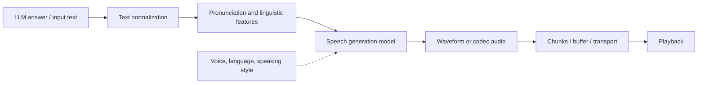
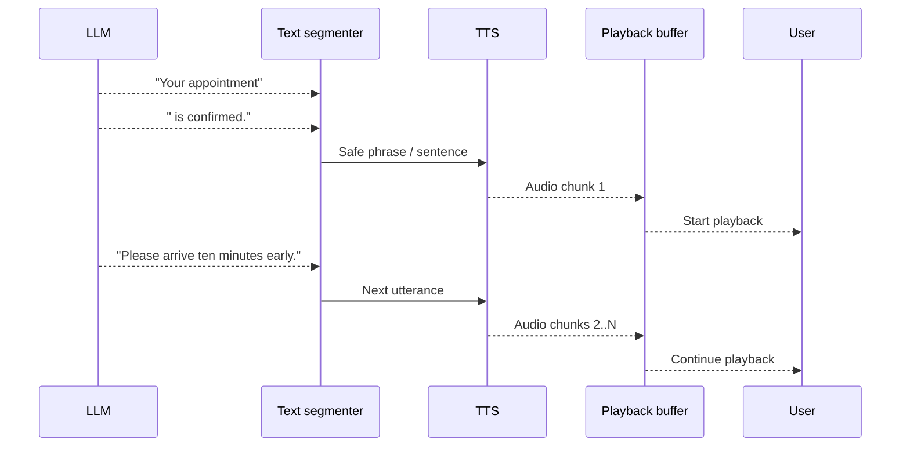
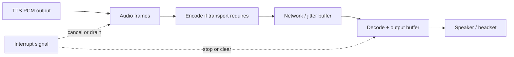
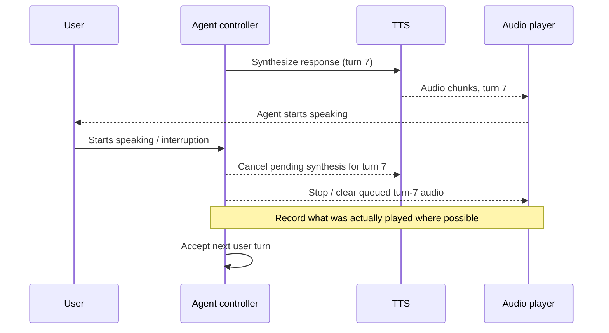

# من النص إلى الصوت: كيف نجعل الوكيل الذكي يتحدث بصورة طبيعية؟

**سلسلة هندسة الوكلاء الصوتيين — المقالة 04 / 16**  
**المستوى:** مبتدئ → متوسط | **زمن القراءة:** نحو 18–25 دقيقة، إضافة إلى المختبر  
**النسخة الإنجليزية:** [[04-Text-to-Speech-EN|Read in English]]  
**المقالة السابقة:** [[03-Speech-to-Text-AR|من الصوت إلى النص: STT]]  
**خارطة السلسلة:** [[00-Series-Roadmap|Voice AI Engineering Roadmap]]

![[assets/tts-cover.png]]

> [!abstract] الفكرة في دقيقة
> تعلمنا في [[03-Speech-to-Text-AR|المقالة الثالثة]] كيف يُحوَّل الكلام إلى نص. الآن نعكس العملية: كيف تتحول إجابة الوكيل المكتوبة إلى **صوت واضح، طبيعي، قليل التأخير، وقابل للإيقاف عند المقاطعة**؟ ليست المهمة مجرد إنشاء ملف MP3؛ فالتطبيق الحقيقي يحتاج إلى ضبط النطق والإيقاع، وتوليد الصوت على دفعات، وإرساله وتشغيله وإدارة حالته.

## مشكلة تبدأ بجملة بسيطة

تخيّل وكيل مواعيد يقول:

> «تم حجز موعدك يوم الخميس الساعة العاشرة والنصف صباحاً.»

المعنى صحيح، لكن التجربة قد تفشل في واحدة من أربع نقاط: ينطق الوقت بطريقة مربكة، أو يبدو الصوت آلياً بلا إيقاع، أو ينتظر عدة ثوانٍ قبل أن يبدأ، أو يواصل الكلام بعد أن يقاطعه المستخدم. هذه أخطاء مختلفة: **جودة لغوية، وجودة صوتية، وتأخير زمني، وإدارة محادثة**.

> [!question] سؤال المقالة
> كيف ننقل النص من نموذج اللغة إلى مسار صوتي يستطيع المستخدم سماعه مبكراً، مع الاحتفاظ بالنطق الصحيح وقدرة الوكيل على التوقف؟

## 1. ما المقصود بـ Text-to-Speech؟

**تحويل النص إلى كلام (Text-to-Speech — TTS)** هو توليد إشارة صوتية تحمل كلاماً منطوقاً اعتماداً على مدخل نصي. قد ينتج النظام موجة PCM أو صوتاً مضغوطاً، وقد يُرجع ملفاً كاملاً أو دفعات صوتية متتابعة. هذا يختلف عن **STT** الذي يبدأ بالصوت وينتهي بالنص.

| المكوّن | مدخله | مخرجه | المسؤولية |
|---|---|---|---|
| **STT** | الصوت | النص | التعرف على الكلمات المنطوقة |
| **LLM** | السياق والتعليمات | النص / قرارات | صياغة ما سيقوله الوكيل |
| **TTS** | النص وإعدادات الصوت | بيانات صوتية | نطق الإجابة |
| **Audio playout** | حزم/دفعات صوتية | صوت يسمعه المستخدم | التوقيت والتخزين المؤقت والتحكم بالتشغيل |

ليست كل الأنظمة الصوتية الحديثة مبنية على هذا التسلسل. فبعض الأنظمة من نوع **Speech-to-Speech** تولد صوتاً مباشرة من سياق صوتي متعدد الوسائط؛ وسنقارن المعماريات في [[00-Series-Roadmap|المقالة السادسة]].[^openai-audio]

## 2. ماذا يحدث داخل نظام TTS؟



*الشكل 1 — مسار مفاهيمي. بعض الأنظمة العصبية تجمع مراحل النطق والتوليد في نموذج واحد، وليس ضرورياً أن تنفذ كل مرحلة كوحدة مستقلة.*

### أ. تهيئة النص — Text Normalization

كثير من النصوص لا تُقرأ حرفياً كما تظهر على الشاشة:

| النص الخام | طريقة النطق المطلوبة بحسب السياق |
|---|---|
| `10:30 AM` | العاشرة والنصف صباحاً |
| `12/05/2026` | تاريخ يحتاج تحديد اصطلاح اليوم/الشهر قبل قراءته |
| `250 USD` | مئتان وخمسون دولاراً أمريكياً |
| `Dr.` | دكتور، أو اختصار آخر بحسب اللغة والسياق |
| `API` | حروف منفصلة غالباً، لا كلمة واحدة |

> [!warning] لا تجعل TTS يختار معنى البيانات الحساسة
> لا تعتمد على محرك النطق لفهم تاريخ ملتبس أو لتحديد قيمة مالية من سياق ناقص. يجب على **منطق التطبيق** إعداد النص المنطوق بصورة غير ملتبسة قبل تمريره إلى TTS. النطق الجميل لا يصحح بيانات خاطئة.

### ب. النطق — Pronunciation / Phonemes

قد يُحوِّل النظام الكلمات إلى تمثيل نطقي (Phonemes) أو يتعلم العلاقة بين الحروف والصوت داخلياً. تهم هذه الخطوة في أسماء الأشخاص والأماكن، والمصطلحات التقنية، والكلمات الأجنبية. يمكن لبعض الأنظمة استخدام قواعد نطق أو معاجم خاصة؛ وتختلف الإمكانات باختلاف المزود والنموذج.[^piper-py]

### ج. الإيقاع والتنغيم — Prosody

الصوت الطبيعي ليس سلسلة من الأصوات الصحيحة فقط. **Prosody** تشمل الوقفات، والنبر، وسرعة الكلام، والتنغيم، وتغير الشدة والإيقاع. قد تكون الجملة نفسها مطمئنة أو ساخرة أو مملة حسب النطق.

![[assets/tts-prosody.png]]

*الشكل 2 — مثال تعليمي اصطناعي لتغير التردد الأساسي مع الزمن. المنحنيان ليسا قياساً حقيقياً لنموذج، ولا يعني منحنى أكثر تغيراً دائماً صوتاً أفضل.*

> [!tip] قاعدة تحريرية
> قبل تعديل إعدادات الصوت، حسّن **النص الذي سيُقال**: جمل أقصر، تعليمات مباشرة، فواصل منطقية، ومصطلحات واضحة. لا يمكن لمؤثرات الصوت أن تنقذ جملة معقدة ومليئة بالأقواس والرموز.

## 3. الصوت الجميل ليس بالضرورة تجربة جيدة

تخيّل وكيلين:

- **الوكيل A:** صوت ممتاز، لكنه ينتظر نهاية الفقرة كاملة قبل أن ينطق أول كلمة.
- **الوكيل B:** صوت جيد، ويبدأ الرد بعد توفر أول مقطع مناسب ويستمر في إخراج الصوت تدريجياً.

قد يبدو الثاني أكثر طبيعية في الحوار. لكن تقليل التأخير بصورة عدوانية قد يجعل الكلام مقطوعاً أو يفسد التنغيم. **المسألة مفاضلة بين جودة النطق، والتأخير، واستقرار البث.**

### ما الفرق بين Batch TTS وStreaming TTS؟

| البعد | Batch synthesis | Streaming synthesis |
|---|---|---|
| المدخل | فقرة أو جملة جاهزة | نص جاهز أو مقاطع متتابعة، حسب واجهة المحرك |
| الصوت | غالباً ملف/استجابة مكتملة | دفعات يمكن تشغيلها أثناء توليد البقية |
| بدء الاستماع | قد ينتظر الملف كاملاً | قد يبدأ عند وصول أول صوت صالح للتشغيل |
| التعقيد | أقل | يتطلب إدارة حزم وطوابير وتشغيل ومقاطعات |
| الاستخدام | المقالات المسجلة، الإعلانات، الملخصات | مساعد صوتي ومحادثة تفاعلية |

**انتباه:** نقل ملف مكتمل على دفعات عبر HTTP ليس هو نفسه إدخال نص جديد تدريجياً إلى نموذج قادر على *incremental text-to-audio*. وقد يُحاكي إطار العمل البث عبر تقسيم النص إلى جمل حين لا يدعم TTS البث النصي أصلاً؛ هذا سلوك موثق في LiveKit.[^livekit-nodes]

## 4. كيف يعمل البث من LLM إلى TTS؟



*الشكل 3 — نموذج توضيحي: لا يُرسل بالضرورة كل رمز نصي منفرداً إلى TTS، لأن التقسيم المبالغ فيه قد يضعف النطق.*

### ما المقصود بـ Text Chunking؟

إن بدأ الـ LLM بإنتاج:

`"تم" → " حجز" → " موعدك" → " يوم" → " الخميس."`

فإرسال كل كلمة إلى TTS منفردة قد يقطع الوقفات والتشكيل والإيقاع. الأفضل غالباً تجميع **وحدات لغوية قابلة للنطق**، مثل جملة قصيرة أو عبارة مكتملة المعنى، مع وضع حدّ أعلى للتأخير. هذا ليس قانوناً عاماً: يختلف الحجم الأمثل باختلاف النموذج واللغة وخصائص البث.

## 5. ما المقصود بزمن بدء الكلام؟

أحياناً تُستخدم كلمة **TTFB** بطرق مختلفة؛ لذلك يجب تعريف النقطة التي قستها بالتحديد:

- **First text available:** لحظة وصول أول نص صالح للإلقاء من LLM.
- **First generated audio chunk:** لحظة إخراج أول دفعة صوتية من TTS.
- **First audio byte received:** أول بايت صوتي يصل إلى العميل عبر الشبكة.
- **First sound played:** لحظة بدء تشغيل صوت فعلي عند جهاز المستخدم.

هذه ليست لحظة واحدة، ولا يجوز أن نستنتج من قياس أول دفعة صوتية أن المستخدم سمعها في الوقت نفسه.

![[assets/tts-streaming-timeline.png]]

*الشكل 4 — مخطط زمني توضيحي غير مأخوذ من تجربة فعلية؛ الأرقام لا تمثل نتائج معيارية لأي مزوّد.*

### Real-Time Factor — RTF

نقيس سرعة توليد الصوت أحياناً عبر:

$$
RTF = \frac{T_{synthesis}}{T_{generated\ audio}}
$$

لو استغرق توليد صوت مدته 4 ثوانٍ زمناً حسابياً قدره 0.8 ثانية، فإن `RTF = 0.2`؛ أي إن التوليد في هذا الاختبار أسرع من الزمن الحقيقي. **هذه أرقام حسابية افتراضية** وليست Benchmark لنموذج معين. قد يُقاس الزمن مع أو دون تحميل النموذج، ويجب توثيق الاختيار.

لا يكفي RTF وحده للحكم على تجربة المستخدم: فقد يكون النموذج سريعاً إجمالاً لكن أول صوت يصل متأخراً، أو يتوقف التشغيل بسبب نفاد البيانات في الـbuffer.[^livekit-metrics]

## 6. رحلة دفعة صوتية من TTS إلى السماعات

من [[02-Digital-Audio-for-Developers-AR|المقالة الثانية]] نتذكر أن PCM يحدد معدل العينات والقنوات وعمق العينة. مثلاً، عند **24,000 Hz وMono و16-bit PCM**:

- معدل البيانات الخام: `24,000 × 1 × 2 = 48,000 bytes/s`.
- دفعة **20 ms** تحتوي على `480 sample`، أو **960 byte**.
- يجب ألا يُرسل PCM الخام إلى مستقبل يتوقع MP3 أو Opus من دون ترميز/فك ترميز صحيح.



**تمييز مهم:** «تم توليد الصوت» لا يساوي «تم تشغيله» ولا «سمعه المستخدم بالكامل». يجب تتبع تقدم التشغيل والتعامل مع صوت ما زال في الطابور. سنشرح تفاصيل المقاطعة و`playback state` في [[00-Series-Roadmap|المقالة العاشرة]].

## 7. بناء أول تجربة TTS محلية باستخدام Piper

سنجرب [Piper](https://github.com/OHF-Voice/piper1-gpl)، وهو محرّك Neural TTS محلي. يتيح إنشاء ملف WAV والتوليد على أجزاء عبر Python، دون الحاجة إلى مفتاح API سحابي بعد تنزيل نموذج الصوت.[^piper-readme][^piper-py]

> [!important] قبل البدء
> ملف التجربة يحتاج **تثبيت مكتبة Piper وتنزيل ملف نموذج صوت** مرة واحدة. الأمثلة تستخدم صوتاً إنجليزياً معلناً في توثيق المشروع؛ **لا يفترض ذلك توفر العربية في الصوت ذاته**. راجع اللغات المتاحة وترخيص كل صوت قبل استخدامه أو توزيعه، وتحقق من ترخيص المكتبة أيضاً.

### 7.1 التحضير

نفّذ من داخل مجلد `Voice-Agent-Series`:

```bash
python -m pip install piper-tts
python -m piper.download_voices en_US-lessac-medium
```

ملاحظة: قد يحتاج تنزيل النموذج إلى اتصال بالإنترنت. يعمل المثال محلياً بعد توفر الملفات.

### 7.2 توليد كلام فعلي وقياس الأداء

```bash
python examples/tts_piper_demo.py \
  --model en_US-lessac-medium.onnx \
  --text "Hello! Your appointment is confirmed for Thursday." \
  --output examples/tts_piper_output.wav
```

هذا البرنامج الموجود ضمن الحزمة:

1. يحمّل صوت Piper مرة واحدة.
2. يولد الصوت عبر `PiperVoice.synthesize()` على هيئة دفعات.
3. يكتب دفعات PCM إلى ملف WAV صالح للاستماع.
4. يقيس زمن أول دفعة مُولّدة، والمدة الكلية، ومدة الصوت، وRTF.

**حدود القياس:** يبدأ عدّ التوليد بعد تحميل النموذج، ويُكتب الصوت إلى ملف على القرص. لذا **لا يمثّل قياسه زمن شبكة WebRTC أو زمن بدء الاستماع لدى مستخدم بعيد**. ولم نُشغّل نموذج Piper نفسه داخل هذه البيئة؛ قد تختلف النتيجة حسب جهازك والنموذج.

### 7.3 مختبر التحليل دون أي نموذج

إذا لم ترد تثبيت Piper حالياً، استخدم المختبر المستقل بمكتبات Python القياسية:

```bash
python examples/tts_metrics_lab.py examples/demo_16k_mono.wav --compute-seconds 0.2
python -m unittest discover -s examples -p 'test_*.py' -v
```

الملف `demo_16k_mono.wav` **نغمة صناعية من المقالة الثانية وليس كلاماً مولداً**؛ يستخدم فقط للتحقق من حسابات WAV وPCM وRTF، و`0.2` مثال زمن افتراضي أدخلته أنت، وليس قياساً تلقائياً. وبعد توليد صوت Piper الحقيقي، استبدل الملف بملف الخرج.

## 8. كيف تختار محرّك TTS؟

| المعيار | السؤال العملي |
|---|---|
| **اللغة واللهجة** | هل ينطق العربية التي يحتاجها جمهورك؟ وكيف يتعامل مع مزج العربية والإنجليزية؟ |
| **النطق** | هل ينطق التواريخ والأسماء والأرقام والاختصارات بصورة صحيحة؟ |
| **الطبيعية** | هل الوقفات والتنغيم مناسبين للمحادثة لا للإعلانات فقط؟ |
| **زمن أول صوت** | متى يصل أول صوت قابل للتشغيل فعلياً؟ |
| **البث** | هل يبث ملفاً جاهزاً أم يقبل نصاً متدرجاً؟ وهل يمكن إلغاء التوليد؟ |
| **التكلفة والتشغيل** | محلي أم سحابي؟ ما حدود الاستخدام والعتاد والموثوقية؟ |
| **الخصوصية والترخيص** | كيف تُعالج النصوص؟ وهل صوت النموذج مرخّص للاستخدام المقصود؟ |

من التطبيقات المحلية يمكن دراسة Piper؛ وللخدمات السحابية راجع الواجهات الحالية في وثائق مزودك. **ملاحظة زمنية مهمة (21 نوفمبر 2026):** توثيق OpenAI يعلن إيقاف نماذج `tts-1` و`tts-1-hd` و`gpt-4o-mini-tts` في **6 يناير 2027**، ويوجّه إلى مسار Realtime مختلف؛ لذلك لا نبني مثالاً طويل العمر على تلك النماذج المقرر إيقافها.[^openai-tts]

## 9. تحديات خاصة باللغة العربية

- **الحركات:** قد تتغير طريقة نطق كلمة عربية غير مشكولة حسب المعنى، ولا يحلها TTS دائماً.
- **الأرقام والتواريخ:** يجب فك الالتباس قبل توليد الكلام؛ وقد تحتاج التواريخ إلى تحويل نصي صريح.
- **اللهجات:** نموذج ينجح في العربية الفصحى ليس بالضرورة الأفضل في الشامية أو المصرية.
- **Code-switching:** في الجملة «رح نعمل reset للـsession» يجب اختبار نطق المقاطع الإنجليزية واختيارات الوقف.
- **الأسماء:** كلمة واحدة منطوقة خطأ في اسم شخص قد تجعل التجربة غير احترافية حتى لو كان باقي الصوت طبيعياً.

> [!example] اختبار لغوي عملي
> اختبر مع الصوت الذي تختاره هذه الجمل: «موعدك يوم الثلاثاء الساعة 10:30»، «رقم الطلب 2026-104»، «نحتاج مراجعة ملف الـAPI»، و«الاسم يزن أم يَزَن؟». قارِن بين النص الخام ونص تم تطبيعه كتابةً، من دون تغيير القيمة أو المعنى.

## 10. ماذا يحدث عند المقاطعة؟



القاعدة ليست فقط إيقاف **توليد** الصوت؛ بل أيضاً إيقاف أو تنظيف **الصوت المخزن في طابور التشغيل** وإلغاء ما تبقى من الاستجابة بحسب سياسات المحادثة. قد يصل صوت متأخر عبر الشبكة بعد المقاطعة؛ لذا يفيد ربط الدفعات بمعرّف الرد `turn_id` حتى لا يعود كلام قديم للتشغيل. هذه آلية تصميم مقترحة وليست حقلاً موحداً لدى كل مزود.

## 11. كيف نقيّم جودة TTS بصورة منهجية؟

لا تختبر جملة واحدة على سماعة واحدة. كوّن مجموعة تجارب تشمل الأسماء والأرقام واللهجات والصمت والسرعات المختلفة. اجمع بين مقاييس قابلة للتكرار وتقييمات بشرية:

| المقياس | ماذا يخبرك؟ | تنبيه |
|---|---|---|
| **RTF** | سرعة التوليد مقارنة بمدة الصوت | ليس زمناً لبدء التشغيل |
| **Time to first generated chunk** | سرعة أول خرج من المحرك | لا يساوي ما سمعه المستخدم |
| **Time to first sound played** | تجربة بدء الاستماع | يتطلب قياس جهة المشغّل |
| **Audio underruns** | انقطاعات بسبب نفاد المخزن | تعتمد على الشبكة والتشغيل |
| **Pronunciation error rate** | أخطاء نطق أسماء/أرقام محددة | تحتاج مرجعاً وتعريفاً للاختبار |
| **Human listening evaluation** | وضوح وطبيعية وملاءمة التعبير | تأثر المقيمين يجب ضبطه |

**لا تقارن زمن أول صوت بين مزوّدين دون توحيد الأجهزة ودفء النموذج وطول النص والصيغة وشروط الشبكة**. تبرز وثائق LiveKit أهمية جمع بيانات أداء TTS مثل زمن أول بايت ومدة الصوت والتوليد.[^livekit-metrics]

## 12. أخطاء شائعة واعتبارات أخلاقية

1. **اعتبار MP3 مساوياً لـ PCM:** الحزمة المشفّرة تحتاج فك ترميز بمطابقة الصيغة.
2. **إرسال كل رمز نصي إلى TTS:** قد يقطع الإيقاع ويزيد عدد الطلبات.
3. **خلط TTFB بوقت سماع الصوت:** القياسان مختلفان.
4. **قياس RTF من دون تحديد تحميل النموذج:** يجعل المقارنات مضللة.
5. **إهمال النص العربي قبل النطق:** حتى النموذج الجيد قد يلفظ الاختصارات والتواريخ بصورة خاطئة.
6. **نسيان المقاطعات:** قد يظل الصوت القديم يعمل بعد بدء دور المستخدم.
7. **انتحال صوت شخص حقيقي دون إذن:** استعمل الأصوات المرخصة والموافقة الصريحة عند الحاجة، وأفصح للمستخدم عن أن الصوت مولد بالذكاء الاصطناعي حيث يلزم ذلك.[^openai-tts]

## 13. مهمة عملية للمقالة

> [!todo] مختبر 30–45 دقيقة
> 1. شغّل `tts_piper_demo.py` لتوليد جملتين إنجليزيتين: إحداهما قصيرة والأخرى طويلة.
> 2. استمع إلى كل ملف، وسجّل **وضوح النطق والتوقفات** بدلاً من الحكم فقط على جمال الصوت.
> 3. شغّل `tts_metrics_lab.py` على ملفي WAV؛ قارن المدة الفعلية ومعدل البيانات.
> 4. كرّر تجربة Piper مرة ثانية **بعد تحميل النموذج**، ولاحظ الفرق بين زمن أول دفعة ومجمل زمن التوليد.
> 5. صمّم قاعدة نصية لتطبيع التواريخ قبل الإلقاء، واكتب ثلاث جمل عربية تختبر بها محركاً يدعم العربية.
> 6. اقترح كيف توقف دفعات الصوت المتبقية حين يقاطعك المستخدم.

> [!success] ما الذي تعلمناه؟
> TTS ليس «نصاً يتحول إلى MP3»، بل **جزءاً من منظومة محادثة آنيّة**. النجاح يعتمد على صحة النص والنطق وطبيعية الإيقاع وبداية الصوت واستمرار التشغيل وقدرة النظام على إيقافه. المقالة التالية تنتقل إلى المكون الذي يقرر **ماذا يقول الوكيل وماذا يتذكر**: [[05-LLM-and-Conversation-State-AR|LLM & Conversation State]].

---

## مصادر ومراجع موثوقة

المعلومات مرتبطة بالمراجع التقنية بتاريخ **21 نوفمبر 2026**. راجع الإصدارات والتراخيص قبل الاستخدام الإنتاجي.

[^piper-readme]: [Open Home Foundation — Piper: Local neural TTS](https://github.com/OHF-Voice/piper1-gpl) — المشروع المحلي وتثبيته.
[^piper-py]: [Piper — Python API](https://github.com/OHF-Voice/piper1-gpl/blob/main/docs/API_PYTHON.md) — `PiperVoice.load` و`PiperVoice.synthesize_wav` و`synthesize`.
[^piper-cli]: [Piper — Command-line guide](https://github.com/OHF-Voice/piper1-gpl/blob/main/docs/CLI.md) — تنزيل الأصوات وأمثلة التشغيل.
[^livekit-nodes]: [LiveKit — Pipeline nodes and hooks](https://docs.livekit.io/agents/logic/nodes/) — `tts_node` وتجميع الجمل وآلية المقاطعة.
[^livekit-metrics]: [LiveKit — TTS Metrics](https://docs.livekit.io/reference/recipes/metrics_tts/) — جمع قياسات TTFB ومدة الصوت.
[^openai-audio]: [OpenAI — Audio and voice](https://developers.openai.com/api/docs/guides/audio) — الفرق بين مسارات TTS وSpeech-to-Speech.
[^openai-tts]: [OpenAI — Text to speech](https://developers.openai.com/api/docs/guides/text-to-speech) — واجهات TTS، الإفصاح عن الصوت الصناعي، وحالة إيقاف النماذج في يناير 2027.

*تحرير: إبراهيم العبيد — سلسلة Voice AI Engineering، المقالة الرابعة.*
