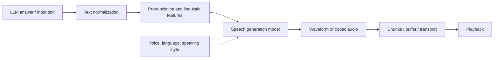
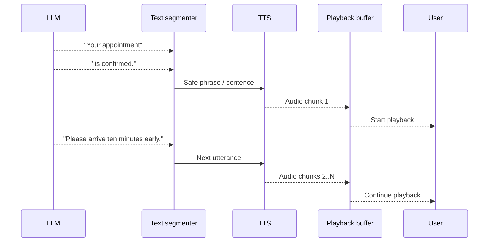
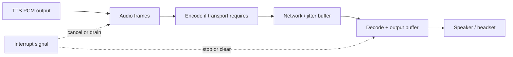
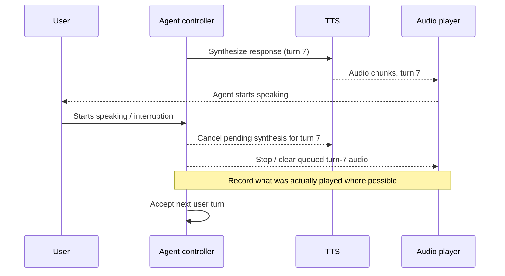

# Text-to-Speech: How to Make a Voice Agent Sound Natural

**Voice AI Engineering Series — Article 04 / 16**  
**Level:** Beginner → Intermediate | **Reading time:** About 18–25 minutes, plus the lab  
**Arabic edition:** [[04-Text-to-Speech-AR|اقرأ بالعربية]]  
**Previous article:** [[03-Speech-to-Text-EN|Speech-to-Text: How Machines Turn Speech into Text]]  
**Series roadmap:** [[00-Series-Roadmap|Voice AI Engineering Roadmap]]

![[assets/tts-cover.png]]

> [!abstract] The one-minute idea
> In [[03-Speech-to-Text-EN|Article 03]], we saw how a speech recognizer turns audio into text; this article goes the other way, from the agent's answer to **speech that is intelligible, natural, low-latency, and stops when the user interrupts**. In a real voice agent, TTS is much more than writing an MP3 file. It covers pronunciation, prosody, incremental synthesis, audio transport, playback buffers, and cancellation.

## A deceptively simple sentence

Imagine an appointment agent saying:

> “Your appointment is confirmed for Thursday at ten thirty in the morning.”

The information may be correct and the experience can still fail. The system might pronounce the date ambiguously, speak in a robotic rhythm, wait several seconds before starting, or keep talking after the caller interrupts it. Each of those is a different kind of failure: **language, sound quality, latency, and conversation management**.

> [!question] Our guiding question
> How do we take text from an LLM and turn it into audio the user can hear promptly, without sacrificing clarity or the ability to stop speaking?

## 1. What is text-to-speech?

**Text-to-Speech (TTS)** is the process of generating a speech-bearing audio signal from text. Its output can be uncompressed PCM, compressed audio, an entire file, or a sequence of audio chunks. It is the opposite direction from **Speech-to-Text (STT)**, which recognizes text from incoming speech.

| Component | Input | Output | Responsibility |
|---|---|---|---|
| **STT** | Human audio | Text | Recognize spoken words |
| **LLM** | Context and instructions | Text / decisions | Decide what the agent will say |
| **TTS** | Text and voice options | Generated audio | Produce the spoken answer |
| **Audio playout** | Audio packets/chunks | Audible output | Buffering, scheduling, playback, interruption |

Not all voice systems use this exact cascade. Some **speech-to-speech** systems generate speech directly from multimodal audio context. We will compare these designs in Article 06.[^openai-audio]

## 2. What happens inside a TTS pipeline?



*Figure 1 — Conceptual stages. Different neural architectures may combine pronunciation, acoustic generation, and waveform synthesis within one model.*

### A. Text normalization

The text written on a screen is not always the text a voice engine should say:

| Raw text | Intended spoken form, depending on context |
|---|---|
| `10:30 AM` | “ten thirty in the morning” |
| `12/05/2026` | A date that requires a specified day/month convention |
| `250 USD` | “two hundred and fifty US dollars” |
| `Dr.` | “Doctor” in a relevant context |
| `API` | Usually the individual letters, not one word |

> [!warning] Do not outsource ambiguous facts to speech synthesis
> The application should make dates, numerical values, and other high-impact information **unambiguous before TTS**. A fluent voice cannot make incorrect input facts correct.

### B. Pronunciation and phonemes

Some TTS architectures rely on text-to-phoneme conversion or other linguistic representations; others learn pronunciation inside a neural network. Correct pronunciation matters especially for names, domain terminology, acronyms, and code-switching. Some engines expose custom pronunciation mechanisms; the details are vendor and model-specific.[^piper-py]

### C. Prosody: what makes speech sound natural?

Natural speech is more than pronounceable syllables. **Prosody** includes pauses, stress, speaking rate, pitch movement, rhythm, and emphasis. The same words can sound warm, reassuring, cold, or awkward based on how they are delivered.

![[assets/tts-prosody.png]]

*Figure 2 — Synthetic teaching example showing possible pitch contours. This is not measured output from a TTS system; more pitch movement does not always mean better speech.*

> [!tip] Improve the written response first
> Before adjusting a voice model's style controls, edit the **text being spoken**: prefer short sentences, straightforward instructions, natural pause points, and explicit terminology. Audio styling cannot reliably rescue confusing language.

## 3. Good sound quality does not guarantee a good conversation

Imagine two agents:

- **Agent A:** Excellent voice quality, but it waits for an entire paragraph before speaking.
- **Agent B:** Good voice quality, but it begins after the first sensible phrase and continues streaming the answer.

Agent B may feel more conversational. Starting early has a cost, though: aggressive early synthesis can fragment the speech or hurt pronunciation. In practice you are trading off **naturalness, first-audio latency, and steady playback**.

### Batch versus streaming TTS

| Dimension | Batch synthesis | Streaming synthesis |
|---|---|---|
| Input | Completed text passage | Complete text or incremental segments, depending on engine |
| Output | Typically a completed result/file | Audio emitted while later audio is still being synthesized |
| Playback start | May wait for the whole output | May begin after sufficient early audio arrives |
| Complexity | Lower | More buffer, scheduling, and cancellation logic |
| Typical use | Narration, messages, stored assets | Interactive, low-latency voice agents |

**Important distinction:** sending a pre-synthesized file through HTTP in chunks is not the same as a model that accepts *incremental text input and produces corresponding audio*. When native streaming is unavailable, frameworks can simulate incremental synthesis by splitting text into sentences; LiveKit documents this approach.[^livekit-nodes]

## 4. Streaming from LLM to TTS



*Figure 3 — A simplified interaction. Individual LLM tokens should not necessarily become individual TTS synthesis requests.*

### Why text chunking matters

An LLM may stream text like:

`"Your" → " appointment" → " is" → " confirmed" → "."`

Forwarding each token separately can destroy prosody, increase request overhead, and create audible gaps. It usually works better to wait for a **linguistically coherent phrase** or short sentence, while imposing a maximum waiting period. Optimal granularity depends on the synthesis model, language, and latency requirements.

## 5. What does time to first audio actually mean?

Teams use **TTFB** inconsistently unless they specify where the measurement is taken. It helps to distinguish four events:

- **First text available:** the first text segment that the LLM has produced for speaking.
- **First generated audio chunk:** the first chunk produced by the TTS engine.
- **First audio byte received:** the first audio byte reaching the client across transport.
- **First sound played:** the first audible output starting on the user's device.

These events happen at different times. Measuring the first generated chunk does **not** prove that the user heard audio at that moment.

![[assets/tts-streaming-timeline.png]]

*Figure 4 — An illustrative timeline, not measured data or a vendor benchmark.*

### Real-time factor (RTF)

A common throughput metric for synthesis is:

$$
RTF = \frac{T_{synthesis}}{T_{generated\ audio}}
$$

If a hypothetical engine requires **0.8 seconds** to generate **4 seconds** of speech, its RTF is **0.2** for that measurement. That is faster-than-real-time synthesis, but it says little about the first audible response, network congestion, or buffer stalls. Be explicit about whether model loading, decoding, disk writing, and other overhead are included.[^livekit-metrics]

## 6. How audio chunks reach the speaker

Recall the PCM basics from [[02-Digital-Audio-for-Developers-EN|Article 02]]. At **24,000 samples/sec**, **mono**, and **16-bit PCM**:

- The raw byte rate is `24,000 × 1 × 2 = 48,000 bytes/second`.
- A **20 ms** frame contains `480 samples` or **960 bytes**.
- Raw PCM cannot be sent as MP3 or Opus without the appropriate encoding or decoding steps.



Keep in mind that **generated**, **queued**, **sent**, and **played** are four different states. A well-built agent tracks the playback cursor where possible and stops obsolete audio from continuing after a new turn starts. We will examine playback-aware interruption in Article 10.

## 7. Your first local TTS experiment with Piper

[Piper](https://github.com/OHF-Voice/piper1-gpl) is a local neural text-to-speech engine. Its Python interface can write WAV files or yield audio chunks you iterate over. Once a voice has been downloaded, synthesis does not need a cloud API key.[^piper-readme][^piper-py]

> [!important] Practical prerequisites
> This experiment **requires installing Piper and downloading a voice model**. The example uses an English voice documented by the project; it does **not** imply that this voice supports Arabic. Check the available voices and **both engine and voice licenses** before distribution or commercial use.

### 7.1 Install the engine and a voice

From the `Voice-Agent-Series` directory:

```bash
python -m pip install piper-tts
python -m piper.download_voices en_US-lessac-medium
```

A one-time internet connection may be necessary for installation and downloading the model. Synthesis runs locally once the files are available.

### 7.2 Synthesize real speech and measure performance

```bash
python examples/tts_piper_demo.py \
  --model en_US-lessac-medium.onnx \
  --text "Hello! Your appointment is confirmed for Thursday." \
  --output examples/tts_piper_output.wav
```

The included script:

1. Loads the Piper voice.
2. Calls `PiperVoice.synthesize()` and receives audio chunks.
3. Writes the chunks to a playable PCM WAV file.
4. Reports **time to first generated chunk**, **synthesis wall time**, **audio duration**, and **RTF**.

**Measurement boundaries:** the timer starts after the model is loaded; playback happens from a saved file, not a remote real-time call. These measurements do **not** include WebRTC transport latency or the time at which a distant listener hears the first word. We did not execute the actual Piper model in this environment; exact speed and sound quality depend on your hardware and selected voice.

### 7.3 An offline metrics lab with no TTS model

If you are not ready to install Piper, start with the standard-library metrics lab:

```bash
python examples/tts_metrics_lab.py examples/demo_16k_mono.wav --compute-seconds 0.2
python -m unittest discover -s examples -p 'test_*.py' -v
```

`demo_16k_mono.wav` is a **synthetic teaching tone from Article 02, not synthesized speech**. It is suitable for verifying WAV metadata, PCM frame sizes, and RTF arithmetic. The `0.2` argument is a **hypothetical duration entered by the reader**, not an automatically observed measurement. Later, pass your actual Piper output file to the same tool.

## 8. How to evaluate a TTS engine for voice agents

| Dimension | Engineering question |
|---|---|
| **Language and accent** | Does it support your users' actual dialects and code-switching? |
| **Pronunciation** | Does it correctly speak names, times, numbers, and abbreviations? |
| **Naturalness** | Are pauses and emphasis suitable for conversation? |
| **First audible output** | When does the end user actually begin hearing speech? |
| **Streaming and cancellation** | Can it accept incremental text, emit early audio, and stop synthesis? |
| **Runtime and cost** | Can it run locally? What hardware, connectivity, and quotas are required? |
| **Privacy and licensing** | Who receives the text and audio, and what rights govern the voice? |

For local work, Piper is one reasonable starting point. With cloud providers, read the **current** API contract carefully. **As of November 21, 2026**, OpenAI's official TTS guide says `tts-1`, `tts-1-hd`, and `gpt-4o-mini-tts` are scheduled for shutdown on **January 6, 2027**, with a migration path to a different Realtime API workflow. We therefore avoid building the core lab around those sunset models.[^openai-tts]

## 9. Arabic and multilingual speech synthesis

For Arabic voice agents, test each of these difficulties separately:

- **Diacritics and ambiguity:** an unvowelled word can have multiple pronunciations or meanings.
- **Numbers and dates:** date conventions should be resolved by the application first.
- **Dialect fidelity:** a model that performs well in Modern Standard Arabic may not sound natural in Levantine or Egyptian Arabic.
- **Code-switching:** a phrase like «رح نعمل reset للـsession» can expose awkward language transitions.
- **Names and identifiers:** incorrect pronunciation of an Arabic name or alphanumeric reference can reduce trust even when the rest of the speech sounds fluent.

> [!example] Suggested test set
> Compare raw text with an intentionally normalized spoken form for: «موعدك يوم الثلاثاء الساعة 10:30»، «رقم الطلب 2026-104»، «نحتاج مراجعة ملف الـAPI»، and two legitimate pronunciations of a name. Do not let normalization change the underlying value or fabricate meaning.

## 10. What happens when a user interrupts the agent?



Stopping synthesis is not enough. The system also needs to **stop or clear output already queued for playback** and handle late-arriving packets. One practical design is to tag audio with a response or turn ID so that obsolete chunks are rejected. This is an architectural pattern, not a universal field guaranteed by all TTS providers.

## 11. A systematic TTS evaluation plan

A single studio-quality sentence is not a benchmark. Evaluate names, digits, long and short responses, speaking styles, accents, interruptions, and realistic device conditions. Combine automatically captured data with human listening tests.

| Metric | What it tells you | Caveat |
|---|---|---|
| **RTF** | Overall synthesis throughput | Does not measure audible-start latency |
| **Time to first generated chunk** | Engine output startup time | Not the first sound heard |
| **Time to first sound played** | User-facing startup experience | Must be observed at the player/device |
| **Audio underruns** | Playback gaps from insufficient buffering | Depends on transport and playback implementation |
| **Pronunciation error rate** | Failures on selected names/numbers | Needs a documented test set and rubric |
| **Human listening evaluation** | Intelligibility, naturalness, and suitability | Requires consistent rating criteria |

**Never compare two providers' first-audio numbers without controlling text length, cold/warm model state, hardware, encoding, and network conditions.** LiveKit's documentation includes practical collection of TTS timing and audio metrics.[^livekit-metrics]

## 12. Common engineering and ethical mistakes

1. **Treating MP3 and PCM as interchangeable.** Compressed audio has a decoding contract.
2. **Passing every LLM token to synthesis.** This can make speech disjointed and expensive.
3. **Conflating first TTS bytes with what the listener hears.** The transport and player matter.
4. **Reporting RTF without defining model warmup.** Comparisons become misleading.
5. **Ignoring Arabic text normalization.** Dates and abbreviations can be mispronounced.
6. **Failing to clear playback during interruptions.** Old responses may leak into the next turn.
7. **Imitating a real person's voice without permission.** Use authorized, properly licensed voices and disclose AI-generated speech as appropriate.[^openai-tts]

## 13. Your assignment

> [!todo] A 30–45 minute lab
> 1. Run `tts_piper_demo.py` for a short English utterance and a longer one.
> 2. Listen to both WAV files, evaluating **pronunciation and pauses**, not only whether the voice sounds pleasant.
> 3. Use `tts_metrics_lab.py` to inspect duration and raw PCM rate.
> 4. Compare the first-chunk interval with full synthesis time; document the model-loading boundary.
> 5. Write an unambiguous date-normalization rule and prepare three Arabic sentences for a voice that supports Arabic.
> 6. Design a way to discard remaining output chunks if the user starts speaking again.

> [!success] Key takeaway
> In a voice agent, TTS is more than “text into an MP3 file”; it is one part of a **real-time conversational system**. Getting it right takes clear input text, correct pronunciation, good prosody, early playback, reliable buffering, and interruption controls that actually work. The next article addresses **what the agent decides to say and what it remembers**: [[05-LLM-and-Conversation-State-EN|LLM & Conversation State]].

---

## Technical references

These sources were consulted for the state of interfaces on **November 21, 2026**. Recheck versions and licensing before production use.

[^piper-readme]: [Open Home Foundation — Piper](https://github.com/OHF-Voice/piper1-gpl) — fast local neural TTS and installation.
[^piper-py]: [Piper — Python API](https://github.com/OHF-Voice/piper1-gpl/blob/main/docs/API_PYTHON.md) — `PiperVoice.load`, `synthesize_wav`, and streaming `synthesize`.
[^piper-cli]: [Piper — CLI guide](https://github.com/OHF-Voice/piper1-gpl/blob/main/docs/CLI.md) — voice downloading and example commands.
[^livekit-nodes]: [LiveKit — Pipeline nodes and hooks](https://docs.livekit.io/agents/logic/nodes/) — TTS hooks, text segmentation, and playback behavior.
[^livekit-metrics]: [LiveKit — TTS metrics](https://docs.livekit.io/reference/recipes/metrics_tts/) — tracking synthesis latency, TTFB, and audio duration.
[^openai-audio]: [OpenAI — Audio and voice](https://developers.openai.com/api/docs/guides/audio) — TTS versus direct audio-to-audio agent workflows.
[^openai-tts]: [OpenAI — Text to speech](https://developers.openai.com/api/docs/guides/text-to-speech) — audio streaming, model sunset, and AI-voice disclosure requirements.

*Editorial: Ibrahim Alobaid — Voice AI Engineering, Article 04.*
