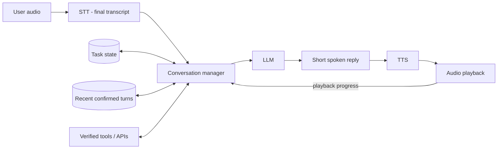
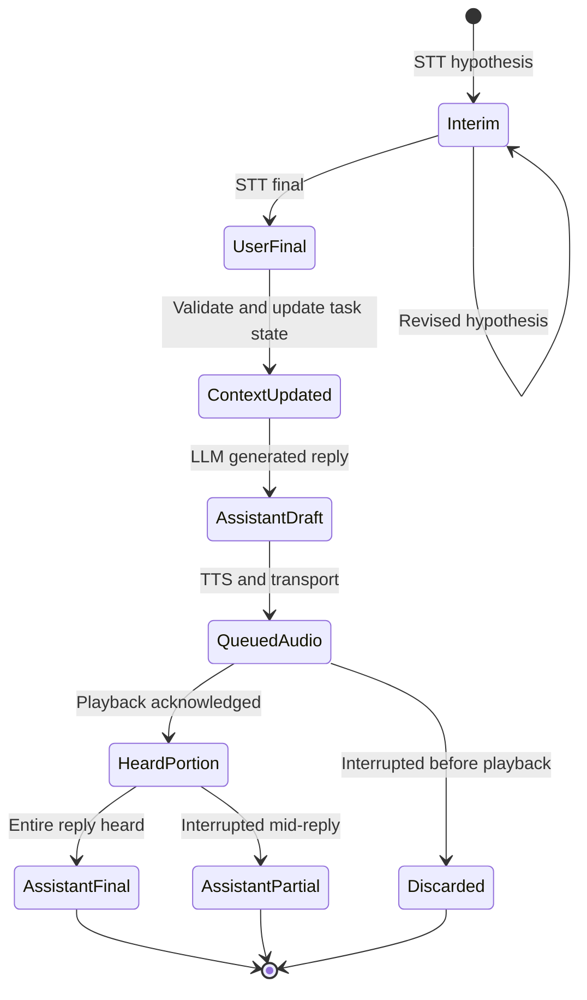
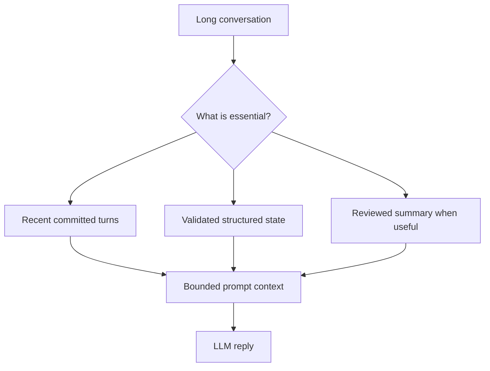

# عقل الوكيل الصوتي: كيف يفهم LLM المحادثة ويحافظ على سياقها؟

**سلسلة هندسة الوكلاء الصوتيين — المقالة 05 / 16**  
**المستوى:** مبتدئ ← متوسط | **زمن القراءة:** 18–25 دقيقة، إضافة إلى المختبر العملي  
**English version:** [[05-LLM-and-Conversation-State-EN|Read in English]]  
**المقالة السابقة:** [[04-Text-to-Speech-AR|كيف نجعل الوكيل الصوتي يتحدث؟]]  
**خارطة السلسلة:** [[00-Series-Roadmap|Voice AI Engineering Roadmap]]

![[assets/llm-conversation-cover.png]]

> [!abstract] الفكرة في دقيقة
> بعد تعلم [[03-Speech-to-Text-AR|تحويل الكلام إلى نص]] و[[04-Text-to-Speech-AR|تحويل النص إلى كلام]]، نصل إلى قلب الوكيل: **النموذج اللغوي الكبير (LLM)**. وظيفته أن يفهم طلب المستخدم ويقرر الرد المناسب؛ لكن **المحادثة الطبيعية تتطلب أكثر من إرسال آخر جملة إلى النموذج**. نحتاج إلى تعليمات واضحة، وسجل محادثة، وحالة مهمة منظمة، وطريقة آمنة لتحديث الحقائق بعد التصحيحات والمقاطعات.

## سؤال يبدأ من محادثة عادية

تخيّل أنك تبني وكيلاً لحجز المواعيد:

> **المستخدم:** أريد استشارة يوم الخميس الساعة العاشرة.  
> **الوكيل:** حسناً، استشارتك يوم الخميس الساعة العاشرة، وسـ...  
> **المستخدم، مقاطعاً:** لا، قصدي الساعة الثالثة عصراً.  
> **الوكيل الجيد:** فهمت، سأعتمد الثالثة عصراً بدلاً من العاشرة. هل تؤكد هذا الوقت؟

في السطر الأخير يبدو السلوك بسيطاً، لكن وراءه أسئلة هندسية:

1. هل يعرف النموذج أنّ عبارة «الثالثة» تصحح «العاشرة» وليست موعداً إضافياً؟
2. كيف يتجنب تكرار بقية الجملة التي لم يسمعها المستخدم؟
3. أين تُحفظ الساعة الجديدة: في الرسائل أم في قاعدة بيانات المهمة؟
4. هل يحق للوكيل أن يقول «تم الحجز» قبل تنفيذ عملية حجز ناجحة؟

هذه هي مشكلة **إدارة سياق المحادثة (Conversation State Management)**.

> [!question] سؤال المقالة
> كيف نمنح الوكيل «ذاكرة عمل» تساعده على فهم ما قيل وما صُحّح وما نُفّذ فعلياً، من دون أن نحمّل النموذج وحده مسؤولية إدارة حالة التطبيق؟

## 1. أين يقع LLM في نظام Voice Agent؟



*الشكل 1 — معمارية متسلسلة (Cascaded). مدير السياق يجمع المدخلات الموثوقة ويحدّث حالة المهمة؛ وليس كل ما يتولد نصياً قد أصبح كلاماً مسموعاً.*

- **STT** يقدّم نص كلام المستخدم، وقد يخرج نصوصاً مؤقتة قبل النتيجة النهائية.
- **LLM** يفسّر الطلب ويولد إجابة أو يقترح استخدام أداة، لكنه لا يثبت بمفرده أن إجراء خارجياً قد نجح.
- **TTS** يحول الإجابة إلى صوت يمكن إرساله وتشغيله.
- **Conversation Manager** ينظم ما يعرفه الوكيل وما أذن له بتنفيذه، وماذا قيل للمستخدم بالفعل.

هذا تصميم هندسي توضيحي؛ بعض أنظمة Speech-to-Speech تدمج أجزاء منه داخل نموذج متعدد الوسائط، لكن مسؤولية حالة المهمة والتحقق من الأفعال لا تختفي.[^realtime]

## 2. ما الفرق بين النموذج، والسياق، والذاكرة؟

هناك ثلاثة مفاهيم تختلط كثيراً:

| المفهوم | معناه | مثال |
|---|---|---|
| **LLM** | نموذج يولّد مخرجات اعتماداً على مدخلاته الحالية | «سأطلب تأكيد الوقت الجديد» |
| **Context Window** | المحتوى الذي يصل إلى النموذج في الطلب الحالي ضمن حد رموزه | التعليمات + آخر الرسائل + ملخص + بيانات المهمة |
| **Application State / Memory** | بيانات يحافظ عليها التطبيق ويراجعها خارج استنتاج النموذج | `appointment.time = "15:00"` |

**لا تفترض أن النموذج يتذكر محادثة سابقة تلقائياً.** طريقة حفظ واستعادة السياق تعتمد على الواجهة المستخدمة: قد تدير أنت سجل الرسائل، أو تستعمل خدمة تحافظ على حالة المحادثة، أو تجمع الحالتين. توضح وثائق OpenAI إمكان إدارة السياق يدوياً أو باستخدام Conversations/Responses APIs.[^openai-state]

### مثال: حقائق قابلة للتحديث وليست فقرة حوار

```json
{
  "intent": "schedule_consultation",
  "slots": {
    "service": "consultation",
    "date": "2026-11-26",
    "time": "15:00"
  },
  "user_approved": false,
  "booking_status": "not_requested"
}
```

*البيانات في المثال افتراضية. تاريخ ووقت الموعد الفعليان يجب تأكيدهما وفق المنطقة الزمنية والتوافر في نظام الحجز.*

يمكن تقديم الحالة المنظمة للنموذج عند إنشاء الرد، لكن **التطبيق** هو الذي يتحقق من صحة الحقول، وصلاحية المستخدم، ونتيجة الحجز.

## 3. أربع طبقات لبناء سياق مفيد

![[assets/llm-context-layers.png]]

*الشكل 2 — يوضح أربع طبقات سياق، لا أربع «ذكريات» متطابقة.*

### الطبقة الأولى — Instructions

تعليمات السلوك: من أنت؟ ما دورك؟ ما حدودك؟ بأي لغة تتحدث؟ ومتى تسأل للتوضيح؟ لا تُخلط هذه التعليمات مع نصوص المستخدم أو محتوى صفحات الويب غير الموثوق.

### الطبقة الثانية — Recent Conversation

الرسائل الأخيرة التي **تم تثبيتها** في سياق المحادثة، مثل سؤال المستخدم النهائي، أو جملة من الوكيل تأكد تشغيلها. في نظام صوتي، لا يساوي سجل نصوص LLM الخام دائماً ما سمعه المستخدم.

### الطبقة الثالثة — Structured Task State

الحقائق المطلوبة لتنفيذ المهمة: نوع الخدمة، التاريخ، الوقت، المنطقة الزمنية، حالة الموافقة، وحالة العملية في النظام الخارجي. هذه طبقة يُنصح بتحديثها بعمليات تحقق واضحة، لا بمجرد تلخيص حر.

### الطبقة الرابعة — Verified External Data

بيانات تأتي من تقويم، أو قاعدة بيانات، أو خدمة حجز، أو سياسة عمل. يجب عرض مصدرها وحداثتها عند الحاجة، والتعامل مع النصوص الخارجية بوصفها **بيانات لا تعليمات موثوقة**.[^owasp]

> [!important] المبدأ الأهم
> **النموذج يقترح ما ينبغي قوله أو فعله؛ أمّا التطبيق فيحدد ما يعرفه يقيناً وما الذي سُمح بتنفيذه، وما إذا كانت النتيجة قد تأكدت.**

## 4. دورة حياة الرسالة: من فرضية STT إلى كلام مسموع

ليست جميع النصوص متساوية من حيث الثقة:



*الشكل 3 — نموذج حالات مفاهيمي. قد تكون للأنظمة الحقيقية أحداث أكثر تفصيلاً، وتبقى صعوبة محاذاة الصوت والنص مرتبطة بمزود الخدمة وآلية التشغيل.*

**لماذا لا نعتمد آخر Transcript مؤقت مباشرة؟** لأن STT قد يغيّر فرضيته قبل إصدار Final Transcript. لا ينبغي تثبيت موعد أو إطلاق إجراء اعتماداً على كلمة مؤقتة غير مؤكدة.

**لماذا لا نحفظ إجابة LLM بمجرد توليدها؟** ربما قاطع المستخدم صوت الوكيل قبل تشغيل نصف الإجابة. إذا خزنّا النص كاملاً فقد نَنسِب إلى الوكيل معلومة لم يسمعها المستخدم أصلاً. تشرح وثائق OpenAI Realtime معالجة المقاطعة وقص الصوت غير المشغّل، مع التنبيه إلى أن محاذاة النص والصوت ليست دائماً دقيقة.[^realtime]

> [!warning] حدّ التبسيط في مختبرنا
> مثال Python اللاحق يعترف فقط بالمقاطع التي اكتمل تشغيلها بحسب إقرار من طبقة التشغيل (**Playback ACK**). لا يدّعي معرفة الكلمات التي سُمعت داخل المقطع الجاري عند وقوع المقاطعة؛ فيحذف هذا المقطع من السياق احتياطياً. لإنتاج نظام حقيقي، يلزم ربط حالة التشغيل بوسائط النقل وقياسات العميل.

## 5. أهم مهارة: تصحيح المعلومات دون فقدان السياق

![[assets/llm-correction-timeline.png]]

*الشكل 4 — تصحيح موعد من 10:00 إلى 15:00، وإلغاء الموافقة القديمة حتى يُطلب تأكيد جديد.*

لنستعرض الحالة خطوة بخطوة:

| الحدث | `time` | `user_approved` | ما يجب فعله |
|---|---|---|---|
| طلب موعد أولي | `10:00` | `false` | جمع البيانات الناقصة |
| وافق المستخدم على التفاصيل | `10:00` | `true` | يمكن طلب الحجز بعد تحقق الشروط |
| قال: «بل الساعة الثالثة» | `15:00` | `false` | تعديل الوقت وإلغاء الموافقة السابقة |
| وافق صراحة على الوقت الجديد | `15:00` | `true` | إرسال طلب الحجز إلى API مصرح بها |
| ردّ API بـ Success | `15:00` | `true` | فقط الآن يمكن تأكيد الحجز للمستخدم |

لاحظ أن **الموافقة على وقت سابق لا تشمل تلقائياً وقتاً معدلاً**. هذا مثال على قاعدة عمل لا ينبغي تركها لاستنتاج LLM.

## 6. كيف نكتب تعليمات مناسبة لوكيل صوتي؟

تحتاج التعليمات إلى توازن بين الإيجاز والطبيعة البشرية والصدق بشأن الأفعال:

```text
ROLE
You are a concise voice assistant for appointment requests.

SPEAKING STYLE
- Answer in the user's language.
- Prefer short, natural sentences suitable for speech.
- Ask one focused question when required information is missing.
- Do not read raw JSON, code, long URLs, or internal identifiers aloud.

STATE AND CORRECTIONS
- Use verified task state for current appointment details.
- If the user corrects a detail, acknowledge the new value.
- Never treat a draft or unheard assistant sentence as delivered.

ACTIONS
- Do not claim that a booking is complete before a trusted API confirms it.
- Obtain explicit approval of updated details before requesting booking.
- If information is unavailable, say so rather than inventing it.
```

**أمثلة عملية للصياغة:**

- إجابة مطولة غير مناسبة للصوت: «يسرني أن أبلغك بأن المعلومات المطلوبة لإتمام العملية قد تمت مراجعتها وفقاً للإجراءات المعتمدة...». 
- إجابة صوتية أفضل: «الموعد يوم الخميس الساعة الثالثة. هل أتابع الحجز؟»

التعليمات ليست بديلاً عن الاختبارات وضوابط الخادم؛ يجب تنفيذ الصلاحيات والتحقق من الأدوات في التطبيق نفسه.[^owasp]

## 7. ماذا نفعل عندما يطول الحوار؟

كلما زاد عدد الأدوار، كبرت تكلفة السياق وازدادت احتمالية إدخال معلومات قديمة أو متعارضة. أمامنا ثلاث وسائل مكملة:

1. **Recent Window:** الاحتفاظ بآخر عدد محدود من الأدوار اللازمة للرد.
2. **Structured State:** الاحتفاظ بالقيم الحالية والمتحقق منها خارج النافذة، حتى لا تضيع تفاصيل المهمة عند حذف الرسائل القديمة.
3. **Summary:** تلخيص السياق السابق عند الحاجة، مع التمييز بين الحقائق المؤكدة والافتراضات، ومراجعة الملخص قبل الاعتماد عليه.

لا تجمع سلسلة المحادثة كلها في كل مرة بلا حدود، ولا تعتمد على ملخص لغوي لتحديد تاريخ أو مبلغ أو موافقة مهمة من دون تحقق. تدعم LiveKit مثلاً عمليات نسخ `ChatContext` واقتطاع أحدث العناصر ونقل السياق عند الانتقال بين الوكلاء.[^livekit]



## 8. المختبر العملي: مدير سياق باستخدام Python

الهدف هنا ليس بناء STT أو LLM جديد، بل عزل **منطق إدارة حالة المحادثة** ليصبح قابلاً للاختبار حتى بدون ميكروفون أو اتصال بالإنترنت.

**ملفات المختبر في هذا المجلد:**

- `examples/voice_context_lab.py` — مدير سياق وحالة مواعيد بسيط.
- `examples/test_voice_context_lab.py` — اختبارات للاعتراف بالمقاطع المشغّلة والتصحيح والموافقة.
- `examples/make_context_figures.py` — الشيفرة المستخدمة لإنشاء مخططي الشرح، تتطلب `matplotlib` إن رغبت في إعادة توليدهما.

من داخل مجلد `Voice-Agent-Series`:

```bash
python examples/voice_context_lab.py
python -m unittest discover -s examples -p 'test_voice_context_lab.py' -v
```

المختبر يستخدم مكتبات Python القياسية فقط، ولا يجري حجزاً حقيقياً ولا يتصل بنموذج ذكاء اصطناعي. يمر بالسيناريو التالي:

```python
from examples.voice_context_lab import VoiceContext

state = VoiceContext()
state.commit_user_turn(
    "Book a consultation on Thursday at 10.",
    {"service": "consultation", "date": "2026-11-26", "time": "10:00"},
)
state.queue_reply([
    "You requested a consultation at ten.",
    "I will now summarize the details.",
])
state.acknowledge_played_segment(0)  # Transport confirms full segment played
state.interrupt_reply()              # Remaining segments are NOT committed
state.commit_user_turn(
    "Actually, make it three in the afternoon.",
    {"time": "15:00"},
)
```

> [!info] مهم بشأن استخراج الحقول
> تُمرر `service/date/time` إلى مدير السياق **بعد** أن تكون طبقة أخرى قد استخرجتها وراجعتها. المثال لا يحل مشكلة تحليل الزمن من اللغة الطبيعية، ولا يتحقق من التوافر أو المنطقة الزمنية أو صلاحية التاريخ؛ هذه مسؤوليات يجب إضافتها في التطبيق الحقيقي.

تبدو خلاصة الحالة المتوقعة هكذا:

```json
{
  "slots": {
    "service": "consultation",
    "date": "2026-11-26",
    "time": "15:00"
  },
  "user_approved": false
}
```

كما تبقى في سجل الوكيل **الجملة التي تأكد تشغيلها فقط**، لا الجملة الثانية التي أُلغيت بسبب المقاطعة. عند استدعاء `approve_current_details()` بعد موافقة صريحة، تسمح `ready_to_request_booking()` **بطلب** الحجز؛ ولا تدّعي أنها نفّذته.

### ماذا تُثبت الاختبارات؟

| الحالة المختبرة | السلوك الصحيح |
|---|---|
| Interim transcript | لا يُثبّت كرسالة نهائية |
| Final transcript | يُضاف إلى سجل المحادثة |
| تعديل الوقت | يحدّث الحقل ويلغي الموافقة السابقة |
| مقاطعة بعد أول مقطع | يُسجَّل المقطع المؤكد فقط |
| مقاطعة قبل تشغيل أي صوت | لا تُضاف إجابة غير مسموعة |
| Playback ACK بترتيب خاطئ | يرفضه مدير السياق |
| رسائل كثيرة | تُعرض أحدث الرسائل وتبقى حقائق المهمة |
| محاولة طلب حجز بلا موافقة | تُرفض |

## 9. ماذا يتغير عند الانتقال إلى الإنتاج؟

المثال التعليمي يثبت منطقاً صغيراً، لكن النظام الحقيقي يحتاج إلى ما هو أكثر:

| الاحتياج | القرار الهندسي |
|---|---|
| **Session isolation** | فصل حالة كل مستخدم وجلسة تماماً عن الآخرين |
| **Concurrency** | معالجة تسابق المقاطعة مع اكتمال TTS أو أداة خارجية |
| **Persistence** | تخزين الحالة عند الحاجة وفق سياسة احتفاظ وموافقة واضحة |
| **Validation** | التحقق من التاريخ والتوقيت والمنطقة الزمنية من مصادر معتمدة |
| **Tool safety** | صلاحيات صريحة، تحقق مدخلات، ومنع الأفعال المكررة |
| **Playback** | تتبع توقيت التشغيل الفعلي والقطع والتأكد قدر الإمكان من المسموع |
| **Observability** | أحداث قابلة للتتبع مع تقليل تسجيل البيانات الحساسة |
| **Recovery** | استعادة آمنة بعد انقطاع الشبكة أو تبديل وكيل أو فشل أداة |

في أنظمة KYC أو الصحة أو الخدمات المالية، تصبح ضوابط الامتثال، والموافقة، والتوثيق، والخصوصية أكثر أهمية، ولا يكفي أن يتذكر النموذج ما قيل في المحادثة.

## 10. أسئلة شائعة وأخطاء ينبغي تجنبها

**هل أرسل كامل المحادثة إلى LLM دائماً؟**  
ليس بالضرورة. اجمع آخر الأدوار الضرورية وحالة المهمة الصحيحة وملخصاً مدققاً عند الحاجة. تعظيم عدد الرموز ليس هدفاً بحد ذاته.

**هل يمكن أن أستخدم LLM لاستخراج التاريخ والوقت؟**  
نعم، كاقتراح منظّم، لكن تحقّق منه قبل تحديث حالة المهمة أو استدعاء خدمة خارجية؛ خصوصاً إذا كان الكلام ملتبساً أو ينقصه تاريخ أو منطقة زمنية.

**هل محرك LLM هو ذاكرة المستخدم؟**  
لا. سياق الطلب محدود، أما الذاكرة المستمرة فهي قرار تصميم وتخزين وصلاحيات وسياسة خصوصية داخل التطبيق أو الخدمة المستخدمة.

**هل يمكن تجاهل كلام الوكيل المقطوع؟**  
لا يجب افتراض أن المستخدم سمع الإجابة كاملة. في المقابل لا تدّعِ محاذاة كلمة بكلمة ما لم تدعمها منظومة التشغيل فعلاً.

**هل حفظ اسم المستخدم أو رقم الهوية داخل Prompt مفيد دائماً؟**  
فقط إن كان ضرورياً ومصرحاً به. طبّق تقليل البيانات وتجنّب إدراج المعلومات الحساسة غير اللازمة في السجلات أو الملخصات.

## 11. تمارين لتثبيت المفهوم

- **تمرين 1:** أضف حقلاً `timezone`، واجعل مدير السياق يرفض طلب الحجز إن لم يحدده التطبيق بوضوح.
- **تمرين 2:** أضف `booking_status` بحالات `not_requested`, `pending`, `confirmed`, `failed`، واجعل قول «تم الحجز» مشروطاً بوصول نتيجة API موثوقة.
- **تمرين 3:** اكتب اختباراً لمقاطعتين متتاليتين تتداخلان مع اكتمال صوت TTS.
- **تمرين 4:** جرّب نصاً عربياً مختلطاً بالإنجليزية، وافصل بين استخراج الحقول والاستجابة المحكية.

> [!success] ماذا ينبغي أن تتذكر؟
> **LLM ليس مدير الحالة الوحيد.** الوكيل الجيد يعرف الفرق بين نص متوقع ونص نهائي، وبين إجابة مولّدة وصوت مسموع، وبين معلومة قالها المستخدم ومعلومة أكدها نظام خارجي. عندما نفصل هذه المفاهيم ونختبرها، تصبح المحادثة أكثر طبيعية وموثوقية.

## ما التالي؟

في **المقالة السادسة: Cascaded vs. Speech-to-Speech Architecture** سنقارن تصميم `STT → LLM → TTS` بالنماذج الصوتية المباشرة: أين نكسب المرونة وقابلية المراقبة؟ أين نخسر في التأخير؟ وكيف نختار المعمارية وفق متطلبات المنتج؟

**ارجع إلى:** [[00-Series-Roadmap|خارطة السلسلة]] | [[05-LLM-and-Conversation-State-EN|English edition]]

---

## المصادر والمراجع

[^livekit]: [LiveKit — Chat context](https://docs.livekit.io/agents/logic/chat-context/)؛ يشرح إنشاء السياق وتعديله واقتطاعه ومروره بين الوكلاء.
[^openai-state]: [OpenAI — Conversation state](https://developers.openai.com/api/docs/guides/conversation-state)؛ يشرح إدارة الرسائل والسياق عبر الواجهات.
[^realtime]: [OpenAI — Realtime conversations](https://developers.openai.com/api/docs/guides/realtime-conversations)؛ يتناول حالة المحادثة والتشغيل والمقاطعة وقطع أجزاء الصوت غير المشغلة.
[^owasp]: [OWASP — LLM Prompt Injection Prevention Cheat Sheet](https://cheatsheetseries.owasp.org/cheatsheets/LLM_Prompt_Injection_Prevention_Cheat_Sheet.html)؛ ضوابط التعامل مع مدخلات غير موثوقة والأفعال الخارجية.

*ملاحظة تحريرية: المخططات والأمثلة أعلاه تعليمية، ولا تعبّر عن قياس أداء أو تطبيق إنتاجي مكتمل. راجع الوثائق الرسمية عند تطبيق واجهات SDK المتغيرة.*
