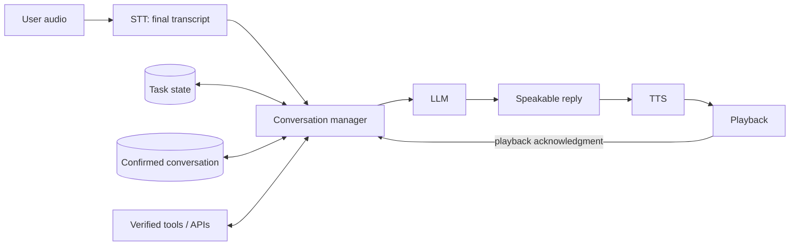
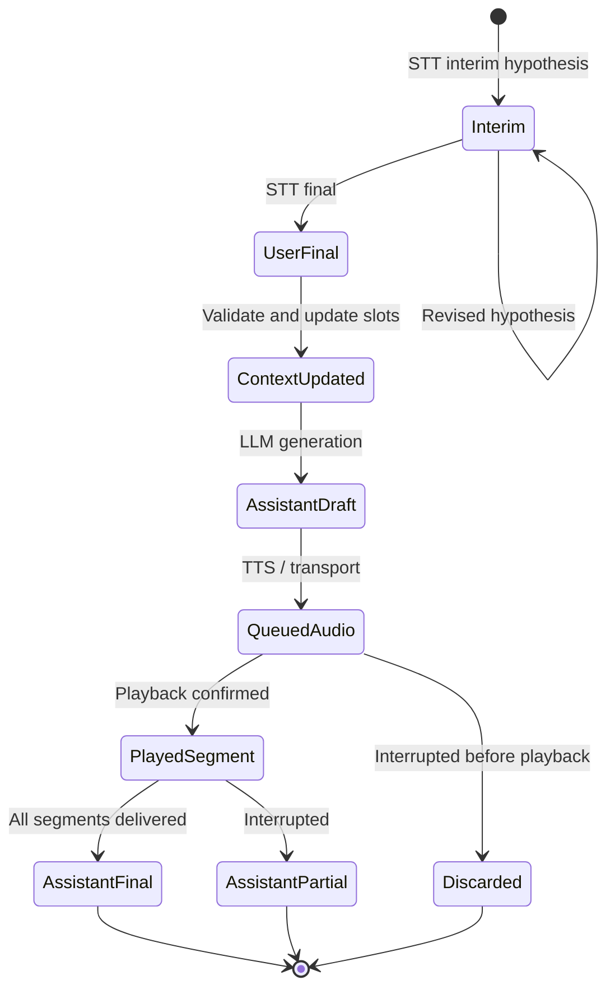
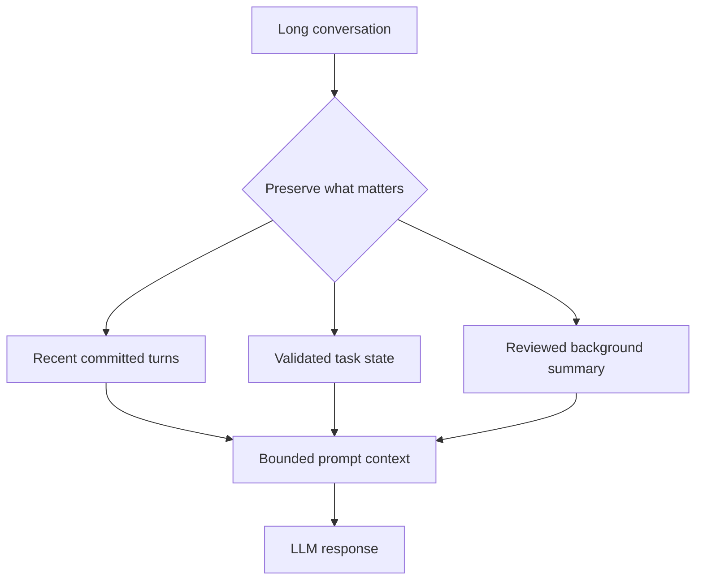

# The Voice Agent's Brain: How LLMs Maintain Conversation Context

**Voice AI Engineering — Article 05 / 16**  
**Level:** Beginner → Intermediate | **Reading time:** 18–25 minutes, plus the hands-on lab  
**العربية:** [[05-LLM-and-Conversation-State-AR|اقرأ المقالة بالعربية]]  
**Previous:** [[04-Text-to-Speech-EN|Text-to-Speech and Streaming]]  
**Series roadmap:** [[00-Series-Roadmap|Voice AI Engineering Roadmap]]

![[assets/llm-conversation-cover.png]]

> [!abstract] In one minute
> We now know how [[03-Speech-to-Text-EN|STT transcribes speech]] and how [[04-Text-to-Speech-EN|TTS speaks a reply]]. Between those stages sits the **large language model (LLM)**. It interprets what the user wants and produces an appropriate response. Yet a natural voice conversation requires more than passing the latest transcript to a model: it also needs instructions, reliable history, structured task state, and a precise approach to corrections and interrupted speech.

## A simple conversation with a hidden engineering problem

Consider a voice assistant that schedules appointments:

> **User:** I'd like a consultation on Thursday at ten.  
> **Agent:** So that's Thursday at ten, and I'll just—  
> **User, interrupting:** Actually, make it three in the afternoon.  
> **Good agent:** Understood, three in the afternoon instead of ten. Can you confirm the new time?

That last line seems trivial. Behind it, the system must answer four difficult questions:

1. Did “three” replace the old time or create a second appointment?
2. Which part of the previous reply did the user actually hear?
3. Where is the corrected time stored and validated?
4. Can the assistant truthfully say “booked” before an external booking system confirms success?

These are not just prompt-writing questions. They form the foundation of **conversation state management**.

> [!question] The central question
> How do we give a voice agent reliable working context—what was said, what was corrected, and what actually happened—without delegating the application's entire state to probabilistic text generation?

## 1. The LLM's position in the voice pipeline



*Figure 1 — A conceptual cascaded architecture. Not everything generated by an LLM has necessarily been heard by the user.*

Each component has a different responsibility:

| Component | Its job | What it does not guarantee |
|---|---|---|
| **STT** | Transcribe speech | A partial hypothesis is not necessarily final |
| **LLM** | Interpret and formulate a response or tool request | The booking actually exists |
| **TTS** | Produce audio from the reply | The user actually heard the audio |
| **Playback system** | Deliver and play audio | Accurate word-level alignment without extra instrumentation |
| **Conversation manager** | Maintain verified state and history | Correctness of unknown external facts without verification |

Some speech-to-speech systems collapse multiple stages into one multimodal model, but they do not remove the need for valid task state and authorization checks.[^realtime]

## 2. A model is not the same as memory

These three concepts are often confused:

**LLM:** the inference engine producing the current response from the input presented to it.

**Context window:** the bounded collection of instructions, messages, and data supplied to the model for the current turn.

**Application memory/state:** the information the surrounding application stores and updates, potentially across requests or sessions.

A model does not automatically retain the history of earlier, unrelated requests unless that history is made available through the API or application. OpenAI, for example, documents both manual history handling and stateful Conversations/Responses patterns.[^openai-state]

Imagine that a user has corrected a consultation from `10:00` to `15:00`. Instead of trusting the model to reconstruct the latest facts from a long transcript, store a validated task object:

```json
{
  "intent": "schedule_consultation",
  "slots": {
    "service": "consultation",
    "date": "2026-11-26",
    "time": "15:00"
  },
  "user_approved": false,
  "booking_status": "not_requested"
}
```

*Illustrative data only. A real appointment requires a validated calendar date, timezone, availability, and explicit approval.*

The model can read this object when preparing its next answer. The application—not the model's wording—must verify external actions and their outcomes.

## 3. Four layers of reliable context

![[assets/llm-context-layers.png]]

*Figure 2 — Four types of contextual input, each with a distinct trust level and purpose.*

### Layer A: Instructions

These define role, tone, restrictions, language choice, and escalation behavior. They should be managed separately from user-supplied messages and untrusted retrieved content.

### Layer B: Recent conversation

A compact history of finalized user turns and assistant speech that can legitimately be treated as delivered. A raw generation log is not a perfect record of what a human heard.

### Layer C: Structured task state

Fields such as `service`, `date`, `time`, timezone, user approval, and action status. These belong to application-level state with validation and explicit transitions.

### Layer D: Verified external facts

Calendar availability, authorized account data, policy rules, and tool results. Track their origin and freshness. Content retrieved from a webpage or an untrusted tool may contain malicious instructions, so **data must not be promoted into trusted instructions**.[^owasp]

> [!important] The central design rule
> Let the LLM propose what to say or what tool to request. Let application logic establish the current facts, authorization, and the result of any external operation.

## 4. A conversation turn has a lifecycle

In a text-only chatbot, one reply may appear almost instantly. In a real-time voice system, several versions of the “same message” can coexist:



*Figure 3 — A simplified event/state model. Real transports may expose additional timing and cancellation events.*

**Interim is not final.** An STT engine may revise its partial transcription several times. Don't update business state or invoke external actions solely because an interim string looks plausible.

**Generated is not heard.** The LLM may have produced a complete answer, and TTS may even have synthesized it, while the user has heard only its beginning. The OpenAI Realtime documentation discusses interruption handling and truncation of unplayed output, including the limitation that textual alignment with played audio may be imperfect.[^realtime]

> [!warning] Our lab is intentionally conservative
> The demo accepts a playback acknowledgment only when an **entire segment** has finished playing. If interruption happens inside the next segment, that unfinished segment is omitted from committed history. This does not claim perfect word-level knowledge of what was heard.

## 5. Corrections: updating facts without losing the conversation

![[assets/llm-correction-timeline.png]]

*Figure 4 — Changing an appointment time from 10:00 to 15:00 must invalidate any previous approval.*

| Event | Current time | Approved? | Appropriate behavior |
|---|---|---|---|
| User initially requests a time | `10:00` | No | Gather any missing information |
| User explicitly confirms | `10:00` | Yes | A booking request may be attempted if authorized |
| User corrects the time | `15:00` | No | Replace the field, reset approval |
| User confirms the correction | `15:00` | Yes | Request booking through an authorized API |
| API confirms success | `15:00` | Yes | Now, and only now, report success |

An approval for one set of details should not automatically carry forward to a changed set. This is an application rule, not an LLM personality setting.

## 6. Prompt instructions for spoken responses

A good voice prompt is not simply a traditional chatbot prompt with “speak naturally” added at the end. It should enforce short, sayable outputs and honest status reporting.

```text
ROLE
You are a concise voice assistant for appointment requests.

SPEAKING STYLE
- Respond in the user's language.
- Prefer short, natural sentences.
- Ask one focused question if essential details are missing.
- Never read raw JSON, code, long links or IDs aloud.

STATE AND CORRECTIONS
- Use the current verified task state for appointment details.
- Explicitly acknowledge corrected information.
- Do not assume that generated but unplayed speech was heard.

TOOLS AND ACTIONS
- Never claim a booking succeeded before the trusted API confirms it.
- Seek explicit approval of any changed details before booking.
- Say when required information is unavailable; do not invent it.
```

**Written style:** “We would like to inform you that your requested appointment details have been successfully received and are currently being processed...”

**Spoken style:** “Thursday at three. Should I go ahead and book it?”

One caution: prompting by itself is not a security boundary. Tool permissions, input validation, and action confirmation must be enforced outside the model.[^owasp]

## 7. What happens as conversations get longer?

Keeping every message forever in every prompt is not a scalability strategy. As the conversation grows, you may increase cost and include outdated or contradictory statements.

Use three complementary mechanisms:

1. **Recent-turn window:** include only the most useful recent committed messages.
2. **Structured state:** retain current, validated task facts outside that window.
3. **Reviewed summary:** compress background context when needed, but don't treat a free-form summary as authoritative proof of a date, amount, consent, or completed action.

LiveKit's `ChatContext` documentation describes creating, copying, truncating, merging, and passing context through agent handoffs.[^livekit]



## 8. Hands-on lab: a dependency-free conversation manager

The point of this exercise is to test **conversation state transitions** independently of STT, LLM hosting, TTS, or a live microphone. This makes failures easier to reproduce.

The files shipped with this article are:

- `examples/voice_context_lab.py` — a deterministic appointment state manager.
- `examples/test_voice_context_lab.py` — unit tests for interim/final transcription, corrections, approval, and playback acknowledgments.
- `examples/make_context_figures.py` — source for the two diagrams in this article (optional `matplotlib`).

Run from the `Voice-Agent-Series` directory:

```bash
python examples/voice_context_lab.py
python -m unittest discover -s examples -p 'test_voice_context_lab.py' -v
```

The core scenario is:

```python
from examples.voice_context_lab import VoiceContext

state = VoiceContext()
state.commit_user_turn(
    "Book a consultation on Thursday at 10.",
    {"service": "consultation", "date": "2026-11-26", "time": "10:00"},
)
state.queue_reply([
    "You requested a consultation at ten.",
    "I will now summarize the details.",
])
state.acknowledge_played_segment(0)  # First whole audio segment finished
state.interrupt_reply()              # Discard the remaining unplayed text
state.commit_user_turn(
    "Actually, make it three in the afternoon.",
    {"time": "15:00"},
)
```

**Crucial boundary:** `commit_user_turn` takes *already extracted and validated* slot values. The demo does not parse time from natural speech, perform timezone handling, check calendar availability, call an LLM, or execute booking operations.

The resulting state looks like:

```json
{
  "slots": {
    "service": "consultation",
    "date": "2026-11-26",
    "time": "15:00"
  },
  "user_approved": false
}
```

The conversation also preserves only the first acknowledged spoken segment. The unplayed segment never enters committed history. Calling `approve_current_details()` after real, explicit approval can enable `ready_to_request_booking()`, which means **eligible to request a booking**, not **booking confirmed**.

### What the tests exercise

| Scenario | Expected outcome |
|---|---|
| STT interim hypothesis | Not recorded as a final turn |
| STT final event | Stored as a user turn |
| New time replaces old time | Task state updated; approval reset |
| Interrupt after one segment | Only that acknowledged segment is committed |
| Interrupt before audio playback | No assistant message is committed |
| Out-of-order playback ACK | Rejected |
| History exceeds recent window | Old turns omitted but task state remains |
| Booking requested without approval | Not eligible |

## 9. Preparing the architecture for production

A teaching demo does not include all of the controls required by a reliable real-time application:

| Requirement | Production implication |
|---|---|
| Session isolation | Prevent data leakage between users, tenants, or calls |
| Concurrency | Make interrupt, playback ACK, and tool-completion races deterministic |
| Persistence | Apply retention rules, encryption, deletion policies, and consent |
| Validation | Verify dates, timezones, service identity, and availability |
| Tool authorization | Enforce permissions and idempotency independently of the model |
| Playback accounting | Observe what finished playing; use precise alignment only if available |
| Monitoring | Track changes, failures, and latency without unnecessary PII |
| Recovery | Handle reconnection, handoffs, retries, and tool errors safely |

This distinction is especially important in identity verification, healthcare, and financial workflows, where conversation quality alone cannot establish a safe or valid decision.

## 10. Common questions and mistakes

**Should I always send the entire chat history?**  
No. Maintain a relevant recent window plus validated task state and carefully reviewed summaries as needed.

**Can an LLM extract appointment fields?**  
Yes, it can propose structured fields. An application must still validate them, resolve ambiguities, and check authoritative sources before action.

**Is LLM context the same as persistent user memory?**  
No. Persistence, retention, access control, and user consent are separate product decisions.

**Can I save every generated assistant reply as if it were spoken?**  
Not safely in an interruptible system. Generated text, synthesized audio, transmitted audio, and confirmed playback are distinct events.

**Should I store all sensitive details in a summary?**  
Only data necessary for the task, permitted by policy, and protected appropriately. Minimize what you collect and log.

## 11. Exercises

- **Exercise 1:** Add a `timezone` field and require it before allowing any booking request.
- **Exercise 2:** Introduce `booking_status = not_requested | pending | confirmed | failed`; only report success after a trusted tool result.
- **Exercise 3:** Simulate two rapid interruptions and an overlapping TTS completion event.
- **Exercise 4:** Try mixed Arabic/English user instructions while keeping extraction, state, and spoken output separate.

> [!success] Key takeaway
> **An LLM is not the only owner of conversation state.** A reliable voice agent knows the difference between interim text and finalized user speech, generated replies and played audio, user-provided details and externally verified outcomes. Those distinctions make interruption handling testable and conversations genuinely more trustworthy.

## Coming next

**Article 06: Cascaded vs. Speech-to-Speech Architecture** explores the practical tradeoffs between `STT → LLM → TTS` and direct audio-to-audio models: modularity, observability, latency, interruption behavior, and product requirements.

**Navigate:** [[00-Series-Roadmap|Series roadmap]] | [[05-LLM-and-Conversation-State-AR|Arabic edition]]

---

## References

[^livekit]: [LiveKit — Chat context](https://docs.livekit.io/agents/logic/chat-context/): building, copying, truncating, and handing off agent conversation context.
[^openai-state]: [OpenAI — Conversation state](https://developers.openai.com/api/docs/guides/conversation-state): stateful and manually managed conversation patterns.
[^realtime]: [OpenAI — Realtime conversations](https://developers.openai.com/api/docs/guides/realtime-conversations): audio sessions, interruption, and truncation of unplayed output.
[^owasp]: [OWASP — LLM Prompt Injection Prevention Cheat Sheet](https://cheatsheetseries.owasp.org/cheatsheets/LLM_Prompt_Injection_Prevention_Cheat_Sheet.html): trust boundaries, untrusted content, and external action safeguards.

*Editorial note: All diagrams and examples are educational, not production benchmarking or a complete voice framework implementation. Consult the current SDK docs before integrating provider-specific event APIs.*
