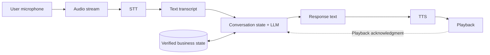
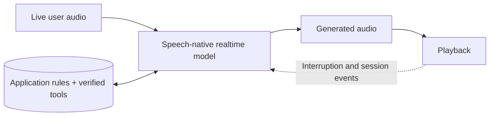
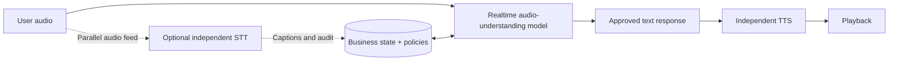
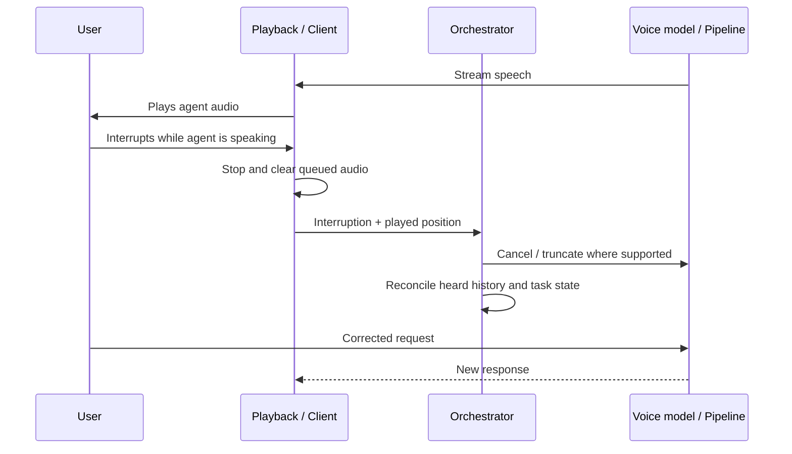

# كيف نختار معمارية الوكيل الصوتي؟ من STT → LLM → TTS إلى Speech-to-Speech

**سلسلة Voice AI Engineering — المقالة 06 / 16**  
**المستوى:** مبتدئ → متوسط | **مدة القراءة:** 18–25 دقيقة + المختبر  
**English:** [[06-Cascaded-vs-Speech-to-Speech-EN|Read in English]]  
**السابقة:** [[05-LLM-and-Conversation-State-AR|عقل الوكيل الصوتي وإدارة سياق المحادثة]]  
**الفهرس:** [[00-Series-Roadmap|خارطة السلسلة]]

![[assets/voice-architectures-cover.png]]

> [!abstract] ملخص المقالة
> تناولنا في المقالات السابقة التعرف على الكلام (STT)، وتوليد الرد بالنموذج اللغوي (LLM)، وتحويل النص إلى صوت (TTS)، لكن الوكيل الصوتي لا يحتاج دائماً إلى ثلاثة نماذج منفصلة موصولة ببعضها. نقارن في هذه المقالة بين ثلاث معماريات: **Cascaded** و**Realtime Speech-to-Speech** و**Hybrid**. ويؤثر اختيارك بينها في درجة التحكم، وجودة المحادثة، وإمكانية التدقيق، وزمن الاستجابة، وتكلفة التشغيل.

## 1. سؤال يسبق اختيار النموذج

تخيّل وكيلاً صوتياً يحجز المواعيد، ودار بينه وبين المستخدم الحوار التالي:

> **المستخدم:** احجز لي موعداً يوم الخميس الساعة العاشرة.  
> **الوكيل:** حسناً، سأتحقق من المواعيد المتاحة...  
> **المستخدم، مقاطعاً:** لحظة، أقصد الثالثة بعد الظهر!

تحتاج المنظومة إلى سماع التصحيح، وإيقاف الصوت الجاري، وتحديث الوقت السابق، ثم طلب تأكيد جديد قبل تنفيذ الحجز. وقد ترغب أيضاً في الاحتفاظ **بنص موثوق للمحادثة** لمراجعة الأخطاء.

الآن غيّر السيناريو: الوكيل مدرّب لغة، ويجب أن يفهم التردد والنبرة والمزاح، وأن يرد بطريقة سريعة ومتفاعلة. قد تصبح **الإشارات الصوتية** أهم من سهولة مراجعة النص المكتوب.

> [!question] السؤال الهندسي
> هل نحتاج تحكماً دقيقاً بمراحل الاستماع والتفكير والكلام، أم نحتاج تفاعلاً صوتياً غنياً ومباشراً؟ ما نبحث عنه هو المعمارية الأنسب **لمتطلبات المنتج**، لا «أفضل نموذج» على الإطلاق.

## 2. المعمارية المتسلسلة — Cascaded Pipeline



تستخدم معمارية **Cascaded** ثلاثة مكونات متخصصة: STT يحوّل الصوت إلى نص، ثم LLM يفهم النص ويُنتج الرد، ثم TTS يُولّد صوت الإجابة. الحدود بين المكونات واضحة، ويمكن اختبار كل مرحلة أو استبدالها وحدها.[^livekit-pipelines]

**لماذا يفضّلها كثير من المهندسين؟**

- **سهولة تتبع الأخطاء:** يمكن فحص نص STT، والرد الذي اختاره LLM، ثم الصوت الصادر من TTS.
- **مرونة اختيار المزود:** تستطيع تغيير STT من دون إعادة بناء واجهة الرد بالكامل.
- **نصوص جاهزة للتدقيق:** وجود نص وسيط يسهل البحث والمراجعة وإنشاء واجهة Subtitles، مع التذكير بأن النص قد يحتوي أخطاء في التعرف على الكلام.
- **التحكم في الكلام:** يستطيع TTS نطق نص محدد بعد التحقق منه؛ ميزة مهمة لرسائل التأكيد والتعامل مع إجراءات منظمة.

**لكنها ليست مجانية من ناحية التأخير.** كل مرحلة تحتاج معالجة وتبادلاً للبيانات، وقد تفقد بعض المعلومات مثل التردد والنبرة لأن LLM يتعامل أساساً مع النص المستخرج. يمكن تعويض جزء من الفقد بإضافة إشارات صوتية مستقلة، لكن ذلك يزيد التعقيد.[^livekit-pipelines]

> [!tip] لا تخلط بين «متسلسلة» و«غير متدفقة»
> يمكن أن تعمل هذه المعمارية بأسلوب **Streaming**: يرسل STT نتائج مؤقتة، ويُنتج LLM رموزاً تدريجية، ويحوّل TTS أجزاء من الرد إلى صوت قبل اكتمال النص. وهكذا تتداخل المراحل زمنياً، ولا تنتظر كل مرحلة انتهاء التي قبلها.

## 3. المعمارية الصوتية المباشرة — Speech-to-Speech



في معمارية **Speech-to-Speech (S2S)** يستقبل نموذج متعدد الوسائط الصوت مباشرة ويولّد صوتاً، بدلاً من اعتماد واجهة STT نصية منفصلة ومحرك TTS مستقل في مسار الاستجابة. هذا **لا يعني** بالضرورة غياب التمثيلات النصية أو عمليات تعرف الصوت داخلياً؛ بل يعني أن التطبيق لا يحتاج إلى ربط تلك المراحل الثلاث بوصفها خدمات مستقلة.[^livekit-pipelines]

أبرز ما قد تكسبه:

- تقليل عمليات التسليم بين النماذج، ما قد يحسن زمن الاستجابة.
- الاستفادة من خصائص النبرة والإيقاع والتردد التي قد تضيع في تفريغ نصي مجرد.
- إنتاج كلام أكثر تعبيراً، بحسب إمكانات النموذج والصوت واللغة.

لكن انتبه: **Speech-to-Speech لا يساوي Full-Duplex دائماً**.

| النمط | السلوك |
|---|---|
| **Turn-based Realtime** | ينتظر عادة نهاية دور المستخدم قبل بدء الرد، مع إمكان دعم المقاطعات. |
| **Full-Duplex** | يستطيع معالجة الكلام الوارد والرد الصوتي في الوقت نفسه، إذا كانت المنظومة والنموذج يدعمان ذلك فعلاً. |

توضح وثائق LiveKit هذا الفرق، كما توضّح أن قدرات النصوص المؤقتة والكلام الحرفي وإدارة المقاطعات تختلف بين نماذج Realtime.[^livekit-realtime]

**الثمن المحتمل:** رؤية أقل إلى المراحل الداخلية، وتحكم أقل في ألفاظ الرد بالضبط، واعتماد أكبر على واجهة مزود واحد. وقد تأتي التفريغات النصية متأخرة أو لا تكون متاحة بالصيغة الحية التي يحتاجها التطبيق.[^livekit-realtime]

## 4. خيار ثالث مهم: Hybrid

ليس من الضروري الالتزام بأحد الطرفين.



في مثال **Hybrid** يمكن لنموذج صوتي آني فهم المدخلات الصوتية ونبرتها، لكنه يخرج **نصاً** يمر عبر ضوابط التطبيق ثم يحوّله TTS مستقل إلى كلام. يمكن أيضاً تشغيل STT منفصل للأغراض التي تتطلب نصوصاً متدفقة أو سجلاً قابلًا للتدقيق.[^livekit-realtime]

هذه المعمارية مفيدة إذا أردت الحفاظ على فهم الصوت المباشر مع التحكم بصوت المخرجات ونصها. لكنها ليست متاحة بالنمط نفسه لكل نموذج أو مزود، وقد تزيد التكاليف والتعقيد. **Full-Duplex ودعم Hybrid خاصيتان منفصلتان؛ لا تفترض أن نموذجاً يدعم كليهما.**

![[assets/voice-architecture-comparison.png]]

*الشكل 1 — ثلاثة مسارات مفاهيمية. المخطط تعليمي وليس وعداً بدعم كل تركيب من جميع المزودين.*

## 5. مقارنة هندسية عملية

| معيار الاختيار | Cascaded STT–LLM–TTS | Realtime S2S | Hybrid |
|---|---|---|---|
| **قابلية تبديل كل نموذج** | عالية عادة | محدودة نسبياً | متوسطة |
| **ظهور النص والتدقيق** | أقوى؛ الحدود النصية واضحة | قد يتأخر التفريغ أو يحتاج قناة إضافية | بحسب وجود STT مستقل |
| **الاستفادة من النبرة الصوتية** | محدودة في المسار النصي التقليدي | مباشرة غالباً | مباشرة عند المدخل |
| **نطق تعليمات حرفية** | أسهل مع TTS | أقل ضماناً | جيد عند التحكم بنص TTS |
| **زمن الاستجابة** | قد تزيده المراحل؛ يحسّنه Streaming | قد يكون أقل بتقليل التحويلات | يعتمد على تكوينه |
| **تعقيد المراقبة** | متعدد المكونات، واضح المراحل | أقل حدوداً، أصعب في التفسير | أعلى تكويناً |
| **المقاطعات** | تتطلب تنسيق STT/TTS/التشغيل | تعتمد على النموذج والواجهة | تتطلب تنسيق المكونات |
| **التكلفة** | مجموع تكاليف STT وLLM وTTS والبنية | تسعير صوت/زمن/رموز بحسب المزود | يتضمن مكونات إضافية |

> [!important] لا تصدر حكماً نهائياً من الجدول
> «الأسرع» و«الأرخص» و«الأكثر طبيعية» نتائج **قياس** وليست صفات ثابتة لكل النماذج. اختبر لغة المستخدم، والجهاز، والشبكة، وطول المحادثة، وكثافة استخدام الأدوات، وأوقات الذروة.

## 6. كيف نحسب Latency بطريقة صحيحة؟

في المقالة [[04-Text-to-Speech-AR|الرابعة]] ناقشنا زمن أول دفعة صوتية. الآن نحتاج إلى تحديد نقطة بداية ونهاية القياس:

\[
L_{\mathrm{response}} = t_{\mathrm{first\ audible\ audio}} - t_{\mathrm{user\ speech\ end}}
\]

هذا هو **زمن بدء الصوت المسموع** بعد انتهاء المستخدم من الكلام. وهو يختلف عن `LLM TTFT` أو `TTS TTFB` أو وقت وصول أول حزمة إلى الشبكة؛ فقد تكون البيانات جاهزة ولم يبدأ تشغيلها بعد.[^livekit-traces]

في المعمارية المتسلسلة قد تمر الاستجابة بعدة مراحل: كشف نهاية الدور، واعتماد التفريغ النهائي، وبداية إخراج LLM، وتجهيز أول صوت من TTS، ثم Buffering والتشغيل. **لكن لا تجمع متوسطات كل خدمة جمعاً أعمى:** بعض المراحل تتداخل أو تعمل بالتوازي، ولا يحدد زمن انتظار المستخدم إلا ما يقع منها على المسار الحرج.

![[assets/voice-architecture-latency.png]]

*الشكل 2 — أرقام افتراضية **مصطنعة بالكامل للتوضيح**: 780ms مقابل 450ms في مثال تعليمي واحد. ليست قياساً لخدمة أو منتج، ولا دليلاً على تفوق معماري عام.*

### مقاييس ينبغي جمعها

| المقياس | ماذا يخبرنا؟ |
|---|---|
| **End-to-first-audible-audio** | كم ينتظر المستخدم من نهاية كلامه حتى يسمع الرد؟ |
| **P50 / P95** | الأداء الوسيط وتجربة المستخدمين في الحالات الأبطأ. |
| **Interruption-stop latency** | الزمن من بداية مقاطعة المستخدم حتى توقف تشغيل صوت الوكيل. |
| **Turn detection errors** | هل بدأ الرد مبكراً أو تأخر بسبب سوء فهم نهاية الكلام؟ |
| **Transcript quality** | دقة النص، إذا كان مطلوباً للواجهة أو التدقيق أو الأفعال. |
| **Task completion / correction rate** | هل فهم الوكيل الطلب والتصحيح ونفّذ الإجراء الصحيح؟ |
| **Cost per successful task** | التكلفة الفعلية للمهمة المكتملة، لا مجرد سعر دقيقة صوتية. |

تقدم LiveKit تعريفات دقيقة لمقاييس مثل E2E وSTT delay وEOT وLLM TTFT وTTS TTFB، ولها مسارات توقيت مستقلة للنماذج الآنية.[^livekit-traces]

## 7. المقاطعات ليست ميزة نموذج وحده



سواء استخدمت Cascaded أم S2S، يجب التفريق بين **الصوت المُولّد** و**الصوت المرسَل** و**الصوت الذي شُغّل فعلياً**. وقد تتطلب المقاطعة إيقاف التشغيل على العميل أولاً، ثم إلغاء توليد جديد وتحديث سياق المحادثة. توضح وثائق OpenAI Realtime أن إجراء `conversation.item.truncate` يمكن استخدامه لمزامنة السياق مع مدة الصوت الذي شُغّل فعلاً، لكن محاذاة النص مع الصوت ليست مثالية دائماً.[^openai-interruptions]

**لا تفترض** أن كشف VAD وحده يعني أن تجربة المقاطعة ممتازة، أو أن كل نموذج Full-Duplex يوقف توليده الداخلي عند إيقاف الصوت الخارجي. افحص سلوك الواجهة التي تستخدمها.[^livekit-realtime]

## 8. متى أختار كل خيار؟

**سيناريو (أ): التحقق من الهوية أو خدمة حساسة**  
إذا كان عليك إظهار كلمات واضحة، وتوثيق ما وافق عليه المستخدم، والتحقق من نتيجة أداة خارجية قبل إعلان النجاح، فإن Cascaded أو Hybrid مع حوكمة نصية واضحة يستحقان الاختبار أولاً. لا تعفيك أي معمارية من تطبيق صلاحيات الأفعال وحماية البيانات.

**سيناريو (ب): مدرّب محادثة أو رفيق تعليمي صوتي**  
إذا كانت الاستجابة للنبرة والتردد والحديث المتداخل من معايير النجاح، فاختبر Realtime S2S؛ وقيّم جودته باللغة المطلوبة وليس بعيّنة دعائية.

**سيناريو (ج): دعم عملاء مع نصوص إلزامية**  
عندما تتطلب السياسة قراءة جملة محددة أو إظهار نص مباشر لخدمة العملاء، قد تفضّل Cascaded أو Hybrid مع TTS منفصل، مع اختبار النصوص الدقيقة والمقاطعات.

**سيناريو (د): نموذج أولي سريع**  
الاعتماد على نموذج Realtime واحد قد يقلل عدد الخدمات التي تحتاج إلى ربطها، لكن راجع حدود التسعير والاتصال والدعم الوظيفي والخصوصية قبل الانتقال إلى الإنتاج.

## 9. مختبر Python: قياس الفروقات دون الادعاء بوجود Benchmark

الملفات المرفقة:

- `examples/architecture_tradeoff_lab.py`
- `examples/test_architecture_tradeoff_lab.py`
- `examples/make_architecture_figures.py`

شغّل من جذر المجلد `Voice-Agent-Series`:

```bash
python examples/architecture_tradeoff_lab.py
python -m unittest discover -s examples -p 'test_*.py' -v
```

يستخدم المختبر كائن `TurnTrace` لتمثيل أزمنة أحداث جلسة صوتية، ثم يحسب زمن أول صوت مسموع والتأخير بين جاهزية الصوت وتشغيله، ويحسب P50 وP95 بطريقة **Nearest Rank** المعروفة. كما يقيس زمن توقف التشغيل بعد المقاطعة عندما توجد أحداث مناسبة.

```python
from architecture_tradeoff_lab import TurnTrace

trace = TurnTrace(
    architecture="cascaded",
    user_speech_end_ms=0,
    response_audio_ready_ms=700,
    audible_start_ms=780,
    interruption_started_ms=2200,
    playback_stopped_ms=2310,
)

print(trace.response_latency_ms)          # 780 ms
print(trace.playback_delay_ms)            # 80 ms
print(trace.interruption_stop_latency_ms) # 110 ms
```

> [!warning] حدود التجربة
> الأرقام داخل المثال **اصطناعية** وليست نتائج قياس على OpenAI أو LiveKit أو Pipecat. ليس في المختبر اتصال صوتي أو API حقيقي. كما أن `P95` لعدد ضئيل من الأدوار لا يعطي ثقة إحصائية عن الأداء الإنتاجي؛ سجّل آلاف الجلسات الواقعية بإذن مناسب، وراجع التوزيع حسب اللغة والشبكة والحالة.

## 10. قائمة اختيار معمارية قبل كتابة أول سطر

- [ ] هل أحتاج نصاً متدفقاً ودقيقاً نسبياً أثناء كلام المستخدم؟
- [ ] هل يجب قراءة نص قانوني أو إجرائي حرفياً؟
- [ ] هل النبرة الصوتية جزء جوهري من المطلوب؟
- [ ] هل أحتاج تشغيل المكونات محلياً أو تغيير مزود بعينه؟
- [ ] كيف سأوقف الصوت عند مقاطعة المستخدم؟
- [ ] كيف أعرف ما الذي سمعه المستخدم فعلياً؟
- [ ] أين تحفظ حالة المهمة المؤكدة، بعيداً عن رد النموذج؟
- [ ] هل قست P50/P95 والتكلفة ومعدل إتمام المهام على بيانات واقعية؟

> [!success] القاعدة العملية
> **ابدأ من متطلبات المنتج، وليس من شهرة النموذج.** إذا كانت سهولة التدقيق والنص الدقيق أولوية، فاختبر Cascaded أولاً. وإذا كانت المحادثة التعبيرية وزمن الاستجابة هما الأهم، فاختبر Speech-to-Speech. لا تستبعد Hybrid عندما تحتاج المزايا معاً.

## تمرين قصير

1. صمّم ثلاثة مسارات للوكيل نفسه: Cascaded وRealtime وHybrid.
2. اختر مهمة واحدة: تغيير موعد بعد مقاطعة الوكيل في منتصف جملة.
3. عرّف خمسة أحداث قابلة للقياس، وحدد الفرق بين «بدأ صوت النموذج» و«سمع المستخدم الرد».
4. قرر أين تحفظ المعلومات المؤكدة، وكيف تمنع تنفيذ حجز اعتماداً على Transcript مؤقت.
5. اكتب سبب اختيارك النهائي، والمخاطر التي قبلتها، والاختبارات التي ستغيّر بها قرارك.

## خلاصة المقالة

لا توجد معمارية تتفوق في كل المشاريع. تمنحك **Cascaded** مرونة ووضوحاً في الحدود بين المكونات، وقد يجعل **Realtime Speech-to-Speech** التفاعل أكثر طبيعية ويخفض التأخير، أما **Hybrid** فيجمع بين فهم الصوت والتحكم بالنص المنطوق حين تسمح قدرات المزود بذلك. والقرار الصحيح يأتي من اختبار مهامك الحقيقية، ومن تتبّع مسار الصوت كاملاً من الميكروفون حتى أذن المستخدم.

**المقالة التالية (07):** [[07-Build-First-Voice-Agent-with-Pipecat-AR|ابنِ أول وكيل صوتي باستخدام Python وPipecat]] — سنحوّل هذه القرارات المعمارية إلى نظام أولي يمكن تشغيله، ثم نطوره خطوة بخطوة.

## المصادر والمراجع

[^livekit-pipelines]: [LiveKit — Pipeline types: Cascaded, Realtime and Hybrid](https://docs.livekit.io/agents/models/pipelines/). توثيق للميزات والقيود ومخططات العمل.
[^livekit-realtime]: [LiveKit — Realtime models](https://docs.livekit.io/agents/models/realtime/). الفرق بين Turn-based وFull-Duplex، وحدود الترجمة النصية والكلام المحدد.
[^livekit-traces]: [LiveKit — Session traces and latency metrics](https://docs.livekit.io/reference/agents/session-traces/). تعريفات المقاييس ومواضعها.
[^openai-interruptions]: [OpenAI — Realtime conversations: Interruption and truncation](https://developers.openai.com/api/docs/guides/realtime-conversations). إجراءات مزامنة الصوت المسموع مع السياق.

---

**وسوم:** #voice-ai #voice-agents #speech-to-speech #cascaded #realtime #architecture #python
