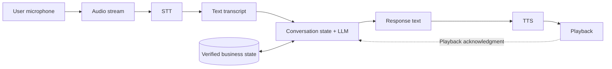
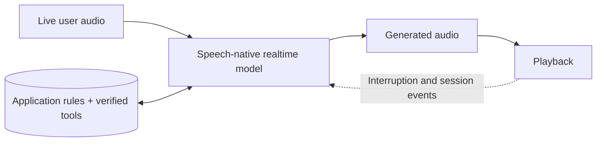
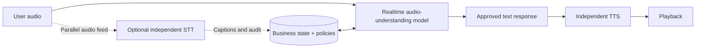
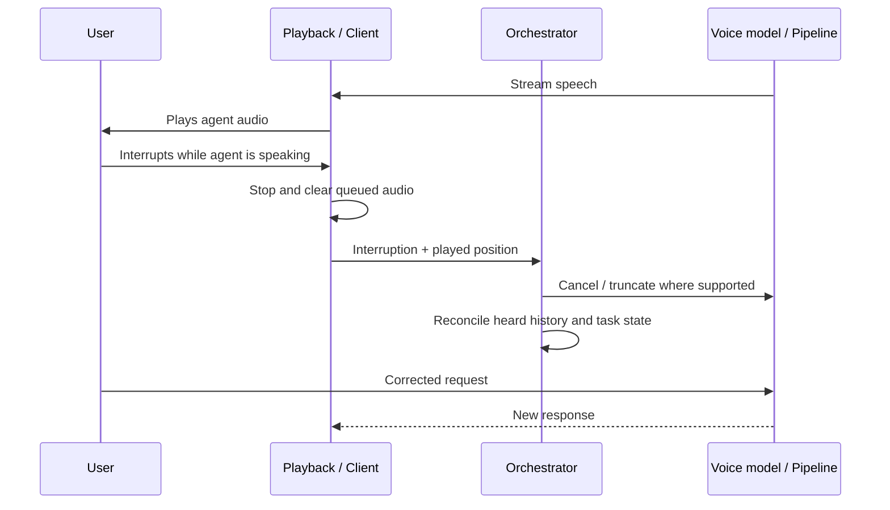

# Choosing a Voice-Agent Architecture: Cascaded vs. Speech-to-Speech

**Voice AI Engineering — Article 06 / 16**  
**Level:** Beginner → Intermediate | **Reading time:** 18–25 minutes + hands-on lab  
**العربية:** [[06-Cascaded-vs-Speech-to-Speech-AR|اقرأ المقالة بالعربية]]  
**Previous:** [[05-LLM-and-Conversation-State-EN|LLMs and Conversation State]]  
**Series:** [[00-Series-Roadmap|Voice AI Engineering Roadmap]]

![[assets/voice-architectures-cover.png]]

> [!abstract] In one minute
> Earlier articles covered how **STT** turns speech into text, how an **LLM** writes a response, and how **TTS** gives that response a voice, but a voice agent does not always need three separately connected models. This article compares **cascaded STT–LLM–TTS**, **realtime speech-to-speech (S2S)**, and **hybrid** architectures. It then shows how to choose between them from product requirements and measured behavior instead of hype.

## 1. The question to ask before choosing a model

Imagine a scheduling assistant:

> **User:** Book my consultation for Thursday at ten.  
> **Agent:** Sure, I'll check what is available...  
> **User, interrupting:** Wait, I meant three in the afternoon.

The application must stop its current audio, understand that the time has changed, invalidate any earlier confirmation, and request fresh approval before taking action. You might also need an inspectable transcript to investigate errors.

Now consider a language-learning companion. It is judged on how naturally it responds to hesitation, emphasis, emotional tone, and overlapping speech, and only partly on whether it fills in a booking form correctly.

These are different product requirements, and they may call for different systems.

> [!question] The engineering question
> Do we value explicit stage-level control and auditability most, or do we need direct acoustic understanding and expressive, low-latency interaction? Pick an **architecture for the job** rather than a model chosen only because its demo was impressive.

## 2. Cascaded architecture: STT → LLM → TTS



A **cascaded pipeline** connects three specialist components: STT produces text from incoming speech; the LLM reasons over that text and application state; TTS converts approved reply text into audio. Each stage has a relatively clean interface, which makes it easier to test, replace, and observe independently.[^livekit-pipelines]

**Why this is attractive:**

- **Debuggability:** inspect the transcript, the model's generated response, and the spoken audio separately.
- **Provider flexibility:** replace an STT or TTS provider without rebuilding the entire interaction model.
- **Visible text boundaries:** create captions, searchable transcripts, and structured action validation. Keep in mind that STT can make errors.
- **Script control:** ask a TTS model to read validated wording, especially useful for confirmations or prescribed disclosures.

The price is more hand-offs and more processing stages. A text transcript may also discard acoustic information such as hesitation, prosody, emphasis, or emotional cues. Additional acoustic classifiers can enrich a cascaded setup, but they add complexity.[^livekit-pipelines]

> [!tip] Cascaded does not mean batch processing
> A good cascaded agent can be **streaming**: STT streams interim hypotheses, the LLM emits partial output, and TTS begins synthesizing chunks before the whole answer has been written. The stages can overlap in time rather than blocking one another until completion.

## 3. Realtime speech-to-speech architecture



A **speech-to-speech** model accepts audio and produces audio through one realtime model interface instead of requiring independent STT and TTS services on the primary path. That **does not prove** the model performs no internal speech recognition or text processing; it simply means your application does not need to explicitly connect three external model stages.[^livekit-pipelines]

Potential advantages include fewer inter-stage transitions, access to vocal nuance and timing, and more expressive generated speech. The actual outcome still depends on the model, language, hardware, connection, and interaction pattern.

### Realtime does not automatically mean full-duplex

| Mode | What it means |
|---|---|
| **Turn-based realtime** | The model generally waits until the user finishes speaking before responding, though it can support interruptions. |
| **Full-duplex** | The model can process incoming speech while producing outgoing speech, if its implementation and session behavior support that overlap. |

LiveKit documents these as distinct model categories, with different options for turn detection, scripted output, and transcript availability.[^livekit-realtime]

Potential drawbacks include less stage-level introspection, tighter dependency on one model provider, less guarantee that speech exactly follows a script, and delayed or unavailable interim text transcripts. Those limitations matter for products that need live captions, deterministic messages, or detailed audits.[^livekit-realtime]

## 4. Hybrid: a third option worth evaluating

You do not have to accept all the tradeoffs of either extreme.



In one **hybrid** design, a speech-native realtime model receives audio and produces **text output**. The application can validate that text, then send it to a separate TTS engine. An additional STT component may provide captions or an inspectable transcript when the realtime model does not offer adequate interim transcriptions.[^livekit-realtime]

This can keep acoustic understanding on the input side while giving you more control over the output voice and wording. It may also mean more integration work and higher cost, and it is **not supported in the same way by every realtime model**. Full-duplex capability and separate-TTS hybrid support are different properties; check the provider's current implementation before committing to a design.

![[assets/voice-architecture-comparison.png]]

*Figure 1 — Three conceptual architectures. This is a teaching diagram, not a claim that every provider supports every possible combination.*

## 5. Compare the tradeoffs, not the marketing

| Criterion | Cascaded STT–LLM–TTS | Realtime S2S | Hybrid |
|---|---|---|---|
| **Swap individual model providers** | Usually straightforward | More limited | Moderate |
| **Inspect and audit text** | Clear textual boundaries | Transcripts may be delayed or additional | Depends on separate STT |
| **Preserve acoustic cues** | Limited in a text-only path | More direct access | More direct on input |
| **Say exact approved wording** | Easier using TTS | Less predictable | Often practical with separate TTS |
| **Response latency** | Extra transitions; streaming helps | May reduce hand-offs | Depends on configuration |
| **Observability** | Clear but multi-stage | Fewer visible internals | More complicated integration |
| **Interruptions** | Requires coordination across stages | Depends on model and session | Requires coordinated components |
| **Costs** | STT, LLM, TTS, transport, infrastructure | Provider-specific audio/token/time pricing | Additional model and component costs |

> [!important] A comparison table is not a benchmark
> Statements such as “always faster” or “always cheaper” cannot be inferred from architecture labels. Measure your language, network, device, turn lengths, audio overlap, concurrency, tool use, and peak load.

## 6. How to measure latency without misleading yourself

From the user's perspective, a useful metric is:

\[
L_{\mathrm{response}} = t_{\mathrm{first\ audible\ audio}} - t_{\mathrm{user\ speech\ end}}
\]

This measures the elapsed time from the end of a user turn to the first **audible** agent response. It is not identical to LLM TTFT, TTS TTFB, the first bytes received by the client, or the first synthesized audio frame. Playback buffers and transports matter.[^livekit-traces]

A cascaded response may involve endpointing, STT finalization, the first LLM output, the first TTS chunk, network delivery, and client playback. But avoid blindly adding each provider's reported averages: streaming allows stages to overlap, and only stages on the critical path determine the time the user waits.

![[assets/voice-architecture-latency.png]]

*Figure 2 — Entirely **invented educational numbers**: 780 ms for one illustrative cascaded turn and 450 ms for one illustrative realtime turn. These are not vendor measurements and establish no general superiority.*

### What should an engineering benchmark report?

| Metric | Why it matters |
|---|---|
| **End-of-turn → first audible audio** | User-perceived startup time |
| **P50 and P95** | Typical and slow-tail responsiveness |
| **Interruption-stop latency** | How quickly audible speech stops when the user interrupts |
| **Turn detection errors** | Premature or delayed turn transitions |
| **Transcript quality** | Accuracy when captions, audits, or text-triggered actions are required |
| **Task completion and correction rate** | Whether the assistant completes the actual task reliably |
| **Cost per successful task** | Overall economics, beyond one provider's per-minute rate |

LiveKit exposes measurements such as E2E, STT delay, end-of-turn detection, LLM time to first token, TTS time to first byte, and distinct realtime-model timing spans.[^livekit-traces]

## 7. Interruptions belong to the system, not just the model



Regardless of the architecture, keep **generated**, **sent**, and **actually played** audio conceptually separate. When a user interrupts, the client may need to stop playback immediately, discard buffered output, notify the orchestrator, and reconcile conversation history. OpenAI Realtime documents `conversation.item.truncate` for synchronizing context with played output, while noting that exact audio-to-text alignment can be imperfect.[^openai-interruptions]

A VAD trigger on its own does not prove that interruptions are handled well. Nor does full-duplex support guarantee that cancelling external audio stops the model's own internal speech generation immediately. Test the specific API and client behavior you are using.[^livekit-realtime]

## 8. Which design fits which product?

**A. Identity verification or other high-assurance workflows**  
If you need precise confirmations, auditable user-facing text, and independent verification of tool outcomes, start by evaluating a cascaded architecture, or a hybrid with tightly controlled text output. Architecture alone does not enforce authorization, privacy, or policy compliance.

**B. Language tutoring or expressive conversation**  
If hearing hesitation, tone, and overlapping speech is central to the experience, test speech-native realtime models. Evaluate the languages and accents you will actually support, not only polished promotional samples.

**C. Customer support with mandatory scripts**  
When exact wording or live captions are essential, cascaded STT–LLM–TTS or hybrid with separate TTS can be more practical. Verify both wording fidelity and barge-in behavior.

**D. Fast proof of concept**  
A single realtime provider may reduce initial setup, but check billing, capabilities, privacy constraints, and deployment limitations before selecting a production architecture.

## 9. Hands-on Python lab: compare traces, not imaginary model quality

Included source files:

- `examples/architecture_tradeoff_lab.py`
- `examples/test_architecture_tradeoff_lab.py`
- `examples/make_architecture_figures.py`

From the root of the `Voice-Agent-Series` folder:

```bash
python examples/architecture_tradeoff_lab.py
python -m unittest discover -s examples -p 'test_*.py' -v
```

The lab defines a small `TurnTrace` data structure and calculates time to audible output, audio-ready-to-playback delay, interruption-stop delay, and P50/P95 response metrics. The percentiles use the explicit **nearest-rank** definition to make the results reproducible.

```python
from architecture_tradeoff_lab import TurnTrace

trace = TurnTrace(
    architecture="cascaded",
    user_speech_end_ms=0,
    response_audio_ready_ms=700,
    audible_start_ms=780,
    interruption_started_ms=2200,
    playback_stopped_ms=2310,
)

print(trace.response_latency_ms)          # 780 ms
print(trace.playback_delay_ms)            # 80 ms
print(trace.interruption_stop_latency_ms) # 110 ms
```

> [!warning] Limits of the lab
> All demo timing values are **synthetic**. The lab makes no API calls and does not run real speech recognition, speech synthesis, or speech-native inference. A P95 calculated from only a few turns is statistically weak; production evaluation requires a sufficiently large and representative sample across network conditions, languages, devices, and interruption scenarios, with appropriate consent and privacy protections.

## 10. Architecture decision checklist

- [ ] Do users or supervisors need interim captions or reliable textual transcripts?
- [ ] Must the assistant deliver exact legal, procedural, or confirmation text?
- [ ] Are emotional tone, timing, and prosody central to the task?
- [ ] Must components run locally or be replaceable across providers?
- [ ] How quickly does playback stop after an interruption?
- [ ] How do we know how much of an answer the user heard?
- [ ] Where do verified task state and authorization rules live?
- [ ] Have we measured P50/P95, task success, and cost on realistic scenarios?

> [!success] Practical rule
> **Start with the product's constraints, not the trendiest model.** If auditability and exact wording dominate, benchmark cascaded first. If expressive interaction and latency dominate, benchmark speech-to-speech. Consider hybrid when you need elements of both and the models you intend to use support it.

## Practice exercise

1. Sketch cascaded, realtime, and hybrid designs for the same scheduling assistant.
2. Test a single scenario: the user changes the appointment time while interrupting a sentence.
3. Define five observable events, including *audio ready* and *first audio audible*.
4. Decide where confirmed appointment details live and how interim transcripts are prevented from triggering action.
5. Write down your architectural choice, accepted risks, and the measurements that would cause you to revisit it.

## Conclusion

No architecture wins everywhere. **Cascaded pipelines** give you modularity and visible boundaries between stages, while **realtime speech-to-speech** can keep vocal nuance and cut hand-offs. Where the provider supports it, a **hybrid** can pair acoustic understanding with controlled speech output. You find the right choice by testing real tasks and following the audio all the way from the microphone to the user's ear.

**Next (Article 07):** [[07-Build-First-Voice-Agent-with-Pipecat-EN|Your First Voice Agent with Python & Pipecat]]. We will implement a real pipeline and connect the choices discussed here to executable software.

## References

[^livekit-pipelines]: [LiveKit — Pipeline types: Cascaded, Realtime and Hybrid](https://docs.livekit.io/agents/models/pipelines/). Official comparison of patterns, strengths, and limitations.
[^livekit-realtime]: [LiveKit — Realtime models](https://docs.livekit.io/agents/models/realtime/). Turn-based versus full-duplex modes; transcription, hybrid configuration, and scripted output caveats.
[^livekit-traces]: [LiveKit — Session traces and latency metrics](https://docs.livekit.io/reference/agents/session-traces/). Metric definitions and timing spans.
[^openai-interruptions]: [OpenAI — Realtime conversations: Interruption and truncation](https://developers.openai.com/api/docs/guides/realtime-conversations). Synchronizing context with actual playback after interruption.

---

**Tags:** #voice-ai #voice-agents #speech-to-speech #cascaded #realtime #architecture #python
