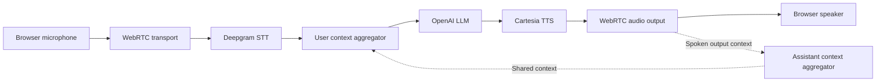
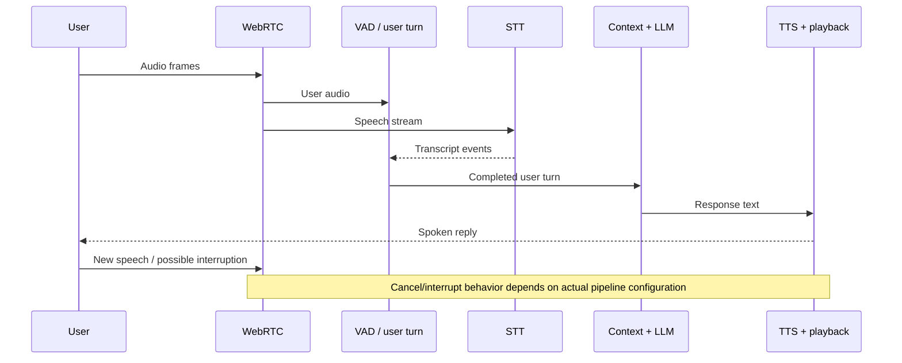
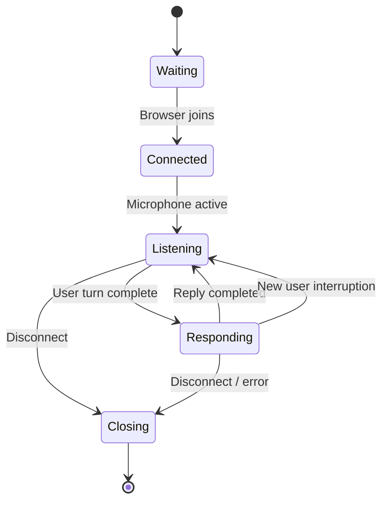

# ابنِ أول وكيل صوتي باستخدام Python وPipecat: من الفكرة إلى محادثة تعمل

**Voice AI Engineering — المقالة 07 / 16**  
**المستوى:** مبتدئ → متوسط | **زمن القراءة:** 20–30 دقيقة + تطبيق عملي  
**English:** [[07-Build-First-Voice-Agent-with-Pipecat-EN|Read in English]]  
**السابقة:** [[06-Cascaded-vs-Speech-to-Speech-AR|كيف تختار معمارية الوكيل الصوتي؟]]  
**الفهرس:** [[00-Series-Roadmap|خارطة السلسلة]]

![[assets/first-pipecat-agent-cover.png]]

> [!abstract] ما الذي سنبنيه؟
> نربط في هذه المقالة تحويل الكلام إلى نص (**STT**) ونموذج اللغة (**LLM**) وتحويل النص إلى كلام (**TTS**) في **أول وكيل صوتي يعمل من المتصفح**: تتكلم في الميكروفون، فيحوّل الوكيل كلامك إلى نص، ويولّد رداً، ثم ينطقه لتسمعه. نستخدم **Pipecat** لتنسيق المكونات و**WebRTC** لنقل الصوت بين المتصفح والوكيل. وفي المقالة مساران عمليان: وكيل حي يعمل عند توفير مفاتيح الخدمات، ومختبر محلي للتوقيت يعمل من دون أي خدمات خارجية.

## 1. لماذا لا يكفي ربط ثلاثة API Calls؟

لو استخدمنا ثلاث دوال متتابعة، سنحصل على سيناريو بسيط: سجّل ملفاً صوتياً، أرسله إلى STT، أرسل النص إلى LLM، ثم احفظ نتيجة TTS في ملف. هذا يثبت أن النماذج تعمل معاً، لكنه ليس **محادثة صوتية حية**.

تخيّل أنك تقول: «اشرح الفرق بين RAM وSSD»، ثم تتذكر أنك تريد إجابة أبسط فتقاطع الوكيل: «لحظة، اشرحها لطفل عمره عشر سنوات». إذا كان البرنامج ينتظر انتهاء TTS كاملاً، فسيتجاهل كلامك أو يؤخره؛ وإذا أبقى ردّ النموذج السابق داخل السياق بعد إيقافه، فقد يفترض أنك سمعت شرحاً لم تسمعه.

يتطلب الوكيل الحي إدارة أمور إضافية: صوت يدخل ويخرج باستمرار، أحداث اتصال وانفصال، حدود دور المستخدم، سياق محادثة، ومقاطعات. **Pipecat إطار orchestration لتنسيق تدفق هذه الأحداث**، وليس بديلاً عن STT أو LLM أو TTS بحد ذاتها.[^pipecat-intro]

> [!question] السؤال المركزي
> كيف نحوّل مكونات تعمل منفصلة إلى **Pipeline** واحد يستقبل الصوت ويُخرج استجابة، مع القدرة على مراقبة ما يجري في كل مرحلة؟

## 2. التصميم الذي سنختاره

في هذه المقالة سنستخدم معمارية **Cascaded** لأنها تسهّل رؤية كل مرحلة وتصحيح مشاكلها:



![[assets/pipecat-first-agent-pipeline.png]]

*الشكل 1 — الأجزاء الأساسية. مخطط Mermaid يبيّن الخدمات المختارة، والصورة المبسطة توضّح مسار الصوت والنص بصرياً.*

| الجزء | مسؤوليته | اختيار التجربة |
|---|---|---|
| **Transport** | نقل صوت المستخدم وتشغيل صوت الرد | WebRTC عبر Pipecat Runner |
| **STT** | تحويل الكلام إلى نص | Deepgram |
| **Turn/VAD** | تقدير بداية كلام المستخدم ونهايته | Silero VAD ضمن إعداد مجمّع المستخدم |
| **LLM** | توليد الإجابة | OpenAI |
| **TTS** | تحويل الإجابة إلى موجات صوتية | Cartesia |
| **Context aggregators** | تجميع أدوار المستخدم وردود الوكيل | Pipecat |
| **Runner / Worker** | إدارة تشغيل Pipeline والجلسة | Pipecat |

> [!important] ليس هذا الخيار الوحيد
> استخدمنا مزودين سحابيين لتقليل تعقيد الإعداد التعليمي. لا يعني ذلك أن هذه الخدمات مجانية أو أن Pipecat لا يدعم حلولاً محلية؛ يمكنك استبدالها لاحقاً، لكن عليك مراجعة توافق كل خدمة واللغة والصوت ومعدل العينات قبل ذلك. مفاتيح الخدمات الثلاثة مطلوبة لتجربة هذا المسار كما هو.[^pipecat-quickstart]

## 3. ما هو Pipecat، ولماذا نستخدمه؟

Pipecat إطار مفتوح المصدر بلغة Python لبناء تطبيقات صوتية ومتعددة الوسائط في الزمن الحقيقي. الفكرة الأساسية هي وجود **معالجات (Processors)** تتلقى **Frames** وتدفع Frames جديدة إلى المعالج التالي، بدلاً من كتابة حلقة واحدة ضخمة تحتوي المنطق والشبكة والصوت والسياق معاً.[^pipecat-intro]

- **Frame:** وحدة بيانات أو حدث تمر عبر Pipeline؛ قد تحمل صوتاً، نصاً، أو إشارة تحكم.
- **Processor:** مكوّن يعالج Frames أو يحوّلها، مثل STT أو LLM.
- **Pipeline:** الترتيب الذي يربط المعالجات.
- **Transport:** نقطة التفاعل بين Pipecat والمستخدم عبر وسيط اتصال.
- **Context:** ذاكرة المحادثة التي يعتمد عليها نموذج اللغة؛ ليست هي نفسها قاعدة بيانات حقائق معتمدة.
- **Worker/Runner:** مكونات تشغيل وإدارة دورة حياة Pipeline.

> [!warning] انتبه إلى تغيّر API
> أمثلة Pipecat القديمة تستخدم `PipelineTask` وبعض أصناف تجميع السياق الأقدم. المثال المصاحب لهذه المقالة يتبع **أسلوب Pipecat 1.x الحديث، الذي يستخدم `PipelineWorker` و`LLMContextAggregatorPair`** وفق المثال الرسمي عند إعداد هذه المقالة بتاريخ 21 نوفمبر 2026. قبل التعديل أو الترقية، ارجع إلى المثال الرسمي الحالي وتحقق من الإصدار المثبت؛ لا تخلط واجهات نسخ مختلفة.[^pipecat-example]

## 4. المتطلبات قبل البدء

للتجربة الفعلية تحتاج إلى:

1. **Python 3.11 أو أحدث**، ومحرر مثل VS Code، ومدير الحزم `uv`.
2. متصفح حديث يسمح باستخدام الميكروفون على `localhost`.
3. حسابات ومفاتيح API لكل من **Deepgram** و**OpenAI** و**Cartesia**.
4. اتصال إنترنت؛ لأن النماذج المختارة في هذا المثال تُستدعى عبر خدمات سحابية.
5. سماعات لتقليل صدى الصوت المرتد إلى الميكروفون أثناء الاختبار.

> [!caution] أمان مفاتيح API
> ضع المفاتيح في `.env` على الخادم المحلي، وأضف الملف إلى `.gitignore`. لا تضع المفاتيح في JavaScript يعمل داخل المتصفح، ولا تنشرها في GitHub أو لقطات الشاشة أو سجلات الأخطاء. بعض الخدمات قد تفرض تكلفة حسب الاستخدام.

## 5. أسرع مسار موثوق لتشغيل أول Voice Agent

واجهات المكتبات تتغير بسرعة، لذلك نبدأ بالمشروع الذي تولّده **واجهة Pipecat CLI الرسمية**، ثم نقرؤه ونعدّل عليه. هذا أسلم من تجميع dependencies يدوياً اعتماداً على مقال قديم.[^pipecat-quickstart]

### الخطوة الأولى — أنشئ مشروعاً رسمياً

```bash
# After installing uv on your system:
uv tool install "pipecat-ai[cli]"
pipecat init quickstart
cd pipecat-quickstart
```

هذه الأوامر تنشئ مشروع quickstart مستقلاً. **لا تشغّلها داخل مجلد مقالات Obsidian نفسه**؛ اختر مجلد تطوير خاصاً بك مثل `~/projects/`.

### الخطوة الثانية — أضف مفاتيح الخدمات

```bash
cp .env.example .env
```

افتح `.env` وضع القيم الحقيقية **على جهازك**:

```dotenv
DEEPGRAM_API_KEY=<your-secret>
OPENAI_API_KEY=<your-secret>
CARTESIA_API_KEY=<your-secret>
```

القيم أعلاه **أماكن مخصصة للشرح** وليست مفاتيح فعّالة. يمكن الاستفادة من الملف `examples/pipecat-first-agent.env.example` داخل حزمة المقالة لمعرفة الأسماء؛ لا تضع فيه أسرارك عند مشاركة الحزمة.

### الخطوة الثالثة — ثبّت وشغّل

```bash
uv sync
uv run bot.py
```

افتح عنوان Pipecat الافتراضي: **http://localhost:7860/client**، واسمح للمتصفح باستخدام الميكروفون، ثم اضغط **Connect**. إذا كانت الخدمات والمفاتيح والإعدادات صحيحة، تستطيع التحدث مع الوكيل وسماع إجابته.[^pipecat-quickstart]

> [!info] ماذا تحققنا منه؟
> هذا مسار تشغيل موثق من المشروع الرسمي، لكن **لم أشغّل محادثة حقيقية هنا** لأن هذه الحزمة لا تحتوي مفاتيح حساباتك ولا متصفحاً موصولاً بميكروفون. جرّبه على جهازك قبل أن تعتمد عليه في بيئتك.

## 6. افهم الكود: أنشأنا Pipeline، لكن ماذا يحدث داخله؟

بعد نجاح quickstart، افتح الملف `bot.py`. في **نسخ Pipecat الحديثة** يبدو جوهر الكود قريباً من المقتطف التالي (مبسّط من ملف المثال المصاحب):

```python
pipeline = Pipeline([
    transport.input(),
    stt,
    user_aggr,
    llm,
    tts,
    transport.output(),
    assistant_aggr,
])
```

الترتيب مهم:

1. `transport.input()` يستقبل الصوت من المتصفح.
2. `stt` يولّد نص الكلام المُتعرف عليه.
3. `user_aggr` يبني دور المستخدم ويضيفه إلى سياق المحادثة عند اكتماله.
4. `llm` يولّد ردّاً مناسباً اعتماداً على السياق.
5. `tts` يحوّل الرد النصي إلى صوت.
6. `transport.output()` يرسل الصوت إلى المتصفح.
7. `assistant_aggr` يحافظ على سجل الردود في سياق المحادثة وفق أحداث التشغيل المتاحة.

**الـ Pipeline لا يساوي سير تنفيذ متزامناً بالكامل**: قد تبث الخدمات الصوت والنص تدريجياً. توجد Frames خاصة بالتحكم والتوقف والإلغاء، ولذلك يجب احترام دورة حياة الجلسة وعدم افتراض أن كل معالجة تقابل ملفاً مكتملًا.[^pipecat-example]

> [!tip] لماذا يأتي مجمّع المساعد بعد إخراج الصوت؟
> لأن ربط السياق بالمخرجات المنطوقة مهم عند المقاطعات. ومع ذلك، **وجود Aggregator لا يضمن وحده معرفة العينات التي خرجت فعلياً من سماعة المستخدم**؛ قد تحتاج تأكيدات تشغيل من العميل ومزامنة أدق مع الـ TTS. سنشرح ذلك تفصيلياً في المقالة العاشرة.

## 7. دور VAD وTurn Detection



**VAD** يكشف نشاطاً صوتياً، لكنه لا يفهم المحتوى، ولا يحدد وحده دائماً انتهاء المعنى. أما **Turn Detection** فيقرر متى ينتقل الدور من المستخدم إلى الوكيل استناداً إلى إعدادات النظام والأحداث المتاحة. في المثال التعليمي نستخدم Silero VAD مع مجمّع المستخدم، ولا نزعم أنه يكتشف كل المقاطعات بكفاءة مثالية.[^pipecat-example]

عند وجود ضجيج أو استخدام مكبرات الصوت بدلاً من سماعات، قد تضطرب قرارات بداية الكلام ونهايته بسبب الصدى، ولهذا نحكم على النتيجة بالتجربة لا بشكل المخطط.

## 8. شغّل النسخة التعليمية المرفقة

تتضمن الحزمة الملف الأصلي التالي:

**`examples/pipecat_first_agent.py`**

يحافظ هذا المثال على Pipeline واضح ويضبط تعليمات الوكيل بحيث يجيب بجمل قصيرة قابلة للنطق. يستخدم الواجهات الحديثة ويعرض أحداث الاتصال والانفصال؛ وهو **مثال مستقل للتعلّم**، لا تعديلاً ضرورياً على مشروع Pipecat الرسمي.

لتشغيله، بعد أن تنجح تجربة quickstart، انسخ الملف إلى مجلد مشروع Pipecat الذي أنشأته، ثم شغّله:

```bash
# From the pipecat-quickstart project directory:
# Copy examples/pipecat_first_agent.py from your Obsidian pack here.
uv run pipecat_first_agent.py
```

التطبيق المرفق يخصص المساعد حالياً **للمحادثة الإنجليزية** ليتوافق مع الصوت الافتراضي المستخدم في المثال. لتفعيل العربية راجع دعم اللغة في STT والصوت المختار في TTS، ثم غيّر تعليمات LLM واختبر النطق عملياً. **تغيير Prompt فقط لا يضمن دعماً صوتياً عربياً سليماً.**

## 9. دورة حياة جلسة المحادثة

![[assets/pipecat-session-lifecycle.png]]

في التطبيق الحقيقي يوجد تسلسل أحداث أكبر من التحدث والرد:



هذا **نموذج مفاهيمي** لا تسمية حرفية لكل حالة داخل Pipecat. يجب أن تعالج عملية الانفصال إلغاء العمل الجاري وتحرير موارد الاتصال، بدلاً من إبقاء خدمات الصوت تستقبل وتولد بيانات بلا مستفيد.[^pipecat-example]

## 10. كيف نتحقق من أن النظام يعمل؟

سماع «مرحباً» مجرد بداية. جرّب الحالات التالية:

| الحالة | ما يجب ملاحظته |
|---|---|
| اتصال جديد | يظهر المتصفح متصلاً، والميكروفون مرخّص، ورسالة البداية مسموعة |
| سؤال قصير | النص المستخرج مفهوم، والرد موجز، والصوت واضح |
| سؤال ثانٍ يشير إلى السابق | يحافظ الوكيل على سياق الحديث |
| صمت قصير وسط الجملة | لا يتكرر رده قبل أن ينهي المستخدم كلامه |
| مقاطعة الوكيل | يكتشف الكلام ويوقف الرد وفق قدرة الإعدادات؛ لا تفترض النجاح دون قياس |
| إغلاق المتصفح أو Disconnect | تنتهي الجلسة دون استمرار غير مرغوب في المعالجة |
| مفتاح خاطئ أو خدمة معطلة | خطأ مفهوم، دون كشف مفاتيح أو بيانات حساسة في السجلات |

> [!warning] تجربة تفاعلية ليست اختبار إنتاج
> نجاح جلسة واحدة لا يثبت انخفاض زمن الاستجابة ولا جودة اكتشاف المقاطعات ولا قابلية النظام للتوسع. المقالات 09–15 مخصصة لرفع موثوقيته وقياسه وتأمينه.

## 11. مختبر ثانٍ: افهم التوقيت دون API

إلى جانب الوكيل الحقيقي، أضفت مختبراً صغيراً يعمل بمكتبة Python القياسية:

```bash
# From Voice-Agent-Series folder:
python examples/pipecat_pipeline_lab.py
python -m unittest discover -s examples -p "test_*.py" -v
```

يحفظ المختبر أحداثاً زمنية اصطناعية، مثل `user_speech_end` و`stt_final` و`first_audio_audible` و`user_interruption` و`playback_stopped`. ويحسب:

\[
L_{\text{response}} = t_{\text{first audible}} - t_{\text{user speech end}}
\]

\[
L_{\text{interrupt}} = t_{\text{playback stopped}} - t_{\text{user interruption}}
\]

في البيانات التعليمية المصطنعة، يظهر **840 ms** لبدء الصوت المسموع بعد نهاية كلام المستخدم، و**90 ms** لإيقاف الصوت بعد بدء المقاطعة. **هذه ليست Benchmark** ولا نتائج حقيقية لـPipecat أو Deepgram أو OpenAI أو Cartesia.

## 12. تشخيص الأخطاء الشائعة

| العَرَض | الأسباب المحتملة | أول فحص عملي |
|---|---|---|
| لا يظهر المتصفح متصلاً | العنوان أو المنفذ خطأ، الخدمة لم تبدأ | راجع سجل التشغيل وعنوان URL المعروض |
| لا يسمع الوكيل صوتي | إذن الميكروفون أو جهاز الإدخال أو الاتصال | جرّب الميكروفون في المتصفح واستخدم سماعات |
| يسمعني لكنه لا يرد | خطأ STT/LLM أو انتهاء الحصة أو تعثر السياق | افحص الأخطاء دون طباعة أسرار API |
| يكتب النص لكنه لا يصدر صوتاً | إعداد TTS أو الصوت غير مدعوم | افحص خدمة TTS وصلاحية Voice ID |
| يرد مرتين أو يقاطعني | توقيت VAD/Turn Detection أو صدى | خفّف الصدى وأعد الاختبار على عيّنات واقعية |
| الصوت متأخر | شبكة أو نموذج بطيء أو Buffering | قس كل مرحلة ووقت تشغيل أول صوت مسموع |

## 13. تحسينات هندسية قبل مشاركة المشروع

- افصل إعدادات الخدمات عن المنطق، وضع الأسرار في متغيرات البيئة.
- ثبّت نطاق إصدارات dependencies عند تهيئة مشروع فعلي، ثم اختبر الترقية.
- أضف زمن انتظار وإعادة محاولة محدودة للأخطاء المؤقتة **مع منع تكرار الأفعال الحساسة**.
- لا تخزّن الصوت أو التفريغات النصية الشخصية دون حاجة واضحة وموافقة وضوابط احتفاظ.
- راقب `STT final`, `LLM first token`, `TTS first chunk`, `audible playback`, `disconnect`.
- لا تستخدم Prompt وحده لحماية أدوات خارجية أو تنفيذ عمليات؛ ضع التحقق والصلاحيات في كود التطبيق.

> [!important] هذه التجربة لم تُصبح Production-Ready
> تشغيل Pipecat على جهاز المطور لا يغني عن TLS وشبكات الإنتاج وإدارة جلسات متعددة والمصادقة والحد من المعدل ومراقبة الفشل والتكلفة والخصوصية. سنبني هذه الطبقات تدريجياً خلال السلسلة.

## 14. تمرين تطبيقي

1. شغّل quickstart وتحدث مع الوكيل ثلاث مرات على الأقل.
2. عدّل التعليمات حتى تصبح الإجابات جملتين قصيرتين بدلاً من فقرة طويلة.
3. جرّب مقاطعة الوكيل في منتصف جملة وسجّل ما الذي حدث فعلياً.
4. بدّل سؤالاً عادياً بسؤال يتضمن مصطلحات تقنية باللغة الإنجليزية، ولاحظ جودة STT.
5. شغّل المختبر المحلي وقارن زمن `audio ready` مع `audible`.
6. اكتب ما ستغيره أولاً: STT، أم TTS، أم VAD، أم شبكة WebRTC؟ ولماذا؟

## ماذا أصبحت تعرف الآن؟

انتقلنا من ثلاث خدمات منفصلة إلى **Pipeline صوتي مترابط**. المهم هنا ليس عدد أسطر الكود، وإنما أن تعرف أين يدخل الصوت، وكيف يُبنى دور المستخدم، ومن أين يأتي الرد، وأين يخرج الصوت، ومن المسؤول عن إنهاء الجلسة. إذا كنت تستطيع شرح هذه الحدود ورصد أحداثها، فلديك أساس تستطيع تحسينه مرحلةً بعد مرحلة.

**[[08-Real-Time-Audio-Transport-AR|المقالة التالية (08): Real-Time Audio Transport — WebRTC vs WebSockets]]**: نشرح فيها مسار الصوت عبر الشبكة، وJitter وPacket Loss وSTUN/TURN، وما الذي يتغير عندما ينتقل الوكيل من جهازك إلى مستخدم بعيد.

## المصادر والمراجع

[^pipecat-intro]: [Pipecat — Official repository and overview](https://github.com/pipecat-ai/pipecat). وصف الإطار ومفهوم المعالجات وFrames وأمثلة الخدمات.
[^pipecat-quickstart]: [Pipecat — Official Quickstart](https://docs.pipecat.ai/pipecat/get-started/quickstart). خطوات إنشاء المشروع، ومتطلبات المفاتيح، وتشغيل المتصفح محلياً.
[^pipecat-example]: [Pipecat — Getting Started, 06 Voice Agent](https://github.com/pipecat-ai/pipecat/blob/main/examples/getting-started/06-voice-agent.py). مرجع واجهات PipelineWorker وتجميع السياق والخدمات؛ راجع آخر نسخة قبل النقل إلى مشروعك.
[^pipecat-examples]: [Pipecat — Official Examples README](https://github.com/pipecat-ai/pipecat/blob/main/examples/README.md). أمثلة متقدمة لمسارات WebRTC وخدمات الصوت وحالات المقاطعة.
[^webrtc]: [MDN — WebRTC API](https://developer.mozilla.org/en-US/docs/Web/API/WebRTC_API). أساسيات اتصال الصوت من المتصفح.

---

**وسوم:** #VoiceAI #Pipecat #Python #AIEngineering #SpeechAI
