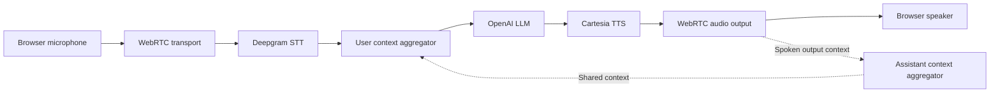
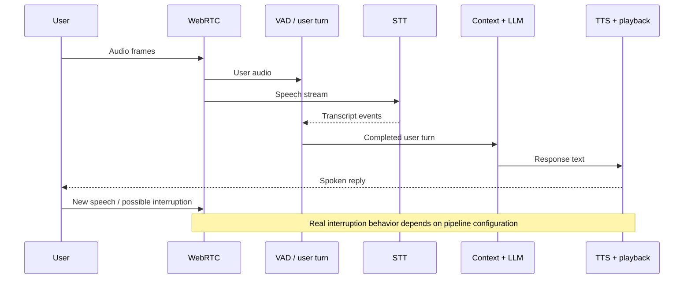
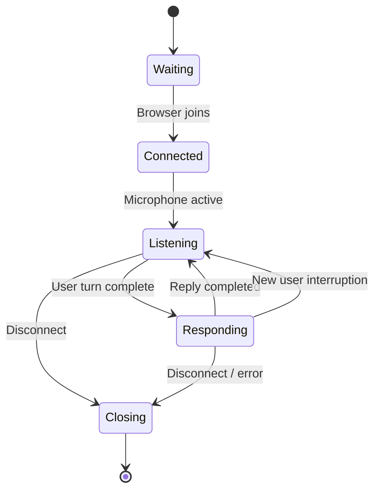

# Build Your First Voice Agent with Python and Pipecat: From Components to Conversation

**Voice AI Engineering — Article 07 / 16**  
**Level:** Beginner → Intermediate | **Reading time:** 20–30 minutes + hands-on lab  
**العربية:** [[07-Build-First-Voice-Agent-with-Pipecat-AR|اقرأ المقالة بالعربية]]  
**Previous:** [[06-Cascaded-vs-Speech-to-Speech-EN|Choosing a Voice-Agent Architecture]]  
**Series:** [[00-Series-Roadmap|Voice AI Engineering Roadmap]]

![[assets/first-pipecat-agent-cover.png]]

> [!abstract] What will you build?
> We now know what **STT**, **LLM**, **TTS**, and conversation state do. This article connects those components into a **first browser-based voice agent**: speak into a microphone, transcribe speech, generate an answer, synthesize audio, and hear it back. We will use **Pipecat** for orchestration and **WebRTC** for browser communication. You will get two distinct learning paths: a live agent that needs configured services, and a standalone timing lab that runs without any APIs.

## 1. Why three API calls are not a conversation

A basic proof of concept often looks like this: record a WAV file, transcribe it, send the text to an LLM, synthesize the response, and play the result. That demonstrates the model chain, but it does not yet create a **natural, continuous voice conversation**.

Suppose you ask, “What is the difference between RAM and an SSD?” The agent starts answering, but you interrupt: “Wait. Explain it to a ten-year-old.” If your code waits for the entire TTS output, the interruption arrives too late. If it discards audio but keeps the entire generated answer in history, the agent may incorrectly assume you heard the whole explanation.

A real voice agent must coordinate streaming input and output, turns, connection events, shared context, cancellations, and errors. **Pipecat is an orchestration framework** for these interactions, not a built-in replacement for every speech or language model.[^pipecat-intro]

> [!question] The engineering question
> How do we connect independently useful AI services into one **observable, controllable audio pipeline**?

## 2. The architecture we will build

For a first implementation, use a **cascaded** architecture. Its stages are explicit and individually debuggable:



![[assets/pipecat-first-agent-pipeline.png]]

*Figure 1 — An end-to-end conceptual view. The editable Mermaid diagram includes the specific services; the illustration emphasizes the basic audio and text stages.*

| Component | Responsibility | Our choice |
|---|---|---|
| **Transport** | Send user audio and receive response audio | WebRTC through Pipecat Runner |
| **STT** | Speech recognition | Deepgram |
| **VAD / turn handling** | Detect speech activity and organize user turns | Silero VAD with user aggregator |
| **LLM** | Generate responses | OpenAI |
| **TTS** | Synthesize speech | Cartesia |
| **Context aggregators** | Maintain the user and assistant turns | Pipecat |
| **Worker / Runner** | Run the pipeline and manage its lifecycle | Pipecat |

> [!important] A teaching choice, not a universal architecture
> Cloud services make the first integration straightforward. They may incur charges and require separate API credentials. Pipecat supports other providers and local components, but every replacement requires checks for supported languages, voices, sample rates, package extras, and runtime compatibility.[^pipecat-quickstart]

## 3. Pipecat's core building blocks

Pipecat is an open-source Python framework for realtime voice and multimodal agents. It connects **processors** that exchange **frames** in a pipeline. Instead of placing networking, model inference, audio playback, and turn logic into one large function, each component has a clearer responsibility.[^pipecat-intro]

- **Frame:** An item of data or control information flowing through a pipeline; it might represent audio, text, or a lifecycle signal.
- **Processor:** A stage that handles frames and produces downstream frames.
- **Pipeline:** An ordered set of processors.
- **Transport:** The interface between your bot and the user's audio connection.
- **Context:** The conversation material available to the model, distinct from verified business-state storage.
- **Worker and Runner:** Components used to run and manage the active pipeline.

> [!warning] Watch the Pipecat version
> Older Pipecat examples often use `PipelineTask` and earlier context aggregator APIs. The accompanying example follows the **Pipecat 1.x-style `PipelineWorker` and `LLMContextAggregatorPair`** shown by the official getting-started code reviewed on November 21, 2026. Avoid mixing examples from different major versions; always verify the installed package and current official example.[^pipecat-example]

## 4. What you need

Your live voice agent requires:

1. **Python 3.11 or newer**, the `uv` package manager, and a code editor.
2. A browser and working microphone; local browser testing normally uses `localhost`.
3. API keys from **Deepgram**, **OpenAI**, and **Cartesia**.
4. Internet connectivity for the cloud-based AI services in this tutorial.
5. Headphones, preferably, to reduce echo while testing interruptions.

> [!caution] Protect credentials
> Keep API keys in a local `.env` file, excluded by `.gitignore`. Never put them in browser-side JavaScript or commit them to Git. Avoid logging raw credentials or private audio/transcripts. Provider costs and quotas vary.

## 5. Start with the official project generator

Because framework APIs evolve, the least fragile way to begin is the **current Pipecat CLI quickstart** rather than hand-assembling dependencies from an old article. We will inspect the generated project after it works.[^pipecat-quickstart]

### Step 1 — Scaffold the project

```bash
# After uv has been installed:
uv tool install "pipecat-ai[cli]"
pipecat init quickstart
cd pipecat-quickstart
```

Run these commands in a **separate development folder**, not inside your Obsidian notes vault. The generator creates a standalone application.

### Step 2 — Configure the service credentials

```bash
cp .env.example .env
```

Edit `.env` **on your own machine**:

```dotenv
DEEPGRAM_API_KEY=<your-secret>
OPENAI_API_KEY=<your-secret>
CARTESIA_API_KEY=<your-secret>
```

These placeholders are not credentials. The Obsidian pack includes `examples/pipecat-first-agent.env.example` to show the relevant names. Do not save actual credentials in a copy that you plan to distribute.

### Step 3 — Install and run

```bash
uv sync
uv run bot.py
```

Open **http://localhost:7860/client** in your browser, allow microphone access, and select **Connect**. With valid configuration and accessible services, your browser can hold a live audio conversation with the bot.[^pipecat-quickstart]

> [!info] What has and has not been verified
> These instructions come from the official Pipecat quickstart. The live conversation itself **has not been executed in this artifact environment** because your provider credentials and an interactive microphone are not available. The next section's deterministic Python lab has been run and tested independently.

## 6. Read the central pipeline

Once the quickstart runs, open its `bot.py` and find the pipeline. In modern Pipecat, its main idea resembles the following abbreviated snippet from our companion file:

```python
pipeline = Pipeline([
    transport.input(),
    stt,
    user_aggr,
    llm,
    tts,
    transport.output(),
    assistant_aggr,
])
```

Read it from top to bottom:

1. `transport.input()` receives browser audio.
2. `stt` turns speech into text events.
3. `user_aggr` organizes user turns into shared conversation context.
4. `llm` reads context and generates response text.
5. `tts` converts text into audio.
6. `transport.output()` sends audio back to the browser.
7. `assistant_aggr` contributes assistant output to the conversation context, according to the available processing events.

This **does not mean** every stage waits for a complete recording. Models may stream text and audio; control frames can signal start, stop, and cancellation.[^pipecat-example]

> [!tip] Why does the assistant aggregator follow audio output?
> Turn history should reflect the assistant's spoken behavior rather than blindly treating all generated text as delivered. But an aggregator by itself does **not** prove which samples physically played on a user's device. Precise playback acknowledgement and interruption-aware context synchronization may need additional client integration. That is the focus of Article 10.

## 7. Voice activity and turn detection



**VAD** is useful for detecting speech activity, but not for understanding what was said. **Turn detection** decides when the system should treat a user's contribution as complete, using the available evidence and configured rules. This tutorial uses Silero VAD in the user aggregator, but it does not claim perfect endpointing, speaker detection, or interruption handling.[^pipecat-example]

Echo from speakers, noise, hesitation, network jitter, and overlapping voices can all complicate turn decisions. Evaluate their effects with real input rather than trusting a clean diagram.

## 8. Try the companion bot implementation

The pack contains:

**`examples/pipecat_first_agent.py`**

This is a teaching-oriented Pipecat bot using a short, speech-friendly system instruction, browser transport configuration, a context aggregator pair, and connection/disconnection handlers. It complements the official scaffold; it is not required for the official quickstart to work.

After successfully running the generated quickstart, copy our Python file into its project folder and run:

```bash
# From the pipecat-quickstart directory:
# First copy examples/pipecat_first_agent.py into this directory.
uv run pipecat_first_agent.py
```

The bundled bot starts with an **English-speaking** prompt and a demonstration English voice ID. If you need Arabic, confirm the target STT language and an Arabic-capable TTS voice, then adjust the prompt. **A prompt change alone does not guarantee proper Arabic transcription or pronunciation.**

## 9. Understand the session lifecycle

![[assets/pipecat-session-lifecycle.png]]



These are **conceptual states**, not a claim that Pipecat exposes events with exactly these names. Session cleanup matters: when the client disconnects, the application should cancel unnecessary processing and release transport and model resources.[^pipecat-example]

## 10. A functional test plan

Hearing the greeting is a beginning, not a complete validation. Test these situations:

| Scenario | What to observe |
|---|---|
| Initial connection | Browser connects; microphone permission works; greeting is audible |
| Short spoken question | Recognizable transcript, concise LLM response, audible output |
| Follow-up referring to an earlier question | The agent preserves context appropriately |
| Brief pause mid-sentence | The agent does not repeatedly answer before the user is finished |
| Interrupting during a response | Behavior is recorded and evaluated; do not assume cancellation works perfectly |
| Disconnecting | Unneeded session work stops |
| Invalid key or inaccessible service | Useful error without leaking credentials or private data |

> [!warning] A functioning demo is not a production benchmark
> One successful voice call does not establish latency, resilience, interruption performance, uptime, or cost at scale. Articles 09–15 will address detection, evaluation, observability, security, and deployment.

## 11. A second lab that runs without service keys

The pack also includes **`examples/pipecat_pipeline_lab.py`**, a small standard-library-only timeline model. This is not a network client or a substitute for Pipecat; it teaches event ordering and latency definitions.

```bash
# From the Voice-Agent-Series folder:
python examples/pipecat_pipeline_lab.py
python -m unittest discover -s examples -p "test_*.py" -v
```

It tracks synthetic timestamps such as `user_speech_end`, `stt_final`, `first_audio_audible`, `user_interruption`, and `playback_stopped`.

Response latency is:

\[
L_{\text{response}} = t_{\text{first audible}} - t_{\text{user speech end}}
\]

Interruption stop latency is:

\[
L_{\text{interrupt}} = t_{\text{playback stopped}} - t_{\text{user interruption}}
\]

In this deliberately artificial trace, response latency is **840 ms** and interruption stop latency is **90 ms**. These are **not measured Pipecat or provider performance results**.

## 12. Troubleshooting checklist

| Symptom | Potential cause | First check |
|---|---|---|
| Browser cannot connect | Wrong URL/port, server did not start | Check startup output and displayed local URL |
| Bot cannot hear speech | Microphone permission, device, or transport | Test the mic in the browser; use headphones |
| Text seems to arrive but bot does not respond | LLM, key, quota, or context errors | Inspect sanitized server logs |
| Bot generates text but there is no audio | TTS configuration or unsupported voice | Check TTS service and voice ID |
| Agent talks over the user | VAD/turn logic or acoustic echo | Reduce echo and test actual interruptions |
| Long response delay | Cloud latency, buffering, model choice | Measure each stage and audible start |

## 13. Engineering improvements before sharing the project

- Separate configuration from code; keep secrets out of source control.
- Pin compatible dependency ranges and verify upgrades.
- Add timeouts and bounded retries for recoverable failures, without repeating sensitive actions.
- Avoid retaining raw audio or personal transcripts without a defined purpose, consent, and retention rules.
- Measure STT completion, LLM first token, TTS audio readiness, audible playback, and disconnect.
- Enforce permissions and validations in application code; system prompts alone do not protect external actions.

> [!important] This is still a learning application
> A production agent additionally needs appropriate TLS, auth, rate limiting, concurrent-session handling, error recovery, privacy controls, monitoring, and resource/cost management. We will develop these areas later rather than labeling a local demo as production-ready.

## 14. Hands-on exercise

1. Start the official quickstart and complete at least three spoken turns.
2. Change the prompt so replies are limited to two short sentences.
3. Interrupt the bot mid-sentence and record the actual behavior.
4. Include a technical term in the question and evaluate STT accuracy.
5. Run the offline timeline lab and distinguish *audio ready* from *audio audible*.
6. Decide which subsystem you would change first: STT, TTS, turn detection, or transport—and explain why.

## What you have learned

You have moved from isolated services to an integrated **voice pipeline**. The important engineering achievement is knowing where audio enters, how a completed user turn reaches the LLM, what gets converted to speech, how audio reaches the browser, and how the session ends. Once those boundaries are visible and testable, you have a foundation for systematically improving the agent.

**[[08-Real-Time-Audio-Transport-EN|Next (Article 08): Real-Time Audio Transport — WebRTC vs WebSockets]]**. We will explore how audio travels across networks, including jitter, packet loss, STUN/TURN, and the difference between a local browser demo and a remote voice session.

## References

[^pipecat-intro]: [Pipecat — Official repository and overview](https://github.com/pipecat-ai/pipecat). Framework architecture and use cases.
[^pipecat-quickstart]: [Pipecat — Official Quickstart](https://docs.pipecat.ai/pipecat/get-started/quickstart). Current project initialization, credentials, local run, and browser URL.
[^pipecat-example]: [Pipecat — Getting Started, 06 Voice Agent](https://github.com/pipecat-ai/pipecat/blob/main/examples/getting-started/06-voice-agent.py). Reference for modern processor and context APIs; verify changes before adapting it.
[^pipecat-examples]: [Pipecat — Official Examples README](https://github.com/pipecat-ai/pipecat/blob/main/examples/README.md). Additional transport, voice, and interruption examples.
[^webrtc]: [MDN — WebRTC API](https://developer.mozilla.org/en-US/docs/Web/API/WebRTC_API). Browser real-time communication concepts.

---

**Tags:** #VoiceAI #Pipecat #Python #AIEngineering #SpeechAI
