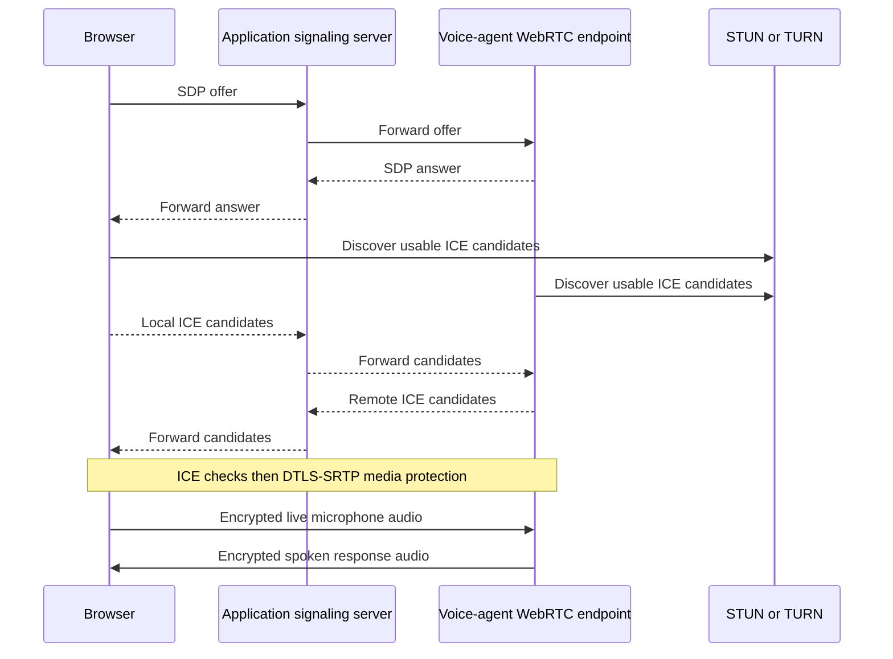
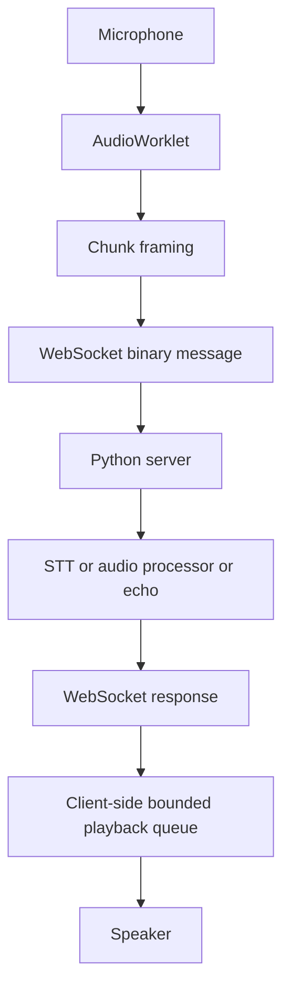

# كيف ينتقل الصوت في الزمن الحقيقي؟ WebRTC مقابل WebSockets في هندسة الوكلاء الصوتيين

**Voice AI Engineering — المقالة 08 / 16**  
**المستوى:** متوسط | **زمن القراءة:** 25–35 دقيقة + مختبر عملي  
**English:** [[08-Real-Time-Audio-Transport-EN|Read in English]]  
**السابقة:** [[07-Build-First-Voice-Agent-with-Pipecat-AR|بناء أول وكيل صوتي باستخدام Pipecat]]  
**الفهرس:** [[00-Series-Roadmap|خارطة السلسلة]]

![[assets/real-time-transports-cover.png]]

> [!abstract] الفكرة الأساسية
> قد يولّد وكيل صوتي مبني على **STT → LLM → TTS** إجابات صحيحة، ومع ذلك يصل صوته إلى المستخدم متأخراً أو متقطعاً، والسبب في حالات كثيرة ليس النموذج بل **نقل الصوت عبر الشبكة**. نشرح في هذه المقالة الفرق بين **WebRTC** و**WebSockets**، وأدوار **ICE/STUN/TURN**، وأثر **Jitter** و**Packet Loss** في ما يسمعه المستخدم. ثم نبني تجربة WebSocket صوتية صغيرة على الجهاز المحلي، ونراجع كيف نقيس جودة اتصال WebRTC فعلياً.

## 1. لماذا يُعدّ النقل جزءاً من تجربة الذكاء الاصطناعي؟

تخيّل سيناريو خدمة عملاء: يقول المستخدم: «أريد تغيير موعدي من الثلاثاء إلى الخميس». يكتمل التعرف على كلامه سريعاً، ويولد النموذج الرد، لكن الصوت يتأخر نصف ثانية أخرى داخل الشبكة أو قائمة انتظار التشغيل. حين يبدأ الوكيل بالكلام، يكون المستخدم قد غيّر طلبه مرة ثانية.

يوضح هذا المثال أن **زمن النموذج ليس هو زمن المحادثة**. ويمكن تقسيم المسار تقريبياً إلى المراحل التالية:


الـ**Transport** يؤثر في زمن وصول عينات المستخدم، وفي انتظام وصول صوت الوكيل، وفي سرعة تنفيذ أوامر الإيقاف عند المقاطعة. لذلك فاختيار وسيلة النقل قرار يمسّ تجربة المستخدم مباشرة، وليس تفصيلاً شبكياً فقط.

> [!important] تعريف عملي
> **Low latency** يعني وصول المعلومة بسرعة، أما **Low jitter** فيعني وصولها بانتظام. قد تمتلك اتصالاً سريعاً في المتوسط، لكنه يعاني تقطّعاً ملحوظاً بسبب تفاوت أزمنة وصول الحزم.

## 2. ما الفرق بين WebRTC وWebSockets؟

**WebRTC** مجموعة تقنيات ومعايير تتيح التواصل الصوتي/المرئي الآني داخل المتصفح، بما في ذلك التقاط وسائط المستخدم، والتفاوض على الاتصال، وإرسال وسائط محمية، ومعالجة عدد من مشاكل الشبكات المتقلبة. أما **WebSocket** فهو قناة ثنائية الاتجاه بين العميل والخادم؛ يمكن نقل رسائل نصية وثنائية (Binary) عبرها، لكنه **لا يوفر تلقائياً** Codec صوتياً أو Jitter Buffer أو VAD أو منطق تشغيل الصوت.[^webrtc-overview][^websocket-mdn]

![[assets/transport-architecture.png]]

*الشكل 1 — مساران مفاهيميان: WebRTC لنقل الوسائط الآنية، وWebSocket كقناة عامة ينشئ فوقها التطبيق بروتوكول الصوت الخاص به.*

| جانب المقارنة | WebRTC | WebSocket |
|---|---|---|
| الاستخدام النموذجي | صوت وفيديو مباشر، اتصال تفاعلي | رسائل وأحداث وتدفق بيانات مخصص |
| نقل الوسائط | RTP/SRTP مع إدارة شبكة ووسائط | رسائل ثنائية يحدد التطبيق معناها |
| سلوك الفقد | يمكن مواصلة تشغيل الوسائط مع تعويض/إخفاء الفقد وفق النظام | النقل الموثوق والمرتب عبر TCP قد يؤخر البيانات اللاحقة عند فقد جزء سابق |
| الشبكات خلف NAT | تفاوض ICE واستخدام STUN/TURN عند الحاجة | اتصال عميل بخادم معروف دون تفاوض P2P مشابه |
| التشفير | وسائط WebRTC محمية باستخدام آليات DTLS-SRTP | استخدم **WSS** (WebSocket عبر TLS) |
| صعوبة البناء من الصفر | تعقيد تفاوض وإعداد أعلى؛ دعم وسائط مدمج | اتصال أبسط؛ التطبيق يبني تسجيل الصوت وتأطيره وتشغيله |
| مناسب للوكيل الصوتي؟ | غالباً خيار ممتاز للمحادثات الصوتية عبر المتصفح | مناسب إذا كان لديك بروتوكول بث مخصص وتفهم المقايضات |

> [!note] تجنّب المبالغة
> WebRTC ليس دائماً أسرع من WebSocket، وWebSocket ليس دائماً غير مناسب للصوت. قد يستخدم WebRTC مسار TURN فوق TCP في بعض الحالات. **القرار الهندسي** يُقاس في ظروف المستخدم الفعلية: وقت الاتصال، P95 للتأخير، التقطّع، استعادة الاتصال، والمقاطعات.[^rfc-transports]

## 3. WebRTC من الداخل: ليس مجرد إرسال UDP

ثمة ثلاثة مستويات ينبغي الفصل بينها:

1. **Signaling:** قناة تطبيقية لتبادل عرض/إجابة SDP ومعلومات مرشّحي ICE. يمكن تنفيذها عبر HTTPS أو WebSocket؛ WebRTC لا يفرض بروتوكول Signaling واحداً.
2. **Connectivity:** آلية ICE تبحث عن مسار اتصال صالح، مستعينة بخوادم STUN وTURN عند الحاجة.
3. **Media transport:** تبادل الوسائط باستخدام RTP المحمي ضمن WebRTC، مع تقنيات مثل RTCP للتغذية الراجعة والإحصاءات، إضافة إلى Buffer وتشغيل الصوت عند الطرف المستقبل.[^mdn-connectivity][^rfc-transports][^rfc-media]



*هذا مخطط مفاهيمي؛ قد تبدأ عملية جمع المرشّحين قبل وصول جواب SDP، وقد تكون الرسائل مختلفة بين التنفيذات.*

### STUN وTURN وICE: لماذا نحتاج الثلاثة؟

- **NAT:** يربط الأجهزة ذات العناوين الخاصة بالشبكة العامة؛ وقد يعيق إنشاء مسار مباشر متبادل.
- **STUN:** يساعد الطرف على اكتشاف عنوانه/منفذه الظاهرين من الخارج. **لا يعني الحصول على عنوان عبر STUN ضمان نجاح الاتصال.**
- **TURN:** يمرّر الوسائط عبر خادم وسيط عند تعذّر المسار المباشر. هذا يرفع الاعتمادية في بعض الشبكات، لكنه يستهلك عرض نطاق للخادم وقد يزيد التأخير والتكلفة.
- **ICE:** يجمع أنواعاً من المسارات المحتملة ويفحص قابليتها للوصول ثم يختار زوج المرشّحين المناسب.

يمكن تلخيص مفهوم Candidate كالتالي:

| النوع | معناه التقريبي |
|---|---|
| `host` | عنوان اتصال محلي أو عنوان واجهة متاح للطرف |
| `srflx` | عنوان منعكس يكتشفه الطرف عبر STUN |
| `relay` | عنوان اتصال يوفره خادم TURN |

[^mdn-connectivity][^webrtc-guide]

> [!warning] سوء فهم شائع
> «أضفت خادم STUN مجانياً، إذن WebRTC سيعمل في كل مكان» عبارة غير صحيحة. اختبر المسارات **relay** أيضاً، خصوصاً لدى المستخدمين على شبكات الشركات والهواتف والشبكات المقيّدة. لا تعتمد على خادم TURN عام لا تعرف شروطه أو موثوقيته في الإنتاج.

## 4. كيف يبدو اتصال WebRTC من جهة المتصفح؟

الكود التالي **مقتطف توضيحي** وليس تطبيقاً مستقلاً؛ يحتاج خادم Signaling وطرف WebRTC آخر لتبادل SDP وICE:

```javascript
const peer = new RTCPeerConnection({
  iceServers: [
    { urls: 'stun:stun.example.org:3478' },
    // Configure your own TURN credentials on a trusted server:
    // { urls: 'turns:turn.example.org:5349', username: '...', credential: '...' }
  ]
});

const mic = await navigator.mediaDevices.getUserMedia({ audio: true });
mic.getAudioTracks().forEach(track => peer.addTrack(track, mic));

peer.ontrack = ({ streams }) => {
  // Attach the incoming track/stream to an <audio autoplay> element.
};

peer.onicecandidate = ({ candidate }) => {
  if (candidate) {
    // Send candidate to your trusted signaling server.
  }
};

const offer = await peer.createOffer();
await peer.setLocalDescription(offer);
// Send offer to the server; receive answer; call setRemoteDescription.
// Receive remote ICE candidates; call addIceCandidate for each.
```

تجري بعض هذه الخطوات بالنيابة عنك عندما تستخدم **Pipecat SmallWebRTCTransport** أو بنية جاهزة أخرى. لن تحتاج دائماً إلى كتابة Signaling بنفسك، لكنك ستحتاج إلى فهمه حين يفشل الاتصال أو يتعذّر اجتياز NAT.[^pipecat-transport]

## 5. WebSocket: قناة عامة يمكن أن تحمل الصوت

يتصل المتصفح بالخادم عبر `ws://` محلياً أو `wss://` على الإنترنت، ثم يستطيع الطرفان تبادل رسائل نصية أو Binary. عند إرسال صوت، يجب على التطبيق الاتفاق على:

- **ترميز الصوت:** PCM؟ Opus؟ ما معدل العينات وعدد القنوات؟
- **حدود الرسائل:** ما حجم Chunk، وما رقم تسلسله؟
- **التحكم:** start / stop / interruption / disconnect.
- **تشغيل الصوت:** كيف تتعامل مع التأخير وتفاوت وصول البيانات دون تضخم قائمة الانتظار؟
- **الخصوصية والأمان:** المصادقة، WSS، حدود حجم الرسائل، والسياسات الخاصة بالتسجيل والاحتفاظ بالصوت.



جوهر المقايضة هنا هو الترتيب. يضمن WebSocket ترتيب البيانات في القناة، لكن هذه الميزة لا تناسب الصوت الحي دائماً: عند فقد جزء من تدفق TCP قد تنتظر البيانات التالية إعادة إرساله، وهذا ما يسمى **Head-of-Line Blocking**. وفي المقابل، تجاهل الفقد وحده ليس حلاً؛ على تطبيق الوسائط أن يتعامل مع الفجوات، ويضبط الـBuffer، ويحافظ على صوت مفهوم.[^websocket-mdn][^rfc-media]

## 6. لماذا قد نسمع صوتاً متقطعاً رغم توفر سرعة إنترنت جيدة؟

هناك ثلاثة مؤشرات مختلفة:

| المؤشر | السؤال الذي يجيب عنه |
|---|---|
| **Latency** | كم تأخر وصول الصوت/تشغيله بعد إرساله؟ |
| **Jitter** | ما مدى تفاوت التأخير من حزمة لأخرى؟ |
| **Packet loss** | كم حزمة لم تصل أو لم تصل في الوقت المفيد للتشغيل؟ |

![[assets/transport-jitter-timeline.png]]

*الشكل 2 — بيانات اصطناعية فقط: الحزمة 2 غير مستلمة، والحزمة 4 وصلت قبل الحزمة 3؛ هذا يوضح سبب الحاجة إلى Buffer ومعالجة إعادة الترتيب.*

**Jitter Buffer** يحتفظ بقدر محدود من الصوت الوارد ليعيد تشغيله بإيقاع ثابت. زيادة حجمه قد تقلل التقطّع، لكنها تضيف تأخيراً؛ وتصغيره يقلل التأخير لكنه يجعل التشغيل أكثر حساسية لتقلبات الشبكة.

> [!example] حساب حجم الإطارات
> إذا التقطنا صوتاً أحادي القناة بمعدل **48,000 عينة/ثانية** و**Float32 (32 bit)**، فإن إطاراً بطول **20 ms** يحوي **960 عينة × 4 بايت = 3,840 بايت**. وبمعدل 50 إطاراً في الثانية يصبح الصوت الخام وحده **1,536 kbit/s** (قبل ترويسات WebSocket/TCP/TLS). لهذا نستخدم عادة ترميزات مناسبة مثل Opus عند الحاجة إلى إرسال صوت مضغوط. معدل البت الفعلي يعتمد على الإعدادات والمحتوى.

## 7. أين نقيس جودة WebRTC بدلاً من التخمين؟

توفّر واجهة `RTCPeerConnection.getStats()` إحصاءات للاتصال. من أهمها:

- `inbound-rtp.jitter`: تقدير Jitter للحزم المستلمة؛ **وحدته ثانية** في واجهة الإحصاءات، وليس ميلي ثانية.
- `inbound-rtp.packetsLost`: عدد الحزم المفقودة كما يحسبه الإحصاء؛ لا تحول الرقم التراكمي إلى معدل إلا باستخدام نافذة زمنية وتعريف واضح.
- `candidate-pair.currentRoundTripTime`: تقدير RTT إن توفر، لكنه ليس تأخير الكلام من النهاية إلى النهاية.
- `transport.selectedCandidatePairId`: للوصول إلى زوج المسارات المحدد، إن وفره المتصفح.

```javascript
async function inspectWebRTC(peer) {
  const report = await peer.getStats();
  for (const stat of report.values()) {
    if (stat.type === 'inbound-rtp' && stat.kind === 'audio') {
      console.log({
        jitterMs: typeof stat.jitter === 'number' ? stat.jitter * 1000 : null,
        lostPackets: stat.packetsLost ?? null,
        receivedPackets: stat.packetsReceived ?? null,
      });
    }
    if (stat.type === 'candidate-pair' && stat.nominated) {
      console.log({
        currentRttMs: typeof stat.currentRoundTripTime === 'number'
          ? stat.currentRoundTripTime * 1000 : null,
      });
    }
  }
}
```

لا يعني مجرد ظهور `nominated` أن هذا هو الإحصاء الوحيد المهم دائماً؛ استخدم الربط الرسمي بزوج الاتصال المحدد عندما يكون متاحاً. كما ينبغي قياس **وقت أول صوت مسموع، والتأخير بين المقاطعة وتوقف التشغيل، وP50/P95** على مستوى التطبيق، لأنها لا تختزل في RTT.[^mdn-stats]

## 8. تجربة عملية: نقل صوت حقيقي عبر WebSocket محلي

داخل مجلد هذه السلسلة ستجد:

```text
examples/
├── transport_network_lab.py
├── test_transport_network_lab.py
├── make_transport_figures.py
└── ws_voice_demo/
    ├── server.py
    ├── index.html
    ├── main.js
    ├── audio-worklet.js
    └── requirements.txt
```

هذه **تجربة loopback حقيقية محلياً** لا تستخدم STT/LLM/TTS، ولا تزعم بناء WebRTC؛ الغرض منها إظهار ما الذي يتعين على مطوّر WebSocket تنفيذه بنفسه: التقاط الصوت، تقسيمه، إرسال Binary، والجدولة المحدودة للتشغيل.

### التشغيل

> [!caution] الخصوصية والسلامة
> شغّلها على جهازك فقط، وباستخدام سماعات رأس. الخادم الافتراضي مربوط بـ`127.0.0.1` ويقبل Origins محلية محددة. لا تنشره على الإنترنت: ليس لديه نظام حسابات أو ضبط مستخدمين، ويستخدم `ws://` محلياً لا `wss://` إنتاجياً. لا يبدأ التقاط الصوت إلا بعد موافقتك في المتصفح، ولا يحفظ الخادم أي ملف صوتي.

من داخل `Voice-Agent-Series` افتح طرفية أولى:

```bash
python -m pip install -r examples/ws_voice_demo/requirements.txt
python examples/ws_voice_demo/server.py
```

ثم افتح طرفية ثانية:

```bash
python -m http.server 8008 --bind 127.0.0.1 --directory examples/ws_voice_demo
```

افتح `http://127.0.0.1:8008`، واضغط **Start microphone loopback**، واسمح للمتصفح باستخدام الميكروفون. سيُرسل المتصفح Frames بصيغة Float32 وبمعدل عينات جهازك الحالي، ويعيد الخادم الحزم كما هي، ثم يجدول المتصفح تشغيلها. استخدم **Stop** لإغلاق الجلسة وتحرير الميكروفون.

**ما الذي تراقبه؟** إن تأخّر تشغيل الصوت أو ارتفع استهلاك الذاكرة، فالمشكلة ليست في أي نموذج AI، وإنما في قائمة الانتظار وتراكم البيانات في WebSocket أو في التشغيل. يضع المثال حداً لـ`bufferedAmount` ويُسقط بعض الإطارات عند امتلاء قائمة الانتظار؛ إنه خيار تعليمي للحفاظ على الاستجابة، **وليس سياسة تشغيل صوت مناسبة للإنتاج**.[^audio-worklet][^websocket-mdn]

### لماذا لم نختر WebRTC في هذا المختبر؟

لأن بناء اتصال WebRTC حقيقي من الصفر يتطلب طرفي WebRTC، وSignaling، وتفاوض ICE، وشروط تشغيل مناسبة. يمكنك إعادة استخدام وكيل المقالة السابعة المستند إلى Pipecat لاختبار WebRTC الحقيقي، ثم تطبيق `getStats()` أعلاه على الـ`RTCPeerConnection` الذي تديره الواجهة المستخدمة. **لا يُنشئ هذا المختبر بحد ذاته جلسة WebRTC.**

## 9. مختبر Python: Jitter وPacket Loss دون شبكة

```bash
python examples/transport_network_lab.py
python -m unittest discover -s examples -p "test_*.py" -v
```

يعمل المختبر ببيانات اصطناعية، ويعرض مثلاً أن الحزمة `seq=2` مفقودة ضمن 6 حزم متوقعة (فقد مرصود **16.67%**)، وأن `seq=4` وصلت قبل `seq=3`. يحسب أيضاً تقديراً تعليمياً لتفاوت التأخير وفق متوسط أسي مستوحى من صيغة RFC 3550؛ هذا **ليس** تقرير WebRTC `getStats()` ولا Benchmark لشبكة حقيقية.

> [!tip] تمرين اختياري
> عدّل أزمنة `arrived_ms` في `example_stream()` مع بقاء أزمنة الإرسال كما هي. راقب كيف يتغير `jitter_ms`. أضف حزمة لم تصل، أو أرسل حزمة مكررة، أو غيّر ترتيب الوصول. ثم فكّر: هل من الأفضل إعادة المحاولة أم إخفاء الفقد والاستمرار، إذا كان المستخدم يسمع الرد الآن؟

## 10. كيف تختار النقل لمشروعك؟

| السيناريو | نقطة البداية العملية |
|---|---|
| محادثة صوتية مباشرة من المتصفح | جرّب **WebRTC** أو SDK صوتياً يقدم اتصال وسائط جاهزاً |
| بث نصوص STT وأحداث التحكم ونتائج الأدوات | **WebSocket** أو HTTP streaming حسب طبيعة التطبيق |
| خدمة هاتفية بمزود Telephony معين | استخدم Transport المدعوم لدى المزود وراجع Codec والوقت الفعلي |
| شبكة شركات مع منافذ مقيدة | اختبر ICE وTURN وسياسات الشبكة، وليس STUN فقط |
| خدمة صوتية موجودة تعرض WebSocket Streaming فقط | استخدم WebSocket ولكن صمّم الصوت والـBuffer والتعافي بوعي |
| تطبيق يحتاج فيديو + صوت + مقاطعات | عادةً ابدأ من WebRTC أو منصة وسائط متخصصة |

وثائق **Pipecat** توفر عدة أنواع من Transports، بما فيها SmallWebRTC وWebSocket. اختر بناءً على المنصة والتكامل الفعلي، لا على اسم البروتوكول وحده.[^pipecat-transport]

## 11. ما الذي يجعله جاهزاً للإنتاج؟

- [ ] **TLS**: استخدام HTTPS/WSS ووسائط WebRTC المحمية.
- [ ] **Authentication/authorization**: تقييد من يستطيع بدء جلسة صوتية، وتحديد مدة الجلسة وصلاحياتها.
- [ ] **TURN reliability**: مسار relay معروف وموثوق، مع اختبار شبكات مختلفة ومراقبة التكلفة.
- [ ] **Backpressure**: منع تراكم غير محدود للصوت، ووضع سياسة واضحة لـDrop/Retry/Concealment.
- [ ] **Observability**: قياس ICE failures وRTT وJitter وPacket Loss ووقت بدء الصوت المسموع.
- [ ] **Session lifecycle**: تحرير الميكروفون والاتصالات وموارد المعالجة عند الانفصال والمقاطعة.
- [ ] **Privacy**: موافقة واضحة قبل الميكروفون، وسياسة حفظ/حذف، وعدم تسجيل الصوت افتراضياً.
- [ ] **Testing**: اختبارات شبكات ضعيفة، وانتقال Wi-Fi/Cellular، وانقطاع الاتصال، وإلغاء الكلام أثناء الرد.

> [!warning] مشكلة معمارية شائعة
> **Transport encryption ليس تشفيراً شاملاً من المستخدم إلى النموذج (End-to-End Encryption)** إذا كان الخادم يفك تشفير الوسائط لمعالجتها باستخدام STT أو LLM. يجب وصف الحدود الأمنية بدقة، خصوصاً للأنظمة الطبية والمالية.

## 12. أخطاء شائعة يجب تجنّبها

1. **الخلط بين Signaling وMedia:** اتصال HTTPS أو WebSocket يرسل SDP لا يعني أن الصوت نفسه سيمر عبر تلك القناة.
2. **الاكتفاء بـSTUN:** بعض شبكات المستخدمين لا تسمح بالمسار المباشر وتحتاج TURN.
3. **قياس RTT باعتباره زمن الرد الصوتي:** RTT ليس مجموع STT وLLM وTTS والتشغيل.
4. **إرسال PCM خام في الإنتاج دون حساب Bandwidth:** جرّب حساب 48 kHz Float32 السابق.
5. **عدم تقييد مخزن WebSocket:** الرسائل قد تتراكم لأن الواجهة التقليدية لا تتضمن آلية Backpressure تلقائية.[^websocket-mdn]
6. **تجاهل الصدى:** تشغيل صوت الوكيل على مكبرات الصوت قد يجعله يدخل الميكروفون ويُحسب كمقاطعة.
7. **اعتبار النتائج الاصطناعية مؤشرات أداء لمنتج:** محاكاة شبكة محلية لا تثبت جودة الصوت عند آلاف المستخدمين.

## الخلاصة

اختيار النقل أكبر من سؤال «أي API أستخدم؟»؛ فهو يحدد **إمكانية الاتصال، انتظام الصوت، سرعة المقاطعة، وقدرة النظام على التعافي من مشاكل الشبكة**. WebRTC يعطيك مجموعة متكاملة من أدوات الوسائط الآنية، بينما WebSocket يمنحك قناة عامة تحتاج أن تصمم فوقها دلالات الصوت وجدولته ومعالجة ازدحامه. قِس الأداء عند المستخدم ولا تكتفِ بزمن استجابة النموذج.

> [!success] ما أصبحت قادراً على فعله
> تمييز WebRTC عن WebSocket، وشرح Signaling/ICE/STUN/TURN، وفهم Jitter Buffer وHead-of-Line Blocking، وتشغيل تجربة WebSocket صوتية محلية، وبدء مراقبة WebRTC بإحصاءات قابلة للقياس.

### المقالة القادمة

**[[09-VAD-Endpointing-and-Turn-Detection-AR|09 — VAD, Endpointing & Turn Detection: كيف يعرف الوكيل متى يبدأ المستخدم ومتى ينتهي من الكلام؟]]** ننتقل فيها من نقل الصوت إلى تحديد دور الحديث: متى ينهي المستخدم كلامه، ومتى يحين دور الوكيل.

---

## المراجع الأساسية

[^webrtc-overview]: [MDN — WebRTC API](https://developer.mozilla.org/en-US/docs/Web/API/WebRTC_API)؛ مقدمة لتقنيات الوسائط واتصالات الأقران.
[^websocket-mdn]: [MDN — WebSocket API](https://developer.mozilla.org/en-US/docs/Web/API/WebSocket)؛ يشمل الرسائل الثنائية و`bufferedAmount` وحدود Backpressure.
[^mdn-connectivity]: [MDN — WebRTC Connectivity](https://developer.mozilla.org/en-US/docs/Web/API/WebRTC_API/Connectivity)؛ ICE candidates والمسارات.
[^webrtc-guide]: [WebRTC.org — Getting Started with Peer Connections](https://webrtc.org/getting-started/peer-connections)؛ STUN وTURN وإعداد ICE.
[^rfc-transports]: [RFC 8835 — Transports for WebRTC](https://www.rfc-editor.org/rfc/rfc8835.html)؛ متطلبات النقل والتشفير.
[^rfc-media]: [RFC 8834 — Media Transport and Use of RTP in WebRTC](https://www.rfc-editor.org/rfc/rfc8834.html)؛ RTP/RTCP وفقد الحزم وJitter.
[^pipecat-transport]: [Pipecat — Choosing a Transport](https://docs.pipecat.ai/client/concepts/choosing-a-transport)؛ و[Pipecat — Transports](https://docs.pipecat.ai/pipecat/learn/transports).
[^mdn-stats]: [MDN — RTCInboundRtpStreamStats](https://developer.mozilla.org/en-US/docs/Web/API/RTCInboundRtpStreamStats)؛ و[W3C WebRTC Statistics](https://www.w3.org/TR/webrtc-stats/).
[^audio-worklet]: [MDN — Using AudioWorklet](https://developer.mozilla.org/en-US/docs/Web/API/Web_Audio_API/Using_AudioWorklet)؛ و[MDN — getUserMedia](https://developer.mozilla.org/en-US/docs/Web/API/MediaDevices/getUserMedia).

---

*ملاحظة تحريرية: تمت مراجعة المراجع بتاريخ 21 نوفمبر 2026. الأرقام الواردة في المختبر والصور بيانات اصطناعية أو حسابات لحجم PCM؛ نتائج التشغيل الفعلي تعتمد على المتصفح والشبكة والعتاد.*
