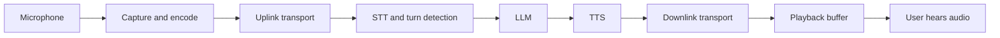
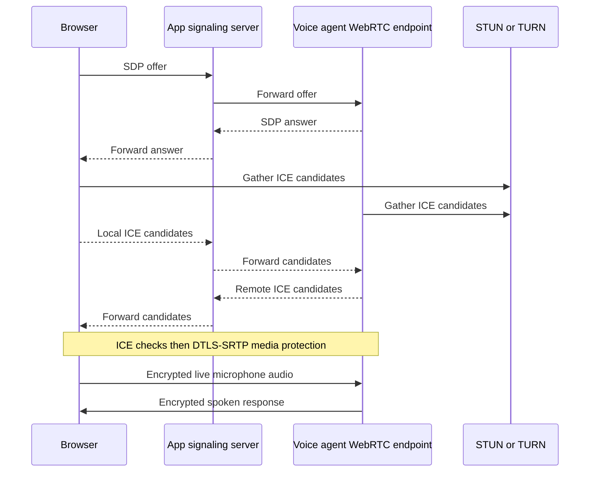
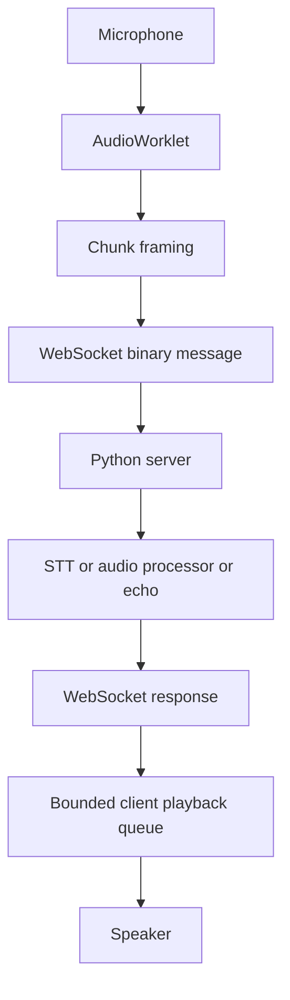

# Real-Time Audio Transport for Voice Agents: WebRTC vs WebSockets

**Voice AI Engineering — Article 08 / 16**  
**Level:** Intermediate | **Reading time:** 25–35 minutes + hands-on lab  
**العربية:** [[08-Real-Time-Audio-Transport-AR|اقرأ المقالة بالعربية]]  
**Previous:** [[07-Build-First-Voice-Agent-with-Pipecat-EN|Your First Voice Agent with Pipecat]]  
**Series index:** [[00-Series-Roadmap|Voice AI Engineering Roadmap]]

![[assets/real-time-transports-cover.png]]

> [!abstract] What you will learn
> We have covered **STT, LLM, TTS, and conversational pipelines**. But even a perfect model can feel slow or unreliable when audio arrives late or unevenly. The missing component is often the **real-time transport layer**. This article compares **WebRTC and WebSockets**, explains **ICE/STUN/TURN**, demonstrates **jitter and packet loss**, and provides a local WebSocket audio lab plus practical WebRTC diagnostics.

## 1. The network is part of the conversation

Imagine a caller saying, “Move my appointment from Tuesday to Thursday.” Speech recognition completes quickly, the LLM generates a correct answer, and TTS emits audio. Then an unpredictable network queue adds half a second before the first sound reaches the user's headphones. The caller has already started correcting the request.

This reveals an important engineering fact: **model response time is not the same as conversation latency**.



Transport affects when user speech reaches the agent, how regularly generated audio reaches the client, and how fast the system can stop speaking after an interruption. It is an **interaction-design decision**, not merely a networking implementation detail.

> [!important] Two different goals
> **Low latency** means data arrives quickly. **Low jitter** means arrival delays are consistent. A system can have a good average network delay while still producing audible glitches because packet arrival times vary widely.

## 2. WebRTC vs WebSockets at a glance

**WebRTC** is a collection of standards and browser APIs designed for interactive real-time media: microphone/video capture, connection negotiation, encrypted media transfer, and mechanisms that support playback over imperfect networks. **WebSocket** provides a bidirectional message channel between a client and a server. It can carry binary audio data, but it does not automatically supply audio codecs, voice activity detection, playback scheduling, or a jitter buffer.[^webrtc-overview][^websocket-mdn]

![[assets/transport-architecture.png]]

*Figure 1 — Two conceptual paths: WebRTC includes a real-time media transport; WebSocket provides a generic channel on which your application defines an audio protocol.*

| Dimension | WebRTC | WebSocket |
|---|---|---|
| Common use | Interactive audio/video | Custom messages, events, arbitrary binary streams |
| Media behavior | RTP/SRTP, media and connectivity handling | Application-defined binary messages |
| Packet loss | Can continue playout despite some missing media, depending on codec and receiver behavior | Reliable ordered delivery over TCP can delay later data while an earlier segment is retransmitted |
| NAT traversal | ICE, often using STUN and TURN | Typical client-initiated connection to a reachable server; no comparable P2P negotiation required |
| Encryption | WebRTC media protection using DTLS-SRTP | **WSS** (WebSocket over TLS) |
| Engineering effort | More setup and signaling concepts, but media features are built in | Simple socket API, more application work for audio processing |
| Voice-agent fit | Often a strong default for browser calls | Viable for provider-specific streaming and custom pipelines |

> [!note] No protocol wins every benchmark
> WebRTC is not necessarily faster in every deployment. WebRTC can use TURN over TCP where direct UDP communication fails, and a carefully engineered WebSocket pipeline may perform well for its intended workload. Measure your **real users**, network paths, P95 latency, reconnect behavior, and interruption response time.[^rfc-transports]

## 3. What actually happens inside WebRTC?

It helps to separate three distinct responsibilities:

1. **Signaling:** The application exchanges SDP offers/answers and ICE candidate messages. This can happen over HTTPS or WebSocket; WebRTC does not prescribe one signaling protocol.
2. **Connectivity:** ICE discovers and checks candidate network paths, optionally assisted by STUN and TURN servers.
3. **Media transport:** The peers exchange protected RTP media, use feedback and statistics, and schedule/decode audio on the receiving side.[^mdn-connectivity][^rfc-transports][^rfc-media]



*This sequence is conceptual. ICE candidate discovery can overlap SDP signaling, and specific implementations may exchange messages in a different order.*

### ICE, STUN, TURN, and NAT

**NAT (Network Address Translation)** maps devices on private networks to externally reachable addresses. It can make it difficult to establish direct communication between peers.

- **STUN:** Helps a peer discover the public-facing address/port observed from outside. Learning an external address **does not guarantee** successful peer connectivity.
- **TURN:** Relays traffic through a server when a direct route cannot be established. This can improve reachability, but introduces relay bandwidth and potentially extra latency/cost.
- **ICE:** Collects connectivity candidates, performs checks, and selects a usable candidate pair.

| Candidate type | Conceptual meaning |
|---|---|
| `host` | A local/network-interface candidate |
| `srflx` | Server-reflexive candidate discovered using STUN |
| `relay` | A relayed candidate allocated through TURN |

[^mdn-connectivity][^webrtc-guide]

> [!warning] A common misconception
> Adding a public STUN server does not guarantee calls will connect from every corporate, cellular, or filtered network. Production systems should test reliable **relay candidate** paths, with managed credentials and monitoring. Do not depend on an unknown public TURN relay for critical workloads.

## 4. A browser-side WebRTC connection, conceptually

The snippet below is **not** a complete runnable application. It shows the browser primitives; a real deployment needs a signaling service and another WebRTC endpoint:

```javascript
const peer = new RTCPeerConnection({
  iceServers: [
    { urls: 'stun:stun.example.org:3478' },
    // Replace with TURN servers and real credentials when needed.
    // { urls: 'turns:turn.example.org:5349', username: '...', credential: '...' }
  ]
});

const stream = await navigator.mediaDevices.getUserMedia({ audio: true });
for (const track of stream.getAudioTracks()) peer.addTrack(track, stream);

peer.onicecandidate = ({ candidate }) => {
  if (candidate) {
    // Send candidate to your trusted signaling channel.
  }
};

peer.ontrack = ({ streams }) => {
  // Attach the remote stream to an <audio autoplay> element.
};

const offer = await peer.createOffer();
await peer.setLocalDescription(offer);
// Send offer, receive SDP answer, call setRemoteDescription(answer).
// Receive remote ICE candidates and call addIceCandidate(candidate).
```

Frameworks such as **Pipecat SmallWebRTCTransport** help you avoid implementing the full signaling and media stack from scratch. Still, understanding candidate gathering and the distinction between signaling and audio transport is valuable when debugging connection failures.[^pipecat-transport]

## 5. What sending audio over WebSocket requires

A browser can send text and binary frames across a WebSocket connection (`ws://` for local experiments; **`wss://` in production**). But because WebSocket does not interpret an audio frame, the application must decide:

- Which **audio format** to use: PCM or a codec, with an explicit sample rate/channel layout.
- How to **frame chunks**: durations, sequence numbers, timestamps, and message boundaries.
- How to implement **control events**: start, stop, cancel, barge-in, disconnect.
- How to manage **backpressure and playback** without unbounded buffering.
- How to enforce **security and privacy**: authentication, input limits, WSS, consent, and data retention.



The central tradeoff is ordering. WebSocket's TCP connection provides ordered, reliable delivery. When a TCP segment is lost, later bytes can be delayed until earlier bytes are retransmitted. This **head-of-line blocking** may be undesirable when old audio is less useful than the newest audio. Conversely, simply allowing lost audio to disappear is not sufficient; media applications need concealment, scheduling, and controls for quality.[^websocket-mdn][^rfc-media]

## 6. Latency, jitter, packet loss, and the jitter buffer

These metrics answer different questions:

| Metric | What it describes |
|---|---|
| **Latency** | Time needed for an audio item to arrive or become audible |
| **Jitter** | Variation in the delay between different arriving packets |
| **Packet loss** | Packets that do not arrive, or do not arrive in time for useful playout |

![[assets/transport-jitter-timeline.png]]

*Figure 2 — Entirely synthetic packet arrivals: packet 2 is absent, and packet 4 arrives before packet 3.*

A **jitter buffer** holds a short span of received media so the player can output a smoother stream. A larger buffer can reduce dropouts but increases playback delay. A smaller buffer reduces delay, but makes playback more sensitive to network variation. This is why the best buffering policy depends on the user experience, codec, network, and tolerance for glitches.

> [!example] Estimating raw audio bandwidth
> At **48,000 samples/second**, **Float32 = 32 bits per sample**, and **mono audio**, a **20 ms** frame contains **960 samples × 4 bytes = 3,840 bytes**. Fifty frames per second require **1,536 kbit/s** of *raw audio*, before WebSocket/TCP/TLS overhead. A compressed codec such as Opus can reduce this considerably, with a bitrate depending on settings and source characteristics.

## 7. Measure WebRTC instead of guessing

The browser's `RTCPeerConnection.getStats()` API exposes connection statistics. Useful fields include:

- `inbound-rtp.jitter`: estimated receiver RTP jitter, expressed in **seconds**, not milliseconds.
- `inbound-rtp.packetsLost`: cumulative packet-loss value for the stream; compute a rate only with a well-defined observation window.
- `candidate-pair.currentRoundTripTime`: estimated RTT for a candidate pair if available; **not end-to-end voice response latency**.
- `transport.selectedCandidatePairId`: when exposed, identifies the selected candidate pair.

```javascript
async function inspectWebRTC(peer) {
  const report = await peer.getStats();
  for (const stat of report.values()) {
    if (stat.type === 'inbound-rtp' && stat.kind === 'audio') {
      console.log({
        jitterMs: typeof stat.jitter === 'number' ? stat.jitter * 1000 : null,
        lostPackets: stat.packetsLost ?? null,
        receivedPackets: stat.packetsReceived ?? null,
      });
    }
    if (stat.type === 'candidate-pair' && stat.nominated) {
      console.log({
        currentRttMs: typeof stat.currentRoundTripTime === 'number'
          ? stat.currentRoundTripTime * 1000 : null,
      });
    }
  }
}
```

A nominated candidate pair is not necessarily the only relevant entry; use the browser's selected-pair mapping where supported. Also measure application-facing values such as **time to first audible output**, **interruption-to-playback-stop latency**, and **P50/P95** of end-user response times. Network RTT cannot replace those measures.[^mdn-stats]

## 8. Hands-on lab: browser microphone over a local WebSocket

The pack includes a real local **audio loopback** demo:

```text
examples/
├── transport_network_lab.py
├── test_transport_network_lab.py
├── make_transport_figures.py
└── ws_voice_demo/
    ├── server.py
    ├── index.html
    ├── main.js
    ├── audio-worklet.js
    └── requirements.txt
```

This is deliberately **not a complete voice agent** and it **does not use WebRTC**. It demonstrates the extra plumbing an engineer must build when using a generic WebSocket transport: capturing audio, producing ~20-ms binary chunks, echoing those bytes, and scheduling browser-side playback.

### Run the local demo

> [!caution] Privacy and safety boundaries
> Use the demo **only on your machine**, with headphones. The example binds its server to `127.0.0.1`, allows only predefined localhost browser Origins, and does not persist microphone audio. It has no user authentication and uses local `ws://`, so it must not be deployed on the public internet as-is. The browser requests explicit microphone permission.

From inside `Voice-Agent-Series`, open one terminal:

```bash
python -m pip install -r examples/ws_voice_demo/requirements.txt
python examples/ws_voice_demo/server.py
```

Open a second terminal:

```bash
python -m http.server 8008 --bind 127.0.0.1 --directory examples/ws_voice_demo
```

Visit `http://127.0.0.1:8008`, select **Start microphone loopback**, and approve the microphone request. The browser samples native-rate mono Float32 audio, sends binary messages to the local Python server, receives the echoed samples, and schedules playback. Press **Stop** to close the connection and release the mic.

**Watch for:** growing delay, queue buildup, unexpected glitches, and the relationship between network bytes and actual audible playback. The example monitors `WebSocket.bufferedAmount` and bounds its playback queue. Under pressure it drops data for responsiveness: an educational choice, **not a production-grade audio concealment strategy**.[^audio-worklet][^websocket-mdn]

### What about an actual WebRTC experiment?

The voice agent developed in **Article 07** already uses Pipecat with WebRTC. Use that setup, with a compatible running frontend/backend, to observe live ICE and RTP metrics. This WebSocket lab cannot make a claim about WebRTC performance because it does **not establish a WebRTC connection**.

## 9. Pure Python exercise: packet arrival and jitter

```bash
python examples/transport_network_lab.py
python -m unittest discover -s examples -p "test_*.py" -v
```

The deterministic exercise simulates six expected packets, one missing `seq=2`, and a reordering event in which `seq=4` arrives before `seq=3`. In this synthetic example the observed missing-packet fraction is **16.67%**. A small RFC 3550-inspired exponential estimator illustrates transit-time variation; it is **not** equivalent to the actual browser's `getStats()` implementation, and it does not benchmark any transport service.

> [!tip] Exercise
> Change `arrived_ms` in `example_stream()` while keeping send times fixed. Add a duplicate packet or a missing packet. Observe how the jitter estimate and packet summary change. Ask yourself: if the user needs the latest spoken audio *now*, is retransmitting old audio more valuable than moving on and concealing the gap?

## 10. Choosing a transport for your application

| Use case | Good starting point |
|---|---|
| Browser-to-voice-agent live conversation | **WebRTC** or a proven media SDK |
| STT text updates, tool events, chat control | **WebSocket** or HTTP streaming, depending on the service |
| A telephony provider integration | Use the provider's supported transport and check its codec/latency specifications |
| Restricted corporate networks | Test ICE, TURN, and permitted firewall paths |
| A vendor that only exposes streaming over WebSockets | Use WebSocket with deliberate framing, bounded buffering, reconnection, and security |
| Audio plus video plus interruption handling | Usually start with WebRTC or a managed real-time media service |

**Pipecat** supports several transports, including SmallWebRTC and WebSocket. Select one based on actual service compatibility and performance constraints, not protocol popularity.[^pipecat-transport]

## 11. A production readiness checklist

- [ ] **Encryption:** HTTPS/WSS and protected WebRTC media connections.
- [ ] **Authentication/authorization:** Who may create sessions, for how long, and with what privileges?
- [ ] **TURN readiness:** Reliable relay paths across restrictive networks, with usage and cost monitoring.
- [ ] **Backpressure:** Bounded queues and explicit rules for dropping, retrying, or concealing audio.
- [ ] **Observability:** ICE connection failures, RTT, jitter, packet loss, time to first audible output.
- [ ] **Session lifecycle:** Release microphones, sockets, and inference resources on disconnect/cancel.
- [ ] **Privacy:** Explicit capture consent, deliberate retention policy, no incidental recording by default.
- [ ] **Network testing:** Loss, jitter, Wi-Fi-to-cellular changes, reconnects, and barge-in while playing audio.

> [!warning] Security terminology matters
> **Transport encryption is not end-to-end encryption between the user and the AI model** if a server terminates the encrypted media connection to run speech recognition or other processing. Document where plaintext audio or transcripts are accessible, particularly for sensitive applications.

## 12. Seven mistakes to avoid

1. **Confusing signaling with media:** An HTTPS/WS signaling connection does not mean RTP audio travels inside it.
2. **Assuming STUN guarantees reachability:** Restricted networks may require TURN relays.
3. **Calling RTT your voice-agent latency:** Model and playback work are missing from that number.
4. **Ignoring raw PCM bandwidth:** The 48 kHz Float32 calculation above is not small.
5. **Unbounded WebSocket buffering:** Classic WebSocket APIs do not automatically enforce receive backpressure.[^websocket-mdn]
6. **Ignoring echo:** Agent playback picked up by the mic can trigger false interruptions.
7. **Treating a simulation as a product benchmark:** Local synthetic packet timing proves no production latency or quality level.

## Conclusion

Choosing a transport is not just choosing an API. It determines **connectivity, the timing and continuity of speech, responsiveness to interruptions, and recovery from network faults**. WebRTC offers a broad set of native real-time media facilities. WebSocket gives you a generic message channel on top of which you must design your own audio semantics and queue management. Measure at the user's ears, not only at your model's response boundary.

> [!success] You can now
> Explain WebRTC versus WebSocket, separate signaling from media, describe ICE/STUN/TURN, reason about jitter and head-of-line blocking, run a local microphone loopback, and begin inspecting WebRTC statistics.

### Next article

**[[09-VAD-Endpointing-and-Turn-Detection-EN|09 — VAD, Endpointing & Turn Detection: How Does a Voice Agent Know When Someone Is Done Speaking?]]** The next article moves from transporting audio to deciding whose turn it is in the conversation.

---

## References

[^webrtc-overview]: [MDN — WebRTC API](https://developer.mozilla.org/en-US/docs/Web/API/WebRTC_API) — real-time browser communication.
[^websocket-mdn]: [MDN — WebSocket API](https://developer.mozilla.org/en-US/docs/Web/API/WebSocket) — binary frames and `bufferedAmount`/backpressure caveats.
[^mdn-connectivity]: [MDN — WebRTC Connectivity](https://developer.mozilla.org/en-US/docs/Web/API/WebRTC_API/Connectivity) — signaling, ICE, and candidates.
[^webrtc-guide]: [WebRTC.org — Getting Started with Peer Connections](https://webrtc.org/getting-started/peer-connections) — STUN/TURN and connectivity.
[^rfc-transports]: [RFC 8835 — Transports for WebRTC](https://www.rfc-editor.org/rfc/rfc8835.html) — mandatory transport and security aspects.
[^rfc-media]: [RFC 8834 — Media Transport and Use of RTP in WebRTC](https://www.rfc-editor.org/rfc/rfc8834.html) — RTP, RTCP, loss, and jitter.
[^pipecat-transport]: [Pipecat — Choosing a Transport](https://docs.pipecat.ai/client/concepts/choosing-a-transport) and [Pipecat — Transports](https://docs.pipecat.ai/pipecat/learn/transports).
[^mdn-stats]: [MDN — RTCInboundRtpStreamStats](https://developer.mozilla.org/en-US/docs/Web/API/RTCInboundRtpStreamStats) and [W3C WebRTC Statistics](https://www.w3.org/TR/webrtc-stats/).
[^audio-worklet]: [MDN — Using AudioWorklet](https://developer.mozilla.org/en-US/docs/Web/API/Web_Audio_API/Using_AudioWorklet) and [MDN — getUserMedia](https://developer.mozilla.org/en-US/docs/Web/API/MediaDevices/getUserMedia).

---

*Editorial note: Sources reviewed November 21, 2026. Timing figures are either synthetic or raw-audio arithmetic, not measurements of a commercial provider. Actual browser and network behavior must be tested independently.*
