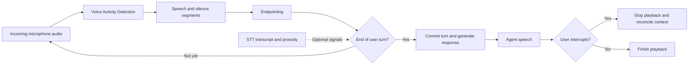
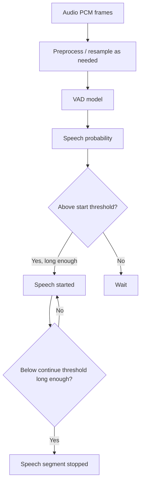
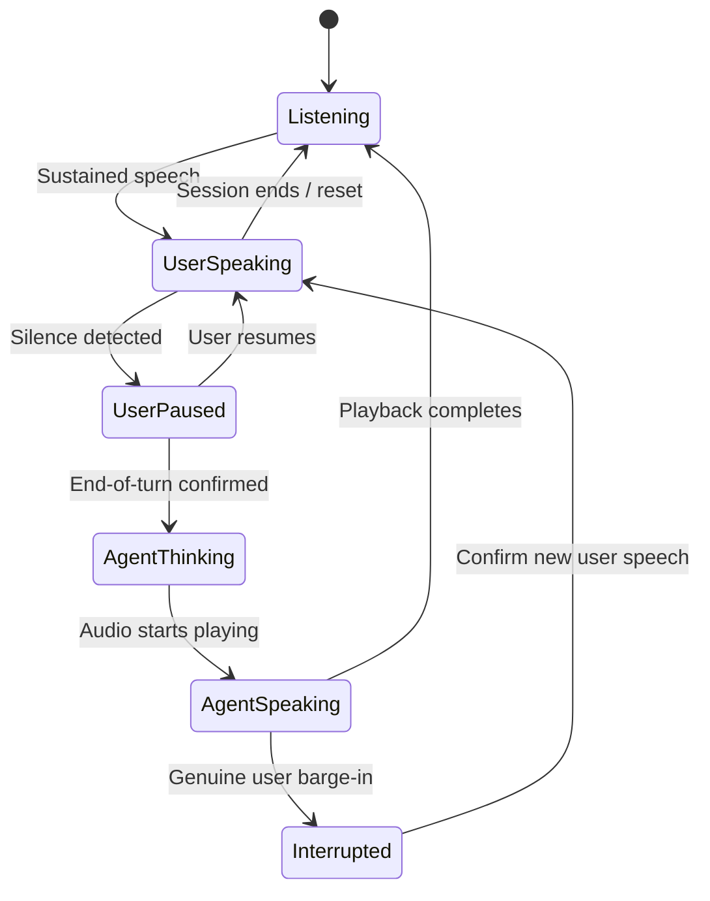

# كيف يعرف الوكيل الصوتي متى نتحدث ومتى ننتهي؟

**VAD, Endpointing & Turn Detection — المقالة 09 / 16**  
**المستوى:** متوسط | **زمن القراءة المتوقع:** 25–35 دقيقة + تطبيق عملي  
**English:** [[09-VAD-Endpointing-and-Turn-Detection-EN|Read in English]]  
**السابقة:** [[08-Real-Time-Audio-Transport-AR|WebRTC مقابل WebSockets]]  
**الفهرس:** [[00-Series-Roadmap|خارطة السلسلة]]

![[assets/turn-detection-cover.png]]

> [!abstract] السؤال الذي سنجيب عنه
> يستطيع الوكيل الصوتي اكتشاف أن الميكروفون التقط كلاماً، لكنه لا يعرف تلقائياً **هل انتهى المستخدم من فكرته؟** في هذه المقالة سنفصل بين **Voice Activity Detection (VAD)** و**Endpointing** و**Turn Detection**، ونفهم المقاطعات والتوقفات الطبيعية، ثم ننفذ مدير أدوار صوتية تعليمي باستخدام Python ونختبره.

## 1. لماذا تبدو بعض الوكلاء الصوتيين غير طبيعية؟

تخيّل أن المستخدم يقول:

> **المستخدم:** «أريد حجز موعد يوم الثلاثاء ... [يتوقف ليفكر] ... لا، الخميس أفضل، الساعة الخامسة.»
>
> **الوكيل المتسرّع:** «حسناً، حجزت لك الثلاثاء!»

المشكلة ليست بالضرورة في فهم اللغة أو في جودة STT. **النظام قرر أن دور المستخدم انتهى مبكراً**. وفي الحالة المعاكسة ينتظر الوكيل طويلاً بعد انتهاء الجملة، فيبدو بطيئاً.

من هنا تنشأ معادلة التفاعل الطبيعي: **لا تبدأ بالرد قبل أن ينتهي المعنى، ولا تنتظر طويلاً بعد انتهائه.**



*الشكل 1 — قرار «هناك كلام» يسبق قرار «انتهى الدور»؛ والأخير قد يستخدم الإشارات الصوتية والنص والسياق معاً.*

## 2. ثلاثة مصطلحات مختلفة لا ينبغي خلطها

| المفهوم | السؤال | الدخل المعتاد | الناتج | ما لا يفعله بمفرده |
|---|---|---|---|---|
| **VAD** | هل يوجد نشاط كلامي؟ | إطارات صوتية | كلام / لا كلام، أو احتمال كلام | لا يفهم اكتمال المعنى |
| **Endpointing** | هل انتهى مقطع الكلام الحالي؟ | توقف الصوت وإشارات STT | حدّ نهاية محتمل | ليس دائماً نهاية دور المستخدم |
| **Turn Detection** | هل المستخدم سلّم الدور للوكيل؟ | VAD + نص/نغمة/سياق حسب التنفيذ | قرار الاستجابة أو الانتظار | لا يضمن وحده إدارة المقاطعة كاملة |

يمكن للصمت أن يحدد نهاية **مقطع صوتي** دون أن يمثل نهاية **فكرة**. وقد تنتج خدمة STT نصاً نهائياً لمقطع بينما يستمر دور المستخدم في الجملة التالية.[^livekit-turns][^pipecat-speech]

> [!important] قاعدة ذهنية
> **Speech stopped ≠ User turn ended.**  
> توقف الصوت عن الكلام ليس بالضرورة انتهاء المستخدم من الحديث.

## 3. كيف يعمل Voice Activity Detection؟

يستقبل VAD الصوت في إطارات قصيرة ويقرر، غالباً لكل إطار، مدى احتمالية وجود الكلام. يمكن بناء كاشف بسيط يعتمد طاقة الإشارة (Energy-based VAD)، لكن الأصوات العالية ليست كلها كلاماً: ضجيج المكيف، طرق الباب وصوت الوكيل الخارج من السماعة قد تخدع هذا النوع. تستخدم الأنظمة الحديثة نماذج متعلّمة مثل **Silero VAD** للحصول على تقدير أقوى لوجود الكلام.[^silero]



### ثلاث آليات تجعل الكشف مستقراً

1. **Thresholds:** حدّ لبدء الكلام وحدّ آخر للاستمرار؛ غالباً يكون حدّ الاستمرار أخفض لمنع التبديل المتكرر بين حالتي الكلام والصمت (Hysteresis).
2. **Minimum speech duration:** نتجاهل نبضة قصيرة جداً حتى لا نعدّ صوت نقرة كلمةً بشرية.
3. **Minimum silence duration:** لا نغلق المقطع عند توقف قصير داخل كلمة أو بين كلمتين.

مثال تعليمي: قد نستخدم عتبتين `0.65` و`0.35`، وشرط 100ms للكلام و240ms للصمت. **هذه إعدادات مختبرنا وليست أرقاماً موصى بها لكل لغة أو بيئة**. في Silero VAD تختلف المعلمات والتفاصيل الفعلية وفق واجهة التشغيل؛ راجع المصدر الرسمي قبل الاستخدام.[^silero]

![[assets/turn-detection-timeline.png]]

*الشكل 2 — منحنى احتمالية كلام اصطناعي. يوجد توقف داخل الجملة، ثم يستأنف المستخدم قبل أن يُغلق الدور. القيم ليست قياسات من ميكروفون أو نموذج حقيقي.*

## 4. أين يبدأ Endpointing وأين ينتهي دور المستخدم؟

يعمل **Endpointing** عادةً على تجميع إشارات توقف الكلام وتوقيتاتها، وأحياناً إشارات مقدّم STT. الأسلوب الأبسط: «بعد آخر كلام مسموع، انتظر فترة صمت مقدارها X ميلي ثانية، ثم أغلق الدور». لكنه يرتكب خطأين متعاكسين:

- **Premature endpointing:** يغلق الدور بسرعة فيقاطع المستخدم وهو لا يزال يفكر أو يكمل جملته.
- **Late endpointing:** ينتظر طويلاً بعد اكتمال الطلب فتبدو المحادثة بطيئة.

### ثلاثة أساليب لإنهاء الدور

**أ. Fixed silence timeout:** قاعدة زمنية بسيطة، مناسبة للاختبارات الأولى لكنها حسّاسة لطريقة كلام المستخدم.

**ب. Adaptive or semantic turn detection:** نموذج أو خوارزمية تستفيد من نبرة الكلام والنص والسياق لتقدير ما إذا كان المستخدم أنهى فكرته، وليس فقط سكت. تختلف الإشارات المستخدمة بحسب المنتج؛ بعض النماذج متعددة الوسائط وبعضها صوتي فقط.[^livekit-detector][^pipecat-smart]

**ج. STT-native endpointing:** بعض أنظمة التعرف على الكلام ترسل حدثاً خاصاً بنهاية اللفظ أو اكتمال الدور. من المهم معرفة **المعنى الدقيق للحدث** في خدمة STT، وعدم افتراض أن أي `final transcript` يعني انتهاء الحديث.[^livekit-turns]

![[assets/turn-detection-tradeoff.png]]

*الشكل 3 — موازنة تعليمية بين الانتظار وخطر الإغلاق المبكر. جميع القيم في الرسم مخترعة لغرض توضيح العلاقة، وليست Benchmark.*

> [!tip] لماذا لا يكفي الصمت وحده؟
> «أريد التحويل إلى...» يتطلب غالباً انتظار تتمة، حتى لو ظهرت فترة صمت. أما «شكراً، انتهيت» فيمكن أن يكون دوراً مكتملاً سريعاً. تحديد ذلك يعتمد على السياق والنغمة وطبيعة المهمة، وليس على عدد الميلي ثانية فقط.

## 5. Turn-Taking: متى يتبادل الطرفان دور الحديث؟

نحتاج إلى حالات واضحة للنظام؛ مثلاً:



هذا المخطط منطقي، لا يمثل بالضرورة جميع الحالات الداخلية لأي مكتبة. على سبيل المثال قد يبدأ LLM في إعداد جواب مبدئي قبل إعلان نهاية الدور (**preemptive generation**) لتقليل التأخير، لكن ينبغي ألا يُسمَع للمستخدم رد مبني على جزء غير مكتمل من سؤاله دون ضوابط مناسبة.[^livekit-tuning]

### هل المقاطعة مثل بداية كلام جديد؟

لا. أثناء حديث الوكيل، يحتاج النظام إلى تمييز:

- **Barge-in حقيقي:** «توقف، أنا أقصد يوم الخميس!» — ينبغي وقف الصوت والتحول للطلب الجديد.
- **Backchannel:** «مم»، «تمام»، «آها» — قد يدل على الاستماع دون طلب إيقاف الوكيل.
- **Echo:** الصوت الذي خرج من سماعة الجهاز ثم عاد إلى الميكروفون.
- **ضجيج خارجي:** لا يمثل مستخدماً يريد الكلام.

الكشف الصوتي وحده لا يفهم نية المتحدث. يمكن الجمع بين **AEC/Echo Cancellation** وVAD وSTT وآلية مقاطعات تكيفية، مع متابعة تشغيل الصوت على طرف العميل. سنفصل الإلغاء ومزامنة السياق في [[00-Series-Roadmap|المقالة العاشرة المخطط لها]].[^livekit-interrupt]

## 6. مثال واقعي: لماذا تختلف القرارات؟

| الحالة | ما قد يرصده VAD | القرار الأفضل عند الإمكان |
|---|---|---|
| «أريد موعداً يوم... الخميس» | صمت بين عبارتين | الحفاظ على الدور إذا ظهرت علامات عدم اكتمال |
| «أريد الموعد الخميس. شكراً.» | جملة مكتملة ثم صمت | الرد بسرعة مناسبة |
| المستخدم يقول «مم» أثناء رد الوكيل | نشاط صوتي قصير | عدم وقف الوكيل تلقائياً دون اعتبار النية |
| «توقف، الموعد خاطئ!» أثناء الكلام | كلام مستمر أثناء تشغيل الصوت | إيقاف صوت الوكيل ومعالجة التصحيح |
| مكبر الصوت يصدر صوت الوكيل | نشاط قد يُلتقط بالميكروفون | إلغاء الصدى ومنع مقاطعة ذاتية |
| المستخدم يتحدث وسط ضجيج | تقدير VAD غير مستقر | قياس الأداء على الضجيج الحقيقي وضبط المعالجة |

## 7. مختبر Python: بناء Acoustic Turn Gate مبسط

الهدف من المختبر **فهم آلة الحالات والعتبات**. لن ننزّل نموذج VAD ولن نستخدم API؛ نعطي النظام سلسلة **احتمالات كلام اصطناعية** لكل إطار صوتي، ونراقب الأحداث الناتجة.

**الملفات:**

- `examples/turn_detection_lab.py`
- `examples/test_turn_detection_lab.py`
- `examples/make_turn_detection_figures.py`

يبدأ المختبر بإعدادات تعليمية قابلة للتغيير:

```python
from turn_detection_lab import TurnConfig, frames, run_probabilities

config = TurnConfig(
    frame_ms=20,
    start_threshold=0.65,
    continue_threshold=0.35,
    min_speech_ms=100,
    min_silence_ms=240,
    endpoint_ms=700,
    min_interrupt_ms=200,
)

signal = (
    frames(600, 0.95)     # user speaks
    + frames(400, 0.03)   # short thinking pause
    + frames(500, 0.96)   # user continues
    + frames(900, 0.02)   # final silence
)

for event in run_probabilities(signal, cfg=config):
    print(event.at_ms, event.name)
```

**النتيجة المتوقعة** (الزمن بالميلي ثانية، وفق طريقة محاكاة الإطارات):

```text
 100 turn_started
 100 speech_started
 840 speech_stopped
1100 speech_started
1740 speech_stopped
2200 turn_ended
```

لاحظ أن المحرك أصدر **`speech_stopped` مرتين، لكن `turn_ended` مرة واحدة**. هذا بالضبط هو الفرق المطلوب فهمه.

لتنفيذ المختبر من جذر مجلد السلسلة:

```bash
python examples/turn_detection_lab.py
python -m unittest discover -s examples -p 'test_*.py' -v
```

> [!warning] حدود المختبر
> يتلقى هذا الكود احتمالات جاهزة، ولا يحسبها من PCM، ولا يستخدم Silero أو STT، ولا يعرف إن كان المستخدم قال «أمم» أو «توقف». كما أن **حدث المقاطعة** هنا شرط مدة كلام صوتي فقط؛ لذلك يمكن أن يخطئ مع Backchannels أو Echo. لا تستخدمه مباشرةً كمنظومة إنتاج.

### تجربة إضافية: المقاطعة

```python
from turn_detection_lab import frames, run_probabilities

for event in run_probabilities(frames(260, 0.9), assistant_playing=True):
    print(event.at_ms, event.name)
```

سيُصدِر المحاكي `interrupted_assistant` عند استمرارية الكلام 200ms؛ هذا **قرار تجريبي**، وليس دليلاً على أنه تعرّف نية المقاطعة.

## 8. من المختبر إلى Pipecat

يوفّر Pipecat آليات فعلية لبدء دور المستخدم وإيقافه، ويجمع VAD مع حلول Smart Turn أو استراتيجيات تأخير زمنية. تختلف أسماء الوحدات مع تطور الإصدارات؛ المقتطف التالي مستند إلى توثيق Pipecat في نوفمبر 2026، وهو **جزء إعداد** ضمن مشروع Pipecat وليس تطبيقاً قائماً بذاته:[^pipecat-speech][^pipecat-strategies]

```python
from pipecat.audio.turn.smart_turn.local_smart_turn_v3 import LocalSmartTurnAnalyzerV3
from pipecat.turns.user_stop import TurnAnalyzerUserTurnStopStrategy

stop_strategy = TurnAnalyzerUserTurnStopStrategy(
    turn_analyzer=LocalSmartTurnAnalyzerV3()
)
# Pass stop_strategy through UserTurnStrategies in
# LLMUserAggregatorParams, following your installed Pipecat version.
```

والبديل القائم على فترة صمت ثابتة في Pipecat:

```python
from pipecat.turns.user_stop import SpeechTimeoutUserTurnStopStrategy
stop_strategy = SpeechTimeoutUserTurnStopStrategy(user_speech_timeout=0.6)
```

**مهم:** قيمة `0.6` مثال من توثيق واجهة الاستراتيجية؛ لا يمكن اعتبارها ضبطاً مثالياً لكل نظام. راجع توافق إعدادات VAD وSTT وطريقة دمج الاستراتيجيات قبل استخدامها في تطبيقك.[^pipecat-strategies]

## 9. كيف نقيم Turn Detection في الواقع؟

لا يكفي اختبار ملف صوتي نظيف. سجّل سيناريوهات بإذن أصحابها، مع وضع تعليم يدوي للحظات بداية الحديث ونهايته، وما إذا كان المستخدم قد أكمل فكرته أو قاطع الوكيل عمداً. أهم المقاييس:

| المقياس | التعريف العملي | لماذا يهم؟ |
|---|---|---|
| **Speech start detection delay** | من بداية الكلام الفعلية إلى اكتشافه | يؤثر في سرعة التقاط الدور والمقاطعة |
| **End-of-turn latency (P50/P95)** | من آخر كلام في الدور إلى قرار انتهاء الدور | يوضح الانتظار وتجربة المستخدم |
| **Premature end rate** | نسبة الأدوار التي أغلقها النظام قبل اكتمالها وفق تصنيف بشري | يقيس مقاطعة المستخدم |
| **False barge-in rate** | عدد إيقافات الوكيل غير المقصودة لكل عدد محدد من الفرص | يقيس التوقفات المزعجة |
| **Missed interruption rate** | نسبة المقاطعات الحقيقية التي لم يتعامل معها الوكيل | يقيس استجابة النظام لتغيير الطلب |
| **Stop-playback latency** | من بدء مقاطعة حقيقية إلى توقف الصوت المسموع | يربط الكشف بالتشغيل الفعلي |

تجنّب مقارنة خدمات أو إصدارات إذا كانت شروط الاختبار أو تعريفات المقاييس مختلفة. والـ P95 أكثر فائدة من المتوسط وحده في اكتشاف التأخير المتكرر لدى شريحة من المستخدمين.

### مجموعة اختبار مصغّرة مقترحة

1. حديث عربي فصيح وعامي، سريع وبطيء، مع فترات تفكير.
2. تصحيح وقت أو رقم أثناء الكلام («الثلاثاء... لا، الخميس»).
3. كلمة قصيرة للموافقة أثناء تحدث الوكيل مقابل أمر واضح «توقف».
4. سماعات رأس ثم مكبّر صوت لاختبار Echo.
5. ضجيج شارع أو غرفة مكتب، واتصالات بها Jitter.
6. نصوص متعددة اللغات وأسماء أعلام وأرقام متقطعة.

> [!check] معايير قبول قبل الإنتاج
> عرّف حدوداً لمعدّل نهاية الدور المبكرة، وP95 لتأخير الاستجابة، ومعدل المقاطعات الخاطئة **استناداً إلى متطلبات منتجك وبياناتك التجريبية**. ليس هناك حد سحري يصلح لكل اللغات والبيئات.

## 10. أخطاء شائعة يجب تجنبها

- اعتبار **أي صمت** نهاية دور كامل.
- اعتبار **STT Final** مرادفاً لاكتمال الفكرة.
- ضبط عتبة VAD واحدة ثم تجاهل تذبذب الاحتمالات.
- إطفاء استقبال الميكروفون أثناء رد الوكيل ثم الادعاء بدعم المقاطعات.
- الخلط بين صوت المستخدم وصوت الوكيل العائد عبر السماعات.
- اختبار جمل مثالية قصيرة فقط ونسيان التردد والتصحيحات.
- نسب أرقام المختبر الاصطناعية إلى منتج أو نموذج حقيقي.

## الخلاصة

الوكيل الطبيعي لا يكتفي باكتشاف **وجود صوت**؛ بل يقدّر **هل انتهى المستخدم من دوره؟**. يعمل VAD كحساس أولي، ويساعد Endpointing في تفسير فترات الصمت، وتستفيد Turn Detection من إشارات إضافية عندما تتوفر لتقرر متى يرد الوكيل أو يصمت. أما المقاطعات فتحتاج قراراً آخر ومزامنة دقيقة مع تشغيل الصوت والسياق.

> [!success] ما تعلمته
> تستطيع الآن تفسير الفرق بين `speech_stopped` و`turn_ended`، وفهم مفاضلة سرعة الرد مقابل القطع المبكر، وتشغيل مختبر Python لاختبار آلة حالات صوتية، واختيار المقاييس المناسبة لتقييم إدارة الأدوار.

### المقالة القادمة

**10 — Interruptions, Barge-In & Playback State:** ماذا يحدث بعد اكتشاف المقاطعة؟ كيف نوقف الصوت ونلغي التوليد الجاري دون أن نظن أن المستخدم سمع نصاً لم يُشغَّل بعد؟

---

## المراجع الأساسية

[^livekit-turns]: [LiveKit — Turns Overview](https://docs.livekit.io/agents/logic/turns/) — التفريق بين بدء الكلام ونهاية الدور وطرق الكشف.
[^livekit-detector]: [LiveKit — Turn Detector](https://docs.livekit.io/agents/logic/turns/turn-detector/) — كشف نهاية الدور متعدد الإشارات.
[^livekit-tuning]: [LiveKit — Turn-Taking Tuning](https://docs.livekit.io/agents/logic/turns/tuning/) — Endpointing وInterruption وأدوات الضبط.
[^livekit-interrupt]: [LiveKit — Adaptive Interruption Handling](https://docs.livekit.io/agents/logic/turns/adaptive-interruption-handling/) — الفرق بين المقاطعة الحقيقية وإشارات المتابعة.
[^silero]: [Silero VAD — Official Repository](https://github.com/snakers4/silero-vad) و[Source: VAD utilities](https://github.com/snakers4/silero-vad/blob/master/src/silero_vad/utils_vad.py) — عتبات الكلام ومدة الصمت وHysteresis.
[^pipecat-speech]: [Pipecat — Speech Input & Turn Detection](https://docs.pipecat.ai/pipecat/learn/speech-input) — آليات اكتشاف الدور وإشارات النص.
[^pipecat-smart]: [Pipecat — Smart Turn](https://github.com/pipecat-ai/smart-turn) — نموذج لتقدير اكتمال دور المتحدث من الصوت.
[^pipecat-strategies]: [Pipecat — User Turn Strategies](https://docs.pipecat.ai/api-reference/server/utilities/turn-management/user-turn-strategies) — واجهات الاستراتيجيات وأمثلة الدمج.

---

*ملاحظة تحريرية: راجعت المصادر في 21 نوفمبر 2026. الأمثلة العددية والرسومات والمختبر تعليمية وليست نتائج Benchmark أو ضبطاً إنتاجياً موصى به؛ راجع التوثيق الجاري لإصدارات المكتبات قبل الدمج.*
