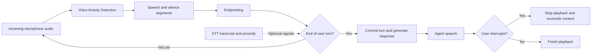
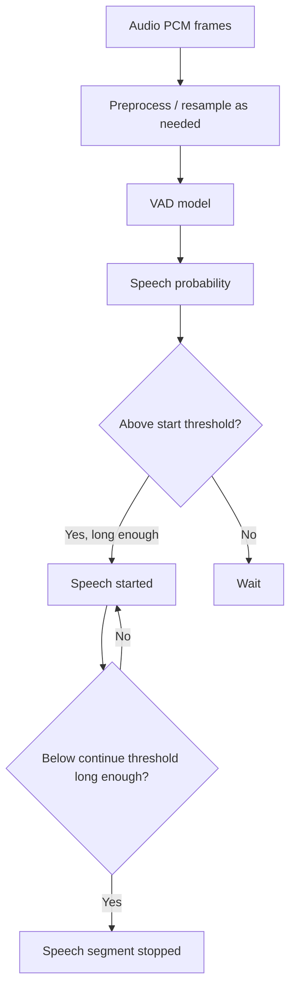
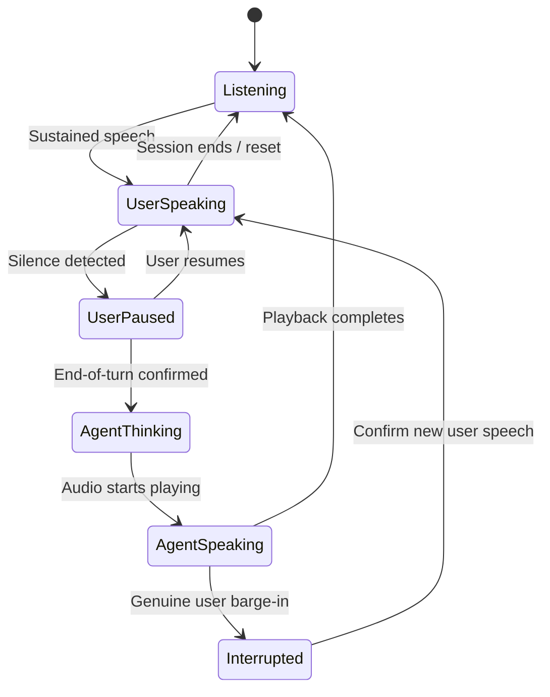

# How Does a Voice Agent Know When to Listen and When to Reply?

**VAD, Endpointing & Turn Detection — Article 09 / 16**  
**Level:** Intermediate | **Estimated reading time:** 25–35 minutes plus practical lab  
**العربية:** [[09-VAD-Endpointing-and-Turn-Detection-AR|اقرأ بالعربية]]  
**Previous:** [[08-Real-Time-Audio-Transport-EN|WebRTC vs WebSockets]]  
**Series:** [[00-Series-Roadmap|Roadmap]]

![[assets/turn-detection-cover.png]]

> [!abstract] The central question
> A voice agent can tell when its microphone is picking up speech, but that alone does not tell it **whether the speaker has finished their thought**. This article separates **Voice Activity Detection (VAD)**, **endpointing**, and **turn detection**, and looks at how hesitations and interruptions complicate each one. It ends with a small, dependency-free Python lab for turn management that you can run and test.

## 1. Why do some voice agents feel unnatural?

Imagine the following exchange:

> **User:** “I'd like to book an appointment for Tuesday ... [pauses to think] ... actually, Thursday at five.”
>
> **Over-eager agent:** “Done, I've booked Tuesday!”

Speech recognition may have been accurate and the LLM may have reasoned well. **The system simply declared the user's turn complete before the user was done.** The opposite failure is just as annoying: the user finishes a clear request, then waits while the agent hesitates for no visible reason.

So natural turn-taking means balancing two risks: **do not answer before the thought is complete; do not wait unnecessarily after it is complete.**



*Figure 1 — “Speech exists” is a different decision from “the conversational turn is over.” The latter can use acoustic, textual, and contextual evidence.*

## 2. Three distinct concepts

| Concept | The question it answers | Typical input | Output | What it does not do by itself |
|---|---|---|---|---|
| **VAD** | Is speech happening? | Audio frames | Speech/non-speech or a probability | Understand whether a thought is complete |
| **Endpointing** | Has the current spoken segment ended? | Silence duration and sometimes STT signals | Possible phrase boundary | Guarantee that the whole turn is over |
| **Turn detection** | Is it the assistant's turn now? | VAD plus optional transcript, prosody, context | Wait/respond decision | Manage all interruption and playback state |

A speaker can stop producing audio while still holding the conversational floor. Similarly, an STT provider can finalize one transcript segment even though the user is about to continue their request.[^livekit-turns][^pipecat-speech]

> [!important] Remember this distinction
> **Speech stopped ≠ user turn ended.**

## 3. What does Voice Activity Detection actually do?

A VAD reads incoming audio in short frames and estimates, frame by frame, whether speech is present. A simple **energy-based VAD** looks only at amplitude, so loud background noise, a closing door, or the agent's own voice leaking from the speakers can all fool it. Learned models such as **Silero VAD** give a better speech-likelihood estimate, but they still know nothing about what the user intends to say.[^silero]



### Three techniques for stability

**Thresholding:** frames above a cutoff are treated as speech candidates. A second, lower cutoff for continuing speech adds **hysteresis**, so a noisy signal does not keep flipping the state back and forth.

**Minimum speech duration:** require consecutive evidence of speech before starting a segment. A single short noise spike should not count as a spoken turn.

**Minimum silence duration:** avoid closing a speech segment after a brief gap between words or syllables.

Our teaching lab uses start/continue thresholds of `0.65` and `0.35`, at least 100 ms of speech, and at least 240 ms of silence. **These values are for teaching; they are not recommended settings for every system.** Real VAD packages and models have their own parameters and behavior, so check the implementation you actually deploy.[^silero]

![[assets/turn-detection-timeline.png]]

*Figure 2 — Synthetic speech probability. The speaker pauses during a turn, then continues before the endpoint decision. The trace is not a microphone recording or model benchmark.*

## 4. Endpointing is a timing decision, not necessarily a language decision

Endpointing uses the timing of speech and silence, sometimes together with STT end-of-utterance signals, to decide that a spoken segment has ended. The simplest strategy is a fixed rule: **after the last evidence of speech, wait X milliseconds of silence, then end the user turn**.

It is easy to implement, and it fails in two opposite directions:

- **Premature endpointing:** the agent starts replying while the user is still searching for words or about to finish their sentence.
- **Late endpointing:** the agent waits too long after an unmistakably complete request.

### Three approaches to a turn-ending decision

**A. Fixed silence timeout:** fine for prototypes and simple workflows, though a single timeout rarely suits fast and slow speakers alike.

**B. Adaptive or semantic turn detection:** a model or algorithm uses prosody, the transcript, and/or conversational context to estimate whether the user has finished expressing an intent. Systems differ in the signals they use. Some models take audio alone; others combine text, audio, and the previous assistant turn.[^livekit-detector][^pipecat-smart]

**C. STT-native endpointing:** some recognizers emit their own end-of-utterance or turn-completion events. Read the provider's event definitions carefully. A **final transcript** may only mean that a segment's text is stable, while the user still intends to keep talking.[^livekit-turns]

![[assets/turn-detection-tradeoff.png]]

*Figure 3 — An intentionally synthetic illustration of the speed-versus-premature-closure tradeoff. The numbers are invented, not measured performance.*

> [!tip] Silence is not enough
> “I want to transfer the call to...” is likely incomplete even with a substantial pause. “That's everything, thank you” may be complete after a much shorter interval. Prosody, context, and the application workflow can help distinguish the cases.

## 5. Turn-taking as a state machine

From an engineering point of view, it helps to give the session explicit states:



This is a conceptual model; it does not describe how any particular framework is built internally. To reduce perceived latency, some systems start preparing a likely LLM response before the end of the turn is confirmed (**preemptive generation**). That saves time, but the pre-generated output has to be cancelled or revised if the user starts speaking again or changes the request.[^livekit-tuning]

### Is an interruption just speech that occurs during playback?

Not necessarily. Consider four cases:

- **Genuine barge-in:** “Stop, I meant Thursday!” The agent should yield and handle the correction.
- **Backchannel:** “Uh-huh”, “right”, or “mm-hm” usually means the user is following along and does not want the agent to stop.
- **Echo:** audio coming from the agent's speakers is captured by the microphone again.
- **Incidental noise:** an environmental sound does not imply conversational intent.

An acoustic VAD cannot reliably tell these apart on its own. A production system may combine **acoustic echo cancellation (AEC)**, STT, user-voice isolation, adaptive interruption handling, and playback-position tracking. The next article covers cancellation and context reconciliation in detail.[^livekit-interrupt]

## 6. Situations that require different decisions

| Situation | What VAD might detect | Desired decision, when possible |
|---|---|---|
| “Book it for ... Thursday” | Silence between phrases | Keep the turn open when the thought is incomplete |
| “Thursday at five. Thank you.” | Finished speech followed by silence | Respond promptly |
| User says “mm-hm” during agent speech | Short burst of voice activity | Do not automatically cancel speech without considering intent |
| “Stop, the time is wrong!” | Sustained speech during playback | Stop the agent and process the correction |
| Agent audio leaks into microphone | Speech-like activity | Suppress echo; prevent self-interruption |
| User speaks in a noisy room | Unstable speech probabilities | Tune against real conditions; don't assume clean-room performance |

## 7. Python lab: implement a minimal Acoustic Turn Gate

This lab lets you study **thresholding, state transitions, and turn boundaries** without a speech model or an API. Its input is a sequence of **synthetic speech probabilities**, one per fixed-duration frame.

Files included in this Obsidian bundle:

- `examples/turn_detection_lab.py`
- `examples/test_turn_detection_lab.py`
- `examples/make_turn_detection_figures.py`

The lab exposes adjustable teaching parameters:

```python
from turn_detection_lab import TurnConfig, frames, run_probabilities

config = TurnConfig(
    frame_ms=20,
    start_threshold=0.65,
    continue_threshold=0.35,
    min_speech_ms=100,
    min_silence_ms=240,
    endpoint_ms=700,
    min_interrupt_ms=200,
)

signal = (
    frames(600, 0.95)     # speech
    + frames(400, 0.03)   # thinking pause
    + frames(500, 0.96)   # continuation
    + frames(900, 0.02)   # final silence
)

for event in run_probabilities(signal, cfg=config):
    print(event.at_ms, event.name)
```

Expected output (timestamps in milliseconds):

```text
 100 turn_started
 100 speech_started
 840 speech_stopped
1100 speech_started
1740 speech_stopped
2200 turn_ended
```

The simulator reports **two `speech_stopped` events but only one `turn_ended` event**. That distinction is the point of the exercise.

Run from the `Voice-Agent-Series` directory:

```bash
python examples/turn_detection_lab.py
python -m unittest discover -s examples -p 'test_*.py' -v
```

> [!warning] Limitations of this teaching lab
> The program accepts precomputed probabilities. It does **not** derive them from real PCM audio, run Silero or an STT engine, infer semantics, or know whether a short phrase means “yes” or “stop”. Its **barge-in decision** is based solely on sustained acoustic activity, so it may misclassify backchannels and echo. Do not deploy it as-is.

### An interruption experiment

```python
from turn_detection_lab import frames, run_probabilities

for event in run_probabilities(frames(260, 0.9), assistant_playing=True):
    print(event.at_ms, event.name)
```

The simulation emits `interrupted_assistant` once sustained speech reaches 200 ms. All this shows is a **timing gate** at work; the code has no way of knowing whether the interruption was intentional.

## 8. Connecting the concepts to Pipecat

Pipecat ships real strategies for deciding when a user turn starts and stops. The current documentation describes VAD combined with Smart Turn, as well as a configurable fixed-timeout strategy. The snippets below follow the November 2026 docs. They are **configuration fragments**, so they will not run as standalone bots:[^pipecat-speech][^pipecat-strategies]

```python
from pipecat.audio.turn.smart_turn.local_smart_turn_v3 import LocalSmartTurnAnalyzerV3
from pipecat.turns.user_stop import TurnAnalyzerUserTurnStopStrategy

stop_strategy = TurnAnalyzerUserTurnStopStrategy(
    turn_analyzer=LocalSmartTurnAnalyzerV3()
)
# Configure this strategy via UserTurnStrategies in
# LLMUserAggregatorParams, as documented for your Pipecat version.
```

An alternative uses an explicit speech timeout:

```python
from pipecat.turns.user_stop import SpeechTimeoutUserTurnStopStrategy
stop_strategy = SpeechTimeoutUserTurnStopStrategy(user_speech_timeout=0.6)
```

The value `0.6` comes from an example in the official strategy API and should not be read as a universal recommendation. Some STT services also make their own turn decisions. If you override the service's recommended strategies, check the **merge behavior** so you do not accidentally remove necessary start, stop, or interruption signals.[^pipecat-strategies]

## 9. Evaluating turn detection in the real world

Real users do not call from a quiet test room. Build a labeled test set, with proper participant consent, that records the actual speech boundaries, the intended interruptions, and whether a human evaluator judged each thought complete.

| Metric | Practical definition | Why it matters |
|---|---|---|
| **Speech-start detection delay** | Actual speech onset to start event | Reaction time for listening and barge-in |
| **End-of-turn latency (P50/P95)** | Last spoken audio of a true turn to completion event | How long a user waits before the agent responds |
| **Premature-end rate** | Fraction of turns closed before the human-labeled ending | Measures over-eager responses |
| **False-barge-in rate** | Unintended agent stops per defined number of interruption opportunities | Measures annoying interruptions |
| **Missed-interruption rate** | Genuine barge-ins not detected or honored | Measures failure to yield |
| **Stop-playback latency** | Genuine interruption onset to cessation of audible output | Connects detection to actual playback behavior |

Don't rank implementations against each other unless the definitions, datasets, languages, device types, and network conditions match. Report tail metrics such as P95; an average on its own hides the slow cases.

### A small but useful test matrix

1. Slow and rapid speech; different Arabic dialects and English accents; long thinking pauses.
2. Mid-utterance correction of a date, number, or name.
3. Short acknowledgments during playback versus an explicit “stop”.
4. Headphones versus loudspeakers, to expose acoustic echo.
5. Office and street noise, including variable network jitter.
6. Language switching, digit sequences, and unfamiliar names.

> [!check] Production acceptance criteria
> Establish your own targets for premature-end rate, P95 end-of-turn delay, false interruptions, and missed interruptions using labeled real traffic and your product's requirements. There is no single threshold that works for every language and environment.

## 10. Common mistakes

- Equating **any silence** with a completed turn.
- Treating **STT final** as a guaranteed signal of complete conversational intent.
- Using one VAD threshold while ignoring rapidly fluctuating probabilities.
- Disabling microphone capture during agent playback while claiming to support barge-in.
- Failing to separate the user's speech from the agent's echo.
- Testing only clear, scripted sentences without hesitation or correction.
- Reporting educational simulation numbers as real model or product benchmarks.

## Conclusion

Detecting sound is the easy part. A natural voice agent has to estimate **whether the speaker still holds the conversational turn**. VAD supplies the acoustic signal, endpointing interprets pauses and segment boundaries, and turn detection adds whatever other cues are available to decide between listening and responding. Interruptions need their own decisions on top of that, coordinated with playback and conversation state.

> [!success] You can now
> Explain why `speech_stopped` and `turn_ended` differ, reason about the responsiveness-versus-cutoff tradeoff, run a deterministic Python state-machine lab, and choose meaningful evaluation metrics for turn-taking behavior.

### Next in the series

**Article 10 — Interruptions, Barge-In & Playback State:** Once an interruption is detected, how do you stop queued audio, cancel generation, and keep the LLM context consistent with what the user actually heard?

---

## References

[^livekit-turns]: [LiveKit — Turns Overview](https://docs.livekit.io/agents/logic/turns/) — turn boundaries and detection modes.
[^livekit-detector]: [LiveKit — Turn Detector](https://docs.livekit.io/agents/logic/turns/turn-detector/) — model-based end-of-turn decisions.
[^livekit-tuning]: [LiveKit — Turn-Taking Tuning](https://docs.livekit.io/agents/logic/turns/tuning/) — endpointing and interruption configuration.
[^livekit-interrupt]: [LiveKit — Adaptive Interruption Handling](https://docs.livekit.io/agents/logic/turns/adaptive-interruption-handling/) — real interruptions versus backchannel speech.
[^silero]: [Silero VAD — Official Repository](https://github.com/snakers4/silero-vad) and [VAD utilities source](https://github.com/snakers4/silero-vad/blob/master/src/silero_vad/utils_vad.py) — speech thresholding and silence handling.
[^pipecat-speech]: [Pipecat — Speech Input & Turn Detection](https://docs.pipecat.ai/pipecat/learn/speech-input) — speech-input lifecycle.
[^pipecat-smart]: [Pipecat — Smart Turn](https://github.com/pipecat-ai/smart-turn) — audio-based user-turn completion detection.
[^pipecat-strategies]: [Pipecat — User Turn Strategies](https://docs.pipecat.ai/api-reference/server/utilities/turn-management/user-turn-strategies) — start/stop strategies and merge behavior.

---

*Editorial note: sources reviewed November 21, 2026. Numeric settings, charts, and test input are educational rather than measured benchmarks or universal production defaults. Validate API signatures and model behavior against the versions you install.*
