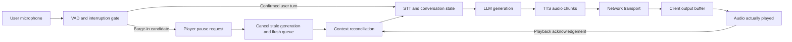
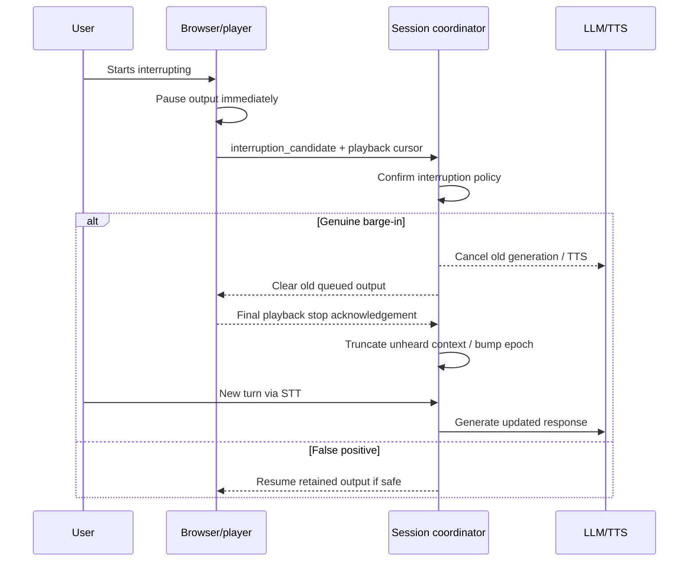

# عندما يقاطعنا المستخدم: هندسة المقاطعات ومزامنة الصوت في الوكلاء الصوتيين

**Interruptions, Barge-In & Playback State — المقالة 10 / 16**  
**المستوى:** متوسط → متقدم | **القراءة:** نحو 25–35 دقيقة + مختبر Python  
**English:** [[10-Interruptions-Barge-In-and-Playback-State-EN|Read in English]]  
**السابقة:** [[09-VAD-Endpointing-and-Turn-Detection-AR|VAD وEndpointing وTurn Detection]]  
**الفهرس:** [[00-Series-Roadmap|سلسلة هندسة الوكلاء الصوتيين]]

![[assets/barge-in-playback-cover.png]]

> [!abstract] السؤال الرئيسي
> عندما يبدأ المستخدم الكلام **بينما الوكيل لا يزال يتحدث**، لا يكفي استدعاء `stop()` على مشغّل الصوت. علينا أن نوقف عدة عمليات غير متزامنة، ونمنع تسرّب صوت قديم، ونضبط ذاكرة الوكيل وفق ما **شُغّل** فعلاً، ثم نتابع المحادثة دون تناقض. تشرح هذه المقالة هذا التنسيق خطوة بخطوة، وتبني مختبر Python صغيراً لاختباره.

## 1. من الديمو إلى المحادثة الحقيقية

تخيّل وكيلاً يساعد مستخدماً على إكمال التحقق من الهوية:

> **الوكيل:** «يمكنك إتمام العملية باستخدام جواز السفر أو بطاقة الهوية، ثم...»  
> **المستخدم، مقاطعاً:** «لحظة، جواز سفري منتهي الصلاحية. هل هناك طريقة أخرى؟»  
> **الوكيل الجيد:** يوقف الصوت بسرعة، يسمع التصحيح، ويفهم أن المستخدم ربما لم يسمع بقية الجملة.

في نظام ساذج قد يستمر الصوت حتى نهاية الجملة، أو تصل دفعات TTS القديمة بعد المقاطعة، أو يبقى في سجل المحادثة جواب كامل لم يسمعه المستخدم. هذه **أخطاء تنسيق بين المكونات**، وقد يكون النموذج نفسه سليماً تماماً.

فرّقنا في [[09-VAD-Endpointing-and-Turn-Detection-AR|المقالة التاسعة]] بين اكتشاف الكلام ونهاية دور المستخدم. نضيف الآن مساراً آخر: **ما الذي نفعله عند اكتشاف كلام المستخدم أثناء إخراج الوكيل؟**

## 2. ما معنى Barge-In؟ ولماذا لا يكفي VAD؟

**Barge-In** أن يتكلم المستخدم أثناء دور الوكيل، فيتوقف الوكيل ويترك له الكلام. لكن ليست كل إشارة صوتية مقاطعةً حقيقية:

| الموقف | الإشارة | القرار المحتمل |
|---|---|---|
| «توقف، الموعد يوم الخميس وليس الثلاثاء» | طلب واضح لتغيير المعلومة | إيقاف الوكيل ومعالجة التصحيح |
| «مم»، «آها» أثناء الشرح | Backchannel: إشارة متابعة | الاستمرار غالباً إذا كانت سياسة النظام واثقة |
| ارتداد صوت السماعة إلى الميكروفون | Echo | منع الوكيل من مقاطعة نفسه |
| ضوضاء أو سعال | احتمال صوتي دون نية واضحة | قد يلزم التحقق قبل إلغاء الإجابة |

يستطيع **VAD** أن يرصد كلاماً محتملاً، لكنه لا يعرف *نية* المقاطعة. للحد من الأخطاء يمكن الاستعانة بـSTT أو بمصنفات صوتية أو بسياسات توقف تكيفية. ويوثّق LiveKit التعامل التكيفي مع المقاطعات، والاستئناف بعد الإيقاف الخاطئ.[^livekit-turns][^livekit-adaptive]

> [!tip] سياسة من مرحلتين
> **مرحلة سريعة:** أوقف أو علّق التشغيل فور ظهور مؤشر مقاطعة موثوق حتى لا «يتكلم النظام فوق المستخدم».  
> **مرحلة تأكيد:** قرر هل كانت مقاطعة فعلية؛ إن لم تكن، استأنف بأمان من موضع محفوظ إذا كانت المنظومة تدعم الاستئناف. هذا *نمط تصميم مقترح*، وطريقة تطبيقه تختلف من مكتبة لأخرى.

## 3. لم نعد نملك مساراً صوتياً واحداً



**الشكل 1.** يمر الصوت الذي تنتجه النماذج بمخازن ومسارات غير متزامنة، ولذلك يجب أن يعود إقرار التشغيل إلى مدير السياق.

عند المقاطعة لا يكفي إيقاف TTS، فربما وصلت دفعات صوتية إلى المتصفح بالفعل. ولا يكفي إيقاف المتصفح وحده، لأن مهمة LLM/TTS ما زالت جارية قد ترسل بعد لحظات دفعات جديدة من الرد القديم. يجب إيقاف الطرفين معاً.

## 4. Generated ≠ Synthesized ≠ Transmitted ≠ Buffered ≠ Played

هذا التمييز هو أول ما يستحق أن تبني حوله اختباراتك:

| المؤشر | ماذا يعني؟ | هل يثبت أن المستخدم سمعه؟ |
|---|---|---|
| **Generated text** | LLM كتب نص الاستجابة | لا |
| **Synthesized audio** | TTS حوّل بعض النص إلى عينات صوتية | لا |
| **Transmitted audio** | الخادم أرسل البيانات | لا |
| **Buffered audio** | العميل خزّن الصوت في قائمة التشغيل | لا |
| **Played audio** | المشغّل أبلغ عن تقدم التشغيل | أفضل تقدير متاح، وليس إثباتاً أن الأذن سمعته |

![[assets/barge-in-playback-cursors.png]]

*الشكل 2 — أرقام اصطناعية للتوضيح: تم توليد 3600 ms، وتجهيز 3100، وإرسال 2600، وتخزين 2400، بينما يؤكد المشغل تشغيل 1500 ms فقط. ليست نتائج Benchmark.*

لنفترض أننا حفظنا النص الكامل في سياق LLM مع أن المستخدم سمع 1.5 ثانية فقط. قد يقول الوكيل لاحقاً: «كما أخبرتك، يمكنك استخدام البطاقة»، مع أن هذه المعلومة لم تُشغَّل أصلاً.

> [!warning] قيد مهم على «ما سمعه المستخدم»
> `played_ms` **مؤشر يقدّمه المشغّل**، وليس قياساً مباشراً لما أدركه المستخدم. بينهما مخازن الأجهزة وتأخير الإخراج وإعدادات الصوت. في المتصفح يساعد `AudioContext.getOutputTimestamp()` و`outputLatency` على تقدير توقيت الإخراج، لكنها تبقى تقديرات، ولا تخبرنا بدقة ما وصل إلى أذن المستخدم.[^mdn-output]

## 5. ما الذي يحدث أثناء المقاطعة خطوة بخطوة؟

1. **Detect:** رصد كلام المستخدم أثناء استجابة الوكيل، مع محاولة عدم الخلط بين Echo أو Backchannel وبين مقاطعة حقيقية.
2. **Pause quickly:** تعليق مشغّل العميل أو إيقافه فوراً، دون انتظار اكتمال STT أو انتهاء طلب LLM.
3. **Confirm:** تحديد إن كانت مقاطعة حقيقية أم إشارة قصيرة عابرة؛ قد تعود الاستجابة للتشغيل في حالة الإنذار الكاذب.
4. **Stop and cancel:** عند التأكيد، إيقاف تشغيل الصوت، وإلغاء/تجاهل عمليات LLM وTTS الجارية ودفعاتها القادمة.
5. **Flush:** تفريغ طابور التشغيل القديم ومنع خلطه مع صوت الرد الجديد.
6. **Reconcile context:** تحديث سجل المحادثة وفق تقدم التشغيل المؤكد، وعدم إدراج الجمل غير المسموعة بوصفها كلاماً موجهاً للمستخدم.
7. **Continue:** معالجة كلام المستخدم الجديد، ثم إنشاء استجابة جديدة بمعرّف توليد (generation ID) جديد.

![[assets/barge-in-cancellation-flow.png]]

*الشكل 3 — المقاطعة المؤكدة تستلزم الإلغاء، أما المقاطعة الخاطئة فيمكن الاستئناف بعدها. القواعد المعروضة تصميم تعليمي، وليست منقولة عن تنفيذ إطار عمل بعينه.*



**الشكل 4 — ترتيب الأحداث توضيحي.** في التطبيق الحقيقي ينبغي استخدام معرفات رسائل وأجيال وربط الإقرارات بالرد الصحيح؛ وقد تتبادل عمليات التحقق والإلغاء مواقعها بحسب واجهة النقل.

## 6. المشكلة الخفية: Late Chunks وRace Conditions

افترض أنك أرسلت `cancel()`، لكن دفعة صوت قديمة كانت في طريقها عبر الشبكة. إن أضافها العميل إلى طابور التشغيل دون تحقق، فسيسمع المستخدم جزءاً من الاستجابة السابقة **بعد** أن بدأ كلامه.

الحل المعتاد أن نعطي كل استجابة **معرّفاً فريداً** (`generation_id`)، مع رقم جيل `epoch` يتغير عند المقاطعة. يقبل المشغّل الدفعات التي تحمل الجيل النشط فقط، ويرفض الدفعات المتأخرة من الجيل الملغى.

```python
# Pseudocode: run this guard before enqueueing audio.
if chunk.generation_id != session.active_generation_id:
    return  # Discard stale audio
player.enqueue(chunk)
```

يجب كذلك حماية أحداث `playback_ack` من التكرار أو الوصول بترتيب مختلف: لا تسمح بتراجع مؤشر التشغيل، ولا تنقل إقرار جيل سابق إلى رد جديد.

**ملاحظة خاصة بالأدوات:** إلغاء استجابة LLM لا يعني التراجع تلقائياً عن طلب API خارجي نُفّذ بالفعل (مثل حجز موعد). عمليات الكتابة تحتاج idempotency keys وتأكيداً واضحاً وسياسة تعويض مستقلة. لا تخلط بين **إيقاف الكلام** و**إلغاء الفعل التجاري**.

## 7. Synchronizing Conversation State: ما الذي ندخله إلى ذاكرة النموذج؟

فكّر في سجلين منفصلين:

- **السجل الداخلي (Internal state):** ما طلبه المستخدم، نتائج الأدوات، نصوص تولدها النماذج، والمعرّفات والأحداث التقنية.
- **السجل الحواري (User-visible context):** ماذا قال المستخدم؟ وما الذي أمكن تشغيله فعلياً من كلام الوكيل؟

إذا توقفت الاستجابة عند 1500 ms فلا تنقل نص الـLLM الكامل تلقائياً إلى سجل الحوار. إن توفرت مزامنة دقيقة بين الصوت والكلمات، احتفظ بالكلمات التي اكتمل تشغيلها فقط. وإن لم تكن المزامنة موثوقة، فالأفضل أن تُسجَّل آخر رسالة على أنها **انقطعت**، بدلاً من اختراع نص للجملة التي يُفترض أنها سُمعت.

### مثال موثّق: OpenAI Realtime عبر WebSocket

في اتصال **WebSocket** يدير فيه العميل تشغيل الصوت، يطلب توثيق OpenAI إيقاف التشغيل، وتحديد المدة التي شُغّلت، ثم إرسال `conversation.item.truncate` لقص الجزء غير المشغّل:[^openai-realtime]

```json
{
  "type": "conversation.item.truncate",
  "item_id": "item_1234",
  "content_index": 0,
  "audio_end_ms": 1500
}
```

هذا **حدث خاص بواجهة OpenAI Realtime**، وليس رسالة قياسية في Pipecat أو WebRTC. ويذكر التوثيق أن القص يزيل من السياق النص المقابل للجزء غير المسموع، لكن الواجهة لا تضمن Transcript مقصوصاً ومتزامناً بدقة كلمةً بكلمة. أما اتصال **WebRTC/SIP** المُدار من الخدمة فيختلف في آلية إدارة مخزن الصوت والقص.[^openai-realtime]

### ماذا عن LiveKit؟

يوضح توثيق LiveKit أن مقاطعة الوكيل توقف كلامه وتقص سجل المحادثة إلى الجزء المشغّل، مع خيارات للتعامل مع المقاطعات الخاطئة؛ التفاصيل تعتمد على وضع الـTurn Detection ونمط الوكيل.[^livekit-turns] ما ينتقل من إطار إلى آخر هو **فهم المسؤوليات**؛ أما التنفيذ فيكون عبر APIs الخاصة بكل إطار، لا بنسخ أحداث OpenAI نفسها إليه.

## 8. مختبر Python: محاكاة مقاطعة مع مزامنة السياق

**الهدف:** اختبار منطق إدارة الاستجابة دون نموذج LLM أو TTS حقيقي ودون ميكروفون.

**الملفات داخل المجلد نفسه:**

- `examples/interruption_playback_lab.py` — مدير تشغيل وسجل أحداث ومقاطعة.
- `examples/test_interruption_playback_lab.py` — حالات اختبار تلقائية.
- `examples/make_interruption_figures.py` — توليد الشكلين التعليميين.
- `examples/10-BARGE-IN-LAB-README.md` — خطوات التشغيل والحدود.

### نموذج البيانات

يتتبع المختبر `generated_ms`, `synthesized_ms`, `transmitted_ms`, `buffered_ms`, و`played_ms`. لا يتقدم `played_ms` إلا بإقرار صريح من المشغّل، ولا يمكن أن يتجاوز الصوت المخزّن أو أن يتراجع.

```python
from interruption_playback_lab import PlaybackController

controller = PlaybackController()
epoch = controller.start("assistant_item_1", total_ms=3000)
for stage, ms in [
    ("generated", 3000),
    ("synthesized", 2600),
    ("transmitted", 2400),
    ("buffered", 2100),
]:
    controller.advance(stage, ms, epoch)

controller.acknowledge_playback(1000, epoch)
controller.pause_for_candidate(epoch)
plan = controller.confirm_interruption(epoch, final_played_ms=1200)
print(plan)
```

**مخرج مختصر متوقع:**

```text
played_ms = 1200
unheard_buffered_ms = 900
unheard_generated_ms = 1800
```

عند الربط مع SDK حقيقي فقط، يمكن تمرير `item_id` و`audio_end_ms` إلى رسالة القص لدى مزوّد يدعمها، مثل OpenAI Realtime عبر WebSocket. المختبر نفسه لا يرسل أي طلب عبر الشبكة.

### تشغيل المختبر والاختبارات

```bash
cd Voice-Agent-Series/examples
python interruption_playback_lab.py
python -m unittest test_interruption_playback_lab -v
```

> [!important] ما الذي اختبرناه؟
> اختبارات منطقية محلية تشمل: الترتيب الصحيح للمراحل، منع الإقرار المتراجع، إيقاف المقاطعة الخاطئة واستئنافها، قطع الرسالة وفق `played_ms`، رفض Late Chunks وإقرارات الجيل القديم، وتجنّب اعتبار «أُرسِل» مرادفاً لـ«سُمِع». **لم نختبر زمناً حقيقياً أو اتصال WebRTC أو صوتاً يصل إلى سماعة فعلية.**

## 9. ماذا تقيس عند الاختبار الحقيقي؟

| المقياس | كيفية القياس | لماذا يهم؟ |
|---|---|---|
| Interruption-stop latency | من ظهور كلام المستخدم الذي اعتُبر مقاطعة حتى تأكيد توقف صوت المشغّل | هل الوكيل يواصل الكلام فوق المستخدم؟ |
| False interruption rate | إيقافات غير مقصودة / فرص المقاطعة المقاسة وفق مجموعة اختبار معرفة | هل «آها» أو ضوضاء بسيطة تسبب إيقافاً؟ |
| Stale-audio leak rate | حالات وصل فيها صوت جيل ملغى إلى التشغيل / مجموع حالات المقاطعة | هل تظهر بقايا الرد القديم؟ |
| Context mismatch rate | حالات احتوى فيها الحوار على ادعاءات صوتية غير مشغّلة / الحالات المراجعة | هل يفترض النظام أن المستخدم سمع ما لم يُشغّل؟ |
| Resume quality | عدد وتوقيت حالات الاستئناف الخاطئ أو المكرر | هل يتكرر الصوت بعد إنذار كاذب؟ |

لا تضع هدفاً رقمياً ثابتاً قبل أن تختبر نوع الجهاز والشبكة واللغة وسياسة المقاطعة. استخدم P50 وP95، واختبر حالات الضجيج والصدى والمستخدم المتردد، لا التسجيلات المثالية وحدها.

## 10. أخطاء متكررة وحلولها

| الخطأ | أثره | التصحيح |
|---|---|---|
| تأخير إيقاف الصوت إلى أن ينتهي STT | كلام متداخل | أوقف المشغّل مبكراً ثم أكد النية |
| إلغاء LLM دون مسح طابور العميل | صوت قديم بعد المقاطعة | Flush / Clear / Generation IDs |
| اعتبار النص المولّد كلاماً مسموعاً | سياق غير صحيح | Playback acknowledgements + آلية قص آمنة |
| قبول الإقرارات المتأخرة | ارتباك حالة المحادثة | Epoch ومؤشر monotonic مرتبط بـitem_id |
| عدّ كل صوت مقاطعة | تجمد الصوت باستمرار | Echo cancellation وAdaptive interruption |
| افتراض أن إلغاء الرد يلغي حجزاً | آثار جانبية غير قابلة للاسترجاع | فصل إجراءات الأدوات عن دورة الصوت |

## 11. مشروع تطبيقي صغير

وسّع مختبرك ليجتاز خمسة سيناريوهات: (1) مقاطعة حقيقية عند 1200ms، (2) Backchannel لا يوقف الإجابة نهائياً، (3) وصول TTS متأخر بعد الإلغاء، (4) إقرار تشغيل مكرر، (5) تصحيح مستخدم يستلزم إعادة صياغة الرد. بعد ذلك صِل المختبر بمشغّل صوت فعلي واستخدم أحداث إقرار حقيقية بدلاً من القيم الاصطناعية.

> [!success] الخلاصة
> **المقاطعة مشكلة مزامنة موزعة، وليست حدثاً صوتياً واحداً.** اكتشاف الكلام هو الخطوة الأولى فقط. بعدها يجب أن تتوقف مخازن التشغيل والعمل الجاري، وأن يُهمَل الصوت المتأخر، وأن تتسق ذاكرة الوكيل مع ما شُغّل فعلاً.

### أسئلة للتأكد من الفهم

1. لماذا لا يكفي حدث `response.done` لإثبات اكتمال تشغيل الكلام؟
2. كيف تتعامل مع `audio_chunk` يصل بعد تأكيد الإلغاء؟
3. لماذا يحتاج النظام إلى `item_id` و`generation_id` معاً؟
4. ما الفرق بين مقاطعة خاطئة وإيقاف مؤكد؟
5. متى يكون قص النص كلمة بكلمة غير موثوق؟

**التالي:** [[11-Latency-and-Streaming-Optimization-AR|المقالة الحادية عشرة — Latency & Streaming Optimization]]: كيف نخفض زمن التفاعل من دون التضحية باستقرار المحادثة؟

## المراجع والمصادر

[^openai-realtime]: [OpenAI API — Realtime conversations, Interruption and Truncation](https://developers.openai.com/api/docs/guides/realtime-conversations) — توثيق التعامل مع المقاطعات وقص الصوت في WebSocket، والفروق مع WebRTC/SIP (تم الاطلاع: 2026-11-21).
[^livekit-turns]: [LiveKit Docs — Turn handling and Interruptions](https://docs.livekit.io/agents/logic/turns/) — سياسات المقاطعة والقص والاستئناف.
[^livekit-adaptive]: [LiveKit Docs — Adaptive interruption handling](https://docs.livekit.io/agents/logic/turns/adaptive-interruption-handling/) — التمييز بين المقاطعة الحقيقية وBackchannel.
[^mdn-output]: [MDN — AudioContext.getOutputTimestamp()](https://developer.mozilla.org/en-US/docs/Web/API/AudioContext/getOutputTimestamp) و[AudioContext.outputLatency](https://developer.mozilla.org/en-US/docs/Web/API/AudioContext/outputLatency) — تقديرات تقدم الإخراج وتأخيره.

---
*هذه المقالة مادة تعليمية، وليست وصفاً مضموناً لسلوك جميع إصدارات المكتبات أو لجميع الشبكات والأجهزة. اختبر واجهات مزودك الفعلية قبل النشر.*
