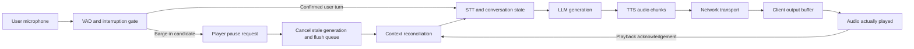
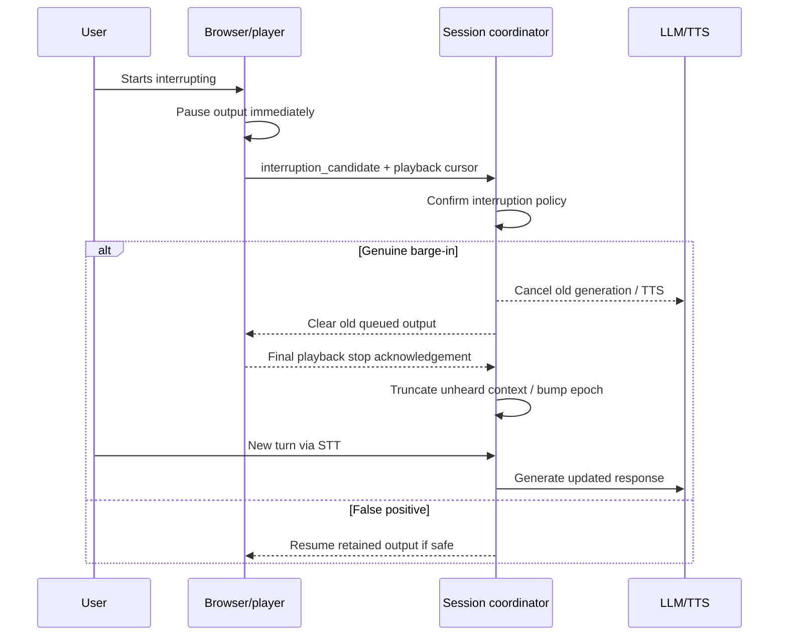

# When Users Interrupt: Barge-In, Playback State, and Context Synchronization

**Interruptions, Barge-In & Playback State — Article 10 / 16**  
**Level:** Intermediate → Advanced | **Estimated reading time:** 25–35 minutes plus a Python lab  
**العربية:** [[10-Interruptions-Barge-In-and-Playback-State-AR|اقرأ المقالة بالعربية]]  
**Previous:** [[09-VAD-Endpointing-and-Turn-Detection-EN|VAD, Endpointing & Turn Detection]]  
**Series index:** [[00-Series-Roadmap|Voice AI Engineering Roadmap]]

![[assets/barge-in-playback-cover.png]]

> [!abstract] The question we will answer
> When a user **starts talking while the agent is still speaking**, calling `stop()` on the audio player is not enough. Asynchronous generation, audio queues, client playback, cancellation, and conversation state all have to be coordinated so the agent never treats unplayed words as spoken. This article walks through that coordination and builds a Python lab that tests it.

## 1. Beyond the perfect demo

Imagine an identity-verification assistant:

> **Agent:** “You can complete verification using a passport or identity card, and then…”  
> **User, interrupting:** “Wait. My passport has expired. Is there another way?”  
> **Good agent:** Stops speaking quickly, captures the correction, and does not assume the user heard the remainder of its earlier answer.

A naive implementation may keep playing queued audio, accept late TTS chunks after cancellation, or store the entire response in the LLM history when the client played only part of it. These are **coordination failures**. The model itself may be working perfectly well.

In [[09-VAD-Endpointing-and-Turn-Detection-EN|Article 09]] we separated speech activity from the end of a user turn. This article adds a second control path: **what happens when speech activity arrives during an agent turn?**

## 2. Barge-in is more than VAD

**Barge-in** is an interruption that makes the agent yield the floor to the user. Not every detected sound qualifies.

| Input | Interpretation | Sensible response |
|---|---|---|
| “Stop, the appointment is Thursday, not Tuesday” | Clear corrective request | Stop agent speech and handle correction |
| “Uh-huh,” “right” during an explanation | Backchannel | Usually keep talking if the detector is confident |
| Agent audio leaking back into microphone | Acoustic echo | Suppress self-interruption |
| A cough or background noise | Speech-like or noisy event | Avoid committing an irreversible cancellation prematurely |

A voice activity detector can flag probable speech, but it cannot tell you what the user intended. Production systems combine VAD with STT, audio-based classifiers, echo cancellation, and adaptive interruption policies. LiveKit documents both adaptive interruption handling and automatic resumption after certain false interruptions.[^livekit-turns][^livekit-adaptive]

> [!tip] A two-phase design
> **Fast response:** pause output as soon as there is convincing evidence of a possible interruption, so the agent does not talk over the user.  
> **Confirmation:** decide whether the event was genuine. If it was a false positive, resume safely from a retained playback cursor where the stack supports it. This is a recommended *design pattern*; it is not a contract that every API follows.

## 3. A voice response has multiple asynchronous paths



*Figure 1 — A generated response passes through several independent components and queues. Keeping context accurate requires a signal that travels back from the playback layer.*

Stopping TTS is not enough if audio has already reached the browser. Stopping the browser is not enough either if an in-flight LLM/TTS task can still send more chunks a moment later. Both ends of the pipeline have to be stopped together.

## 4. Generated ≠ Synthesized ≠ Transmitted ≠ Buffered ≠ Played

In real-time voice work, these five positions have to be tracked separately:

| Cursor | What it describes | Proof the user heard it? |
|---|---|---|
| **Generated text** | Tokens or text created by the LLM | No |
| **Synthesized audio** | Audio samples created by TTS | No |
| **Transmitted audio** | Audio bytes sent over the network | No |
| **Buffered audio** | Audio stored in the client output queue | No |
| **Played audio** | Playback progress acknowledged by the output system | Best available proxy, not proof of human perception |

![[assets/barge-in-playback-cursors.png]]

*Figure 2 — Synthetic illustrative numbers: 3600ms generated, 3100ms synthesized, 2600ms transmitted, 2400ms buffered, and just 1500ms acknowledged as played. These are not performance benchmarks.*

Suppose the LLM generated “You can use your passport or your ID card,” but playback stopped after “You can use your passport…”. If the full answer is stored as an assistant message the user heard, the conversation becomes inconsistent, and the agent may later refer to options the user never heard.

> [!warning] “Heard” is an approximation
> `played_ms` is a **player-side progress estimate**. It does not directly measure what the user perceived: hardware queues, device volume, and output latency all sit in between. Browser APIs such as `AudioContext.getOutputTimestamp()` and `outputLatency` help estimate output timing, but they are still estimates, not exact evidence of what the user heard.[^mdn-output]

## 5. The coordinated interruption sequence

1. **Detect:** Identify likely user speech while the agent is talking; account for noise, backchannels, and echo.
2. **Pause immediately:** Stop or pause client output right away; do not wait for the full STT or LLM round trip.
3. **Confirm intention:** Decide whether a real interruption occurred; preserve the option to resume if it was a false positive.
4. **Cancel active work:** Once confirmed, stop output and cancel or ignore pending LLM and TTS work.
5. **Flush queues:** Discard unplayed audio from the previous response.
6. **Reconcile conversation history:** Record only content reliably associated with playback. Never silently promote all generated text into user-heard history.
7. **Continue with a new turn:** Process the new user utterance and create a fresh generation ID.

![[assets/barge-in-cancellation-flow.png]]

*Figure 3 — Genuine and false interruptions take separate branches. The figure shows a coordination pattern; it is not taken from any particular framework's implementation.*



*Figure 4 — Conceptual event ordering. Real implementations must correlate events with response IDs and playback acknowledgements; exact timing and responsibilities depend on the transport and SDK.*

## 6. Hidden failure: late chunks and race conditions

You request cancellation, but an old audio chunk is already in flight. A second later the client receives it and enqueues it without checking. The user then hears a fragment of the old answer during the next turn.

The usual defense is to label every response with a unique `generation_id`, combined with an increasing session `epoch` or equivalent ownership token. The output layer accepts chunks only from the currently active generation.

```python
# Pseudocode at the client/player ingress boundary.
if chunk.generation_id != session.active_generation_id:
    return  # Stale audio; never enqueue
player.enqueue(chunk)
```

Playback acknowledgements need the same care. Their positions should only increase, each one should be tied to a specific response, and an old or duplicate acknowledgement must never change the state of a newer response.

**Cancellation does not undo external side effects.** If the LLM has already triggered a booking API or another write operation, stopping its speech will not roll that operation back. Use explicit confirmation policies, idempotency keys, and transactional or compensating mechanisms where relevant. Keep the **speech lifecycle** separate from the **business-operation lifecycle**.

## 7. Two kinds of conversation state

It helps to distinguish:

- **Internal application state:** user requests, tool results, partial generation, cancellation tokens, and operational events.
- **User-visible dialogue state:** what the user said and what the agent can reasonably treat as *played* to the user.

If the model's response was interrupted at 1500ms, do not automatically add its full text to the next prompt. With reliable word-to-audio alignment, you can keep the segments that finished playing. Without it, record that the response was **interrupted** instead of inventing a precise verbatim transcript.

### Provider-specific example: OpenAI Realtime over WebSocket

For **WebSocket playback managed by the client**, the OpenAI Realtime documentation instructs applications to stop output, determine the played audio duration, and send `conversation.item.truncate` to remove the unplayed part of the response from the server-side context:[^openai-realtime]

```json
{
  "type": "conversation.item.truncate",
  "item_id": "item_1234",
  "content_index": 0,
  "audio_end_ms": 1500
}
```

This event belongs to **OpenAI Realtime**; Pipecat and WebRTC have no universal equivalent. According to the documentation, transcript text for the unplayed audio is removed, but a precisely aligned partial transcript is **not** guaranteed. In managed **WebRTC/SIP** connections, the server handles output buffering and automatic truncation differently.[^openai-realtime]

### What about LiveKit?

LiveKit's documentation explains that an interruption stops speech and automatically truncates the conversation history to the portion played, with options for false-interruption recovery. Exact behavior depends on the turn-handling mode and on whether a realtime model manages turn detection.[^livekit-turns] What carries over between frameworks is the goal of **state consistency**. Each provider's event types stay with that provider.

## 8. Python lab: simulate interruption and reconcile playback

This lab needs **no API key, microphone, STT, LLM, TTS engine, or real network**. Its only job is to exercise the coordination rules.

Files in this Obsidian folder:

- `examples/interruption_playback_lab.py` — deterministic playback-state controller.
- `examples/test_interruption_playback_lab.py` — automated unit tests.
- `examples/make_interruption_figures.py` — regenerate the two educational diagrams.
- `examples/10-BARGE-IN-LAB-README.md` — setup instructions, limitations, and exercises.

The controller tracks `generated_ms`, `synthesized_ms`, `transmitted_ms`, `buffered_ms`, and `played_ms`. `played_ms` moves **only** after an explicit player acknowledgement. It can never exceed the buffered audio, and it never moves backward.

```python
from interruption_playback_lab import PlaybackController

controller = PlaybackController()
epoch = controller.start("assistant_item_1", total_ms=3000)
for stage, ms in [
    ("generated", 3000),
    ("synthesized", 2600),
    ("transmitted", 2400),
    ("buffered", 2100),
]:
    controller.advance(stage, ms, epoch)

controller.acknowledge_playback(1000, epoch)
controller.pause_for_candidate(epoch)
plan = controller.confirm_interruption(epoch, final_played_ms=1200)
print(plan)
```

**Expected key fields:**

```text
played_ms = 1200
unheard_buffered_ms = 900
unheard_generated_ms = 1800
```

A provider integration may then use the response ID and acknowledged duration to update remote context. The lab contains an **illustrative** OpenAI Realtime WebSocket truncation-event helper, but it does not send any network requests.

### Run the lab

```bash
cd Voice-Agent-Series/examples
python interruption_playback_lab.py
python -m unittest test_interruption_playback_lab -v
```

> [!important] Scope of validation
> The tests cover ordering, monotonic playback cursors, false-interruption resume, confirmed cancellation, stale chunks, old-epoch acknowledgement rejection, and context truncation inputs. **They do not measure real interruption latency or verify audible playback on a hardware device.**

## 9. Metrics worth tracking in production

| Metric | Measurement | What it reveals |
|---|---|---|
| Interruption-stop latency | From detected user-interruption onset to confirmed player stop | How long the agent talks over the user |
| False interruption rate | Unintended stops per labeled interruption opportunities | Whether acknowledgements and noise trigger unnecessary stops |
| Stale-audio leak rate | Interrupted turns with late old-generation playback / interrupted turns | Whether queues and epoch checks work |
| Context mismatch rate | Audited turns containing unplayed response material presented as heard / audited turns | Whether the agent misremembers what it said |
| Resume quality | False-interruption resume failures, duplicated or skipped content | Whether recovery sounds natural |

Measure against clearly defined test sets, on real devices, across the languages you support and with background noise, and report both P50 and P95 latencies. Don't turn arbitrary target numbers into universal SLAs.

## 10. Common mistakes

| Mistake | Symptom | Better approach |
|---|---|---|
| Wait for final STT before stopping playback | User and agent talk over each other | Fast audio pause, then intent confirmation |
| Cancel LLM but keep the client queue | Late audio after interruption | Flush and guard by generation ID |
| Treat generated text as delivered speech | Inconsistent dialogue context | Playback acknowledgements + safe truncation |
| Accept stale playback acknowledgements | State leaks between turns | Per-item epoch and monotonic cursor |
| Classify every sound as barge-in | Constant, irritating pauses | Echo cancellation and adaptive detection |
| Assume cancelling speech cancels a booking | Unexpected external side effects | Separate tool transactions from audio output |

## 11. A practical challenge

Extend the lab to handle five scenarios: a true interruption at 1200ms; a non-interrupting backchannel; a TTS chunk arriving after cancellation; a duplicated playback acknowledgement; and a user correction requiring a new response. Then connect the logic to a real audio player, so the acknowledgements come from an actual client instead of synthetic numbers.

> [!success] Key takeaway
> **Barge-in is a distributed synchronization problem rather than a single audio event.** The agent has to pause promptly, cancel stale work, and discard outdated audio. It then reconciles the dialogue context with the portion that actually played, or records honestly that it does not know exactly what played.

### Check your understanding

1. Why does `response.done` not imply that the entire response was played?
2. What should happen to an old `audio_chunk` after an interruption is confirmed?
3. Why maintain both `item_id` and `generation_id`?
4. What is the difference between a false interruption and a confirmed barge-in?
5. When is word-level truncation too uncertain to trust?

**Next:** [[11-Latency-and-Streaming-Optimization-EN|Article 11 — Latency & Streaming Optimization]]: reducing response time without compromising conversation correctness.

## References

[^openai-realtime]: [OpenAI API — Realtime conversations: Interruption and Truncation](https://developers.openai.com/api/docs/guides/realtime-conversations), accessed 2026-11-21.
[^livekit-turns]: [LiveKit — Turn handling and interruptions](https://docs.livekit.io/agents/logic/turns/), accessed 2026-11-21.
[^livekit-adaptive]: [LiveKit — Adaptive interruption handling](https://docs.livekit.io/agents/logic/turns/adaptive-interruption-handling/), accessed 2026-11-21.
[^mdn-output]: [MDN — AudioContext.getOutputTimestamp()](https://developer.mozilla.org/en-US/docs/Web/API/AudioContext/getOutputTimestamp) and [AudioContext.outputLatency](https://developer.mozilla.org/en-US/docs/Web/API/AudioContext/outputLatency), accessed 2026-11-21.

---
*Educational engineering material. Framework behavior and APIs can change; verify your target SDK and transport before deployment.*
