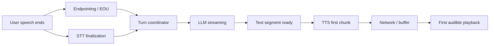
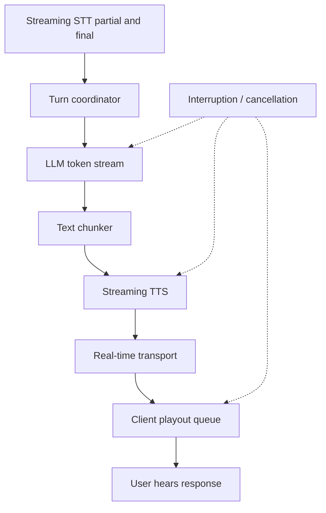
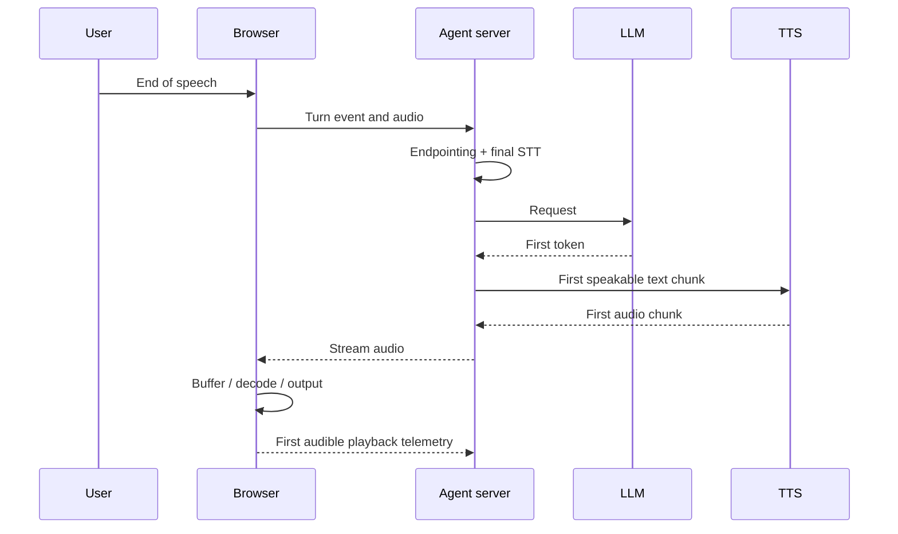

# هندسة السرعة في الوكلاء الصوتيين: من أول Token إلى أول صوت يسمعه المستخدم

**Latency & Streaming Optimization — المقالة 11 من 16**  
**المستوى:** متوسط → متقدم | **القراءة:** نحو 25–35 دقيقة + مختبر عملي  
**English:** [[11-Latency-and-Streaming-Optimization-EN|Read this article in English]]  
**السابقة:** [[10-Interruptions-Barge-In-and-Playback-State-AR|المقالة العاشرة — المقاطعات وإدارة الصوت المشغّل]]  
**الفهرس:** [[00-Series-Roadmap|خارطة سلسلة Voice AI Engineering]]

![[assets/latency-streaming-cover.png]]

> [!abstract] سؤال المقالة
> قد يُنتج الـLLM أول Token في أقل من نصف ثانية، وقد يُرجع TTS أول دفعة صوت بسرعة، ومع ذلك يشعر المستخدم أن الوكيل بطيء. في هذه المقالة نحدد الزمن الذي يهم المستخدم فعلاً، ونتتبع أين تتراكم فترات الانتظار، ونشرح كيف يحسّن Streaming التجربة من دون أن يُفسد جودة المحادثة.

## 1. لماذا لا تكفي عبارة «النموذج سريع»؟

تخيّل وكيلاً صوتياً لحجز موعد. يقول المستخدم: «أريد حجز موعد يوم الخميس». ينتهي من الجملة، ويبدأ النظام بمعالجتها. قد يكون نموذج اللغة سريعاً، لكن الوكيل يتأخر لأنه:

1. انتظر طويلاً كي يقرر أن المستخدم أنهى دوره (**Endpointing**).
2. انتظر نصاً نهائياً من STT رغم إمكانية البدء في تجهيز أجزاء مبكرة.
3. جمع جواب LLM كاملاً قبل إرساله إلى محرك TTS.
4. انتظر TTS حتى يُنشئ الملف الصوتي كله.
5. خزّن المتصفح عدداً كبيراً من الدفعات قبل أن يشغّل أول عينة صوت مفيدة.

في [[09-VAD-Endpointing-and-Turn-Detection-AR|المقالة التاسعة]] فصلنا بين الصمت ونهاية الدور، وفي [[10-Interruptions-Barge-In-and-Playback-State-AR|العاشرة]] فصلنا بين الصوت المُولّد والصوت المُشغّل. هنا نربطهما بتجربة المستخدم: **الزمن من نهاية كلامه إلى بداية رد صوتي مفيد ومسموع**، لا زمن استجابة الخادم فقط.[^openai-voice][^livekit-benchmark]

> [!important] قبل أي تحسين
> عرّف بداية القياس ونهايته. هل يبدأ المؤقت عند آخر صوت للمستخدم، أم عند قرار `turn_ended`؟ هل يتوقف عند أول byte من TTS، أم أول عينة غير صامتة، أم بداية التشغيل في المتصفح؟ **لا تقارن رقمين لهما نقطتا قياس مختلفتان.**

## 2. أين يضيع الوقت؟ خريطة المسار الحرج



*الشكل 1. المسار المبسّط من نهاية كلام المستخدم إلى بدء التشغيل. بعض المراحل قد تحدث بالتوازي، ولا يمثّل الرسم عقداً إلزامياً لكل معمارية.*

المفهوم الأساسي هنا هو **Critical Path**. إذا احتاجت مرحلتان إلى 200 و150 ms وكانتا تعملان بالتوازي، فلا تُضاف الفترتان بالضرورة إلى الزمن الكلي، لأن ما يحدد لحظة أول صوت هو أطول سلسلة من التبعيات. لذلك يعطي **Tracing** صورة أصح من جمع مقاييس متفرقة من سجلات مختلفة.[^livekit-traces]

![[assets/latency-stage-overlap.png]]

*الشكل 2 — مثال اصطناعي: ينتظر النظام 200 ms للتأكد من نهاية دور المستخدم، بينما ينهي STT عمله خلال 150 ms من الفترة نفسها. وجمع 200 + 150 هنا يعني عدّ الوقت المتداخل مرتين. الأرقام للتوضيح وليست Benchmark.*

## 3. المصطلحات التي يجب أن تقيسها

| المقياس | أين يبدأ؟ | أين ينتهي؟ | ما الذي يخبرنا به؟ |
|---|---|---|---|
| **EOU / Endpointing delay** | آخر كلام للمستخدم | قرار انتهاء الدور | هل ينتظر النظام أكثر من اللازم؟ |
| **STT tail latency** | آخر كلام للمستخدم | توفر التفريغ النهائي | تأخر إغلاق التعرف على الكلام |
| **LLM TTFT** | إرسال طلب LLM | أول Token | سرعة بدء التوليد؛ ليس بالضرورة أول كلام مفيد |
| **Text aggregation delay** | أول Token | أول مقطع مناسب للنطق | أثر انتظار جملة أو عبارة قبل TTS |
| **TTS TTFB** | طلب TTS | أول دفعة صوت | زمن بدء التخليق لدى الخدمة |
| **TTS TTFA** | طلب TTS | أول عينة صوتية غير صامتة ناتجة | قد يتضمن صمتاً بادئاً بعد وصول أول byte |
| **Transport/playback delay** | أول دفعة TTS | بدء تشغيل الصوت على العميل | كلفة الشبكة والتخزين والصوت |
| **E2E to first audible** | نهاية كلام المستخدم | بدء صوت مفيد على جهازه | أقرب مؤشر عملي لما يشعر به المستخدم |

> [!warning] المصطلحات ليست موحّدة كلياً بين الأطر
> في Pipecat يوجد تفريق موثّق بين `TTFB` و`TTFA` عند TTS؛ قد تعني `TTFT` في سياق آخر أول رمز نصي من LLM أو أول رمز صوتي من نموذج Realtime. قارن **تعريف المقياس الفعلي** وليس اختصاره وحده.[^pipecat-metrics][^livekit-traces]

وهذا مقياس تجريبي واضح التعريف:

```text
End-to-first-audible latency
  = client_first_audible_ms - user_speech_end_ms
```

في قياس الإنتاج، **«أول صوت مسموع» تقدير من جهة التشغيل**؛ لا يوجد ما يثبت أن المستخدم سمعه بالفعل إذا كان الجهاز مكتوماً أو الصوت منخفضاً. ويُفضَّل استبعاد الصمت الذي يبدأ به صوت TTS، كي لا تُحسب لحظة تشغيل مقطع صامت تحسيناً وهمياً.

### لماذا يختلف First Token عن First Useful Answer؟

قد يبدأ النموذج بـ«دعني أتحقق...» بعد 250 ms، ثم ينتظر أداة خارجية ثانيتين قبل أن يقدم جواب الموعد. إذا كان هدف المستخدم إجابة مفيدة، فإن «بدأ الوكيل يتكلم» ليس مكافئاً لـ«حصل على جواب». قِس **Time to First Useful Spoken Answer** كهدف مستقل يتطلب تعريفاً وتقييماً للمحتوى، ولا تكافئ ردود الحشو الصوتي لمجرد تقليل رقم التأخير.[^openai-voice]

## 4. لماذا يغيّر Streaming المعادلة؟

في تصميم **Batch** قد ننتظر تفريغ الكلام كله ثم جواب LLM كله ثم ملف TTS كله ثم نبدأ التشغيل. أما تصميم **Streaming** فيسمح لبعض الخطوات بأن تنتج أجزاءً مبكرة تُرسل إلى المرحلة التالية قبل اكتمال كل العمل.



![[assets/latency-streaming-overlap.png]]

*الشكل 3 — مقارنة **افتراضية** لتداخل المراحل. التداخل الكامل ليس ممكناً دائماً: يحتاج TTS غالباً إلى قدر من النص القابل للنطق، وقد تكون بعض المخرجات غير صالحة قبل تأكيد البيانات أو نتائج الأدوات.*

### مزايا التداخل

- **خفض التأخير قبل أول صوت:** حين يصل مقطع قابل للنطق إلى TTS بسرعة.
- **استغلال الوقت:** يمكن للنقل الصوتي أن يبدأ فيما يكمل الـLLM بقية الإجابة.
- **تحسين الإحساس بالتفاعل:** لا يحتاج المستخدم إلى انتظار توليد تسجيل طويل بالكامل.

### المفاضلة التي يجب ألا نخفيها

تجزئة النص إلى أجزاء قصيرة جداً قد تسبب نطقاً متقطعاً، وتنغيماً غير طبيعي، أو تكلفة طلبات أعلى. والبدء قبل تثبيت قصد المستخدم قد ينتج ردوداً خاطئة أو إلغاءً متكرراً. لذلك اختر حجم Buffer يناسب ظروف الشبكة ونموذج TTS وسلوك المقاطعات؛ فأصغر Buffer ممكن ليس هدفاً بحد ذاته.

## 5. من أين تبدأ بتحسين الأداء؟ ستة قرارات هندسية

### (أ) تحسين نهاية الدور أولاً

راجع `Endpointing delay` والتوقفات الطبيعية والإنذارات الكاذبة قبل تقليص أي مهلة. تقليص مهلة الصمت قد يختصر زمن الاستجابة، لكنه قد يجعل الوكيل يقاطع المستخدم حين يتوقف ليفكر. لذلك قِس السرعة مع False Endpoint Rate وTurn-Taking Quality معاً.[^livekit-turns]

### (ب) استخدام STT Streaming دون اعتماد النص المؤقت كحقيقة

يمكن الاستفادة من Partial Transcripts في التنبؤ والاستعداد، لكن لا تثبت تفاصيل حرجة مثل اسم أو تاريخ أو رقم اعتماداً على نص متغير. افصل التحضير المبكر عن **تأكيد المدخلات**، واستعد لإلغاء الأعمال المسبقة عندما يصحح المستخدم كلامه.

### (ج) الاستجابة النصية القابلة للنطق

الأجوبة القصيرة والقريبة من لغة الكلام غالباً تحتاج وقتاً أقل للنطق، لكن لا تتخلَّ عن التفاصيل الأساسية. قسّم المخرجات إلى مقاطع ملائمة للتنغيم لا إلى حرف أو Token منفرد في كل مرة. انتبه إلى الأرقام والتواريخ والأسماء العربية والإنجليزية المختلطة.

### (د) تحسين TTS: أول مقطع قبل اكتمال الصوت

استخدم Streaming TTS عندما تدعمه الخدمة، وقارن `TTFB` و`TTFA`، والصمت الأولي، وتكرار الفجوات بين الدفعات. وتأكد أن تغيير حجم الـChunk يخفف الانتظار **دون الإضرار بطبيعية الصوت** أو زيادة حالات إعادة التشغيل.

### (هـ) النقل والتشغيل: احذر من الشبكة والمخازن

قد يكون الـBackend سريعاً بينما يتأخر العميل بسبب Jitter أو مخازن صوت غير متوازنة أو إعادة اتصال. تحتاج إلى تسجيل وقت `first_audio_arrived` و`first_audible_started` على جهة العميل، ومقاييس الشبكة من WebRTC/وسيلة النقل المستخدمة. راجع [[08-Real-Time-Audio-Transport-AR|المقالة الثامنة]].

### (و) تهيئة الاتصالات والاعتمادية

إعادة إنشاء العميل أو جلسة النقل أو تهيئة النموذج عند كل دور قد يضيف زمناً واضحاً. افصل **زمن إنشاء الجلسة** عن **زمن كل دور**، وقيّم أثر إعادة الاتصال، والـCold Start، وفقد الحزم، والفشل في الأداة، وتدفق الضغط (Backpressure). لا تستخدم تشغيلات سريعة منتقاة فقط لعرض الأداء.

> [!tip] قاعدة عملية
> إذا كان التأخير الأكبر من **Endpointing** فلا تتوقع أن يحل تبديل LLM المشكلة. وإذا كان زمن TTS جيداً لكن `client_first_audible` متأخراً، ابحث في الشبكة والتخزين والتشغيل. **قِس عنق الزجاجة ثم غيّر متغيراً واحداً.**

## 6. P50 وP95 وP99: المتوسط وحده يخفي المشكلة

تخيّل أن معظم الردود تستغرق 500–700 ms، لكن بعضها يستغرق ثانيتين. قد يبدو المتوسط مقبولاً بينما يلاحظ المستخدم التباطؤ المتقطع مراراً.

- **P50:** نصف العينات تقريباً عند هذا الزمن أو دونه.
- **P95:** 95% تقريباً من العينات عند هذا الزمن أو دونه؛ يوضح الذيل البطيء.
- **P99:** يفيد في اكتشاف حالات نادرة، لكنه يحتاج عدداً أكبر من العينات كي يكون مستقراً.

![[assets/latency-p50-p95.png]]

*الشكل 4 — توزيعات اصطناعية لثلاث بيئات؛ 12 عينة في كل بيئة. ليست قياساً لـPipecat أو LiveKit أو أي مزوّد.*

في المختبر نستخدم **Nearest-Rank**: نرتب الأرقام تصاعدياً ونختار العنصر عند الرتبة `ceil(p*n/100)` (مع حالة خاصة لـP0). توجد تعريفات إحصائية أخرى تستعمل الاستيفاء؛ لهذا يجب توثيق طريقة الحساب قبل مقارنة Dashboards مختلفة.

| السيناريو الاصطناعي | عدد العينات | P50 | P95 | ملاحظات |
|---|---:|---:|---:|---|
| Quiet room | 12 | 540 ms | 670 ms | ذيل قصير نسبياً |
| Noisy room | 12 | 710 ms | 1400 ms | حالات تأخر نادرة |
| High jitter | 12 | 730 ms | 1900 ms | المخزن أو الشبكة قد يهيمن |

> [!warning] ليس Benchmark
> القيم السابقة **مصنوعة لأغراض التعلّم** ولا تعكس سرعة أي نموذج أو بيئة حقيقية. مع 12 عينة، يساوي P95 وفق Nearest-Rank قيمة العينة القصوى؛ عند القياس العملي اجمع عدداً كافياً من المحادثات واستخدم تقسيمات ثابتة للسيناريوهات.

## 7. كيف نبني Tracing صحيحاً؟

أعطِ كل دور `turn_id`، واستخدم تسميات أحداث واضحة ومرجعاً زمنياً موثوقاً. على الخادم استخدم ساعة أحادية الاتجاه مثل `time.monotonic_ns()`، وفي المتصفح استخدم `performance.now()`؛ لا تطرح طابعين زمنيين خامّين صادرين من ساعتين مختلفتين، حتى لو بدا أنهما بوحدة millisecond.[^mdn-timing]



**بيانات أساسية مقترحة** لكل دور:

```json
{
  "turn_id": "synthetic-001",
  "scenario": "quiet-room",
  "user_speech_end_ms": 0,
  "turn_committed_ms": 200,
  "transcript_final_ms": 150,
  "llm_request_ms": 210,
  "llm_first_token_ms": 320,
  "text_ready_for_tts_ms": 400,
  "tts_request_ms": 405,
  "tts_first_chunk_ms": 530,
  "client_audio_arrived_ms": 570,
  "client_first_audible_ms": 640
}
```

**ملاحظة:** هذا JSON افتراضي، وكل طوابعه الزمنية على خط زمني اصطناعي مشترك. في نظام حقيقي تحتاج إلى ربط أحداث العميل والخادم باستخدام `trace_id`، وضبط الساعات أو استعمال فروق محلية وفترات قياس مخصصة. كما يجب تقليل البيانات الحساسة في السجلات وعدم وضع نصوص المحادثات أو صوت المستخدم في Telemetry دون حاجة وموافقة مناسبة.

## 8. المختبر: تحليل 36 دوراً صوتياً باستخدام Python

أنشأنا مختبراً لا يحتاج نموذج ذكاء اصطناعي أو أي مفتاح API:

| الملف | الوظيفة |
|---|---|
| `examples/latency_streaming_lab.py` | تحليل أحداث كل دور وحساب مؤشرات الزمن والنسب المئوية |
| `examples/11-synthetic-traces.jsonl` | 36 دوراً اصطناعياً موزعة على ثلاث بيئات |
| `examples/test_latency_streaming_lab.py` | 27 اختبار وحدة للتحقق من سلامة الحسابات |
| `examples/make_latency_figures.py` | إعادة توليد الرسومات الثلاثة |
| `examples/11-LATENCY-LAB-README.md` | كيفية التشغيل وتفسير النتائج |

### التشغيل

```bash
cd Voice-Agent-Series
python examples/latency_streaming_lab.py
python examples/latency_streaming_lab.py --json
python -m unittest discover -s examples -p 'test_latency_streaming_lab.py' -v
```

**النتيجة المتوقعة للبيانات المرفقة:**

```text
Synthetic example only — NOT a voice-provider benchmark
Scenario                n    p50 (ms)    p95 (ms)    p99 (ms)
high-jitter            12         730        1900        1900
noisy-room             12         710        1400        1400
quiet-room             12         540         670         670
```

يفحص المختبر وجود الأحداث، وترتيب التبعيات، والقيم السالبة وNaN، وتعريف P50/P95، وتكرار `turn_id`. ولا يدّعي أنه يقيس خادماً أو متصفحاً فعلياً؛ فائدته أن يوضح **كيف تكتب طبقة قياس محايدة للمزود** قبل ربطها بنظامك.

## 9. تصميم لوحة مراقبة في الإنتاج

بدلاً من لوحة تعرض «Latency = 450 ms» فقط، اجعلها تعرض:

| الجزء | ما الذي نراقبه؟ | لماذا؟ |
|---|---|---|
| تجربة المستخدم | P50/P95/P99 لزمن أول صوت مفيد | مقياس التجربة الأساسية |
| Turn-taking | زمن EOU وFalse Endpoint وBarge-in yield | لا تعالج السرعة على حساب المقاطعات |
| STT | تفريغ نهائي، WER/CER عند توفر مرجع | تمنع التضحية بالفهم |
| LLM | TTFT، زمن أول نص قابل للنطق، استدعاءات الأدوات | تكشف الانتظار بين النص والأفعال |
| TTS | TTFB وTTFA وفجوات الدفعات | تكشف صمت البداية وتقطع الكلام |
| Client/Network | وصول أول صوت، التشغيل، Jitter، Buffer underrun | تحدد المشاكل خارج الخادم |
| الاعتمادية | مهلات، أخطاء، إلغاءات، اكتمال المهام | سرعة لا تأتي على حساب النجاح |

لا تمزج مكالمات الهاتف SIP مع WebRTC في نسبة واحدة دون تجزئة؛ النقل والاتصال والجغرافيا تختلف. قارن الإعدادات داخل السيناريو نفسه وثبّت نص المحادثة ووسيلة النقل ومنطقة الخادم وخصائص الضغط.[^livekit-benchmark]

### مثال افتراضي على هدف هندسي (SLO)

> «ضمن فئة اتصال WebRTC على شبكة مرجعية محددة، نريد أن يكون P95 لزمن بداية الرد الصوتي **أقل من 1200 ms**، مع معدل أخطاء قابل للقياس وعدم زيادة المقاطعات الخاطئة». هذه **قيمة هدف مقترحة للتوضيح فقط**، وليست معياراً عاماً ولا نتيجة مثبتة؛ يتحدد الهدف الحقيقي من احتياجات المنتج والقياس الفعلي.

## 10. أخطاء شائعة عند تحسين Latency

1. تحسين LLM TTFT دون قياس تشغيل الصوت لدى المستخدم.
2. جمع جميع أزمنة المراحل، رغم تداخلها، واعتبار الناتج E2E.
3. استخدام أول Byte من TTS كبديل لأول صوت مفيد رغم احتمال وجود صمت بادئ.
4. إزالة كل Buffer، ثم مواجهة تقطع الصوت على الشبكات المتذبذبة.
5. الإسراع في Endpointing حتى يقاطع الوكيل المستخدم أثناء التفكير.
6. إجراء الاختبار على جملة واحدة وشبكة واحدة ثم إعلان «زمن استجابة ثابت».
7. تسجيل Telemetry من أجهزة متعددة ثم طرح طوابعها الزمنية بلا محاذاة.
8. إضافة رسالة «سأتحقق» سريعة لإخفاء انتظار طويل على المعلومة الأساسية.

## 11. خطة تحسين تدريجية: من القياس إلى قرار الإنتاج

**الخطوة 1 — Baseline:** سجّل 100+ دور متنوع كبداية استطلاعية (ليس ضماناً لكفاية إحصائية)، مع فئات الهدوء والضجيج والمقاطعة والاتصال الضعيف والأدوات الخارجية.  
**الخطوة 2 — Trace:** اجمع أحداث الخادم والعميل، وانظر إلى التداخل والمسار الحرج.  
**الخطوة 3 — Hypothesis:** اختر مكوّناً واحداً، مثل تأخر نهاية الدور، واكتب سبباً قابلاً للاختبار.  
**الخطوة 4 — Experiment:** غيّر عاملاً واحداً، مثل سياسة Endpointing أو حجم المقاطع، ثم أعد سيناريوهات مماثلة.  
**الخطوة 5 — Guardrails:** راقب جودة التفريغ، اكتمال المهام، طبيعية النطق، المقاطعات الخاطئة، وموثوقية التشغيل.  
**الخطوة 6 — Rollout:** انشر تدريجياً، وراقب P95 ومعدلات الفشل، ثم احتفظ بإمكانية الرجوع للإعداد السابق.

> [!success] الخلاصة
> سرعة أول Token لا تكفي وحدها لتجعل الوكيل سريعاً. ما يهم أن **يبدأ الوكيل رداً صوتياً مفيداً في وقت مناسب، وبثبات من دور إلى آخر**. وتحسين الأداء عمل هندسي يشمل النظام كله: اكتشاف نهاية الدور، ونصوص STT، وLLM، وTTS، والنقل، والتشغيل، والسياق. **قِس أولاً، ثم حسّن المسار الحرج، وراقب الذيل البطيء والجودة معاً.**

## تمرين للقارئ

1. افتح `11-synthetic-traces.jsonl`، وأضف دوراً واحداً زمنه 2300 ms إلى سيناريو `quiet-room` بمعرّف جديد.
2. شغّل المختبر مجدداً: كيف تغيّر P50 وP95؟ ولماذا يظهر أثر الذيل بوضوح؟
3. ابحث في نظامك عن نقطة قياس «أول صوت بدأ تشغيله على العميل» بدل الاعتماد على زمن خروج TTS من الخادم.
4. صمّم تجربة A/B لتقليل EOU delay، وحدّد مسبقاً مقياساً يمنع زيادة المقاطعات المبكرة.

## المراجع والمصادر

[^openai-voice]: [OpenAI — Voice agents: Measure latency](https://developers.openai.com/api/docs/guides/voice-agents) — يوصي بقياس ما يسمعه المستخدم ومقارنة الوسيط وP95 ومراقبة مراحل الخدمة والنقل والتشغيل.
[^livekit-traces]: [LiveKit — Session traces and metrics](https://docs.livekit.io/reference/agents/session-traces/) — تعريف مراحل EOU وSTT وLLM وTTS وE2E والـtraces.
[^livekit-benchmark]: [LiveKit — Benchmarking](https://docs.livekit.io/reference/agents/benchmarking/) — يعرّف بداية القياس من نهاية كلام المتصل حتى بدء الرد المسموع، ويفصل شبكات الهاتف عن WebRTC.
[^pipecat-metrics]: [Pipecat — Metrics reference](https://reference-server.pipecat.ai/en/latest/api/pipecat.metrics.metrics.html) — يوضح TTFB وTTFA والصمت البادئ وقياس تجميع النص.
[^livekit-turns]: [LiveKit — Turns overview](https://docs.livekit.io/agents/logic/turns/) — يوضح أثر سياسة End-of-turn وPreemptive Generation.
[^mdn-timing]: [MDN — High precision timing](https://developer.mozilla.org/en-US/docs/Web/API/Performance_API/High_precision_timing) — يوضح الساعات الأحادية الاتجاه و`performance.now()` والفروق بين Time Origins.

---

**المقالة التالية:** [[12-Robust-Voice-AI-in-the-Wild-AR|12 — متانة الوكيل الصوتي: الضجيج والصدى واللهجات والتعافي]]  
**English edition:** [[11-Latency-and-Streaming-Optimization-EN]]
