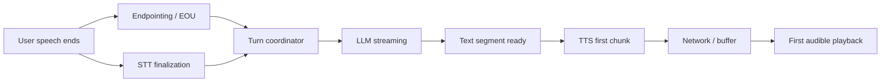
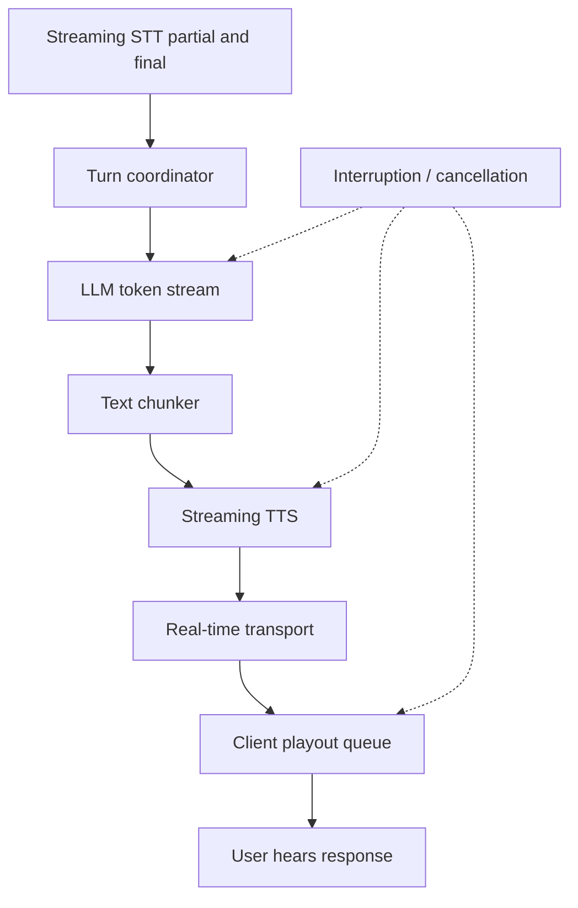
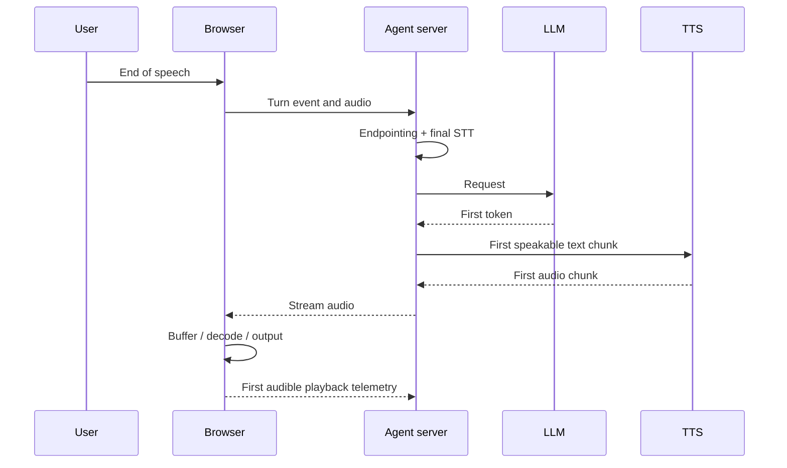

# Voice Agent Latency Engineering: From First Token to First Audible Response

**Latency & Streaming Optimization — Article 11 of 16**  
**Level:** Intermediate → Advanced | **Reading time:** 25–35 minutes plus a Python lab  
**العربية:** [[11-Latency-and-Streaming-Optimization-AR|اقرأ المقالة بالعربية]]  
**Previous:** [[10-Interruptions-Barge-In-and-Playback-State-EN|Interruptions, Barge-In & Playback State]]  
**Series index:** [[00-Series-Roadmap|Voice AI Engineering Roadmap]]

![[assets/latency-streaming-cover.png]]

> [!abstract] The engineering question
> Your LLM produces its first token quickly. Your TTS provider returns audio promptly. Yet the agent still feels sluggish. **What latency should we measure, where does waiting accumulate, and how can streaming reduce perceived delay without damaging turn-taking or speech quality?**

## 1. The model can be fast while the conversation is slow

Imagine a voice assistant helping someone schedule an appointment. The user says, “Book an appointment for Thursday.” After the user stops speaking, the system must make a series of decisions. Delay may arise because it:

1. Waits too long to decide the user has finished (**endpointing**).
2. Waits for final STT output even where early processing could prepare useful work.
3. Accumulates the LLM's full answer before forwarding any text to TTS.
4. Generates a complete audio file instead of streaming its early output.
5. Buffers too much audio on the client before beginning audible playback.

In [[09-VAD-Endpointing-and-Turn-Detection-EN|Article 09]], we distinguished silence from the end of a user turn. In [[10-Interruptions-Barge-In-and-Playback-State-EN|Article 10]], we distinguished generated audio from played audio. Latency engineering combines both lessons: the user cares about **the time until a useful spoken answer begins**, not merely the model's internal processing time.[^openai-voice][^livekit-benchmark]

> [!important] Define the boundaries first
> Did you start your timer at the end of speech or when the server committed the turn? Did you stop it at the first TTS byte, the first non-silent sample, or the beginning of client playback? **Do not compare two metrics that use different boundaries.**

## 2. Trace the critical path



*Figure 1. A conceptual path from the end of user speech to the first audible answer. Real systems may overlap stages or use a native speech-to-speech model instead.*

The **critical path** is the longest chain of dependencies between the start and end of a turn. Imagine that endpointing takes 200 ms and STT finalization takes 150 ms, but both start when speech ends. Adding them together produces a misleading 350 ms. The next stage may only wait for whichever dependency completes last. A correctly instrumented trace reveals this overlap instead of adding unrelated per-service metrics.[^livekit-traces]

![[assets/latency-stage-overlap.png]]

*Figure 2 — Synthetic timeline. Endpointing and STT overlap; summing all labeled durations double-counts time. The numbers are illustrative and are not provider benchmark results.*

## 3. The latency vocabulary that matters

| Metric | Start | End | What it reveals |
|---|---|---|---|
| **EOU / endpointing delay** | Last detected user speech | End-of-turn decision | Excessive waiting for user completion |
| **STT tail latency** | End of user speech | Final transcript available | Post-speech transcription delay |
| **LLM TTFT** | LLM request | First output token | How soon generation starts, not necessarily a useful answer |
| **Text aggregation delay** | First LLM token | First speakable text segment | Time spent collecting a sentence or phrase for TTS |
| **TTS TTFB** | TTS request | First audio chunk | Provider synthesis startup |
| **TTS TTFA** | TTS request | First non-silent synthesized sample | Startup plus any leading silence |
| **Delivery and playback delay** | First TTS audio produced | Playback starts on client | Network, decoding, and buffering effects |
| **End-to-first-audible latency** | End of user speech | First useful audible response begins | A closer approximation of user-perceived delay |

> [!warning] Acronyms are not universally defined
> Pipecat distinguishes TTS **TTFB** from **TTFA**, including leading silence. “TTFT” may mean the first text token in a cascaded system or the first audio output token in a realtime model. Compare the **measurement definition**, not just the acronym.[^pipecat-metrics][^livekit-traces]

A well-defined experimental metric is:

```text
End-to-first-audible latency
  = client_first_audible_ms - user_speech_end_ms
```

Even “audible” is a playback-side approximation: the system cannot verify that a person heard an unmuted speaker. It also matters whether the first output contains leading silence. Report audio playback estimates honestly rather than describing them as direct measurements of human perception.

### First token is not first useful answer

An LLM may output “Let me check...” after 250 ms, then block on a two-second tool call before returning the appointment details. Quick filler speech may improve conversational feedback, but it is not the same as an **actionable answer**. Track a separate *time to first useful spoken answer* with a task-dependent content definition. Do not reward empty filler merely because it lowers the first-audio metric.[^openai-voice]

## 4. What streaming changes

A **batch** pipeline may wait for a full transcript, a complete LLM response, a fully synthesized file, and only then initiate playback. A **streaming** pipeline forwards partially completed work whenever the next stage has enough trustworthy input to proceed.



![[assets/latency-streaming-overlap.png]]

*Figure 3 — An illustrative schedule comparing sequential and overlapping execution. Stages can overlap only when their dependencies, correctness requirements, and service capabilities permit it.*

**Benefits:** The user may hear the first segment before the entire answer is generated; the system can transmit audio while the LLM creates later sentences; and long answers no longer require one giant TTS output file.

**Costs:** Excessively small text chunks can damage prosody, multiply requests, and produce awkward pauses. Aggressive pre-generation may require cancellation when an interim transcript changes. A tiny audio buffer can reduce initial wait yet increase underruns and glitches under network jitter. The goal is not “minimum buffer at any cost” but **responsive, stable, and correct conversation**.

## 5. Six optimization levers

### A. Tune turn completion before replacing the model

Measure endpointing delay and false early turn endings. Shorter silence windows may improve latency but cause the agent to interrupt users who pause to think. Evaluate both speed and turn-taking errors. When available, test adaptive end-of-turn detection rather than treating all pauses as identical.[^livekit-turns]

### B. Use streaming STT without treating interim text as settled fact

Partial transcripts can trigger speculative preparation, but do not commit high-impact data such as an ID number, date, or name before confirmation. Design a clear distinction between **tentative work** and **committed user intent**, and cancel early work when the user corrects their utterance.

### C. Produce speech-friendly LLM segments

Concise answers are usually faster to speak, but must still answer the question. Send complete speakable phrases or clauses to TTS rather than isolated tokens. Watch for numbers, dates, acronyms, and mixed Arabic/English pronunciation; segment boundaries affect naturalness.

### D. Stream TTS and watch for silence

When supported, begin synthesis before the complete LLM answer is available. Compare TTS TTFB with TTFA, leading silence, chunk gaps, and continuity at playback. Smaller segments are not automatically better: test voice quality and the behavior of resumed or interrupted speech.

### E. Measure the network and the actual player

The backend may be fast while the client experiences jitter, excessive buffering, audio decoding delay, or renegotiation. Capture `first_audio_arrived` and `first_audible_started` on the client, alongside connection statistics appropriate to WebRTC or the chosen transport. See [[08-Real-Time-Audio-Transport-EN|Article 08]].

### F. Separate setup latency from per-turn latency

Cold starts, session negotiation, initial model loading, or new connections can dominate the first interaction. Report greeting/startup latency separately from per-turn delay. Also test slow networks, retries, tool failures, cancellation, and backpressure; avoid reporting only hand-selected fast requests.

> [!tip] Practical diagnosis
> If endpointing dominates, replacing the LLM will not fix it. If TTS produces its first chunk promptly but client playback starts late, investigate transport, decoding, and buffers. **Measure the bottleneck, then change one factor at a time.**

## 6. P50, P95, and P99: the tail matters

Suppose most responses begin after 500–700 ms, while occasional replies take two seconds. A mean alone may hide how frequently users experience noticeable stalls.

- **P50 (median):** A typical midpoint of the observed latency distribution.
- **P95:** A tail-oriented metric: roughly 95% of observations are at or below this value.
- **P99:** Highlights more extreme outliers, but needs substantially more samples for stable estimates.

![[assets/latency-p50-p95.png]]

*Figure 4 — Synthetic latency distributions for three scenarios, 12 turns each. None of the values is a measurement of Pipecat, LiveKit, OpenAI, or another provider.*

The lab uses the **nearest-rank percentile**: sort the samples and select rank `ceil(p*n/100)` (with a special case for P0). Other dashboards interpolate between values; document the percentile implementation before making comparisons.

| Synthetic scenario | Turns | P50 | P95 | Interpretation |
|---|---:|---:|---:|---|
| Quiet room | 12 | 540 ms | 670 ms | Relatively short tail |
| Noisy room | 12 | 710 ms | 1400 ms | Occasional slow turns |
| High jitter | 12 | 730 ms | 1900 ms | Potential transport/buffer pressure |

> [!warning] Illustrative numbers, not a benchmark
> These durations are **fabricated to teach the analysis**. With just 12 values, nearest-rank P95 equals the maximum. Real latency studies need adequate repeated observations, controlled conditions, and separate scenario groups.

## 7. Correct instrumentation requires consistent clocks

Assign each user turn a `turn_id`, instrument clear event boundaries, and preserve correlation across the client and server. On the server, use a monotonic clock such as Python's `time.monotonic_ns()`; in the browser, use `performance.now()`. **Never directly subtract raw timestamps from independent clocks** without synchronization or an explicit correlation method, even if both values are denominated in milliseconds.[^mdn-timing]



**A minimal conceptual trace** (all timestamps use one **synthetic shared timeline**):

```json
{
  "turn_id": "synthetic-001",
  "scenario": "quiet-room",
  "user_speech_end_ms": 0,
  "turn_committed_ms": 200,
  "transcript_final_ms": 150,
  "llm_request_ms": 210,
  "llm_first_token_ms": 320,
  "text_ready_for_tts_ms": 400,
  "tts_request_ms": 405,
  "tts_first_chunk_ms": 530,
  "client_audio_arrived_ms": 570,
  "client_first_audible_ms": 640
}
```

In production, use trace/span identifiers, clock alignment or separate duration measurements, event definitions, scenario metadata, and source-of-truth timestamps. Do not mix unsynchronized browser and server event clocks into one timeline. Avoid logging transcripts or recorded audio in metrics by default; respect consent, retention, and privacy requirements.

## 8. The Python lab: 36 simulated voice turns

This lab requires **no LLM, STT/TTS service, microphone, or API key**. It is designed to test telemetry logic before integrating real pipeline events.

| File | Purpose |
|---|---|
| `examples/latency_streaming_lab.py` | Validates events, calculates durations, summarizes percentiles |
| `examples/11-synthetic-traces.jsonl` | 36 synthetic turns across three scenarios |
| `examples/test_latency_streaming_lab.py` | 27 unit tests, including invalid event order and percentile edge cases |
| `examples/make_latency_figures.py` | Recreates the three teaching diagrams |
| `examples/11-LATENCY-LAB-README.md` | Execution steps and limitations |

Run from the `Voice-Agent-Series` directory:

```bash
python examples/latency_streaming_lab.py
python examples/latency_streaming_lab.py --json
python -m unittest discover -s examples -p 'test_latency_streaming_lab.py' -v
```

Expected output for the included synthetic data:

```text
Synthetic example only — NOT a voice-provider benchmark
Scenario                n    p50 (ms)    p95 (ms)    p99 (ms)
high-jitter            12         730        1900        1900
noisy-room             12         710        1400        1400
quiet-room             12         540         670         670
```

The lab rejects missing timestamps, impossible causal order, negative/non-finite numbers, and duplicate turn identifiers. It also demonstrates why component-level durations cannot simply be added to obtain end-to-end time. **It does not measure a real provider or claim a realtime microphone demonstration.**

## 9. What a useful production dashboard shows

A dashboard with one number labeled “Latency = 450 ms” is insufficient. Report a set of metrics:

| Area | Report | Why |
|---|---|---|
| User experience | P50/P95/P99 for first useful audible reply | Measures conversational responsiveness |
| Turn-taking | EOU duration, early endpoint errors, barge-in yield | Protects natural interruptions |
| STT | Tail delay and accuracy when reference data exists | Prevents speed-at-any-cost transcription |
| LLM | TTFT, first speakable text, tool-call duration | Finds generation and tool bottlenecks |
| TTS | TTFB, TTFA, leading silence, chunk gaps | Shows synthesis and prosody tradeoffs |
| Client/network | First audio arrival, playback start, jitter, underruns | Reveals delay outside the backend |
| Reliability | Timeouts, cancellations, errors, task completion | Preserves actual task success |

Benchmark WebRTC and telephony/SIP separately. Keep prompt, user audio, transport, agent version, client geography, provider region, and concurrency load fixed when comparing configurations. LiveKit's benchmarking documentation recommends reporting P50/P95/P99 and sample counts for each scenario.[^livekit-benchmark]

### Illustrative SLO, not a universal target

> “For a defined WebRTC network segment, target P95 under 1,200 ms for first audible reply while maintaining task success and limiting false interruptions.” This is an **example product goal**, not an industry-standard threshold or measured result. Real targets must come from user research and baseline observations.

## 10. Common latency mistakes

1. Optimizing LLM TTFT without instrumenting browser playback.
2. Adding overlapping stage durations and labeling the sum “E2E.”
3. Treating TTS first bytes as the first useful audible content despite leading silence.
4. Removing all buffering and introducing packet-jitter glitches.
5. Shortening endpointing so much that the agent interrupts a thinking user.
6. Testing a single sentence on one fast connection and claiming consistent responsiveness.
7. Subtracting independent client/server clock readings without alignment.
8. Using rapid “Let me check” acknowledgments to disguise a slow final answer.

## 11. A measured optimization workflow

**Step 1 — Establish a baseline.** Collect diverse turns under quiet, noisy, weak-network, interrupted, and tool-heavy scenarios. An initial 100+ turns may be useful for exploration but is **not a guarantee of statistical adequacy**.

**Step 2 — Trace the critical path.** Capture both client and server events, including overlapping work.

**Step 3 — State a hypothesis.** Example: excessive endpointing accounts for much of the wait on short requests.

**Step 4 — Change one variable.** Compare an updated endpointing strategy or text chunker against the same scenarios and network conditions.

**Step 5 — Retain guardrails.** Compare transcription quality, task correctness, voice naturalness, early turn mistakes, interruption yield, and failures.

**Step 6 — Roll out progressively.** Watch P95, stability and error rates. Keep rollback available if the change harms actual conversations.

> [!success] Key takeaway
> A fast voice agent is not simply an agent with a fast first token. It is one that begins delivering a **useful, intelligible spoken response** quickly and consistently, while preserving the user's turn, the correctness of actions, and playback continuity. **Instrument first, optimize the critical path, and track the slow tail together with quality.**

## Reader exercise

1. Add a new `quiet-room` turn with a 2,300 ms end-to-audible duration to `11-synthetic-traces.jsonl` and a unique `turn_id`.
2. Re-run the lab. What happens to P50 and P95, and why does the tail become more visible?
3. Find a client-side playback-start metric in your own voice agent instead of relying on server-side TTS completion.
4. Design an A/B experiment that reduces EOU delay without increasing premature interruptions.

## Sources and further reading

[^openai-voice]: [OpenAI — Voice agents: Measure latency](https://developers.openai.com/api/docs/guides/voice-agents) — user-perceived spoken latency, P95 and backend stages.
[^livekit-traces]: [LiveKit — Session traces and metrics](https://docs.livekit.io/reference/agents/session-traces/) — EOU, STT, LLM, TTS, E2E and trace definitions.
[^livekit-benchmark]: [LiveKit — Benchmarking](https://docs.livekit.io/reference/agents/benchmarking/) — caller-side response latency, scenario comparability and percentiles.
[^pipecat-metrics]: [Pipecat — Metrics reference](https://reference-server.pipecat.ai/en/latest/api/pipecat.metrics.metrics.html) — TTFB, TTFA, leading silence and text aggregation.
[^livekit-turns]: [LiveKit — Turns overview](https://docs.livekit.io/agents/logic/turns/) — endpointing and preemptive generation tradeoffs.
[^mdn-timing]: [MDN — High precision timing](https://developer.mozilla.org/en-US/docs/Web/API/Performance_API/High_precision_timing) — monotonic clocks, `performance.now()`, and time origins.

---

**Next article:** [[12-Robust-Voice-AI-in-the-Wild-EN|12 — Robust Voice AI in the Wild: Noise, Echo, Accents & Recovery]]  
**Arabic edition:** [[11-Latency-and-Streaming-Optimization-AR]]
