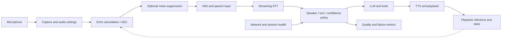
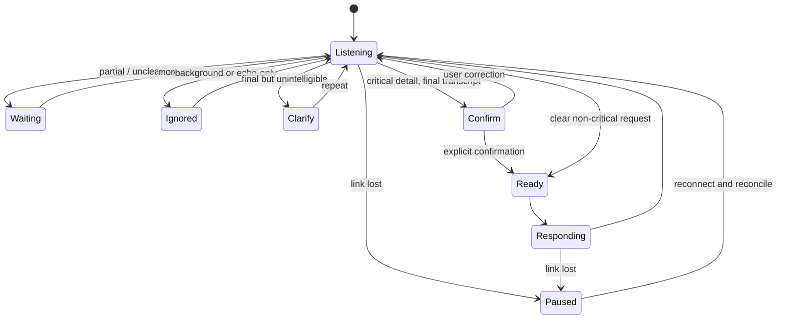
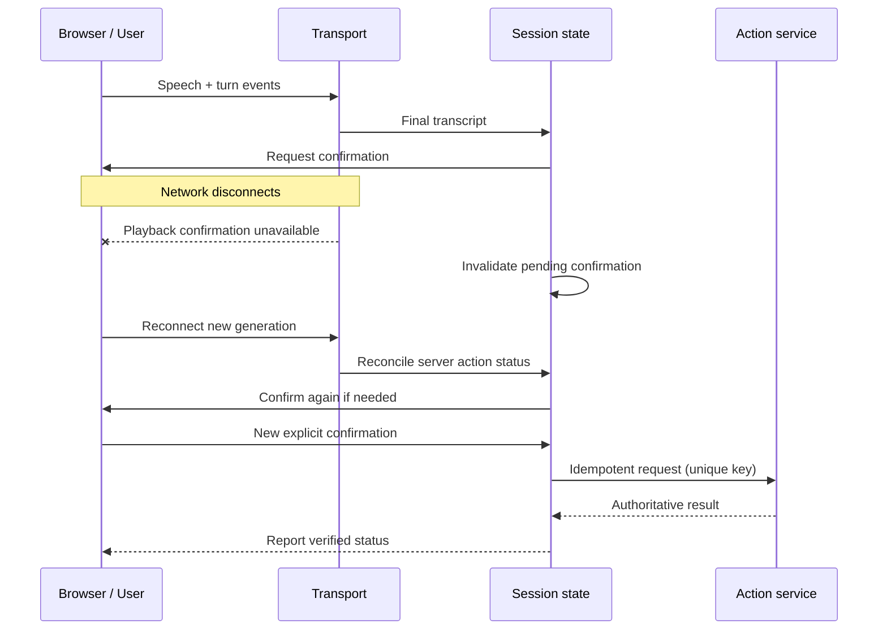
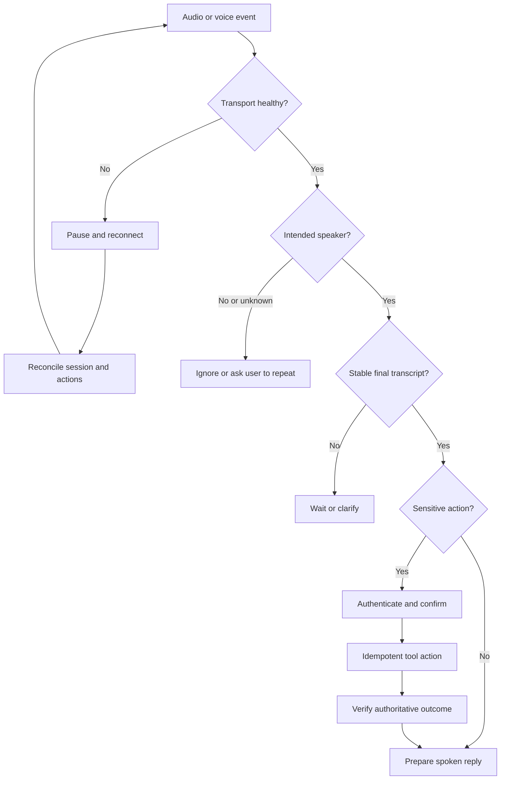

# الوكيل الصوتي في العالم الحقيقي: من غرفة هادئة إلى محادثة لا تتوقف عند أول خطأ

**Robust Voice AI in the Wild — المقالة 12 من 16**  
**المستوى:** متوسط → متقدم | **القراءة:** نحو 25–35 دقيقة + مختبر Python  
**English:** [[12-Robust-Voice-AI-in-the-Wild-EN|Read this article in English]]  
**السابقة:** [[11-Latency-and-Streaming-Optimization-AR|المقالة الحادية عشرة — Latency & Streaming]]  
**الفهرس:** [[00-Series-Roadmap|خارطة سلسلة Voice AI Engineering]]

![[assets/robust-voice-ai-cover.png]]

> [!abstract] سؤال المقالة
> قد يُبهرنا وكيل صوتي في غرفة هادئة باستخدام ميكروفون احترافي، ثم يفشل عند أول تجربة حقيقية: ضجيج شارع، صوت الوكيل يعود إلى الميكروفون، شخص ثانٍ يتكلم، المستخدم يخلط العربية بالإنجليزية، أو اتصال ينقطع أثناء تأكيد حجز. **كيف نصمم نظاماً يتصرف بشكل صحيح عندما لا تكون الإشارة أو الشبكة أو المعلومة مثالية؟**

## 1. من نموذج يعمل إلى منتج يمكن الاعتماد عليه

تخيّل هذا الحوار داخل مركز حجوزات:

**المستخدم:** «بدي غيّر الموعد لبكرا الساعة خمسة».

**الوكيل:** «حسناً، سأغيّر الموعد إلى...».

في هذه اللحظة يسمع الميكروفون صوت الوكيل عبر السماعة، ويقول شخص في الخلفية: «الساعة ستة أحسن!»، ثم يتقطع الاتصال لثانيتين. هل ينبغي للوكيل أن يغيّر الموعد؟ ومن صاحب الطلب؟ وهل سمع المستخدم التأكيد الذي نُطق قبل انقطاع الاتصال؟

هنا يظهر الفرق بين **التعرف على الكلام** و**موثوقية المحادثة**. نحن لا نبني STT مثالياً في الفراغ؛ نبني منظومة تحتاج إلى إثبات أن الصوت وصل من المتحدث المقصود، وأن النص مستقر، وأن العمل المطلوب مسموح وآمن، وأن حالة الجلسة لم تختلط بعد التعافي.

سبق أن درسنا [[03-Speech-to-Text-AR|STT]] و[[08-Real-Time-Audio-Transport-AR|النقل الصوتي]] و[[09-VAD-Endpointing-and-Turn-Detection-AR|اكتشاف دور المستخدم]] و[[10-Interruptions-Barge-In-and-Playback-State-AR|المقاطعات]] و[[11-Latency-and-Streaming-Optimization-AR|التأخير]]. في هذه المقالة نجمعها في منهج **Resilience Engineering**: ضبط الجودة، والكشف عن الفشل، والتعامل الآمن مع عدم اليقين، واستعادة الخدمة من دون اختلاق حالة محادثة.

## 2. خريطة مصادر الخطأ

ليس كل كلام خاطئ يعني أن LLM «لم يفهم»؛ كثيراً ما تبدأ المشكلة قبل وصول الكلام إلى النموذج.

| المصدر | ماذا قد يحدث؟ | الإجراء الهندسي الأول |
|---|---|---|
| **Background noise** | تُطمس كلمات أو تُستثار VAD خطأ | قياس الجودة وتنقية مناسبة واختبارات ضجيج |
| **Acoustic echo** | يلتقط الميكروفون صوت الوكيل | إلغاء الصدى مع مرجع صوت الإخراج |
| **Competing speakers** | يرد الوكيل على شخص بعيد | عزل المتحدث المقصود وسياسة مصدر واضحة |
| **Accents / dialects** | تتحول كلمات عامية إلى كلمات مختلفة | بيانات تقييم ممثلة للهجات ونصوص مرجعية |
| **Code-switching** | يفسد المزج بين لغتين أو أسماء تقنية | STT متعدد اللغات مع الحفاظ على النص الأصلي |
| **Clipping / low volume** | تفقد معلومات صوتية قبل STT | تشخيص إشارة الإدخال والكسب |
| **Packet loss / jitter** | مقاطع مفقودة أو تشغيل متقطع | Telemetry للشبكة وPlayback Buffer متوازن |
| **Disconnect / retry** | ردود قديمة، تكرار أو تنفيذ أمر مرتين | أجيال الجلسات، Idempotency، وتأكيد جديد |



*الشكل 1 — معمارية مفاهيمية وليست ترتيباً إلزامياً لكل إطار. موضع AEC وNoise Suppression قد يكون في نظام التشغيل أو المتصفح أو العميل أو الخادم، ولا يجب تكراره عشوائياً.*

## 3. الضجيج ليس نوعاً واحداً

قد يكون الضجيج ثابتاً، مثل المكيف والمروحة؛ أو متغيراً، مثل المرور؛ أو **صوت إنسان آخر**. النوع الأخير هو الأصعب لأن النظام قد يعتقد أنه كلام ينبغي الرد عليه.

![[assets/robustness-noise-mixture.png]]

*الشكل 2 — إشارة كلام وإشارة تشويش ومزيجهما، **مُولّدة حسابياً** لشرح المشكلة. الرسم لا يمثل نتائج تنقية بواسطة نموذج تعلم عميق.*

### نسبة الإشارة إلى الضجيج (SNR)

إذا عرفت القدرة أو قيمة RMS لكل من الإشارة المطلوبة والضجيج منفصلين، يمكن كتابة العلاقة التعليمية:

$$
\mathrm{SNR}_{dB}=20\log_{10}\left(\frac{\mathrm{RMS}_{speech}}{\mathrm{RMS}_{noise}}\right)
$$

عندما تصبح RMS للكلام والضجيج متساويتين تكون النسبة **0 dB**، وعندما تكون RMS للكلام عشرة أضعاف الضجيج تكون **20 dB**. لكن في تسجيل ميكروفون واحد لا نملك الإشارتين المنفصلتين عادةً، لذا يكون أي SNR مستنتج من التسجيل **تقديراً** يعتمد على افتراضات، وليس «حقيقة» مضمونة.

> [!warning] تحسين جودة الإشارة له تكلفة
> قد تزيل مرشحات التنقية مقاطع من الكلام الهادئ أو أصواتاً مهمة للتمييز بين الحروف. قارن **WER/CER، ومعدل فقد الكلام، وتأخر المعالجة، ومعدل المقاطعات الخاطئة** قبل التنقية وبعدها؛ جودة الصوت المدركة وحدها لا تكفي.[^livekit-noise]

### Clipping والكسب التلقائي

إذا وصل مستوى التسجيل إلى أقصى قيمة مسموحة باستمرار، يتسطّح شكل الموجة وتضيع تفاصيل قد لا يمكن استعادتها لاحقاً. من المفيد قياس نسبة العينات القريبة من ±1 في PCM مع تحديد عتبة، لكن هذا **مؤشر أولي** وليس تشخيصاً كاملاً للتشوه. أما AGC فقد يرفع الأصوات الهادئة لكنه قد يضخم الضجيج أيضاً.

## 4. Echo Cancellation ≠ Noise Suppression ≠ Speaker Isolation

هذه ثلاثة أنظمة لا يجوز التعامل معها كأسماء مختلفة للميزة نفسها:

| التقنية | المشكلة التي تستهدفها | حدودها |
|---|---|---|
| **AEC — Acoustic Echo Cancellation** | رجوع صوت سماعة الوكيل إلى الميكروفون | يحتاج مرجعاً جيداً لصوت الإخراج؛ يتأثر بتغيرات المسار الصوتي |
| **Noise Suppression** | ضجيج الخلفية غير المرغوب | قد يؤدي إلى تشويه الكلام أو حذف حروف منخفضة الشدة |
| **Speaker / Voice Isolation** | فصل الصوت المقصود عن أصوات أشخاص آخرين | قد يخطئ في اختيار المتحدث، ولا يثبت وحده هوية المستخدم |

لاحظ أن **Diarization** تعني تقسيم التسجيل وفق المتحدثين «متحدث 1، متحدث 2...»؛ لكنها لا تحدد تلقائياً أيّهما صاحب الحساب، ولا تثبت الهوية. هذه مشكلة مختلفة تحتاج قواعد مصدر صوتي وربما تحققاً مستقلاً.

يمكنك طلب إعدادات التقاط الصوت في المتصفح:

```javascript
const supported = navigator.mediaDevices.getSupportedConstraints();
console.log({
  echoCancellation: !!supported.echoCancellation,
  noiseSuppression: !!supported.noiseSuppression,
  autoGainControl: !!supported.autoGainControl,
});

const stream = await navigator.mediaDevices.getUserMedia({
  audio: {
    echoCancellation: true,
    noiseSuppression: true,
    autoGainControl: true,
  },
  video: false,
});
const track = stream.getAudioTracks()[0];
console.log(track.getSettings()); // inspect actual selected settings
```

استدعاء `getUserMedia` يحتاج إذن الميكروفون وسياقاً آمناً في المتصفح؛ ونجاحه **لا يضمن** أن تنقية الصوت متطابقة في كل نظام أو أن النتائج ستكون مثالية. افحص خصائص الجهاز وتحقق من الأداء بأجهزة فعلية.[^mdn-constraints][^mdn-echo]

> [!tip] جرّب سماعات الرأس أولاً
> إذا اختفى الصدى عند استخدام سماعات الرأس، فهذه قرينة عملية على مشكلة رجوع صوت الإخراج إلى الميكروفون. لكنها ليست برهاناً على أن AEC يعمل بصورة مثالية أو أن جميع مشاكل المقاطعة قد حُلّت.

## 5. ماذا نفعل عندما يتكلم شخصان في الوقت نفسه؟

في مكالمة منزلية قد يقول المستخدم سؤالاً بينما يتحدث شخص بجواره. قد تنتج أنظمة VAD وSTT نصاً من المتحدثين، وقد يتغير المتحدث المهيمن خلال ثوانٍ. الحل لا يقتصر على خفض حساسية VAD، لأنه قد يمنع المستخدم نفسه من مقاطعة الوكيل.

تصميم عملي يتكون من طبقات:

1. **طبقة صوتية:** تقليل الصوت الخلفي وعزل الصوت القريب، مع الحفاظ على كلام المستخدم.
2. **طبقة مصدر:** عند توفر دليل موثوق، حدّد هل الصوت موجّه إلى الوكيل أم لا.
3. **طبقة محادثة:** إذا بقي المصدر مجهولاً، لا تنسب الكلام تلقائياً إلى المستخدم.
4. **طبقة أفعال:** لا تنفذ تغييرات حساسة قبل تأكيد واضح من صاحب الطلب.

> [!important] لا تحول احتمالاً إلى هوية مؤكدة
> نتائج Speaker Isolation أو Diarization أو Voice Matching هي **أدلة قد تخطئ**. في الأنظمة التي تتعامل مع بيانات حساسة لا تستخدمها بديلاً عن المصادقة أو الموافقة الصريحة.

## 6. اللهجات العربية وCode-Switching

لنختبر الجملتين:

- «بدي أغيّر الموعد لبكرا الساعة خمسة.»
- «ممكن تعمل schedule للـmeeting يوم Friday؟»

التحدي ليس فقط أن يعرف STT الكلمات؛ بل أن يحافظ على **اللغة الفعلية والأسماء والأرقام**، وأن يميز بين اختلاف لهجي مشروع وخطأ في التفريغ. كما يجب ألا يفترض TTS أن النطق الصحيح لأسماء تقنية في العربية يطابق النطق الإنجليزي دائماً.[^openai-transcription][^livekit-stt]

### منهج تقييم مناسب

استخدم تسجيلات مأذوناً بها تغطي:

- السورية والفصحى واللهجات المستهدفة فعلياً، مع التنوع داخل كل لهجة.
- المتحدثين وسرعات الكلام والأجهزة الحقيقية.
- الكلمات الدخيلة، وأسماء المنتجات، والرموز التقنية، والأرقام والتواريخ.
- وجود ضجيج وتداخل متحدثين، لا تسجيلات الاستوديو فقط.
- طول الجمل والمقاطعات والتوقفات المختلفة.

يمكن حساب **WER = (Substitutions + Deletions + Insertions) / Reference Words**، لكن اختلاف فصل الكلمات العربية، والهمزات، والكتابة المختلطة، واختصارات الإنجليزية يجعل مقارنة WER غير عادلة أحياناً إن لم تُعرّف سياسة موحدة للترميز والتطبيع. أضف **CER** وتقييم الكيانات المهمة، ولا تكتف بمتوسط WER واحد.

> [!warning] لا تصحّح بالتخمين
> إذا سمع النظام «الخامسة» أو «السادسة» على نحو ملتبس، فتخمين الساعة اعتماداً على توقعات LLM أخطر من سؤال قصير: «سمعت الساعة خمسة، هل هذا صحيح؟» خاصة قبل تنفيذ تعديل فعلي.

## 7. من النص غير المؤكد إلى قرار آمن

**كيف يتصرف الوكيل عندما لا يملك دليلاً كافياً؟** ليس من الضروري أن يجيب دائماً. أحياناً أفضل استجابة هي الانتظار أو إعادة السؤال أو تأكيد معلومة محددة.

![[assets/robustness-decision-policy.png]]

*الشكل 3 — سياسة قرار تعليمية: مصدر الكلام، استقرار النص، حالة الاتصال وحساسية الطلب متغيرات مستقلة. ليست هذه صورة لمصنف صوتي حقيقي.*



### مثال تطبيقي

**المستخدم:** «غيّر رقمي إلى 050...».  
**الوكيل:** «لم أسمع الرقم كاملاً. هل يمكنك تكراره؟»  
**المستخدم:** «0501234567».  
**الوكيل:** «للتأكد، هل الرقم الذي تقصده هو ...؟»  
**المستخدم:** «نعم».  
**النظام:** ينفذ الإجراء **بعد تحقق الهوية والصلاحيات المناسبة**، ثم يبلغ المستخدم بالنتيجة الموثقة، لا بمجرد توقع النموذج.

هذه السياسة تمنع منطقياً تسرّع الوكيل، لكنها لا تعوّض أنظمة التحقق من الهوية أو الأذونات أو التحقق الخارجي من نجاح الفعل.

## 8. فقدان الشبكة ليس مجرد تأخير

عند انقطاع الاتصال هناك أربعة أسئلة مختلفة:

- هل وصلت آخر دفعة صوت إلى الخادم؟
- هل حدث تشغيلها في جهاز المستخدم؟
- هل أرسل المستخدم تأكيداً لم يصل؟
- هل انتهى تنفيذ الإجراء على الخادم قبل الانقطاع؟

لا يمكن الإجابة من خلال ظهور زر «Connected» وحده. يجب فصل **حالة النقل** و**حالة المحادثة** و**حالة تنفيذ الأفعال**.



*الشكل 4 — تسلسل مفاهيمي. لا يجوز أن تعني إعادة الاتصال إعادة تنفيذ طلب سابق آلياً. إذا كان الطلب قد نُفّذ بالفعل، استعلم عن حالة العملية من الخدمة الموثوقة باستخدام معرّف الإجراء قبل أي إعادة محاولة.*

في WebRTC يمكن متابعة `connectionState` و`iceConnectionState`، وطلب `restartIce()` عند الفشل عندما تسمح المعمارية بذلك، مع تبادل الـOffer/Answer عبر قناة Signaling؛ **استدعاء `restartIce()` وحده ليس إعادة اتصال كاملة** ولا يضمن الاستعادة.[^mdn-ice]

### مبادئ التعافي

- **Session generation / epoch:** تجاهل دفعات صوت قديمة وصلت بعد بدء جلسة منقحة.
- **Idempotency key:** معرّف ثابت للطلب المنطقي يمنع تكرار أثره عندما تدعمه خدمة تنفيذ الأفعال.
- **Acknowledgements:** اعترف فقط بما أكده الطرف المعني؛ لا تعتبر «تم الإرسال» مرادفاً لـ«تم التشغيل».
- **Bounded retries:** تأخير تصاعدي محدود مع Jitter في الإنتاج، وتوقف واضح بعد حد معين.
- **Recovery prompt:** أخبر المستخدم بما لم يُؤكَّد، واطلب تأكيداً جديداً عند الحاجة.

![[assets/robustness-recovery-timeline.png]]

*الشكل 5 — مثال اصطناعي على فصل جيل الجلسة القديم عن الجديد وإبطال التأكيد المعلّق.*

## 9. اختبارات العالم الحقيقي: لا تختبر حالة «صوت نظيف» فقط

لإنشاء مجموعة تقييم قابلة لإعادة الإنتاج، احفظ **بيانات مصرحاً بها أو مُصطنعة** وسجّل خصائص البيئة، لا أسماء الأشخاص أو أصواتهم بغير موافقة. يجب قياس النجاح والفشل عبر شرائح منفصلة، مثل:

| الحالة | سيناريو الاختبار | ما الذي نقيسه؟ |
|---|---|---|
| Quiet | ميكروفون واضح | baseline للفهم والتأخير |
| Noise | شارع، مروحة، مقهى | WER/CER، فقد الكلام، وقت المعالجة |
| Echo | سماعة مفتوحة خلال رد الوكيل | false barge-in وSelf-trigger |
| Overlap | متحدث ثانٍ قريب | false attribution، الرد على شخص غير مقصود |
| Dialect | جمل عامية محلية | خطأ الأسماء والكيانات والمقاصد |
| Code-switch | عربي + إنجليزي | تفريغ الأسماء والتبديل بدون ترجمة غير مرغوبة |
| Packet loss | فقد وعشوائية تأخير | stalls، الفجوات، الانقطاع والتعافي |
| Drop/Reconnect | انقطاع أثناء تأكيد إجراء | تكرار تنفيذ الأفعال، فقد السياق |

### مقاييس موصى بها

1. **Task success rate** بعد التحقق الفعلي من النتيجة.
2. **False interruption / False end-of-turn rate**.
3. **WER/CER** وفق سياسة تطبيع ثابتة ومرجع معلوم.
4. **Critical-slot accuracy** للوقت والتاريخ والاسم والرقم.
5. **Recovery success / Duplicate-action count**.
6. **P50/P95 first useful audible response** مقسمة حسب البيئة.
7. **Clarification rate** مع تقييم فائدتها وعدم إفراط النظام في الطلب.

لا تجعل تحسّن مقياس واحد يخفي تراجع مقياس آخر. قد يقلّ WER بعد التنقية بينما تزيد المقاطعات الخاطئة، أو يتحسن زمن الرد بفضل إغلاق الدور مبكراً لكنه يقطع كلام المستخدم.[^livekit-turns]

## 10. مختبر Python: سياسة للتعامل مع عدم اليقين

المختبر المرفق **لا ينفذ STT أو VAD حقيقيين**؛ يستقبل أحداثاً اصطناعية تشير إلى ما قد تستنتجه المكونات، ثم يختبر قرار النظام ومطابقة الحالات، وحساب WER مبسطاً، وقياس SNR عندما تتوفر قيم RMS منفصلة، وسياسة إعادة الاتصال.

| الملف | الاستخدام |
|---|---|
| `examples/voice_robustness_lab.py` | منطق قرار مستقل عن مزودي الصوت والشبكة |
| `examples/12-synthetic-resilience-cases.jsonl` | 18 حالة اصطناعية مصممة للشرح |
| `examples/test_voice_robustness_lab.py` | 36 اختباراً للمختبر |
| `examples/make_robustness_figures.py` | توليد الرسومات الثلاثة باستخدام NumPy وmatplotlib |
| `examples/12-ROBUSTNESS-LAB-README.md` | تعليمات التشغيل وحدود التفسير |

### التشغيل

```bash
cd Voice-Agent-Series
python examples/voice_robustness_lab.py
python examples/voice_robustness_lab.py --json
python -m unittest discover -s examples -p 'test_voice_robustness_lab.py' -v
```

**مثال من النتائج المرفقة (بيانات صناعية فقط):**

```text
Cases: 18 | policy expectations matched: 18
quiet                n= 2 WER=0.0
noise                n= 3 WER=0.583
accent               n= 2 WER=0.143
code-switch          n= 2 WER=0.222
```

> [!warning] حدود المختبر
> تطابق 18/18 هنا يعني أن سياسة Python أعطت القرارات **التي كتبناها مسبقاً في ملف الاختبار**؛ ليس دقة نموذج ولا قياساً حقيقياً لمعدل اكتشاف المتحدث أو نجاح التعرف على الكلام. وWER المبسّط قد يتجاوز 100% بسبب الإدراج، ويتأثر بفصل الكلمات العربية والتطبيع؛ لا يمكن تعميم أرقامه على خدمات صوتية.

### مثال صغير من الشيفرة

```python
from voice_robustness_lab import Evidence, decide

input_evidence = Evidence(
    speech_detected=True,
    foreground_confirmed=True,
    final_transcript=True,
    transcript="غيّر الموعد إلى الخامسة",
    critical_detail=True,
)
print(decide(input_evidence).action.value)
# confirm_sensitive_details
```

يؤكد المثال الفصل بين **أن النموذج سمع طلباً** وبين **أن النظام حصل على تفويض صحيح لتنفيذه**.

## 11. هندسة متينة للإنتاج: ستة ضوابط

**1. Quality-aware input:** اربط مؤشرات جودة الصوت مع نتائج STT، ولا تفترض أن الصوت الأعلى هو الأفضل دائماً.

**2. Conservative turn policy:** إن لم يتضح المتحدث أو المقصد، انتظر أو استوضح بدل القفز إلى تنفيذ إجراء.

**3. Stable state management:** افصل النص الجزئي عن النهائي، والصوت المرسل عن المشغّل؛ استخدم ما تعلمناه في [[10-Interruptions-Barge-In-and-Playback-State-AR|المقالة العاشرة]].

**4. Reliable action boundary:** اجعل تنفيذ الأفعال الخارجية مسؤولية مكون يتحقق من التفويض والتأكيد ومعرّف العملية والنتيجة الفعلية.

**5. Observability with privacy:** راقب الأخطاء والاتصالات ومعدلات الفشل باستخدام معرفات غير كاشفة، وتجنب تسجيل صوت أو نص حساس إلا عند الحاجة وبموافقة وسياسة احتفاظ واضحة.

**6. Degraded mode:** عندما يفشل STT أو الاتصال، اعرض خيار إعادة المحاولة أو إدخال النص أو النقل إلى موظف؛ لا تختلق إجابة ولا تدّع نجاح فعل لم تتأكد منه.



*الشكل 6 — مسار قرار عام. ليس كل طلب حساس بحاجة إلى تأكيد بصوت فقط؛ قد يتطلب مصادقة إضافية وفق المجال.*

## 12. أخطاء متكررة وكيف تتجنبها

- اعتبار `noiseSuppression: true` ضماناً لتنظيف الصوت.
- إلغاء الميكروفون أثناء كلام الوكيل كي «نحل الصدى»، ثم فقد المقاطعات الحقيقية.
- تصنيف أصوات المتحدثين على أنها هويات موثقة.
- استخدام WER واحد لمجموعة تجمع الفصحى ولهجات مختلفة من دون توضيح توزيع العينات.
- ترجمة الـCode-Switching تلقائياً ثم فقد أسماء أو مصطلحات يحتاجها النظام حرفياً.
- الاعتماد على ثقة STT الخام كأنها احتمال معاير في كل بيئة.
- إعادة تشغيل فعل حساس بعد reconnect من دون معرفة هل نُفّذ أولاً.
- إزالة الصوت الخام وتسجيل النص فقط أثناء الاختبارات، ثم فقد القدرة على تشخيص سبب مشكلة صوتية **في بيئة تدريب مأذون بها**.
- الاحتفاظ بتسجيلات المستخدمين بلا ضرورة أو سياسة حماية.

## 13. تمارين للقارئ

1. خذ عشر جمل، واجعل نصفها باللهجة المستهدفة ونصفها بمزيج عربي/إنجليزي، وأنشئ نصوصاً مرجعية بعد الحصول على الإذن المناسب.
2. قارن بين ميكروفون الحاسوب وسماعة الرأس ومكالمة هاتفية، وسجّل زمن الوصول والصدى والمقاطعات الخاطئة.
3. أضف حالة إلى `12-synthetic-resilience-cases.jsonl` فيها انقطاع اتصال أثناء تأكيد حساس، واختبر أن القرار هو `hold_and_reconnect`.
4. اختبر أن حزمة بيانات صوتية من `generation=1` تُرفض بعد بدء `generation=2`.
5. صمّم سياسة بديلة عندما يتعذر التعرف على الصوت: هل تطلب إعادة الكلام، أم تتحول إلى الكتابة، أم تنقل الجلسة إلى إنسان؟

> [!success] الخلاصة
> الوكيل الصوتي الموثوق ليس الذي يفهم كل كلمة في الظروف المثالية؛ بل الذي **يدرك حدود ما سمعه، ولا ينسب صوتاً إلى المستخدم دون دليل، ولا ينفذ أمراً حساساً قبل تأكيد مناسب، ولا يكرر إجراءً بعد انقطاع الاتصال**. المتانة تُبنى من جودة الإدخال وسياسة القرار وإدارة الحالة والتقييم المستمر، لا من نموذج أكبر وحده.

## المراجع والمصادر

[^mdn-constraints]: [MDN — Media Capture Constraints](https://developer.mozilla.org/en-US/docs/Web/API/Media_Capture_and_Streams_API/Constraints) و[MediaStreamTrack.getSettings](https://developer.mozilla.org/en-US/docs/Web/API/MediaStreamTrack/getSettings) — إعدادات الصوت ودعمها الفعلي.
[^mdn-echo]: [MDN — echoCancellation](https://developer.mozilla.org/en-US/docs/Web/API/MediaTrackConstraints/echoCancellation) و[noiseSuppression](https://developer.mozilla.org/en-US/docs/Web/API/MediaTrackConstraints/noiseSuppression) — فرق إعدادات التقاط الصوت.
[^livekit-noise]: [LiveKit — Noise & echo cancellation](https://docs.livekit.io/transport/media/noise-cancellation/) — حدود عزل الأصوات الخلفية.
[^livekit-turns]: [LiveKit — Turn-taking tuning](https://docs.livekit.io/agents/logic/turns/tuning/) — أثر معالجة الصوت والمقاطعات وVAD.
[^openai-transcription]: [OpenAI — Realtime transcription](https://developers.openai.com/api/docs/guides/realtime-transcription) — أهمية اختبار اللهجات والضجيج والمفردات والتبديل بين اللغات.
[^livekit-stt]: [LiveKit — STT models](https://docs.livekit.io/agents/models/stt/) — قدرات نماذج STT على اكتشاف اللغة متعددةً أو متغيرةً.
[^mdn-ice]: [MDN — RTCPeerConnection.restartIce](https://developer.mozilla.org/en-US/docs/Web/API/RTCPeerConnection/restartIce) و[getStats](https://developer.mozilla.org/en-US/docs/Web/API/RTCPeerConnection/getStats) — سلوك إعادة جمع المرشحين وإحصاءات النقل.
[^pipecat-filter]: [Pipecat — Speech input](https://docs.pipecat.ai/pipecat/learn/speech-input) — توصيات معالجة الصوت قبل VAD وSTT.

---

**المقالة التالية:** [[13-Tools-RAG-and-Agent-Workflows-AR|13 — Tools, RAG & Agent Workflows]]  
**English edition:** [[12-Robust-Voice-AI-in-the-Wild-EN]]
