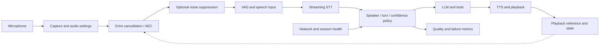
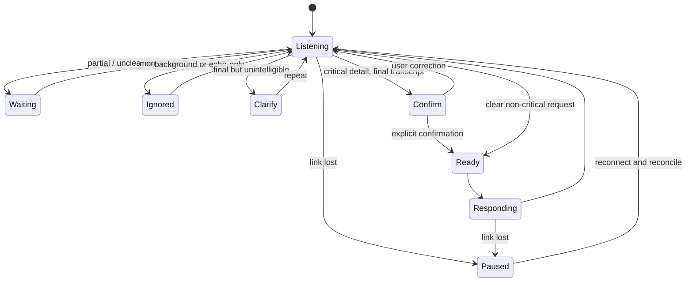
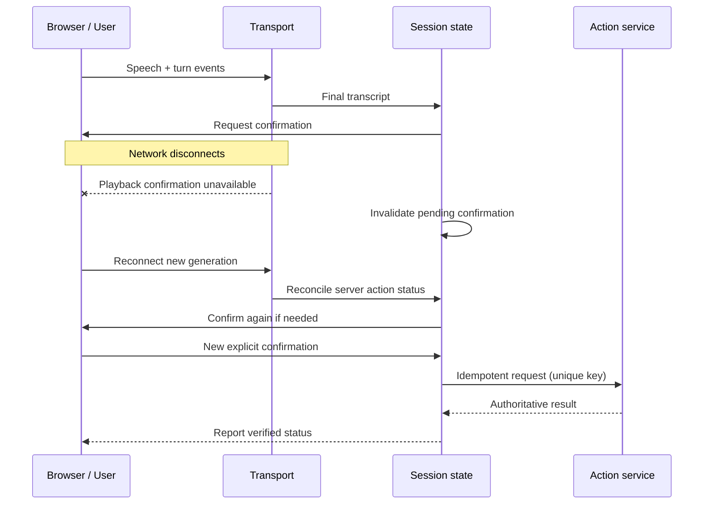
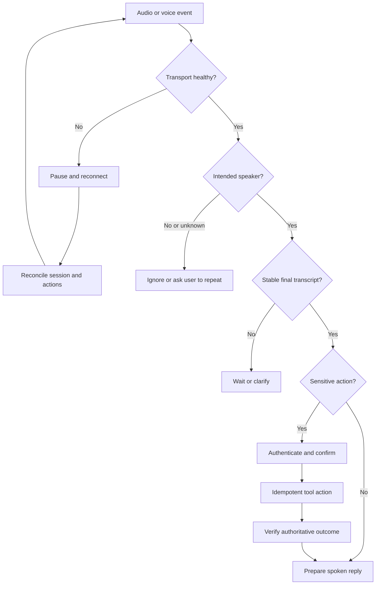

# Robust Voice AI in the Wild: From a Quiet Room to Conversations That Survive Failure

**Robust Voice AI in the Wild — Article 12 of 16**  
**Level:** Intermediate → Advanced | **Reading:** Approximately 25–35 minutes + Python lab  
**العربية:** [[12-Robust-Voice-AI-in-the-Wild-AR|اقرأ المقالة بالعربية]]  
**Previous:** [[11-Latency-and-Streaming-Optimization-EN|Article 11 — Latency & Streaming]]  
**Roadmap:** [[00-Series-Roadmap|Voice AI Engineering Series Roadmap]]

![[assets/robust-voice-ai-cover.png]]

> [!abstract] The central question
> Your voice agent works beautifully with a headset in a quiet demo room. Then someone tests it near a road, a second person speaks, the agent's own output leaks into the microphone, the user switches languages mid-sentence, or the network drops just as a reservation is being confirmed. **How do you engineer a system that behaves correctly when the signal, network, and interpretation are imperfect?**

## 1. Working software is not necessarily reliable software

Consider an appointment assistant in a shared living room:

**User:** “Move my appointment to tomorrow at five.”

**Agent:** “Okay, I will move it to...”

At that moment, the microphone picks up the agent's own speech from the speakers. A second person in the room calls, “Six would be better!” The network then disappears for two seconds. Should the agent reschedule? Who authorized that change? Did the user hear the confirmation before the connection failed?

This is not only a speech-recognition problem. It is a **conversation reliability** problem. The application needs evidence about who was speaking, whether a transcript is stable, whether a request authorizes an action, and whether session state remained consistent during recovery.

We previously covered [[03-Speech-to-Text-EN|STT]], [[08-Real-Time-Audio-Transport-EN|audio transport]], [[09-VAD-Endpointing-and-Turn-Detection-EN|turn detection]], [[10-Interruptions-Barge-In-and-Playback-State-EN|interruptions]], and [[11-Latency-and-Streaming-Optimization-EN|latency]]. Now we connect those pieces with the principles of **resilience engineering**: detect degraded input, avoid unsafe guesses, preserve consistent state, and recover without making up what happened.

## 2. A taxonomy of real-world failure modes

When an agent misbehaves, blaming the LLM is often misleading: the error may have occurred before the LLM ever received text.

| Failure source | What can go wrong? | First engineering response |
|---|---|---|
| **Background noise** | Speech disappears or VAD triggers falsely | Evaluate audio quality and apply measured preprocessing |
| **Acoustic echo** | The user's mic captures the agent's speech | Echo cancellation using output audio as a reference |
| **Competing speakers** | The agent responds to a nearby person | Intended-speaker evidence and a conservative source policy |
| **Accents and dialects** | Valid speech is transcribed incorrectly | Representative test data and error analysis by dialect |
| **Code-switching** | Names, technical words, or mixed-language phrases are corrupted | Multilingual transcription that preserves the original words |
| **Clipping / low volume** | Acoustic information is lost at capture | Input-level and clipping diagnostics |
| **Packet loss / jitter** | Choppy or missing speech segments | Transport telemetry and a balanced playout buffer |
| **Disconnect / retry** | Stale audio, duplicate actions, false assumptions | Session generations, idempotency, explicit reconciliation |



*Figure 1 — A conceptual architecture, not a mandatory processor sequence. AEC and noise suppression may be implemented by the OS, browser, client, or server; stacking them blindly can cause problems.*

## 3. Noise is not a single phenomenon

Steady fan noise, traffic, music, and **another human voice** are different interference sources. The last can be especially difficult because it resembles input the assistant might legitimately act upon.

![[assets/robustness-noise-mixture.png]]

*Figure 2 — A mathematically generated target signal, an interference signal, and their mixture. This image does **not** depict the output of a real noise-removal model.*

### Signal-to-noise ratio (SNR)

If you separately know the RMS amplitudes of the target speech and interference, a useful educational relationship is:

$$
\mathrm{SNR}_{dB}=20\log_{10}\left(\frac{\mathrm{RMS}_{speech}}{\mathrm{RMS}_{noise}}\right)
$$

Equal RMS values produce **0 dB**. A speech RMS that is ten times the noise RMS produces **20 dB**. But a normal single-microphone recording does not give you those two separated components. Any SNR computed from the mixture alone is an **estimate based on assumptions**, not a directly observed ground truth.

> [!warning] Cleaning audio has trade-offs
> Aggressive noise suppression can damage quiet syllables or consonants that the recognizer needs. Compare transcription errors, missed speech, extra latency, and false interruptions both before and after processing. “It sounds cleaner to me” is not a sufficient system benchmark.[^livekit-noise]

### Clipping and automatic gain control

A microphone signal that repeatedly reaches the maximum representable amplitude may clip, losing fine acoustic structure. A simple diagnostic is the fraction of normalized PCM samples near ±1. This is only a **rough warning indicator**, not a complete distortion detector. Automatic gain control (AGC) can help with a quiet speaker but can also amplify interference.

## 4. Echo cancellation, noise suppression, and speaker isolation are different

These technologies solve related but non-equivalent problems.

| Technology | Primary target | Important limitation |
|---|---|---|
| **AEC (Acoustic Echo Cancellation)** | Agent playback returning through the microphone | Depends on a useful output reference and changing acoustic conditions |
| **Noise Suppression** | Unwanted ambient interference | May distort target speech while removing noise |
| **Speaker / Voice Isolation** | Competing human speakers | Can select the wrong source and does not establish a person's identity |

**Diarization** segments speech by anonymous speaker labels such as “speaker 1” and “speaker 2.” It does **not** automatically tell you which person owns an account or is authorized to issue a command. Do not confuse diarization with authentication.

A browser client can request audio-processing constraints:

```javascript
const supported = navigator.mediaDevices.getSupportedConstraints();
console.log({
  echoCancellation: !!supported.echoCancellation,
  noiseSuppression: !!supported.noiseSuppression,
  autoGainControl: !!supported.autoGainControl,
});

const stream = await navigator.mediaDevices.getUserMedia({
  audio: {
    echoCancellation: true,
    noiseSuppression: true,
    autoGainControl: true,
  },
  video: false,
});
const track = stream.getAudioTracks()[0];
console.log(track.getSettings()); // inspect actual selected settings
```

`getUserMedia` requires appropriate microphone permission and a secure browser context. Its successful return is not proof of identical acoustic processing across devices or of perfect echo suppression. Test the deployed browser/hardware combinations.[^mdn-constraints][^mdn-echo]

> [!tip] Use headphones as a simple diagnostic
> If the problem largely disappears when the user switches from speakers to headphones, playback leaking back into the microphone is a plausible contributor. That does not prove an AEC implementation is perfect, nor does it solve every interruption problem.

## 5. The difficult case: two people speaking at once

Imagine a user asking a question while another person nearby answers their own phone. The agent's VAD may detect both voices, and STT may emit fragments from both. Reducing VAD sensitivity alone is a poor general solution: you might suppress legitimate user interruptions too.

A more robust design has four layers:

1. **Audio processing:** reduce background voices without removing the user's speech.
2. **Source evidence:** determine, when reliably possible, whether the utterance was addressed to the assistant.
3. **Conversation policy:** avoid automatically attributing ambiguous speech to the user.
4. **Action boundary:** require meaningful confirmation and authorization before sensitive changes.

> [!important] A speaker label is not proof of identity
> Voice isolation, diarization, and probabilistic speaker matching produce **fallible evidence**. In high-impact workflows they cannot replace appropriate authentication or explicit authorization.

## 6. Accents, Arabic dialects, and code-switching

Consider these two utterances:

- “بدي أغيّر الموعد لبكرا الساعة خمسة.”
- “ممكن تعمل schedule للـmeeting يوم Friday؟”

A strong system should preserve the user's intended words and key entities, including the code-switched segments. The challenge is not merely classifying the language; it includes dialect vocabulary, names, spelling conventions, numbers, and the downstream pronunciation that TTS will use.[^openai-transcription][^livekit-stt]

### Evaluate with realistic utterances

Create a consented or synthetic test set that includes:

- Standard Arabic and the dialects **actually** used by the target audience.
- Diverse speakers, speaking rates, microphones, and call channels.
- Proper nouns, technical terms, dates, account-independent example identifiers, and numbers.
- Realistic environmental interference rather than studio recordings alone.
- Hesitations, interruptions, short answers, and long compound requests.

**WER = (substitutions + deletions + insertions) / reference words** is useful, but Arabic word segmentation and spelling conventions, hamza normalization, mixed Latin/Arabic scripts, and transliteration can all distort comparisons. Define one normalization policy before testing. Supplement WER with **CER**, critical-entity accuracy, and task correctness. Avoid presenting one blended WER number as proof of multilingual robustness.

> [!warning] Never fill critical gaps with a guess
> If the system cannot reliably distinguish “five” from “six,” guessing from LLM context is less safe than asking: “I heard five o'clock. Is that correct?” The same applies to names, dates, and numbers before executing changes.

## 7. Turning uncertain input into safe behavior

A robust agent does not always need to answer immediately. Waiting, clarifying, and requesting confirmation are valid outputs when the evidence is insufficient.

![[assets/robustness-decision-policy.png]]

*Figure 3 — A conceptual policy separating speaker/source evidence, transcript stability, link health, and request sensitivity. It is not a real acoustic classifier.*



### Example interaction

**User:** “Change my contact number to 050...”  
**Agent:** “I did not hear the complete number. Could you repeat it?”  
**User:** “0501234567.”  
**Agent:** “To confirm, is the number ...?”  
**User:** “Yes.”  
**Action service:** Performs the update **only after appropriate identity and permission checks** and reports the authoritative result.

The policy reduces unsafe assumptions. It does not replace identity checks, permissions, or checking the actual status of external actions.

## 8. A dropped network connection is more than added latency

On disconnection, several separate questions appear:

- Did the server receive the user's final audio packet?
- Was the agent's reply actually played on the user's device?
- Did the user speak a confirmation that never arrived?
- Did an external action complete before the connection failed?

The session's “connected” state does not answer these questions. You must keep **transport state**, **conversation state**, and **action state** separate.



*Figure 4 — Conceptual recovery. Reconnecting does not authorize repeating an earlier action. If an action may already have succeeded, query the authoritative action service using its stable identifier before retrying.*

For WebRTC, monitor `connectionState` and `iceConnectionState`. In supported failure conditions, `RTCPeerConnection.restartIce()` can request fresh ICE candidate gathering; it must be integrated with appropriate offer/answer signaling. Calling `restartIce()` **alone** does not guarantee a successful reconnection.[^mdn-ice]

### Recovery design principles

- **Generation / epoch IDs:** ignore packets from an older playback or session generation.
- **Idempotency keys:** identify each logical action consistently so an action service can avoid duplicate effects.
- **Acknowledgments:** distinguish “sent,” “received,” “processed,” and “played.”
- **Bounded retries:** exponential backoff with jitter in real deployments and clear limits on retries.
- **Recovery dialogue:** tell users what remains unconfirmed and request fresh confirmation when necessary.

![[assets/robustness-recovery-timeline.png]]

*Figure 5 — A synthetic event sequence showing stale-generation rejection and invalidation of pending confirmation.*

## 9. Build a real-world evaluation matrix

When creating representative test cases, use recordings you are permitted to process, or use explicitly synthetic input. Capture environment and transport metadata without carelessly exposing personal information.

| Category | Example | What to measure |
|---|---|---|
| Quiet | Clear microphone | Accuracy/latency baseline |
| Noise | Road, fan, café | WER/CER, missed speech, preprocessing cost |
| Echo | Open speaker during agent reply | False barge-in and self-trigger rate |
| Overlap | Second nearby speaker | Wrong-speaker attribution and false requests |
| Dialect | Regional conversational phrases | Critical-entity and intent accuracy |
| Code-switch | Mixed Arabic and English | Preservation of named entities and language switching |
| Packet loss | Jitter and lost packets | Playout gaps, stalls, dropouts |
| Drop / reconnect | Disconnection during confirmation | Duplicate actions, lost state, recovery success |

Track **task success** against verified results, **false interruptions**, **false end-of-turn**, **WER/CER**, **critical-slot accuracy**, **recovery success**, **duplicate-action count**, and **P50/P95 first useful audible response**. Break results down by environment. A single average can hide serious failures.

A noise suppressor might improve transcription while making quiet interruptions harder to detect. Faster endpointing might improve response speed while cutting users off. Compare metrics **together**.[^livekit-turns]

## 10. Python lab: a deterministic resilience policy

The accompanying lab does **not** run a real VAD or STT model. It consumes synthetic evidence describing what those components might produce, then evaluates a conservative action policy, an illustrative word-error metric, SNR from separated RMS inputs, and reconnection safety rules.

| File | Purpose |
|---|---|
| `examples/voice_robustness_lab.py` | Deterministic voice-session decision logic |
| `examples/12-synthetic-resilience-cases.jsonl` | 18 explicitly synthetic scenarios |
| `examples/test_voice_robustness_lab.py` | 36 focused unit tests |
| `examples/make_robustness_figures.py` | Recreate three figures using NumPy + matplotlib |
| `examples/12-ROBUSTNESS-LAB-README.md` | Setup, expected output, and limitations |

### Run the lab

```bash
cd Voice-Agent-Series
python examples/voice_robustness_lab.py
python examples/voice_robustness_lab.py --json
python -m unittest discover -s examples -p 'test_voice_robustness_lab.py' -v
```

**Selected sample output (synthetic educational data only):**

```text
Cases: 18 | policy expectations matched: 18
quiet                n= 2 WER=0.0
noise                n= 3 WER=0.583
accent               n= 2 WER=0.143
code-switch          n= 2 WER=0.222
```

> [!warning] What these results do—and do not—mean
> Matching 18/18 expectations simply means the Python policy produced the **decisions we predefined** in the dataset. It is not speech-recognition accuracy, a speaker-detection score, or a live-model benchmark. The word-error function uses simple whitespace tokenization; Arabic morphological segmentation and code-switching can change the score. WER can exceed 100% when insertions are numerous.

### Code illustration

```python
from voice_robustness_lab import Evidence, decide

input_evidence = Evidence(
    speech_detected=True,
    foreground_confirmed=True,
    final_transcript=True,
    transcript="Change the appointment to five",
    critical_detail=True,
)
print(decide(input_evidence).action.value)
# confirm_sensitive_details
```

The distinction is crucial: **understanding an utterance is not the same as having authorization to carry out its implied action**.

## 11. Six production controls that matter

**1. Quality-aware capture.** Observe clipping, low volume, missing audio, transcription outcomes, and feedback from real devices. Do not assume that louder audio is always better.

**2. Conservative turn-taking.** When source or intent remains uncertain, wait or ask a focused clarification instead of acting.

**3. Stable conversation state.** Keep partial transcripts separate from final ones, and generated audio separate from acknowledged playback. See [[10-Interruptions-Barge-In-and-Playback-State-EN|Article 10]].

**4. A safe action boundary.** External mutations belong behind an explicit component that enforces permissions, action IDs, validation, and authoritative results.

**5. Privacy-aware observability.** Track transport, timeouts, and failure categories without indiscriminately recording voice or transcripts. Define lawful consent, access controls, and retention rules when recording is genuinely required.

**6. Graceful degradation.** If STT or transport fails, allow repeating the phrase, switching to text, or handing off to a human. Never claim an action succeeded until it has been verified.



*Figure 6 — A general decision architecture. Depending on the domain, sensitive actions may require authentication stronger than spoken confirmation.*

## 12. Frequent anti-patterns

- Treating `noiseSuppression: true` as a guarantee of clean speech.
- Muting the microphone whenever the assistant speaks and thereby preventing true barge-in.
- Confusing speaker diarization with verified identity.
- Reporting one WER number without a documented dialect and environment mix.
- Automatically translating code-switched words and accidentally changing exact names or identifiers.
- Interpreting raw STT confidence numbers as universally calibrated probabilities.
- Replaying a sensitive action on reconnect without checking whether it has already executed.
- Keeping no acoustic diagnostic examples in **consented test environments**, making speech-error root causes difficult to investigate.
- Retaining real users' voice recordings without need, safeguards, or a retention policy.

## 13. Reader exercises

1. Create ten test utterances, including five relevant dialect examples and five mixed Arabic/English examples, with appropriately authorized recordings or synthetic substitutes.
2. Compare a laptop microphone, headset, and phone connection. Record echo artifacts, false interruptions, and end-to-end response time.
3. Add a synthetic critical-confirmation disconnect case to `12-synthetic-resilience-cases.jsonl`. Verify that it yields `hold_and_reconnect`.
4. Verify that an audio packet from `generation=1` is rejected after a session advances to `generation=2`.
5. Design a fallback when spoken input is unintelligible: repeat request, text input, or human handoff. Document how the user is informed.

> [!success] Key takeaway
> A reliable voice agent is not the system that understands every word in a perfect demo. It is the system that **recognizes uncertainty, does not attribute stray speech to the user, does not execute sensitive actions without appropriate authorization, and never blindly replays old actions after disconnection**. Reliability comes from audio quality, explicit policy, consistent state, and systematic evaluation—not merely a larger language model.

## Sources and further reading

[^mdn-constraints]: [MDN — Media Capture Constraints](https://developer.mozilla.org/en-US/docs/Web/API/Media_Capture_and_Streams_API/Constraints) and [MediaStreamTrack.getSettings](https://developer.mozilla.org/en-US/docs/Web/API/MediaStreamTrack/getSettings) — practical support and selected capture settings.
[^mdn-echo]: [MDN — echoCancellation](https://developer.mozilla.org/en-US/docs/Web/API/MediaTrackConstraints/echoCancellation) and [noiseSuppression](https://developer.mozilla.org/en-US/docs/Web/API/MediaTrackConstraints/noiseSuppression) — separate browser audio processing controls.
[^livekit-noise]: [LiveKit — Noise & echo cancellation](https://docs.livekit.io/transport/media/noise-cancellation/) — limitations when other voices are present.
[^livekit-turns]: [LiveKit — Turn-taking tuning](https://docs.livekit.io/agents/logic/turns/tuning/) — interaction between preprocessing, interruptions and endpointing.
[^openai-transcription]: [OpenAI — Realtime transcription](https://developers.openai.com/api/docs/guides/realtime-transcription) — representative testing across accents, noise, domain terms, and code-switching.
[^livekit-stt]: [LiveKit — STT models overview](https://docs.livekit.io/agents/models/stt/) — multilingual and language-switching capabilities vary by provider.
[^mdn-ice]: [MDN — RTCPeerConnection.restartIce](https://developer.mozilla.org/en-US/docs/Web/API/RTCPeerConnection/restartIce) and [getStats](https://developer.mozilla.org/en-US/docs/Web/API/RTCPeerConnection/getStats) — reconnection and transport diagnostics.
[^pipecat-filter]: [Pipecat — Speech input](https://docs.pipecat.ai/pipecat/learn/speech-input) — speech input stages and upstream audio filters.

---

**Next article:** [[13-Tools-RAG-and-Agent-Workflows-EN|13 — Tools, RAG & Agent Workflows]]  
**Arabic edition:** [[12-Robust-Voice-AI-in-the-Wild-AR]]
