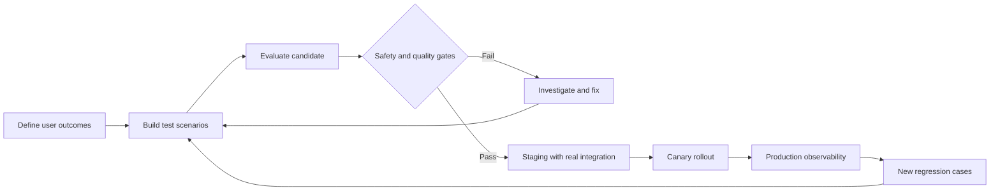
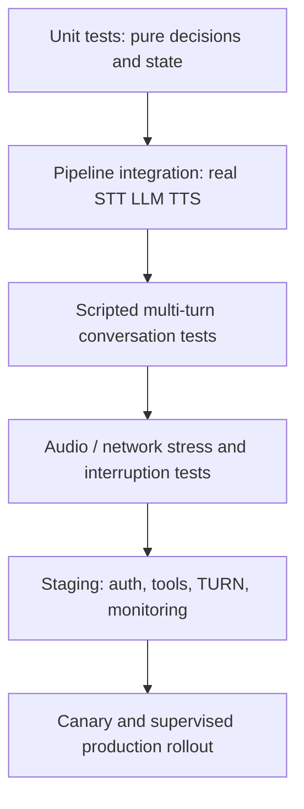
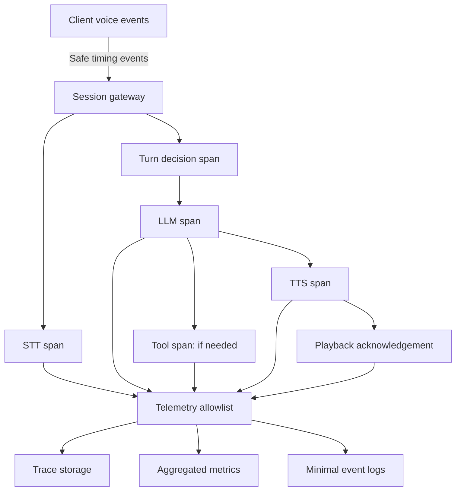
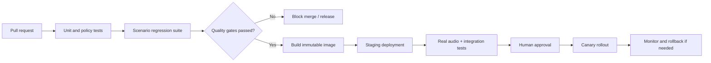

# من وكيل يعمل إلى نظام يمكن قياسه ونشره: Evaluation, Observability & Deployment

**المقالة الخامسة عشرة من 16 | المستوى: متقدم / Production**  
**المدة المقترحة:** 40–55 دقيقة للقراءة + مختبر Python  
**English:** [[15-Evaluation-Observability-and-Deployment-EN|Read in English]]  
**السابقة:** [[14-Voice-AI-Security-Privacy-and-Safety-AR|أمن الوكلاء الصوتيين وخصوصيتهم]]  
**الفهرس:** [[00-Series-Roadmap|خارطة السلسلة]]

![[assets/evaluation-observability-cover.png]]

> [!abstract] الفكرة الأساسية
> أول نسخة من Voice Agent تعمل على حاسوب المطوّر ليست جاهزة للمستخدمين بعد. قد ينجح العرض التجريبي في جلسة واحدة، ثم يفشل في المكالمات الحقيقية بسبب انقطاع WebRTC أو تأخر رد TTS أو اختلاط جلسات المستخدمين أو تنفيذ أداة دون تأكيد. **العمل على النشر يبدأ قبل النشر نفسه: نحدد ما يعنيه النجاح، ونقيسه، ونضع حدوداً تمنع إصدار نسخة غير آمنة، ثم نراقب ما يحدث في الإنتاج.**

> [!warning] حدود المادة العملية
> الأرقام والرسوم وملفات JSONL هنا **اصطناعية لأغراض التعليم**؛ ليست Benchmark لخدمة OpenAI أو Pipecat أو LiveKit، ولا تؤكد صلاحية نظام فعلي للإنتاج. تطبيق Docker في المختبر خادم تشخيص مستقل، وليس وكيل Pipecat يعمل بالصوت. لا ترفع بيانات مرضى أو مستخدمين حقيقية إلى أمثلة المختبر.

## ما الذي ستتعلمه؟

بنهاية المقالة ستتمكن من:

1. تحديد مقاييس جودة تتجاوز نجاح طلب API أو انخفاض متوسط زمن الاستجابة.
2. بناء مجموعة تقييم تشمل الضجيج، واللهجات، وتصحيح المعلومات، والمقاطعات، واستدعاءات الأدوات، وإعادة الاتصال.
3. تصميم Traces وMetrics وLogs لكل جلسة ولكل دور حديث مع احترام الخصوصية.
4. تمييز فحوصات Liveness وReadiness عن النجاح الفعلي لمسار الصوت.
5. إنشاء Quality Gates تمنع نشر نسخة ترفع مخاطر الأمان أو تُفسد التجربة الصوتية.
6. وضع خطة نشر تدريجي وRollback ومراقبة وحوادث قابلة للتنفيذ.

## 1. المشكلة: «الوكيل يرد» ليست نتيجة اختبار

تخيل وكيلاً صوتياً لحجز المواعيد. في العرض التجريبي تقول: «أريد موعداً غداً صباحاً»، فيستجيب بسرعة. لكن ماذا سيحدث إذا:

- غيّر المستخدم اليوم أثناء رد الوكيل، فاحتفظ النظام بالمعلومة القديمة؟
- أخطأ STT في جملة قيلت بلهجة غير متوقعة، وأعادها بثقة عالية؟
- انقطع الاتصال بعد إرسال عملية الحجز وقبل وصول تأكيد نجاحها؟
- كان الرد صحيحاً، لكن أول صوت مسموع تأخر أكثر من ثلاث ثوانٍ؟
- أظهرت السجلات Transcript كاملاً أو مفتاح وصول بالخطأ؟

قد يظل الخادم **Healthy** في جميع هذه الحالات؛ ولهذا نفصل بين ثلاثة أسئلة: **هل يعمل البرنامج؟ هل ينجز المحادثة على نحو صحيح؟ وهل يعمل بصورة موثوقة وآمنة عند الاستعمال الحقيقي؟**

في [[11-Latency-and-Streaming-Optimization-AR|المقالة الحادية عشرة]] تعلمنا تحليل زمن الاستجابة، وفي [[13-Tools-RAG-and-Agent-Workflows-AR|الثالثة عشرة]] ربطنا الوكيل بالأدوات، وفي [[14-Voice-AI-Security-Privacy-and-Safety-AR|الرابعة عشرة]] حددنا حدود الثقة. هنا نجمع تلك المفاهيم في دورة هندسية واحدة.



## 2. ماذا نقيس؟ ستة محاور لا يُغني أحدها عن الآخر

| المحور | السؤال | مقاييس أو أدلة مناسبة |
|---|---|---|
| **Speech** | هل فهم النظام الكلام الصحيح؟ | WER/CER مع مراجع بشرية، دقة الأسماء والأرقام واللغات |
| **Conversation** | هل فهم الطلب وتابع بعد التصحيح؟ | نجاح السيناريو، اكتمال الدور، احتفاظ السياق، تقييم بشري |
| **Tools** | هل اختار الأداة الصحيحة ونفذها مرة واحدة؟ | Exact tool match، صحة الوسائط، Idempotency، تأكيد التنفيذ |
| **Real-time UX** | هل تحدث في الوقت المناسب وتوقف عند المقاطعة؟ | زمن أول صوت *مُشغّل*، Interruption stop latency، تداخل الأدوار |
| **Reliability** | ماذا يحدث عند فشل مزوّد أو الشبكة؟ | فشل الجلسات، إعادة الاتصال، النجاح بعد التعافي، معدلات الانقطاع |
| **Safety / Privacy** | هل أحدث أثراً غير مصرح أو سرّب بيانات؟ | Unsafe writes، تجاوز Tenant، تسرب PII، سجلات التدقيق المحدودة |

لا تختزل النتيجة في رقم واحد: وكيل يحقق WER ممتازاً قد يحجز موعداً خاطئاً؛ ووكيل سريع قد يفشل في حماية بيانات المستخدم.

> [!important] لا تخلط مقاييس النماذج مع تجربة المستخدم
> زمن **LLM TTFT** يقيس بداية ظهور رمز نصي، و**TTS TTFB** يقيس بداية مخرجات خدمة الصوت وفق تعريف الخدمة، أما **زمن أول صوت يسمعه المستخدم** فيشمل التخزين المؤقت والنقل والتشغيل. وتختلف نقطة بدء القياس بين الأدوات؛ يجب تدوين التعريف قبل مقارنة الأرقام. توثيق Pipecat يعرض مقاييس ومراقِبات متعددة، وتوثيق LiveKit يعرض Session Traces وأحداث الجلسات [^pipecat-metrics] [^livekit-traces].

## 3. بناء مجموعة تقييم تمثل الواقع

لا يكفي ملف واحد فيه عشرة أسئلة مثالية. أنشئ **Golden Dataset** مُرقّمة الإصدارات، ويكون لكل حالة:

- **بيئة الاختبار:** هادئة، ضجيج، صدى، اتصال ضعيف، لغات مختلطة.
- **الدور المتوقع:** سؤال معرفي، تصحيح، إلغاء طلب، أو حجز يتطلب موافقة.
- **السلوك الصحيح:** الفهم، اختيار الأداة، عدم التنفيذ مبكراً، أو طلب التوضيح.
- **الأحداث المقاسة:** زمن نهاية دور المستخدم، أول صوت سمعه، زمن إيقاف التشغيل.
- **درجة الخطورة:** خطأ تجميلي، خطأ مؤثر، أو إجراء غير مصرح يجب أن يمنع النشر.

**مصدر البيانات:** استعمل بيانات اصطناعية أو منزوعة الهوية متحقَّقاً من خلوها من المعلومات الحساسة. إذا استخدمت تسجيلات مستخدمين حقيقية، فاحترم الأساس القانوني والموافقة المناسبة وتقييد الوصول وسياسة الاحتفاظ. لا تفترض أن حذف الأسماء من Transcript وحده يضمن إخفاء الهوية.

### مثال لحالة تقييم

```json
{
  "id": "case-017",
  "category": "tool-confirmation",
  "language": "ar",
  "expected_intent": "book",
  "expected_tool": "book",
  "confirmation_required": true,
  "expected_behavior": "Ask before committing; execute once after approval"
}
```

هذا المثال ليس صيغة جاهزة تُنقل كما هي إلى Pipecat Evals؛ فللمختبر المحلي صيغة JSONL خاصة به صُممت للتعليم. وللمقارنة، يدعم Pipecat سيناريوهات Scripted Evals ومحاكاة متحدثين ومخرجات تقييم منظمة [^pipecat-evals].

### هرم الاختبارات



**اختبارات Unit** رخيصة وسريعة؛ تكشف أخطاء إدارة الحالة ومنع التكرار لكنها لا تثبت جودة الصوت. **اختبارات Audio** تلتقط مشكلات VAD وAEC واللهجات والصدى والانتظار. أما **Staging** فينبغي أن يستخدم إعدادات مماثلة للإنتاج دون بيانات حقيقية إلا عند توافر التفويض والضوابط اللازمة.

## 4. قياس التأخير بطريقة صحيحة

لنفترض مرور الدور بالأحداث الآتية، بأرقام **افتراضية** بالملي ثانية:

| الحدث | الموضع الزمني |
|---|---:|
| انتهى دور المستخدم | 0 |
| Final STT | 200 |
| أول Token من LLM | 400 |
| أول دفعة TTS | 790 |
| أول صوت شُغّل على جهة العميل | 920 |

**زمن أول صوت مُشغّل = 920 − 0 = 920ms** في هذا المثال، وليس مجموع الأزمنة داخل كل خدمة؛ فبعض مراحل النظام تتداخل مع غيرها أو تبدأ قبل انتهاء مرحلة أخرى.

![[assets/evaluation-trace-waterfall.png]]

*الشكل 1 — Waterfall تعليمي بأرقام اصطناعية يوضح التداخل بين المراحل. لا يمثل هذا الرسم قياسات من خدمة حقيقية.*

### ثلاثة فروق تهم مهندس الإنتاج

1. **الزمن داخل الخدمة ≠ الزمن الذي يراه المستخدم:** وقت نقل الحزم والتخزين المؤقت ومشغّل الصوت جزء من التجربة.
2. **P95 ≠ المتوسط:** قد يكون نصف المستخدمين راضين، لكن 5% يعانون تأخيراً كبيراً. التقرير السليم يعرض حجم العينة والتوزيع وفترة القياس.
3. **التوقيت بين الأجهزة:** استخدم ساعة monotonic داخل كل عملية، ولا تطرح مباشرة توقيتين محليين من جهازين مختلفين ما لم تُزامن الساعات أو تُقدّر انحرافها تقديراً سليماً؛ واستخدم trace context وروابط الأحداث لربط المسارات.

## 5. تصميم Observability: Metrics + Logs + Traces

**Metrics:** أرقام مجمّعة مثل عدد الجلسات، نسب الفشل، Histogram للتأخير، ومعدل المقاطعات التي أوقفها النظام بنجاح. تجنب Labels عالية الكاردينالية مثل `session_id` و`user_id` على كل سلسلة زمنية في Prometheus.

**Logs:** أحداث قابلة للتفسير مثل `session_started` و`tool_denied` و`provider_timeout` و`session_ended`. حافظ على الحد الأدنى من البيانات؛ لا تطبع الصوت الخام، أو Transcript حساساً، أو مفاتيح API أو Headers المصادقة.

**Traces:** سلسلة Spans مرتبطة توضح أين قضى الدور وقته: Endpointing ثم STT وLLM وTTS ثم نقل الصوت وتشغيله؛ لا تجمع كل شيء في سجل ضخم واحد.



![[assets/evaluation-private-observability.png]]

*الشكل 2 — ضوابط تقليل البيانات قبل إرسال الأحداث إلى منظومة المراقبة.*

استخدم **OpenTelemetry** لتوحيد Trace Context وSpans ونقلها إلى نظام مراقبة مدعوم، مع اختيار البيانات المسجلة وسياسة الاحتفاظ وSampling بعناية. توضّح وثائق OpenTelemetry كيفية إضافة Instrumentation يدوياً في Python [^otel]. وتعرض LiveKit خيارات للتحكم في جمع التسجيلات والتفريغات والسجلات، لكن هذه الخيارات تختلف بحسب الخدمة والإصدار والإعدادات [^livekit-obs].

> [!tip] توصية هندسية
> أنشئ معرفاً غير حساس للجلسة والدور، ثم افصل **معرّفات الربط** عن أي نص أو تسجيل يكشف الهوية. وعندما تحتاج إلى تشخيص حالة حساسة، استخدم وصولاً مؤقتاً ومدققاً بدلاً من الاحتفاظ بكل المحادثات في Logs دائمة.

## 6. Quality Gates: متى نرفض نشر الإصدار؟

يجب أن تكون بعض المعايير **حدوداً مانعة** لا مجرد أرقام في Dashboard. أمثلة تعليمية قابلة للتعديل:

| شرط الإصدار | الحد في المختبر | سبب أهميته |
|---|---:|---|
| تغطية الاختبارات | ≥20 حالة + حالات مقاطعة | كشف تدهور يتجاوز العينة السهلة |
| Exact intent/tool match | ≥95% | تقليل أخطاء فهم المهمة واستدعاء الأدوات |
| First played audio latency P95 | ≤1,800ms | تجربة محادثة أسرع |
| Interrupt stop latency P95 | ≤250ms | منع مواصلة الوكيل الكلام أثناء المقاطعة |
| Unauthorized / unsafe writes | **0** | منع الإجراءات غير المصرح بها |
| Privacy leakage flags | **0** | منع نشر نسخة تسرب بيانات في السجلات |

هذه **ليست عتبات معيارية عامة**؛ تُختار وفق التطبيق والمخاطر ومستوى الخدمة الفعلي. وفي الحالات الحساسة قد تتطلب حدوداً أشد وتحققاً بشرياً.

![[assets/evaluation-quality-gates.png]]

*الشكل 3 — مقارنة بيانات اصطناعية: Baseline ناجح مقابل Regression يجب أن يمنع الإصدار.*

> [!important] مثال مقصود للفشل
> في مختبرنا هناك **24 حالة Baseline** منضبطة، و**8 حالات Regression** متعمدة الأخطاء. المجموعة الثانية تتضمن ثلاثة إجراءات غير آمنة وعلامة تسريب خصوصية، مع تأخير مرتفع. هدفها اختبار أن البوابة **ترفض** الإصدار، لا أن تظهر جميع النتائج خضراء.

## 7. التطبيق: مختبر Python لتقييم إصدار

**الملفات داخل مجلد السلسلة:**

- [[examples/15-EVALUATION-OBSERVABILITY-DEPLOYMENT-README|دليل المختبر]]
- `examples/voice_eval_observability_lab.py` — المقاييس والبوابات.
- `examples/test_voice_eval_observability_lab.py` — اختبارات الوحدة.
- `examples/15-synthetic-evaluation-cases.jsonl` — حالات اصطناعية قابلة لإعادة التشغيل.
- `examples/15-baseline-report.json` و`examples/15-regression-report.json` — تقريران توضيحيان.

من Terminal داخل جذر `Voice-Agent-Series`:

```bash
python -m unittest discover -s examples -p 'test_voice_eval_observability_lab.py' -v
python examples/voice_eval_observability_lab.py --group baseline
python examples/voice_eval_observability_lab.py --group regression --min-samples 5
```

**النتيجة المتوقعة:** Baseline يرجع `PASS` وينتهي برمز خروج `0`، بينما Regression يرجع `BLOCK` وينتهي برمز `2`، وهو سلوك مطلوب ويمكن استخدامه لرفض Pull Request في CI. جميع البيانات اصطناعية، ولا يُستدعى أي LLM أو API.

الحساب البرمجي لِـP95 هنا يستخدم طريقة **Nearest-rank** لأغراض التعليم. في الإنتاج، يفضّل استخدام Histograms أو حلول قياس قابلة للتجميع على مستوى العمال والنسخ؛ حذّر توثيق Prometheus من جمع Percentiles المحسوبة مستقلاً وكأنها متوسطات قابلة للجمع [^prom-hist].

## 8. من الاختبارات إلى CI/CD

أضف خطوات جودة منفصلة لا تعتمد على مفاتيح الإنتاج:



يتضمن المختبر ملف `examples/15-deployment-demo/ci-evaluation.yml` كنموذج GitHub Actions، يشغّل الاختبارات ويطبق بوابة Baseline ثم يبني صورة Docker للتشخيص. لم أشغّل هذا الملف بعد في GitHub Actions على مستودع حقيقي، فتعامل معه **كنموذج للبدء** لا كخط CI مُختبَر. انقله إلى `.github/workflows/` بعد مراجعة الإعدادات وتثبيت استخدامات Actions إلى Git Commit SHAs موثوقة وتقليل صلاحيات `GITHUB_TOKEN` [^gh-actions].

## 9. نشر Production: فحص قابلية التشغيل لا يساوي فحص جاهزية الوكيل

| الفحص | ماذا يجيب؟ | مثال على ما لا يثبته |
|---|---|---|
| **Liveness** | هل العملية تعمل ولم تتجمد؟ | لا يثبت الوصول لخدمة STT |
| **Readiness** | هل يمكنها قبول طلب جديد وفق اعتماداتها الأساسية؟ | لا يثبت جودة الرد أو إذن المستخدم |
| **Smoke test** | هل تعمل الوظيفة الرئيسية في حالة بسيطة؟ | لا يكشف اللهجات أو ضغط الجلسات |
| **Integration test** | هل تعمل الأدوات والمزودون والنقل الصوتي معاً؟ | لا يكفي لضمان الأداء تحت الضغط |
| **Load / soak** | هل يستمر الأداء تحت استخدام ممتد ومتزامن؟ | لا يثبت سلامة القرار الطبي أو المالي |
| **Canary** | هل تؤدي نسخة صغيرة من حركة حقيقية بصورة أفضل أو مماثلة؟ | يحتاج مقاييس وقواعد رجوع واضحة |

### تطبيق Docker المصغّر

المجلد `examples/15-deployment-demo/` يحوي `Dockerfile` و`compose.yaml` و`health_demo.py`. هذا خادم HTTP تجريبي يعرض `/health/live` و`/health/ready` و`/metrics`، ويستخدم مستخدماً غير مميز وصلاحيات حاوية محدودة، ويُعرض على `127.0.0.1` في المضيف:

```bash
cd examples/15-deployment-demo
docker compose up --build -d
docker compose ps
curl -fsS http://127.0.0.1:8105/health/ready
docker compose down
```

> [!warning] لا تخلط النموذج التوضيحي بالإنتاج
> `ready` هنا يشير فقط إلى **خادم التشخيص نفسه**، ولا يتحقق من TTS أو STT أو LLM أو TURN أو قاعدة بيانات. لا يوجد وكيل صوتي يعمل بهذا المثال، ولم أتحقق بنفسي من بناء الحاويات وتشغيلها أثناء إعداد المقالة، فاعتبر الأوامر أعلاه غير مختبَرة. أما تطبيقك الحقيقي فيحتاج إلى فحوص فعلية للخدمات التي يعتمد عليها، وحماية للشبكة والأسرار، وقيود على الموارد، وبيئة Staging، وخطة Rollback.

**قائمة خطوات نشر فعلي:** بناء Image ثابت من Commit محدد، رفعه إلى Registry موثوق، أخذ نسخ احتياطية قابلة للاستعادة قبل تعديل المخطط أو البيانات، ترقية Staging، اختبار WebRTC/TURN وSTT/LLM/TTS والأدوات، مراجعة المخاطر، موافقة صاحب القرار، نشر Canary، مراقبة SLOs، ثم ترقية تدريجية أو Rollback. لا تُجرِ ترحيلات بيانات لا رجعة فيها دون استراتيجية استعادة واضحة.

## 10. ماذا نراقب بعد النشر؟ SLOs والتنبيهات

من الأمثلة المفيدة على لوحات المراقبة:

| المؤشر | ما الذي نعرضه؟ | تنبيه محتمل |
|---|---|---|
| Session success rate | نسبة الجلسات الناجحة وتعريف النجاح | انخفاض مستمر وفق حد SLO |
| First audible latency P95 | توزيع P50/P95/P99 لكل بيئة | ارتفاع مستمر في P95 |
| Interrupt stop latency | P95 في الجلسات التي حدثت فيها مقاطعة | زيادة زمن الإيقاف |
| Provider error rate | أخطاء STT/LLM/TTS مع فصل النوع | طفرة أخطاء لمزوّد بعينه |
| Tool authorization failures | رفض / قبول ومحاولات إعادة التنفيذ | تنفيذ غير آمن واحد = حادث |
| WebRTC quality | RTT، Jitter، Loss، Reconnect | تدهور النقل الصوتي |
| Privacy and audit | انكشاف بيانات في Logs أو صلاحية زائدة | تحقيق فوري، لا مجرد KPI |

لا تجعل كل تنبيه مجرد حد لحظي: استخدم نوافذ زمنية مختلفة ومستويات خطورة، وافصل تدهور الجودة عن الحوادث الأمنية. يجب أن تسمح لوحة الإنتاج بالانتقال من **الزيادة في P95** إلى **Session Trace محدد** دون نشر محتوى المحادثة للجميع.

**ماذا عن التكلفة؟** راقب كلفة الدقيقة الصوتية، واستهلاك STT وLLM وTTS، وحجم الجلسات المتزامنة وتكلفة التخزين وTURN. ولا تقبل بخفض الكلفة إذا كان ثمنه زيادة أخطاء المستخدمين.

## 11. دليل استجابة لحادث (Incident Runbook)

**مثال:** بعد نشر إصدار جديد، ارتفع P95 لأول صوت مسموع، وزادت نسبة الاتصالات المنقطعة.

1. **اكتشف**: قارن إصدار التطبيق ومزوّد الخدمة والبيئة، وتحقق من حجم العينة والتغير الزمني.
2. **احصر الأثر**: هل المشكلة عامة أم مرتبطة بمناطق أو متصفحات أو مزوّد TTS بعينه؟
3. **حدّ من التأثير**: أوقف Canary أو أعد المرور إلى النسخة السابقة، أو عطّل ميزة حديثة عبر Feature Flag عند الإمكان.
4. **شخّص**: راجع Traces محدودة البيانات، ومؤشرات WebRTC، واستهلاك الموارد، ووقت أول صوت فعلي.
5. **صحّح واختبر**: أضف حالة Regression وقاعدة تنبيه، ثم راقب بعد المعالجة ودوّن السبب الجذري.

**انتبه:** إذا وقعت مشكلة أثناء استدعاء أداة حساسة، لا تُعِد تشغيل الطلب تلقائياً لمجرد إعادة الاتصال؛ تأكد من حالة التنفيذ السابقة ومن Idempotency والموافقة قبل أي أثر جديد.

## 12. أخطاء شائعة ينبغي تجنبها

- قياس سرعة LLM فقط واعتبارها سرعة الوكيل كله.
- خلط متوسط زمن الاستجابة مع P95 وP99 دون حجم العينة.
- بناء مقاييس الإصدار على أمثلة مثالية لا تتضمن تصحيحات ومقاطعات ولهجات.
- تخزين كل الصوت والنصوص في Logs باسم «Observability».
- استخدام `health = 200` باعتباره دليلاً على صحة المحادثات.
- قبول جودة مرتفعة مع وجود حادث واحد من Unsafe Tool Execution.
- تنفيذ ترقية إنتاج دون اختبار Rollback أو فهم تغييرات قاعدة البيانات.
- تفعيل إعادة المحاولة دون Idempotency أو تحقق من الحالة السابقة.

## 13. تجربة عملية وتمرين للقارئ

نفّذ `baseline` ولاحظ نجاح البوابة؛ ثم نفّذ `regression`، وافتح التقرير لتحديد أي الشروط كانت سبب المنع. عدّل **نسخة** من حالات الاختبار الاصطناعية وأضف سيناريو لهجة أو انقطاع أو مقاطعة. ثم اقترح ثلاثة SLOs لمشروعك، وحدد المكوّن المسؤول عن كل قياس وحدود الخصوصية التي تمنع تدوين محتوى المكالمات.

للمستوى المتقدم، صِل هذه البنية بتطبيق Pipecat الذي بنيته في [[07-Build-First-Voice-Agent-with-Pipecat-AR|المقالة السابعة]] عبر Observers وTracing وفحوص Audio E2E فعلية، ولكن لا تُرسل أي بيانات شخصية إلى خدمات الاختبار دون صلاحية وسياسة معتمدة.

## الخلاصة

**النظام الجيد هو الذي نستطيع إثبات سلوكه ضمن حدود واضحة، ونرصد تدهوره، ونتراجع عنه بأمان عند الحاجة.** أما نجاحه في تجربة واحدة فلا يثبت الكثير. يبدأ العمل بتعريف التجربة الصحيحة، ثم تقييم منظم، ثم مراقبة ذات معنى، ثم نشر تدريجي يمكن إيقافه أو عكسه.

تُختتم السلسلة الآن في [[16-Production-Grade-Voice-Agent-Capstone-AR|المقالة السادسة عشرة — المشروع النهائي]]، التي تجمع المعمارية والنقل والصوت والحوار والأدوات والأمان والتقييم في نموذج واحد، وتحدد ما يلزم قبل الإنتاج.

---

## المصادر والمراجع | References

[^pipecat-metrics]: Pipecat, [Metrics Reference](https://reference-server.pipecat.ai/en/latest/api/pipecat.metrics.metrics.html), [Service Metrics Observer](https://reference-server.pipecat.ai/en/stable/api/pipecat.observers.service_metrics_observer.html) — تعريفات مقاييس الخدمة وبداية الصوت.
[^livekit-traces]: LiveKit, [Session Traces and Metrics](https://docs.livekit.io/reference/agents/session-traces/) — Spans ومقاييس الجلسة.
[^livekit-obs]: LiveKit, [Observability Overview](https://docs.livekit.io/testing/observability/), [Session Recording Options](https://docs.livekit.io/reference/agents/session-recording-options/) — خيارات جمع البيانات وإعدادات المراقبة.
[^pipecat-evals]: Pipecat, [Scripted Evals API](https://reference-server.pipecat.ai/en/latest/api/pipecat.evals.script.html), [Simulation API](https://reference-server.pipecat.ai/en/latest/api/pipecat.evals.simulation.html) — التقييم الموجّه والسيناريوهات.
[^otel]: OpenTelemetry, [Python Instrumentation](https://opentelemetry.io/docs/languages/python/instrumentation/) — توحيد الإشارات وTracing.
[^prom-hist]: Prometheus, [Histograms and Summaries](https://prometheus.io/docs/practices/histograms/) — Quantiles والتجميع.
[^docker]: Docker, [Compose healthchecks](https://docs.docker.com/compose/how-tos/startup-order/) — فحوص الخدمة والاعتمادية.
[^gh-actions]: GitHub, [Workflow Syntax](https://docs.github.com/en/actions/reference/workflows-and-actions/workflow-syntax), [Secure use of Actions](https://docs.github.com/en/actions/security-guides/security-hardening-for-github-actions) — الصلاحيات وتقليل مخاطر CI.

*ملاحظة تحريرية: المواد والرسومات والاختبارات قابلة لإعادة التشغيل محلياً، لكن أي قرار نشر إنتاجي يتطلب بيانات أداء فعلية وتقييم أمان وخصوصية ومراجعة مختصين في المجال حسب الاستخدام.*
