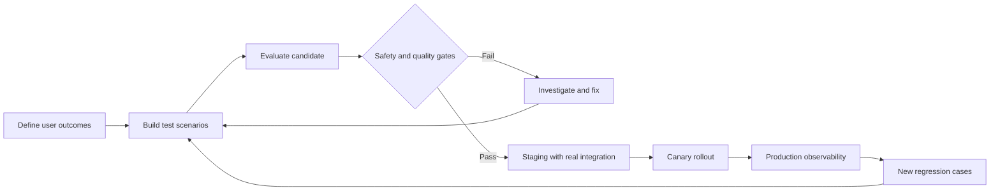
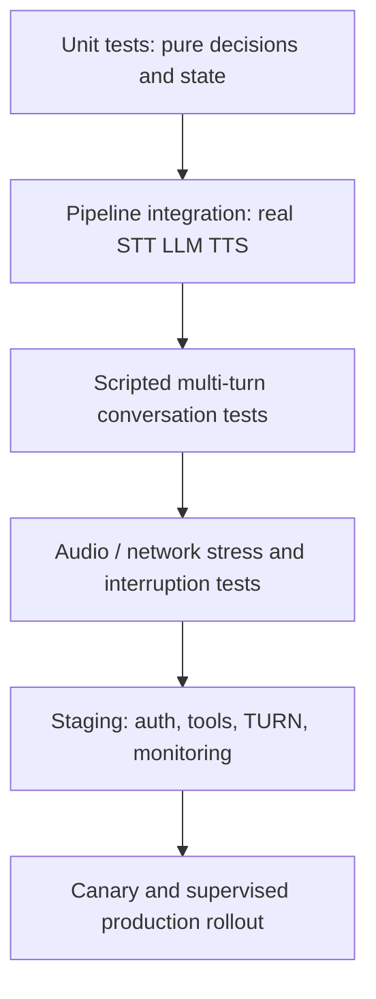
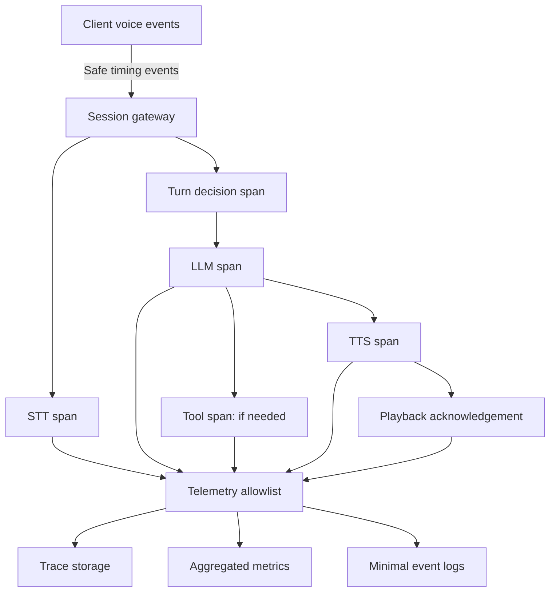
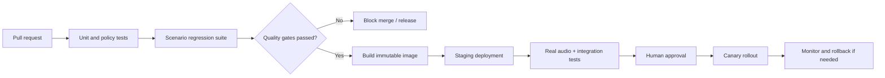

# From a Working Voice Demo to a Measurable Production System

**Voice AI Engineering — Article 15 of 16 | Level: Advanced / Production**  
**Reading time:** 40–55 minutes + Python lab  
**العربية:** [[15-Evaluation-Observability-and-Deployment-AR|اقرأ بالعربية]]  
**Previous:** [[14-Voice-AI-Security-Privacy-and-Safety-EN|Voice AI Security, Privacy & Safety]]  
**Series index:** [[00-Series-Roadmap|Roadmap]]

![[assets/evaluation-observability-cover.png]]

> [!abstract] The central argument
> A voice agent that works in a local demonstration is not necessarily ready to handle real people. Under real traffic, it may lose a WebRTC connection, stall at TTS playback, misunderstand a correction, or repeat an external action after reconnecting. **Production readiness begins before deployment: define success, evaluate it, enforce release gates, instrument the system, and make rollback possible.**

> [!warning] Scope and evidence
> The evaluation datasets, thresholds and figures in this article are **synthetic teaching examples**, not benchmarks of Pipecat, LiveKit, OpenAI, or any provider. The Docker demo is a standalone diagnostics server—not a deployed voice agent. Do not load real patient records, calls, or identifiable user transcripts into this lab.

## Learning objectives

By the end, you should be able to:

1. Define measurable outcomes for accuracy, latency, interruptions, tools, safety and reliability.
2. Build regression scenarios that include noise, accents, code-switching, corrections, tool approvals, and reconnects.
3. Design privacy-aware metrics, logs and distributed traces across an audio pipeline.
4. Explain the difference between a live process, a ready service, and a working conversation.
5. Implement release gates that block unsafe or poor-quality changes.
6. Propose a staged rollout, production monitoring, incident response, and rollback plan.

## 1. A successful reply is not a successful system

Consider a scheduling agent. In a perfect demo, the caller asks for an appointment tomorrow and receives a coherent response. What happens when the caller changes the date mid-sentence? When STT mishears a number? When a booking completes but the network disconnects before the agent confirms it? Or when the response is accurate but the first audible speech takes several seconds?

The HTTP process may still return status `200` in every case. That is why we must distinguish three questions:

- **Does the software run?** Process health, dependency availability, connectivity.
- **Does the conversation behave correctly?** Intent recognition, turn handling, state and tool use.
- **Is the behavior reliable and safe enough for the intended users?** Tail latency, recovery, privacy and release safety.

We explored latency in [[11-Latency-and-Streaming-Optimization-EN|Article 11]], tool execution in [[13-Tools-RAG-and-Agent-Workflows-EN|Article 13]], and trust boundaries in [[14-Voice-AI-Security-Privacy-and-Safety-EN|Article 14]]. Now we turn these pieces into a closed engineering loop.



## 2. Six dimensions of voice-agent quality

| Dimension | Core question | Useful measurements |
|---|---|---|
| **Speech** | Did the agent transcribe the speech accurately? | WER, CER, names/numbers, language recognition |
| **Conversation** | Did it understand, correct and complete the interaction? | Scenario success, context consistency, human evaluation |
| **Tools** | Did it select and execute the correct authorized action once? | Tool match, argument validation, approval and idempotency |
| **Real-time UX** | Did the reply begin and stop at appropriate times? | First *played* audio, interruption stop time, overlap |
| **Reliability** | What happens when the network or a provider fails? | Session drops, recovery success, reconnect behavior |
| **Safety and privacy** | Did it take unauthorized action or expose data? | Unsafe writes, tenant isolation failures, logging leaks |

There is no single “voice AI score.” A system with low WER may still execute the wrong booking; a very fast response may still violate a permission boundary.

> [!important] Beware of mismatched latency definitions
> **LLM TTFT** is the delay until a first text token. **TTS TTFB** is tied to the TTS service's output definition. **First audible playback** also depends on network delivery, buffering and the client's speaker. Pipecat exposes processor and user-to-bot measurements, while LiveKit documents agent session spans; check the precise start and stop semantics before comparing numbers [^pipecat-metrics] [^livekit-traces].

## 3. Building a representative evaluation dataset

A handful of clean scripted prompts cannot cover real conversations. Create a versioned **golden dataset**, where each case includes:

- **Environment:** quiet, noisy, echoing, low bandwidth, multilingual.
- **User behavior:** initial request, mid-turn correction, interruption, confirmation, cancellation.
- **Expected behavior:** correct response or clarification; correct tool or no action; no premature commitment.
- **Timing events:** turn end, transcript completion, first audible output, audio stopped after barge-in.
- **Risk severity:** cosmetic error, functional regression, or unsafe external side effect.

Use synthetic or suitably governed, carefully de-identified material. Simply deleting a name from a transcript does not guarantee anonymity; audio can contain additional identifying characteristics. Real recordings require appropriate legal grounds, access controls, retention limits and user-facing disclosures.

### A minimal scenario record

```json
{
  "id": "case-017",
  "category": "tool-confirmation",
  "language": "ar",
  "expected_intent": "book",
  "expected_tool": "book",
  "confirmation_required": true,
  "expected_behavior": "Ask before committing; execute once after approval"
}
```

This is **not** a drop-in Pipecat Evals scenario schema: the offline lab has its own JSONL structure. Pipecat separately offers scripted evaluations and simulations of users, including audio-capable test paths [^pipecat-evals].

### The testing pyramid



Unit tests are fast and cheap; they verify state transitions, authorization rules and replay prevention, but **cannot** establish microphone quality or end-to-end performance. Audio and network tests address VAD, echo cancellation, accents, browser playback, jitter and disconnects. Staging tests a realistic integration under appropriate data controls.

## 4. Measure the latency users actually experience

Imagine this illustrative timeline, expressed in milliseconds after the end of the user's turn:

| Event | Timestamp |
|---|---:|
| User turn ends | 0 |
| Final STT transcript | 200 |
| First LLM token | 400 |
| First TTS audio | 790 |
| First audio played by client | 920 |

The **first played-audio latency is 920 ms**, not the sum of all processor delays. Some steps may overlap, and clocks and start conditions differ.

![[assets/evaluation-trace-waterfall.png]]

*Figure 1 — Synthetic latency waterfall. Values are illustrations, not real vendor measurements.*

Three details matter in actual instrumentation:

1. **Component latency and user experience are not interchangeable.** Include client buffering, packet delivery and playback acknowledgments where available.
2. **The average hides slow experiences.** Report P50, P95 and P99 alongside sample counts and measurement windows; pay attention to failures and missing timing events.
3. **Multiple machine clocks do not share one origin.** Use monotonic timing inside each process and properly synchronized or correlation-based cross-device measurements rather than subtracting unsynchronized client and server timestamps.

## 5. Observability: metrics, logs and traces

**Metrics** answer aggregate questions: how many sessions failed, how latency is distributed, how frequently TTS times out, and how often a detected barge-in stopped playback on time. For Prometheus-style metrics, do not create a separate time series per user or session; those high-cardinality labels can overwhelm monitoring systems.

**Logs** record useful discrete events (`session_started`, `tool_denied`, `provider_timeout`, `session_ended`) without routinely storing raw transcripts, audio, secret keys, authentication headers or other unnecessary sensitive content.

**Traces** connect spans across a single turn: endpointing, STT, LLM, tools, TTS, network and client playback. They make it possible to diagnose the actual critical path instead of guessing from a single service average.



![[assets/evaluation-private-observability.png]]

*Figure 2 — Allowlist and redact telemetry before collection.*

OpenTelemetry supplies common tracing, metrics and instrumentation concepts, including manual Python instrumentation [^otel]. LiveKit also offers documented session trace and recording controls, depending on the product and its configuration [^livekit-obs]. No library automatically solves privacy: what you export, who can read it and how long it remains available are product decisions.

> [!tip] Operational practice
> Use opaque session and turn correlation IDs, plus tightly controlled and expiring access to sensitive debugging material if absolutely necessary. Avoid turning every support investigation into permanent full-conversation collection.

## 6. Release quality gates: when *not* to ship

A deployment pipeline needs a small number of hard release conditions. Here is a deliberately illustrative set used by our lab:

| Gate | Example threshold | Reason |
|---|---:|---|
| Evaluation sample coverage | 20+ cases and interruption coverage | Avoid an unrealistically easy suite |
| Exact intent/tool match | ≥95% | Guard against task and tool regressions |
| First played audio P95 | ≤1,800 ms | Constrain delayed audible responses |
| Barge-in stop latency P95 | ≤250 ms | Avoid speaking over users |
| Unsafe or unauthorized writes | **0** | No unauthorized external side effects |
| Privacy leak flags | **0** | No detected sensitive-data exposure |

These thresholds are **not universal industry requirements**. Set real targets using empirical baselines, user research, risk severity and service commitments. Some domains need stricter thresholds and human review.

![[assets/evaluation-quality-gates.png]]

*Figure 3 — A passing baseline compared with a deliberately defective synthetic regression set.*

The lab contains 24 passing baseline cases and 8 intentionally regressed cases. The regression set includes authorization and confirmation failures, one privacy leak flag, and high first-played-audio latency. The purpose is to confirm that the **gate blocks release**.

## 7. Practical lab: deterministic Python release evaluation

Files in the same Obsidian folder:

- [[examples/15-EVALUATION-OBSERVABILITY-DEPLOYMENT-README|Full lab readme]]
- `examples/voice_eval_observability_lab.py` — validation, metrics, gating and privacy-safe event projection.
- `examples/test_voice_eval_observability_lab.py` — unit tests.
- `examples/15-synthetic-evaluation-cases.jsonl` — synthetic records.
- `examples/15-baseline-report.json` and `examples/15-regression-report.json` — example outputs.

From the `Voice-Agent-Series` folder:

```bash
python -m unittest discover -s examples -p 'test_voice_eval_observability_lab.py' -v
python examples/voice_eval_observability_lab.py --group baseline
python examples/voice_eval_observability_lab.py --group regression --min-samples 5
```

Expected: `baseline` produces `PASS` and exits `0`; `regression` produces `BLOCK` and exits `2`. These are deterministic data-only checks. They do not call a live LLM, microphone, speech API or external booking service.

For clarity, the lab computes percentiles with a small-sample **nearest-rank** calculation. In production, aggregated distributions are better handled with histograms or measurement systems that can combine data across replicas and windows. Prometheus specifically warns that independently computed quantiles are not generally aggregatable [^prom-hist].

## 8. Continuous integration and delivery



The file `examples/15-deployment-demo/ci-evaluation.yml` shows a GitHub Actions structure for unit checks, the baseline release gate and building an isolated diagnostics image. This is a **template only**: no GitHub workflow was triggered or repository modified. Copy it into `.github/workflows/` only after reviewing paths, permissions, artifact policy and dependency trust. Pin external Actions to reviewed immutable commit hashes and keep `GITHUB_TOKEN` permissions minimal [^gh-actions].

## 9. Deployment: liveness is not agent readiness

| Probe or test | What it checks | What it does **not** establish |
|---|---|---|
| **Liveness** | Process is up and responding | STT provider is available |
| **Readiness** | A process's declared dependencies allow new work | Conversation quality or user permission |
| **Smoke test** | A simple core flow completes | Performance under accent or network stress |
| **Integration test** | Real providers, transport and tools cooperate | Sustained concurrency or resilience |
| **Load/soak testing** | Quality over time and concurrent sessions | Domain safety of decisions |
| **Canary** | A small production segment behaves acceptably | Requires robust metrics and rollback criteria |

### Docker example

The `examples/15-deployment-demo/` directory contains `Dockerfile`, `compose.yaml` and `health_demo.py`. It provides `/health/live`, `/health/ready` and `/metrics` for an isolated HTTP teaching service. The image runs as a non-root user and binds to the host's loopback address:

```bash
cd examples/15-deployment-demo
docker compose up --build -d
docker compose ps
curl -fsS http://127.0.0.1:8105/health/ready
docker compose down
```

> [!warning] This is not a deployed voice agent
> The readiness response checks only the demonstration process. It does **not** probe STT, LLM, TTS, WebRTC/TURN, databases or real audio. Docker execution was not verified in this offline environment. A real deployment requires actual dependency checks, authenticated access, resource isolation, secrets management, monitoring, staging and rollback controls.

A more complete production plan includes: building an immutable image for a specific commit; promoting a reviewed artifact through a trusted registry; validating backups and restore procedures before disruptive data changes; upgrading staging; testing WebRTC and TURN, all model providers and tool integrations; reviewing risks and approvals; launching a canary; watching SLOs; then continuing or rolling back. Do not assume a database migration can be reversed just because an image tag can.

## 10. Production SLOs, alerts and cost observability

| Signal | Dashboard view | Potential alert |
|---|---|---|
| Session success rate | Measured success by release and segment | Persistent SLO decline |
| First audible latency | P50/P95/P99 distributions | Sustained high tail latency |
| Interruption stop latency | Distribution when interruptions occur | Slow stopping or clipping |
| STT/LLM/TTS provider failures | Failure modes and provider labels | Provider-specific error spike |
| Tool authorization and replay | Accepted/denied actions | Any confirmed unsafe write |
| WebRTC quality | RTT, jitter, loss, reconnects | Transport degradation |
| Privacy and audit | Unauthorized sensitive log exposure | Immediate incident response |

Avoid paging on every tiny fluctuation. Set severity, time windows and a clear owner for each alert; distinguish ordinary transient quality degradation from a security event. A helpful workflow is: **P95 trend → affected release/segment → a privacy-safe session trace → actionable remediation**.

Also measure the cost per session or audio minute, concurrent session capacity, model/token and speech usage, TURN egress, and storage footprint. Cost optimization should not silently increase task errors or compromise safety.

## 11. Incident response example

**Situation:** Immediately after a new release, first-audible P95 rises and connection failures increase.

1. **Detect:** Validate the measurement window, sample size, release version and affected components.
2. **Scope:** Determine whether the impact is localized to a browser, region, network or provider.
3. **Mitigate:** Pause the canary, roll back the image or disable a feature behind a controlled flag.
4. **Diagnose:** Examine minimal traces, provider errors, resource utilization and WebRTC quality.
5. **Prevent recurrence:** Add an evaluation case and a meaningful alert, confirm recovery, and record root cause and ownership.

If an external action may have been submitted before a reconnect, never blindly replay it. Reconcile execution status and idempotency before allowing a new write.

## 12. Common engineering mistakes

- Measuring only LLM token latency while calling it “voice response latency.”
- Reporting averages alone and hiding small samples and missing timing events.
- Testing only clean, short dialogues rather than interruption and recovery behavior.
- Sending all recordings and transcripts to a central logging platform.
- Treating an HTTP `200` health probe as evidence of correct conversations.
- Accepting a high average quality score in the presence of an unauthorized tool execution.
- Shipping irreversible schema changes without tested recovery plans.
- Retrying writes without reconciling the prior result or using idempotency.

## 13. Exercises and next step

Run the baseline evaluation, inspect its passing checks, then run the regression set and identify every release blocker. Add a synthetic scenario for a dialect, interrupted utterance or network loss. Design three actual SLOs for your own application, naming the component that supplies each metric and the privacy boundary that limits its telemetry.

As an advanced exercise, instrument your Pipecat project from [[07-Build-First-Voice-Agent-with-Pipecat-EN|Article 7]] using observer hooks and end-to-end real-audio tests; do not upload real private conversations to third-party test services without proper authorization and policy controls.

## Conclusion

**A dependable voice agent is not one that works once; it is one whose behavior can be measured against explicit standards, monitored for degradation, and safely rolled back.** Start from user outcomes, establish evaluation coverage, integrate hard release gates, observe the production path, and keep a concrete response plan.

Continue with the completed [[16-Production-Grade-Voice-Agent-Capstone-EN|Article 16 — Voice Agent Capstone Project]], which combines architecture, real-time speech, safe tools, tests, and a roadmap to production.

---

## References

[^pipecat-metrics]: Pipecat, [Metrics reference](https://reference-server.pipecat.ai/en/latest/api/pipecat.metrics.metrics.html) and [Service Metrics Observer](https://reference-server.pipecat.ai/en/stable/api/pipecat.observers.service_metrics_observer.html).
[^livekit-traces]: LiveKit, [Session traces and metrics](https://docs.livekit.io/reference/agents/session-traces/).
[^livekit-obs]: LiveKit, [Observability overview](https://docs.livekit.io/testing/observability/) and [Session recording options](https://docs.livekit.io/reference/agents/session-recording-options/).
[^pipecat-evals]: Pipecat, [Scripted evaluations](https://reference-server.pipecat.ai/en/latest/api/pipecat.evals.script.html) and [Simulations](https://reference-server.pipecat.ai/en/latest/api/pipecat.evals.simulation.html).
[^otel]: OpenTelemetry, [Python instrumentation](https://opentelemetry.io/docs/languages/python/instrumentation/).
[^prom-hist]: Prometheus, [Histograms and summaries](https://prometheus.io/docs/practices/histograms/).
[^docker]: Docker, [Startup order and health checks](https://docs.docker.com/compose/how-tos/startup-order/).
[^gh-actions]: GitHub, [Actions workflow syntax](https://docs.github.com/en/actions/reference/workflows-and-actions/workflow-syntax), [Secure use of Actions](https://docs.github.com/en/actions/security-guides/security-hardening-for-github-actions).

*Editorial note: All examples are intended for engineering education. Production release decisions require actual operational data, domain-specific acceptance criteria, security review, privacy review, and appropriate human oversight.*
