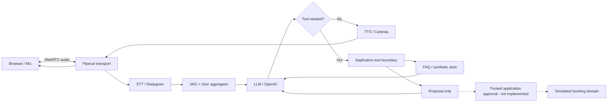
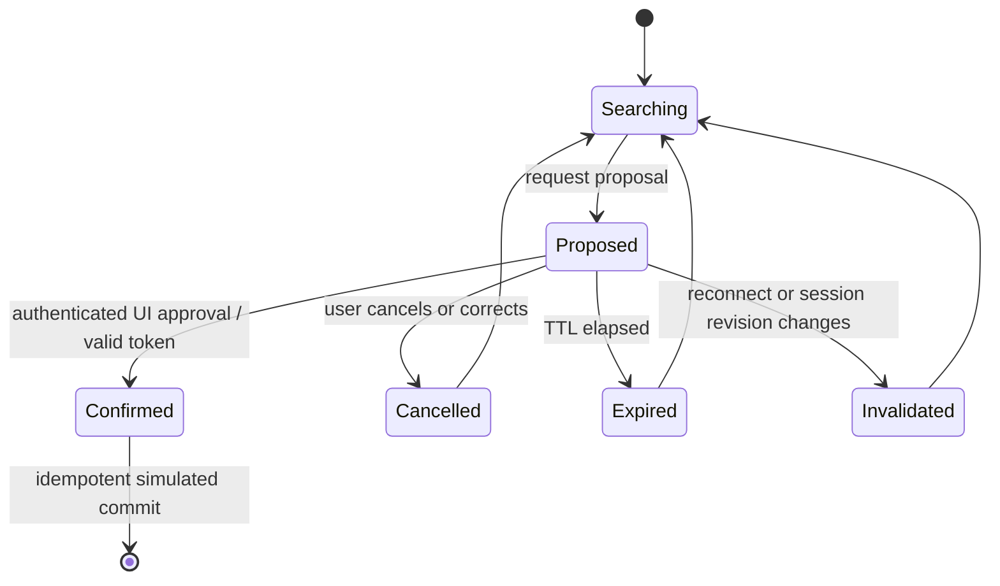
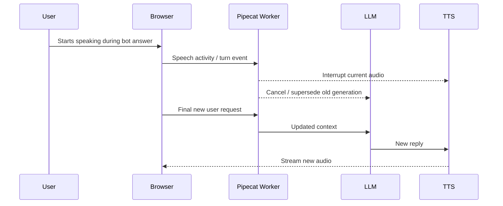
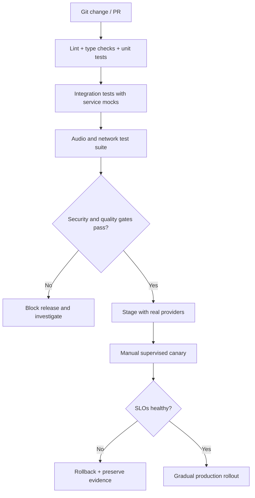

# من أول كلمة إلى نظام صوتي متكامل: مشروع التخرج في هندسة Voice Agents

**المقالة السادسة عشرة والأخيرة من 16 | المستوى: مشروع تطبيقي متقدم**  
**القراءة:** 45–65 دقيقة؛ **التنفيذ:** مختبر محلي + تشغيل صوتي اختياري بالمفاتيح  
**English:** [[16-Production-Grade-Voice-Agent-Capstone-EN|Read in English]]  
**السابقة:** [[15-Evaluation-Observability-and-Deployment-AR|التقييم والمراقبة والنشر]]  
**الفهرس:** [[00-Series-Roadmap|خارطة السلسلة]]

![[assets/capstone-voice-agent-cover.png]]

> [!abstract] الفكرة المحورية
> أصبحنا نفهم الصوت الرقمي وSTT وTTS ونموذج اللغة، وتعلمنا التعامل مع المقاطعات والنقل الشبكي والتقييم والأمان. في هذه المقالة سنجمع الأجزاء في **وكيل صوتي لحجز مواعيد تجريبية**: يسمع عبر المتصفح، يبحث في معلومات افتراضية، يعرض أوقاتاً، ويسجل **طلب حجز غير ملزم**. لكن الوصول إلى حالة «محجوز» يحتاج تأكيداً موثوقاً من التطبيق خارج الـLLM، لا عبارة يولدها النموذج.

> [!warning] ماذا يعمل فعلاً وماذا لا يعمل؟
> - المختبر المحلي والكود المنطقي والاختبارات **يعملون دون مفاتيح أو اتصال بالشبكة**، وقد تم تشغيل اختباراتهم في هذه الحزمة.
> - مثال `capstone_voice_agent.py` يُنشئ Pipeline حقيقياً لـPipecat بالاستناد إلى واجهات Pipecat 1.x الرسمية؛ **لم يتم إجراء مكالمة صوتية فعلية هنا** ولا التحقق من نسخ مكتبات المزوّدين أو الميكروفون.
> - البحث والحجوزات **افتراضية وداخل الذاكرة**. ليس لدينا موعد حقيقي، ولا نظام مصادقة فعلي، ولا قاعدة بيانات دائمة، ولا موصل حي للتقويم.
> - «Production-grade» هنا **مستوى تصميم ومعايير قبول** وليس شهادة أن المشروع مهيأ بالفعل للتعامل مع عملاء حقيقيين أو بيانات حساسة.

## 1. المشروع الذي سنبنيه

تخيل مستخدماً يفتح صفحة اتصال صوتي ويقول:

> «ما أوقات العمل؟ وهل يوجد موعد في الثاني من ديسمبر الساعة العاشرة؟»

فيرد الوكيل ببيانات تجريبية، ثم يقول المستخدم: «اقترح لي الموعد الأول». يستدعي النظام أداة `propose_slot`، ويعيد **رقم طلب**، لكنه لا ينفذ حجزاً. عندما يسأل المستخدم «هل تم الحجز؟» يجيب الوكيل: «لا، تم إنشاء اقتراح فقط؛ يجب اعتماد الطلب عبر واجهة تأكيد موثوقة». هذا التفريق هو أحد مفاتيح الأمان.

**أهداف المشروع:**

1. وصل الميكروفون والمتصفح بخط معالجة صوتي منخفض التأخير.
2. توفير STT وLLM وTTS ضمن Pipeline واحد، مع VAD وإدارة السياق.
3. إتاحة أسئلة معرفية وتصفّح مواعيد خيالية عبر Tool Calling.
4. فصل الاقتراح عن التنفيذ، والتحقق من الجلسة والصلاحية والإصدار والتوقيت عند الموافقة.
5. إعداد اختبارات Unit، ثم تعريف بوابات قبول لا تُستبدل بها اختبارات الصوت الفعلية.
6. رسم خطوات النشر التدريجي والمراقبة والاستجابة للفشل، دون تخطي متطلبات الخصوصية.

**خارج النطاق الحالي:** فيديو KYC، والتعرف إلى هوية المتحدث، والتقويم الحقيقي، والمدفوعات، وإرسال تسجيلات للمستخدمين أو تحويلات هاتفية، والالتزام التنظيمي القابل للإثبات.

## 2. الصورة الكاملة للمعمارية

![[assets/capstone-architecture.png]]

*الشكل 1 — معمارية النظام: الصوت يعالج عبر Pipecat، والأدوات تصل إلى خدمة تطبيق منفصلة. الرسم تصوري ولا يدل على خدمة منشورة.*



### لماذا هذا الترتيب؟

- **Transport** مسؤول عن استقبال الصوت وإرساله، وليس عن اتخاذ قرار الحجز.
- **STT** يعيد الكلام مفهوماً للنموذج، وقد يكون جزئياً قبل أن يصبح نهائياً.
- **VAD وTurn Detection** يساعدان في معرفة وقت الاستماع والرد؛ الصمت البسيط ليس نهاية الدور حتماً.
- **LLM** يفهم الطلب ويختار أداة مناسبة؛ لا يملك صلاحية تنفيذ كتابة حساسة دون ضوابط الخادم.
- **TTS** يحول الاستجابة إلى صوت؛ و**Playback** يحدد ما سمعه المستخدم فعلاً عند حدوث مقاطعة.
- **Application Backend** يستخرج الأدلة، ويفحص الصلاحيات، ويحفظ الحالة بالطرق المناسبة؛ لا ينبغي جعله مجرد امتداد غير محمي للنموذج.

راجِع [[07-Build-First-Voice-Agent-with-Pipecat-AR|المقالة 7]] للـPipeline، و[[10-Interruptions-Barge-In-and-Playback-State-AR|المقالة 10]] للمقاطعات، و[[13-Tools-RAG-and-Agent-Workflows-AR|المقالة 13]] للأدوات.

## 3. اختيار المعمارية والتقنيات

| المكوّن | خيار المختبر | سبب الاختيار | بديل محتمل |
|---|---|---|---|
| Client Transport | WebRTC / Pipecat runner | اتصال صوتي بين المتصفح والخادم | Daily أو LiveKit وفق البنية |
| Voice Activity Detection | Silero VAD | إدراك بداية الكلام ونهايته | مزوّد Turn Detection آخر |
| STT | Deepgram | مثال بثّ مدعوم في Pipecat | Faster-Whisper محلي أو خدمة أخرى |
| LLM | OpenAI LLM | استدعاء دوال والسياق | خدمة متوافقة أو نموذج محلي |
| TTS | Cartesia | إخراج صوت متدفق | Piper أو XTTS محلي |
| Domain layer | Python خالص | اختبار الأمان دون مزوّدين | خدمة مستقلة + قاعدة بيانات |
| QA | unittest | سريع ولا يحتاج حزم خارجية | pytest + محاكاة صوتية |
| Logging/Tracing | إطار قياس لاحق | رصد الأحداث المهمة دون محتوى حساس | OpenTelemetry بموافقة وسياسة |

ليست هذه قائمة «أفضل مزودين للجميع». القيود والسعر والدعم اللغوي والتوافر والتشغيل المحلي تختلف من مشروع لآخر. راجِع [[06-Cascaded-vs-Speech-to-Speech-AR|المقالة 6]] قبل اتخاذ القرار.

## 4. هيكل الملفات المرفقة

```text
Voice-Agent-Series/
├── 16-Production-Grade-Voice-Agent-Capstone-AR.md
├── 16-Production-Grade-Voice-Agent-Capstone-EN.md
├── assets/
│   ├── capstone-voice-agent-cover.png
│   ├── capstone-architecture.png
│   ├── capstone-safe-actions.png
│   └── capstone-release-readiness.png
└── examples/
    ├── capstone_domain.py
    ├── capstone_voice_agent.py
    ├── capstone_demo_cli.py
    ├── capstone-agent.env.example
    ├── test_capstone_domain.py
    ├── make_capstone_figures.py
    └── 16-CAPSTONE-README.md
```

توجد جميع الملفات **في مجلد السلسلة نفسه**، ويمكن فتح الروابط الداخلية والصور عبر Obsidian.

## 5. ابدأ من تجربة لا تحتاج إلى API

افتح Terminal من مجلد السلسلة:

```bash
cd Voice-Agent-Series/examples
python capstone_demo_cli.py
python -m unittest -v test_capstone_domain.py
```

سيُظهر السكربت ثلاثة أحداث أساسية: FAQ اصطناعي، وقائمة مواعيد تجريبية، وطلباً مؤقتاً، ثم تنفيذ **موافقة محاكية** بواسطة مسار تطبيق موثوق داخل المختبر. لا ينفذ أي طلب HTTP لخدمة حجوزات أو تقويم.

توضح اختبارات `test_capstone_domain.py` حالات مثل Tenant Isolation وانتهاء مهلة الموافقة، وإبطال الطلب عند إعادة الاتصال، ومنع إعادة الحجز عند تكرار الطلب.

> [!important] فرّق بين الاختبار والمستخدم الحقيقي
> استخراج `approval_token` من `demo_trusted_approval_details()` مسموح فقط في **المختبر المحلي** لاختبار المنطق. لا تعرض هذه الدالة في API أو أدوات LLM أو واجهة عامة، ولا تحفظ رموز الموافقة في Logs.

## 6. الانتقال إلى الاتصال الصوتي

نسخة Python المرفقة مع المقالة: [[07-Build-First-Voice-Agent-with-Pipecat-AR|تطوير للمختبر السابع]]، لكنها تضيف أدوات معرفة ومواعيد واقتراحات تجريبية. التوثيق الرسمي يبيّن استخدام `PipelineWorker` و`LLMContext` و`FunctionCallParams` كما في الأمثلة الرسمية [^p-voice] [^p-tools].

### المتطلبات

- Python 3.11 أو أحدث، ويُفضّل 3.12، وبيئة Virtual Environment.
- مكتبات Pipecat المتوافقة مع المكونات، وحزم تشغيل الـRunner.
- ثلاثة مفاتيح `DEEPGRAM_API_KEY` و`OPENAI_API_KEY` و`CARTESIA_API_KEY` لتجربة المزوّدين المحددين.
- متصفح بصلاحية الميكروفون؛ وبيئة HTTPS مناسبة عند الانتقال إلى خادم خارجي.

اتبع [Pipecat Quickstart](https://docs.pipecat.ai/pipecat/get-started/quickstart) لتجهيز الاعتماديات. مثال تثبيت توضيحي (راجِع extras في نسختك):

```bash
python -m venv .venv
# Linux/macOS: source .venv/bin/activate
# Windows PowerShell: .venv\Scripts\Activate.ps1
pip install 'pipecat-ai[deepgram,openai,cartesia,silero,runner,webrtc]' python-dotenv loguru
```

ثم انسخ `capstone-agent.env.example` إلى `.env` وضع مفاتيحك **محلياً** دون إرسالها إلى Git:

```bash
python capstone_voice_agent.py
```

استخدم عنوان عميل المتصفح الذي يظهر في Pipecat Runner؛ في أمثلة Pipecat الافتراضية يُستخدم `http://localhost:7860/client/`. قد تختلف تفاصيل التشغيل باختلاف النسخة والبيئة؛ ابدأ بالتوثيق الرسمي عند حدوث تعارض.

> [!note] لم نفحص المكالمة الصوتية في هذه البيئة
> تم فحص صياغة الملفات البرمجية وتشغيل اختبارات المجال، لكن لم نثبّت Pipecat أو نختبر اتصال STT/LLM/TTS أو WebRTC هنا. **لا تعد نجاح اختبارات `unittest` دليلاً على عمل المتصفح أو صحة تكامل الخدمات**.

### القلب البرمجي للـPipeline

```python
pipeline = Pipeline([
    transport.input(),
    stt,
    user_aggr,
    llm,
    tts,
    transport.output(),
    assistant_aggr,
])
```

**لماذا يكون الـAssistant Aggregator بعد الإخراج؟** ذلك يربط الاحتفاظ باستجابة الوكيل بمسار خروج الصوت ويتيح معالجة أحداث الصوت بصورة أوثق؛ لكنه لا يغني وحده عن إشارات Playback من العميل لتحديد كل حرف سُمِع فعلياً. راجِع [[10-Interruptions-Barge-In-and-Playback-State-AR|المقالة 10]].

## 7. المعرفة والأدوات: افصل القراءة عن التأثير

الوكيل يملك ثلاث أدوات فقط:

| الأداة | ماذا تفعل؟ | أثر خارجي؟ |
|---|---|---|
| `read_faq` | معلومة من قاموس تجريبي محدود | لا |
| `find_slots` | ترشيح مواعيد خيالية بحسب اليوم | لا |
| `propose_slot` | تسجيل اقتراح مؤقت خاص بالجلسة | لا يوجد حجز خارجي |

لا نعرض **`confirm_from_trusted_ui()`** كأداة للـLLM. هذه قاعدة تصميم مقصودة: النموذج قد يخطئ في فهم «نعم» أو يُخدع بنص موجود ضمن نتيجة أداة؛ لذا يكون التنفيذ الحساس عبر حدث موثوق صادر من التطبيق بعد مصادقة المستخدم.

### لماذا ليست هذه RAG كاملة؟

نستخدم في المختبر قاموس FAQ مصطنعاً لتبسيط المثال. RAG الإنتاجي يتطلب مصدر معرفة معتمداً، وتقسيماً واسترجاعاً وتقييم جودة، وفلترة حسب صلاحيات المستخدم، واستشهادات، ومنع التعامل مع تعليمات المستندات كتعليمات نظام. سبق شرح ذلك في [[13-Tools-RAG-and-Agent-Workflows-AR|المقالة 13]].

## 8. الموافقات والحالة والكتابة الآمنة

![[assets/capstone-safe-actions.png]]

*الشكل 2 — مسار آمن محاكى: لا تساوي Proposal تنفيذ الحجز؛ موافقة التطبيق منفصلة.*



خدمة Python تطبق خطوات الحماية داخل **المحاكاة**:

1. تربط كل جلسة بزوج `tenant_id + session_id` وبـ`authenticated_subject`، بدلاً من السماح للنموذج باختيار هوية المستخدم.
2. تولد رمز موافقة سرياً خارج رد الـLLM؛ لا تكشفه أدوات المحادثة.
3. تربط الموافقة برقم جيل الجلسة `generation` وإصدار الحالة `revision` ووقت انتهاء.
4. تبطل الطلب المعلّق عند الإلغاء أو إعادة الاتصال.
5. تعيد نتيجة المحاكاة نفسها عند إعادة نفس أمر التأكيد، باستخدام Idempotency على مستوى المخزن في الذاكرة.

**حدوده:** لا يوجد Database Transaction أو Distributed Lock أو نظام Auth حقيقي؛ الكود لا يضمن سلامة الحجز عند تشغيل عدة خوادم أو إعادة تشغيل العملية. قبل نقل التصميم إلى الإنتاج نحتاج قاعدة بيانات ذات قيود Unique، ومفاتيح Idempotency مخزنة بصورة دائمة، وتحقق هوية وصلاحيات على مستوى الخادم، وواجهات موافقة مرتبطة بالجلسة وحماية CSRF بحسب نمط الاعتماد.

## 9. إدارة المقاطعات والتعافي

الحالة المثالية للتجربة:



Pipecat يوفر معالجة لأحداث المقاطعة ضمن خط معالجة الصوت، لكن **تتبع الدقة الفعلية للصوت المسموع وإلغاء الجيل السابق على مستوى كل خدمة** يجب اختباره على مزوديك وعميلك. راقب المقاطعات غير الصحيحة ووقت توقف السماعة، ولا تُعيد إرسال كتابة قديمة بمجرد رجوع الشبكة.

عند انقطاع الاتصال، يبطل مثالنا الطلب المعلق ويزيد `generation`؛ بالتالي لا تعود موافقة قديمة صالحة بعد استعادة الاتصال. وفي تطبيق حقيقي يجب أيضاً إلغاء الوصول السابق، وربط الجلسة الجديدة بالمصادقة الحالية، وإعادة بناء حالة المحادثة من سجل موثوق بدلاً من الاعتماد على النص الموجود في نموذج اللغة وحده.

## 10. قياس الجودة قبل الإعلان عن الجاهزية

![[assets/capstone-release-readiness.png]]

*الشكل 3 — نجاح اختبارات المجال ليس مرادفاً لاجتياز اختبار الصوت الحقيقي أو مراجعة الإنتاج.*

| المستوى | ما نثبته | النتيجة لهذه الحزمة |
|---|---|---|
| Unit | عدم تنفيذ موافقة خاطئة، إبطال طلب قديم، العزل، منع التكرار | اختبارات محلية مُشغّلة |
| Integration | خدمات STT/LLM/TTS، وفشل المزوّد، ودقة Tool Calling | غير مختبَر عبر الإنترنت هنا |
| Speech | الضجيج، لهجات العربية، صدى، Streaming، مقاطعات حقيقية | غير مختبَر على صوت حقيقي هنا |
| Network | WebRTC، TURN، فقد الحزم، تبديل الشبكات | يحتاج بيئة Staging |
| Security | Auth، PII، Prompt Injection، تخزين وحذف، صلاحيات فعلية | تصميم تعليمي فقط |
| Operations | Metrics/Traces، مراقبة، Canary، Rollback | خطة عمل وليست نشرًا منفّذًا |

**اقتراح مقاييس قبول** يُحدّد هدف كل منها وفق حالة الاستخدام ولا يُفترض ثابتاً لكل التطبيقات: نجاح السيناريوهات، نسبة تنفيذ أدوات خاطئة (المطلوب صفر في العيّنة الحرجة)، معدل المقاطعات الخاطئة، `first audible response P95`، `interruption stop P95`، فشل الجلسات، وتسرب البيانات الحساسة. لا تختصر تجربة المستخدم بمتوسط واحد.

ولفهم كيفية تحويل الحالات إلى بوابات نشر انظر [[15-Evaluation-Observability-and-Deployment-AR|المقالة 15]].

## 11. خارطة نشر حقيقية قبل الإطلاق



قبل تشغيل نظام يستقبل مستخدمين حقيقيين يجب إضافة:

- **إدارة الاعتمادات:** Secrets Manager، وعدم وضع مفاتيح الخدمات في عميل الويب أو صور الحاويات أو Logs.
- **هويات وصلاحيات موثوقة:** backend يتحقق من المستخدم والـTenant، وينفذ الكتابة فقط بعد موافقة موثوقة.
- **تخزين آمن:** تدقيق العمليات وحماية البيانات وتحديد مدة الاحتفاظ والحذف؛ المحاكاة الحالية لا تحفظ شيئاً بصورة دائمة.
- **نشر قابل للاسترداد:** Staging منفصل، migrations قابلة للمراجعة، نسخ احتياطي واختبار استعادة إن وُجدت بيانات، rollback مجرب.
- **توافر صوتي:** TLS/HTTPS حيث يلزم، TURN عند الحاجة، مراقبة اتصال WebRTC والمزوّدين، واختبار الانقطاعات.
- **Observability:** session/turn IDs في سجلات غير حساسة، مقاييس زمنية وSLOs، تنبيهات محددة؛ لا تُسجل Transcript كاملاً دون ضرورة وأساس مناسب.
- **تقييم بشري:** لهجات حقيقية، أصوات متداخلة، حالات الانقطاع والمقاطعة، وقبول تجربة المستخدم الفعلي.

يمكن استخدام أدوات النشر ضمن [[15-Evaluation-Observability-and-Deployment-AR|المقالة السابقة]] كنقطة تعلم، لا كدليل أن هذا المثال منشور.

## 12. أخطاء شائعة عند إتمام المشروع

| الخطأ | لماذا يحدث | التصحيح |
|---|---|---|
| «قال الـLLM إنه حجز» | الخلط بين الرد والتنفيذ | تأكيد من backend ونتيجة عملية مسجلة |
| «اختبارات Python ناجحة إذن الصوت جيد» | تغطية منطق دون ميكروفون | اختبارات STT/TTS وWebRTC حقيقية |
| «يكفي نسخ `.env` إلى الخادم» | كشف الأسرار وصعوبة التدوير | Secrets + Least Privilege |
| «أضيف فهرس مستندات = RAG آمن» | تسرب المستندات وPrompt Injection | ACL وفصل سياق الأدوات وتقييم الاسترجاع |
| «ننشر مباشرة بعد PR» | لا يوجد قياس أو Rollback | Staging + Quality Gates + Canary |
| «إذا أعيد الاتصال أعيد الحجز» | تكرار إجراء بعد انقطاع الشبكة | إعادة تحقق + Idempotency دائم |

## 13. تمارين التخرج المقترحة

- **المستوى 1:** شغّل المختبر المحلي، وأضف اختباراً يرفض إعادة استخدام `request_id` عبر جلسات غير مخولة.
- **المستوى 2:** اربط وكيل Pipecat بخدمة صوتية حقيقية وقيّم عشر محادثات صافية وعشر محادثات فيها مقاطعات، دون تسجيل بيانات حساسة.
- **المستوى 3:** أضف FastAPI واجهة منفصلة للموافقة الموثوقة وتخزيناً دائماً بالمفاتيح الفريدة، واختبر الاسترجاع بعد إعادة تشغيل الخادم.
- **المستوى 4:** أضف RAG مع صلاحيات مستندات، وOpenTelemetry ببيانات قليلة، ثم قارن نسختين في Staging قبل Canary.

> [!success] معايير مشروع التخرج
> لا ينجح المشروع لأن الوكيل يرد فحسب؛ ينجح عندما يمكنك إثبات **ما الذي سمعه، وكيف فهمه، وأي أداة استدعاها، ومن أجاز الإجراء، وماذا نُفّذ فعلياً، وكيف تعرّف إلى الفشل وتعافى منه دون اختراق الخصوصية**.

## الخلاصة: التفكير في الـVoice Agent كنظام كامل

بدأنا السلسلة بسؤال: **ما هو الوكيل الصوتي؟** والآن أصبح لدينا تصور هندسي يجمع الصوت والشبكات والذكاء الاصطناعي والأدوات والسياق والأمان والتشغيل. بناء نظام محادثة طبيعي لا يتوقف عند اختيار STT وLLM وTTS؛ التحدي الحقيقي هو إدارة الإيقاع والاختيار الآمن للأدوات والتعافي من الأخطاء وتقديم أدلة قابلة للقياس على الجودة.

هذه هي نقطة نهاية السلسلة التعليمية، وبداية بناء مشروع Voice AI خاص بك، مع مسؤولية اختبار وتطوير ما بين النموذج الأولي والإنتاج.

---

## المصادر والمراجع

[^p-voice]: [Pipecat official getting-started 06 — Voice Agent](https://github.com/pipecat-ai/pipecat/blob/main/examples/getting-started/06-voice-agent.py) — مثال PipelineWorker وSTT/LLM/TTS، راجع النسخة الحالية قبل التطبيق.
[^p-tools]: [Pipecat official getting-started 07 — Function Calling](https://github.com/pipecat-ai/pipecat/blob/main/examples/getting-started/07-function-calling.py) — دوال Python كأدوات LLM و`FunctionCallParams`.

1. [Pipecat Quickstart](https://docs.pipecat.ai/pipecat/get-started/quickstart) — بدء بناء الوكيل الصوتي.
2. [Pipecat Transport Selection](https://docs.pipecat.ai/client/concepts/choosing-a-transport) — المقارنة بين WebRTC وWebSocket.
3. [OWASP Prompt Injection Prevention](https://cheatsheetseries.owasp.org/cheatsheets/LLM_Prompt_Injection_Prevention_Cheat_Sheet.html) — مخاطر الثقة المفرطة في مخرجات النماذج.
4. [OpenTelemetry Python](https://opentelemetry.io/docs/languages/python/instrumentation/) — المقاييس والتتبع.
5. [MDN WebRTC API](https://developer.mozilla.org/en-US/docs/Web/API/WebRTC_API) — نقل الصوت في المتصفح.
6. [[00-Series-Roadmap|فهرس السلسلة الكامل]] — مراجعة المقالات 1–15.

*تاريخ مراجعة المعلومات: 21 نوفمبر 2026. قد تتغير واجهات البرامج والخدمات بعد هذا التاريخ.*
