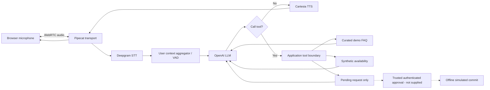
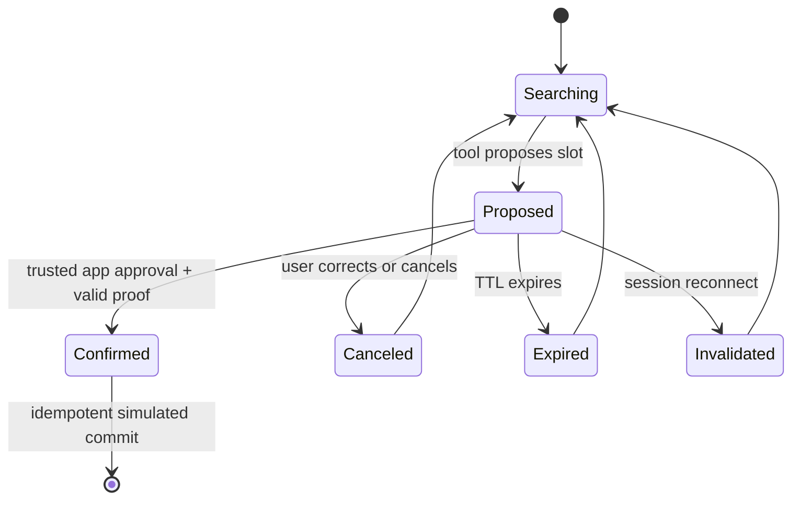
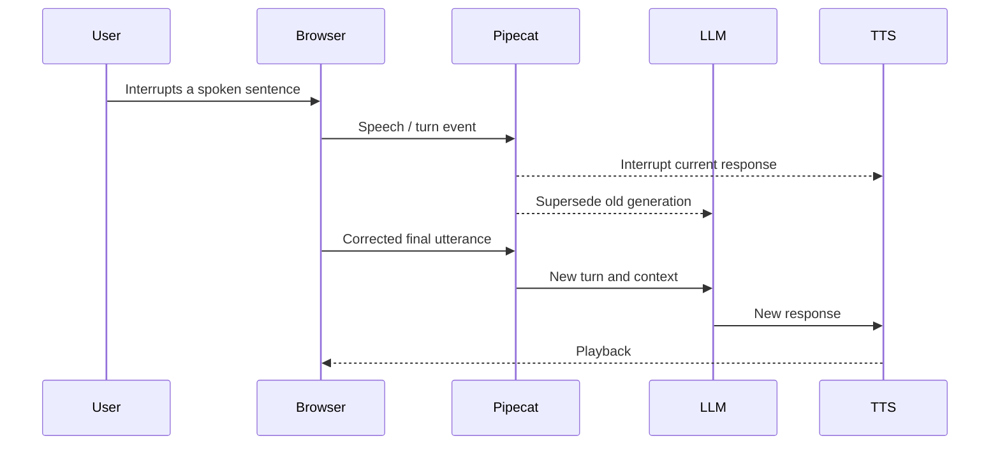
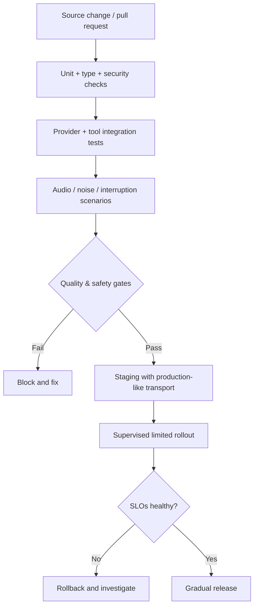

# From the First Spoken Word to a Complete Voice AI System: The Capstone Project

**Article 16 of 16 | Advanced / Capstone**  
**Suggested reading:** 45–65 minutes, plus an optional hands-on voice integration  
**العربية:** [[16-Production-Grade-Voice-Agent-Capstone-AR|اقرأ النسخة العربية]]  
**Previous:** [[15-Evaluation-Observability-and-Deployment-EN|Evaluation, Observability & Deployment]]  
**Index:** [[00-Series-Roadmap|Series Roadmap]]

![[assets/capstone-voice-agent-cover.png]]

> [!abstract] The central idea
> Over the previous 15 articles we covered audio fundamentals, STT, LLMs, TTS, WebRTC, interruptions, tool execution, privacy and production evaluation. This final article puts those pieces together in a **fictional scheduling voice assistant** that listens in a browser, answers from approved demo information, lists synthetic appointment slots and creates a **nonbinding appointment proposal**. A real write happens only after a separate, trusted confirmation in the application, never just because the LLM says the user approved it.

> [!warning] What is implemented, and what remains unverified
> - The local domain logic, tests, and CLI work **offline and without provider credentials**. I have run the tests locally.
> - `capstone_voice_agent.py` assembles a genuine Pipecat 1.x-style STT → LLM → TTS pipeline using APIs confirmed in official example code. **I have not yet verified a live microphone-to-speaker session**, and I have not installed and tested specific versions of every provider SDK.
> - Knowledge and appointments are **fictional and kept in process memory**. There is no live calendar, authenticated public user interface, production database, or real transaction.
> - “Production-grade” describes the **engineering design and acceptance criteria**. The sample code itself is not certified or ready for production users.

## 1. The system we will build

Imagine a user opening a voice interface and asking:

> “What are your opening hours? Do you have a slot on December second at ten?”

The agent answers from a small synthetic knowledge base, searches demo availability, and offers a slot. When the user says “Propose that appointment,” the application creates a **pending request**, not a confirmed booking. If asked whether the slot is booked, the assistant should say, “No. It is only a proposal. A separate, trusted confirmation is required.”

Our engineering goals are:

1. Deliver audio input/output over a real-time browser transport.
2. Assemble a cascaded pipeline with STT, LLM, TTS, VAD and conversation context.
3. Provide structured read-only knowledge and availability tools.
4. Keep model-triggered proposals separate from authenticated write operations.
5. Test state isolation, expiration, retries, and reconnections deterministically.
6. Design measurable quality, security, observability, and rollout gates.

Out of scope for the implemented sample: real bookings, banking/payments, patient data, speaker identity verification, telephony, video KYC, and compliance certification.

## 2. End-to-end architecture

![[assets/capstone-architecture.png]]

*Figure 1 — Browser audio crosses the Pipecat pipeline. Application tools sit behind a separate boundary; a final trusted confirmation is deliberately not implemented as a voice tool.*



Each part keeps its own job: the transport moves media, STT recognizes speech, VAD and turn detection help manage dialogue rhythm, the LLM selects and describes actions, TTS generates speech, and the backend enforces **permissions and business invariants**. An LLM is never a substitute for authorization.

To revisit the foundations, see [[07-Build-First-Voice-Agent-with-Pipecat-EN|Article 07]] for the pipeline, [[10-Interruptions-Barge-In-and-Playback-State-EN|Article 10]] for interruptions, and [[13-Tools-RAG-and-Agent-Workflows-EN|Article 13]] for tool boundaries.

## 3. Technology decisions

| Layer | Selected teaching implementation | Why | Alternatives |
|---|---|---|---|
| Browser transport | WebRTC / Pipecat runner | Native browser audio, low-latency media | Daily, LiveKit depending on requirements |
| VAD | Silero | Detect speech activity in input | Provider turn detection |
| STT | Deepgram | Pipecat streaming integration example | Local Faster-Whisper, other providers |
| LLM | OpenAI LLM | Supports a structured function-calling example | Compatible hosted or local models |
| TTS | Cartesia | Streaming voice-output integration | Piper or XTTS locally |
| Application domain | Pure Python | No-network testability | Separate backend and durable DB |
| Tests | `unittest` | No test framework dependency | pytest and audio/system tests |
| Monitoring | Defined deployment gates | Clearly separate metrics from transcripts | OpenTelemetry + chosen telemetry backend |

These services are **illustrative choices**, not universal winners. Re-evaluate price, availability, languages, latency, privacy requirements, and integration changes for your use case. See [[06-Cascaded-vs-Speech-to-Speech-EN|Article 06]].

## 4. Project folder layout

```text
Voice-Agent-Series/
├── 16-Production-Grade-Voice-Agent-Capstone-AR.md
├── 16-Production-Grade-Voice-Agent-Capstone-EN.md
├── assets/
│   ├── capstone-voice-agent-cover.png
│   ├── capstone-architecture.png
│   ├── capstone-safe-actions.png
│   └── capstone-release-readiness.png
└── examples/
    ├── capstone_domain.py
    ├── capstone_voice_agent.py
    ├── capstone_demo_cli.py
    ├── capstone-agent.env.example
    ├── test_capstone_domain.py
    ├── make_capstone_figures.py
    └── 16-CAPSTONE-README.md
```

The files sit next to the earlier articles, so Obsidian internal links keep working as long as the folder stays intact.

## 5. Run the offline reference workflow first

From the series folder:

```bash
cd Voice-Agent-Series/examples
python capstone_demo_cli.py
python -m unittest -v test_capstone_domain.py
```

The CLI demonstrates a synthetic FAQ answer, synthetic slot lookup, proposal creation, and a **simulated trusted-UI confirmation**. It never calls a live booking system or calendar. The tests exercise tenant separation, unauthorized subjects, expired approvals, stale session generations, canceled proposals, and idempotent confirmation retries.

> [!important] Local test harness ≠ trusted application endpoint
> The `demo_trusted_approval_details()` helper exists solely for the local test harness. Never expose it to an LLM, a browser endpoint, a log, or a production user. A real application must implement authentication and an out-of-band approval action before using the domain method.

## 6. Run the voice-enabled Pipecat example

`capstone_voice_agent.py` builds on the approach from Article 07 and follows Pipecat's official voice-agent and function-calling examples [^pvoice] [^ptools]. It wires together Deepgram, OpenAI, Cartesia, and Silero, and registers only safe demo tools.

### Requirements

- Python 3.11+; Python 3.12 is a useful default.
- A compatible Pipecat installation with runner/WebRTC, Silero, Deepgram, OpenAI, and Cartesia extras.
- `DEEPGRAM_API_KEY`, `OPENAI_API_KEY`, and `CARTESIA_API_KEY` for these providers.
- A browser with a microphone and the necessary permissions; use a suitable HTTPS setup for remote deployment.

Start with the [official Pipecat Quickstart](https://docs.pipecat.ai/pipecat/get-started/quickstart) to verify the current version and dependencies. A sample installation command is:

```bash
python -m venv .venv
# Linux/macOS: source .venv/bin/activate
# Windows PowerShell: .venv\Scripts\Activate.ps1
pip install 'pipecat-ai[deepgram,openai,cartesia,silero,runner,webrtc]' python-dotenv loguru
```

Copy `capstone-agent.env.example` to `.env`, add credentials locally, and run:

```bash
python capstone_voice_agent.py
```

For the standard Pipecat development runner, the browser client is commonly hosted at `http://localhost:7860/client/`. Follow the address and instructions shown by your installed version. Do not commit credentials.

> [!note] Voice runtime validation is still required
> I checked the Python syntax and ran the offline domain tests. I **have not run an actual WebRTC/ASR/TTS call** with this code, and I have not validated exact provider versions; the voice runtime still needs real provider credentials to verify. Passing unit tests does not prove voice functionality.

### The pipeline itself

```python
pipeline = Pipeline([
    transport.input(),
    stt,
    user_aggr,
    llm,
    tts,
    transport.output(),
    assistant_aggr,
])
```

Placing the assistant aggregator after outbound audio mirrors the official example. It does not, however, give you an exact, authoritative record of what reached the listener's ears. For fine-grained playback state, implement appropriate client audio-playback acknowledgments and interruption reconciliation as discussed in [[10-Interruptions-Barge-In-and-Playback-State-EN|Article 10]].

## 7. Tool calls and trusted execution

The voice-enabled agent registers only three functions:

| Function | Behavior | Actual external side effect |
|---|---|---|
| `read_faq` | Return a short answer from a controlled synthetic dictionary | None |
| `find_slots` | List fictional slots on an ISO calendar date | None |
| `propose_slot` | Create an expiring in-memory request | No booking is committed |

**`confirm_from_trusted_ui()` is not an LLM tool.** Even if the model misunderstands an utterance or encounters prompt injection inside retrieved content, it cannot call a write function through its registered tools. The actual authenticated approval path is deliberately left outside the voice sample.

### Does this implementation include full RAG?

No. The demo FAQ is an allowlisted Python dictionary, chosen for reproducibility. A real retrieval system needs a controlled corpus, indexing, citations, access-control filtering, untrusted-source handling, and evaluation of retrieval quality. [[13-Tools-RAG-and-Agent-Workflows-EN|Article 13]] covers those design requirements.

## 8. Booking proposals, state, and safe retries

![[assets/capstone-safe-actions.png]]

*Figure 2 — The proposal is not a committed transaction. Confirmation belongs to a trusted, authenticated application.*



The offline domain module enforces several invariants:

1. An authenticated tenant, session, and subject are fixed by the application, not by LLM input.
2. Approval details are generated server-side and are not included in the tool response.
3. An approval is bound to a session generation, state revision, and expiry time.
4. Cancelation or reconnect invalidates a pending proposal.
5. The same valid approval retry returns its previous simulated receipt rather than creating a second booking.
6. A different approval token on a retry is rejected, even when the request identifier matches.

**Production gaps:** an in-memory store cannot provide durable idempotency or cross-instance concurrency protection. Replace it with a transactional database and unique constraints; implement authenticated approval endpoints, CSRF protections where applicable, service authorization, persistent auditing, reliable retries, and an explicit integration with a real booking provider.

## 9. Interrupted speech and session recovery



Pipecat includes mechanisms for handling interrupted speech, but end-to-end correctness still depends on your particular transport, provider streams, playback buffering, and user experience. Measure false interruption rates, stop latency, and actual playback acknowledgment; do not equate generated text with audible text.

In our offline domain, reconnect invalidates pending approval and advances `generation`. Therefore an approval from the old session state cannot be committed later. A real deployment must additionally reauthenticate the connection and restore only authorized, durable conversation state. It must never blindly replay unconfirmed tool operations.

## 10. Evaluation evidence and release readiness

![[assets/capstone-release-readiness.png]]

*Figure 3 — Passing deterministic tests is necessary but cannot substitute for live audio or production checks.*

| Validation layer | What it proves | Status here |
|---|---|---|
| Unit tests | Deterministic state transitions, authorization preconditions, retries | Executed |
| Provider integration | Compatible STT/LLM/TTS and function-call behavior | Not tested here |
| Real audio | Accents, noise, echo, interruptions, client playback | Not tested here |
| Network | ICE/TURN, packet loss, reconnection, mobile networks | Needs staging |
| Security | Real auth, privacy policies, prompt injection resistance | Design only |
| Production operations | Traces, SLOs, alerts, rollback | Not deployed |

Recommended evaluation axes include task success, hallucinated completion claims, unauthorized tool writes (zero tolerance for critical cases), time to first audible speech, interruption stop latency, session failures, P50/P95/P99 latency, PII leakage, and recovery after network loss. Set thresholds based on measured user needs, not arbitrary universal targets.

For a practical test and release-gate method, revisit [[15-Evaluation-Observability-and-Deployment-EN|Article 15]].

## 11. A production rollout plan



Before exposing a system to real users, you need at least:

- **Credential security:** a proper secret manager and credential rotation; no API secrets in client bundles or source control.
- **Authenticated application actions:** session-bound identity, authorization, explicit user approval, and durable idempotency.
- **Privacy and retention:** data minimization, controlled access, purposeful retention, deletion, and limited logging.
- **Operational reliability:** isolation between staging and production, reviewed migrations, backups when storing data, and tested rollback.
- **Audio infrastructure:** TLS where required, TURN when needed, WebRTC diagnostics, provider failures and reconnection testing.
- **Observability:** non-sensitive trace identifiers, service/error metrics, alerts, and clearly defined SLOs.
- **Human evaluation:** real speakers, representative accents, background noise, overlapping speech, interruptions, and accessibility testing.

Article 15 includes an educational Docker and CI example, but that diagnostic service is **not** a deployment of this voice agent.

## 12. Common failure patterns

| Failure | Root cause | Engineering correction |
|---|---|---|
| “The LLM confirmed a booking” | Model speech mistaken for transaction proof | A backend-confirmed receipt |
| “Unit tests passed, so audio is good” | No microphone, network, or model audio evaluation | End-to-end audio tests |
| “A `.env` file is a deployment security design” | Secrets can leak and cannot be rotated safely | Secret management + least privilege |
| “Adding documents makes RAG reliable” | Unfiltered access and prompt injection | ACLs, evidence checks, retrieval evaluations |
| “Every green CI job means production is safe” | Missing canary, monitoring and rollback | Staging + measured release gates |
| “Reconnect can retry the last booking” | Duplicate side effects after uncertain outcome | Durable idempotency and reconciliation |

## 13. Capstone exercises

- **Level 1:** Run the offline domain tests and add a test preventing session-identity confusion or stale request replay.
- **Level 2:** Run the browser Pipecat pipeline with valid provider keys. Evaluate ten clean and ten interrupted synthetic/non-sensitive conversations.
- **Level 3:** Add a separately authenticated FastAPI confirmation endpoint, a durable DB with uniqueness guarantees, and restart/retry tests.
- **Level 4:** Add access-controlled retrieval, privacy-preserving OpenTelemetry instrumentation, and staging/canary release gates.

> [!success] What counts as a successful capstone?
> A model that replies is not enough. You should be able to show **what speech was received, how a request was understood, which tool was used, who authorized the action, what was actually executed, and how failures are detected and recovered from without compromising privacy**.

## Conclusion: a voice agent is an engineered system

The series began with the question, “What is a voice agent?” It concludes with a design in which real-time media, conversational intelligence, tool access, transaction safety, network reliability, observability and deployment are treated as connected engineering responsibilities. A convincing demo is only the starting point. A reliable product has to rest on **evidence** rather than assumptions.

The final project is deliberately small enough to understand and test, and it states plainly what still has to be built before it can handle real customers.

---

## References and recommended reading

[^pvoice]: [Pipecat official Voice Agent example](https://github.com/pipecat-ai/pipecat/blob/main/examples/getting-started/06-voice-agent.py) — `PipelineWorker`, context aggregators, provider pipeline.
[^ptools]: [Pipecat official Function Calling example](https://github.com/pipecat-ai/pipecat/blob/main/examples/getting-started/07-function-calling.py) — `FunctionCallParams` and registered tools.

1. [Pipecat Quickstart](https://docs.pipecat.ai/pipecat/get-started/quickstart) — setting up a browser voice agent.
2. [Pipecat Transport Selection](https://docs.pipecat.ai/client/concepts/choosing-a-transport) — WebRTC and WebSocket considerations.
3. [OWASP Prompt Injection Prevention](https://cheatsheetseries.owasp.org/cheatsheets/LLM_Prompt_Injection_Prevention_Cheat_Sheet.html) — untrusted tool and retrieval content.
4. [OpenTelemetry Python](https://opentelemetry.io/docs/languages/python/instrumentation/) — observable service instrumentation.
5. [MDN WebRTC API](https://developer.mozilla.org/en-US/docs/Web/API/WebRTC_API) — real-time media fundamentals.
6. [[00-Series-Roadmap|Complete series roadmap]] — the prior 15 articles.

*Information reviewed on November 21, 2026. Confirm dependency versions and service documentation before deployment.*
